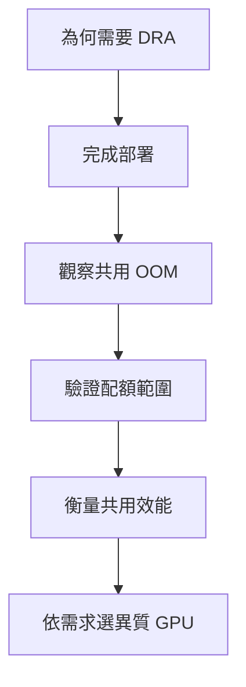

# 前言：為什麼要研究 GPU 共用

## 本頁要回答的問題

我想做到的，是讓幾個 Pod 能在 Kubernetes 上使用、甚至共用 GPU。要談共用，得先把 GPU 的分配管理好：工作如何表達需求、誰決定裝置、資源不足時如何等待，以及工作結束後如何釋放。DRA 因而成為這項研究的起點，但分配成功只是開始；接下來還要確認，共用時的記憶體壓力會不會妨礙別人，以及共用究竟能否改善效能。

本書從可重現的部署與實驗出發，逐步回答這些問題。讀者不需要先看過原始實驗室；每章都交代設定、workload、觀測方法與限制，並連到可執行的重現套件。

## 背景原理

GPU 共用至少牽涉三件不同的事。DRA 管理需求與裝置配置，容量記帳決定新的需求能否被接受；MPS 與 HAMi-DRA 的 runtime 路徑則影響 CUDA 配置或提交行為。最後，成功配置的 tensor 大小、Claim 宣告容量與 NVML 看到的實體 GPU 記憶體用量，仍須分別觀察，不能互相代替。[DRA 物件模型](01-why-dra/dra-model.md)、[三層隔離模型](04-isolation/README.md#三層隔離模型)

### 問題如何串成章節

研究先追問「能否分配與共用」，再把「限制 GPU 記憶體」、「避免 OOM 影響」、「提升吞吐量」與「知道剩餘容量」拆成可驗證的問題。異質 GPU 實驗接著檢查，Task 能否只描述需求，由 ResourceClaimTemplate 自動取得裝置，並在工作生命週期中回收配置；這些問題在各章中的位置如下。

| 要回答的問題 | 閱讀位置 | 本書如何驗證 |
| --- | --- | --- |
| 為何需要 DRA 來管理 GPU 分配與共用 | [第 1 章](01-why-dra/README.md) | 比較 device plugin 與 DRA 的需求、selector 和配置模型 |
| 如何把 GPU Operator 與 DRA 部署成可用的環境 | [第 2 章](02-deploy/README.md) | 從節點準備到 ResourceSlice、Claim 與 CUDA 工作的端到端驗證 |
| 共用 GPU 時，一個工作的 OOM 會如何影響另一個工作 | [第 3 章](03-oom/README.md) | 分別觀察壓力 process 保留與釋放記憶體時，持續服務的配置及運算結果 |
| 哪個方案能限制 GPU 記憶體，能否避免 OOM 影響 | [第 4 章](04-isolation/README.md) | 分開檢查排程記帳、runtime 配額與 Pod 實體用量 |
| GPU 共用是否提升吞吐量，哪些工作適合共用 | [第 5 章](05-performance/README.md) | 比較持續、同步間歇及錯開間歇工作的吞吐量與延遲 |
| Task 能否只描述需求，自動取得 A40 或 RTX 4090 | [第 6 章](06-heterogeneous/README.md) | 檢查屬性選卡、容量選卡、Pending 後再配置，以及 KFP Task 的 Claim 生命週期 |
| 能否知道剩餘容量 | [容量觀測](04-isolation/results.md#記帳餘額不等於實體空閒量)、[異質容量觀測](06-heterogeneous/experiments.md#e4b-的兩種剩餘量) | 同時保存 DRA 帳本與 NVML 實體空閒量，確認兩者的用途與差異 |

## 部署與設定

### 實驗環境

以下是本書實驗使用的環境，完整來源與 image digest 見[版本與 image](appendix/versions.md)。節點由 KVM 虛擬機組成，GPU 透過 PCI passthrough 交給工作節點；本表的 GPU 記憶體容量採 NVML 觀測值，與產品標示容量及 CUDA 可見容量的用途不同。[部署環境](02-deploy/README.md#環境版本)、[節點準備](02-deploy/node-prep.md)

| 項目 | 使用環境 | 來源 |
| --- | --- | --- |
| 控制平面 | `dra-m1`，無 GPU | [節點角色](02-deploy/README.md#節點角色) |
| A40 工作節點 | `dra-a40`，NVIDIA A40，NVML 總量 46068 MiB | [節點角色](02-deploy/README.md#節點角色)、[OOM 量測容量](03-oom/README.md#六輪的精確值) |
| RTX 4090 工作節點 | `dra-4090`，NVIDIA GeForce RTX 4090，NVML 總量 24564 MiB | [節點角色](02-deploy/README.md#節點角色)、[driver 驗證輸出](02-deploy/gpu-operator.md#在-driver-pod-內確認-driver) |
| CPU 工作節點 | `dra-non`，無 GPU | [節點角色](02-deploy/README.md#節點角色) |
| 作業系統與核心 | Ubuntu 24.04.3 LTS；GPU 節點 `6.8.0-142-generic`，其餘節點 `6.8.0-90-generic` | [環境版本](02-deploy/README.md#環境版本) |
| Kubernetes 與 container runtime | Kubernetes v1.37.0；CRI-O v1.37.1 | [環境版本](02-deploy/README.md#環境版本) |
| 網路 | Cilium 1.20.2 | [環境版本](02-deploy/README.md#環境版本) |
| GPU 管理與 driver | GPU Operator v26.7.0；NVIDIA driver 595.91.07 | [環境版本](02-deploy/README.md#環境版本) |
| NVIDIA DRA driver | v0.5.0 | [DRA driver 部署](02-deploy/dra-driver.md) |
| HAMi-DRA | k8s-dra-driver v0.1.0 | [HAMi-DRA 部署](04-isolation/hami-dra.md#原始環境與名稱) |
| GPU workload | PyTorch 2.5.1+cu124；CUDA runtime 12.4 | [OOM 環境](03-oom/README.md#環境與命名) |

## 結果

### 結論速覽

這張表整理實驗已有證據的結論。「Pod 實體上限」問的是整個 Pod 的 NVML 實體用量是否被宣告配額硬性限制，並非只看 tensor 配置是否被拒絕。TimeSlicing 是第五章明確設定的分享模式；第三章無配額基線則使用未明確指定分享策略的共用 Claim，兩者的部署設定見各章。

| 方案 | 排程記帳 | runtime 配額 | Pod 實體上限 | 效能影響 | 異質選卡 |
| --- | --- | --- | --- | --- | --- |
| DRA 裝置配置與 Template | [依需求配置裝置；不等於容量份額](01-why-dra/dra-model.md) | [配置本身不提供 CUDA 配額](01-why-dra/dra-model.md) | [無此保證](04-isolation/README.md#三層隔離模型) | [需另測 runtime 模式](05-performance/README.md#排程發生在不同層次) | [屬性條件與每個 Task 的 Claim 已驗證](06-heterogeneous/experiments.md#e4-的階段驗收) |
| NVIDIA ConsumableShares | [接受需求前扣除 memory 等容量](04-isolation/consumable-shares.md#記帳判定與釋放) | [只記帳；CUDA 仍可超過宣告量](04-isolation/consumable-shares.md#8-gib-claim-仍可保留-825-gib-tensor) | [無此保證](04-isolation/results.md#三層限制的完整比較) | [未作獨立效能比較](05-performance/README.md#共用輸入與物件名稱) | [本次只測單卡；異質容量另用 HAMi-DRA](06-heterogeneous/README.md#實驗設計) |
| TimeSlicing 與無配額基線 | [本次共用 Claim 未請求 memory 容量](05-performance/README.md#time-slicing-模式) | [未提供記憶體配額](05-performance/README.md#time-slicing-讓不同-context-輪流執行) | [共享實體空間仍會互相影響](03-oom/README.md#解讀) | [間歇工作可填補空檔；持續工作增加競爭](05-performance/README.md#解讀) | [選卡仍由 DRA 需求處理](06-heterogeneous/selection.md#多張卡符合時究竟選誰) |
| MPS | [本次設定不啟用容量記帳](04-isolation/README.md#方案與層次的對照) | [限制套用於每個 CUDA process](04-isolation/mps.md#single-process-邊界與-dual-process-合計量) | [同一 Pod 內的多個 process 合計可超過配額](04-isolation/mps.md#解讀) | [同步間歇工作受益；延遲仍須衡量](05-performance/README.md#同步-burst-讓並行機制更重要) | [不是本書的異質選卡策略](06-heterogeneous/README.md#部署與設定) |
| HAMi-DRA | [記錄 memory 與 cores 的需求份額](04-isolation/hami-dra.md#memory-與-cores-的帳本) | [測得 shared-cache 路徑會拒絕超量配置](04-isolation/hami-dra.md#single-process-與同一-container-內的-dual-process) | [實體用量與跨 Pod 合計仍可超過 Claim](04-isolation/hami-dra.md#跨-container-與跨-pod-的配額範圍) | [cores 政策與 library 成本未分離，需依工作比較](05-performance/README.md#初始錯開能讓-time-slicing-填補空檔) | [同一容量模型可供不同 GPU 選卡](06-heterogeneous/experiments.md#e4b-的統一容量與選卡) |

## 解讀

配置、配額與效能沒有單一開關可以一併保證。第四章的反例說明，「Claim 有容量」不能直接推論「Pod 有實體硬上限」；第五章則說明，共用的收益取決於工作是否留下可被填補的空檔。[隔離比較](04-isolation/results.md)、[效能解讀](05-performance/README.md#解讀)

異質選卡也應以驗證範圍理解：第六章證明工作可以描述屬性或容量需求，等待可行配置並追蹤生命週期，但沒有證明 scheduler 會選到最快的 GPU。[異質選卡限制](06-heterogeneous/README.md#限制)

## 限制

本書的數值來自指定環境與 workload，不能當作所有 GPU、CUDA 配置路徑或正式服務的承諾。記憶體實驗主要檢查一般 PyTorch tensor 配置，效能實驗使用固定工作量的 GEMM；致命 GPU 故障、不受信任工作間的安全隔離與效能感知選卡，都還需要另外驗證。[OOM 限制](03-oom/README.md#限制)、[配額限制](04-isolation/README.md#限制)、[效能限制](05-performance/README.md#限制)、[選卡限制](06-heterogeneous/README.md#限制)

## 如何閱讀

| 讀者 | 建議路徑 |
| --- | --- |
| 想建立 GPU 叢集的 Kubernetes 工程師 | 從[為何需要 DRA](01-why-dra/README.md) 與[部署](02-deploy/README.md)開始，再讀[異質需求與生命週期](06-heterogeneous/README.md)；依自己的風險回頭檢查隔離與效能 |
| 要決定共用方案的維運人員 | 先讀[共用 OOM](03-oom/README.md)、[三層隔離模型](04-isolation/README.md)與[效能結果](05-performance/README.md#結果)，最後使用[決策指南](07-conclusion.md#依需求選擇方案) |
| 要核對結果或自行做實驗的讀者 | 先看[重現對照表](appendix/reproduction-map.md)與[版本表](appendix/versions.md)，再選對應 lab；資料來源與分析邊界可由各章的結果表回查 |

## 動手重現

從 [labs 使用說明](../labs/README.md)開始，並用[重現對照表](appendix/reproduction-map.md)找到章節、套件、整理資料與原始證據的對應。每個 lab 都已在原叢集執行縮短版；執行日期為 2026-10-11 或 2026-10-12，個別模式的通過範圍與後續補測狀態以實機驗證紀錄為準。

部署、OOM、隔離與效能的實機驗證紀錄分別位於 [02-setup](../labs/02-setup/VERIFIED.md)、[03-oom](../labs/03-oom/VERIFIED.md)、[04-isolation](../labs/04-isolation/VERIFIED.md) 與 [05-performance](../labs/05-performance/VERIFIED.md)。[06-heterogeneous](../labs/06-heterogeneous/VERIFIED.md) 收錄原生選卡、`firstAvailable` 偏好與替代、兩卡容量選擇，以及 KFP 的 H1、H2、L1 管線。縮短版只證明流程可重現、趨勢一致，不取代原始正式實驗的數字。

## 重點整理

先讓 GPU 需求與配置變得明確，再分別驗證記憶體邊界、執行效率與生命週期，才能判斷一種共用方式是否適合自己的工作。本書保留無法成立的保證與未完成的驗證，讓讀者能沿著證據做選擇。

<!-- nav:start -->
[← 上一頁：Kubernetes DRA GPU 共用實戰](README.md) ｜ [目錄](README.md) ｜ [下一頁：第 1 章　為什麼需要 DRA →](01-why-dra/README.md)
<!-- nav:end -->
