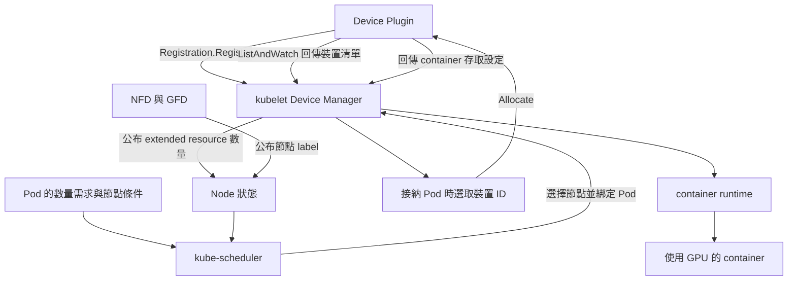

# 1.1 Device Plugin 的限制

## 本頁要回答的問題

同樣寫 `nvidia.com/gpu: 1`，工作可能需要 A40 的記憶體容量，也可能接受 RTX 4090；有些工作只想和另一個 Pod 共用已選定的 GPU。傳統 Device Plugin API 如何處理這些需求，又有哪些資訊沒有進入 scheduler？

本節討論由 **Device Plugin 供應資源**的經典路徑。Kubernetes v1.37 也能讓 DRA 承接 extended resource 請求，因此只看見 `nvidia.com/gpu` 這個名稱，還不足以判斷背後走哪一種路徑；[下一節](dra-model.md#實際的裝置分類)會解釋 DeviceClass 的銜接欄位。[DRA API Objects](https://kubernetes.io/docs/concepts/resource-management/dynamic-resource-allocation/dra-api/)

## 背景原理

Device Plugin 是裝置廠商提供的節點端 plugin。它透過 kubelet 的 gRPC 介面註冊資源、持續回報裝置清單，並在 kubelet 要啟動使用裝置的 container 時提供存取設定。這個 API 的主要對話對象是 kubelet，而 scheduler 看到的是 Node 上公布的資源數量。[Kubernetes Device Plugins](https://kubernetes.io/docs/concepts/extend-kubernetes/compute-storage-net/device-plugins/)

| 介面 | 呼叫方向 | 傳遞的資訊與作用 |
|---|---|---|
| `Registration.Register` | Device Plugin → kubelet | 提供 plugin 的 Unix socket、API 版本與資源名稱，例如 `nvidia.com/gpu`。 |
| `ListAndWatch` | kubelet → Device Plugin，plugin 持續回傳 | 提供裝置 ID、健康狀態及可用的拓樸資訊；kubelet 據此更新 Node 資源。 |
| `Allocate` | kubelet → Device Plugin | kubelet 送出已選取的裝置 ID；plugin 回傳裝置節點、掛載、環境變數或 CDI 名稱等 container 存取設定。 |



具體裝置由 kubelet 的 Device Manager 在接納 Pod 的裝置配置階段選取。Plugin 可透過選用的 `GetPreferredAllocation` 提供建議，但最後的選擇仍由 Device Manager 處理；scheduler 沒有在這條路徑替 Pod 選 GPU UUID。[kubelet v1.37.0 的裝置選取實作](https://github.com/kubernetes/kubernetes/blob/v1.37.0/pkg/kubelet/cm/devicemanager/manager.go)、[Device Plugin 的選用介面](https://kubernetes.io/docs/concepts/extend-kubernetes/compute-storage-net/device-plugins/#device-plugin-implementation)

### 整數資源代表什麼

以下是 container 的需求欄位示意，並非完整部署檔：

```yaml
resources:
  limits:
    nvidia.com/gpu: 1
```

| 參數 | 意義 | 為什麼這樣設 |
|---|---|---|
| `resources.limits.nvidia.com/gpu: 1` | 請求一個 plugin 公布的資源單位。 | 經典路徑以整數計數；資源單位的實際意義由 plugin 設定決定。 |

Extended resources 不能使用小數，也不能在 Kubernetes 的資源記帳中超額承諾。沒有額外的共用設定時，NVIDIA plugin 的單位通常是 GPU；啟用 time-slicing 後，單位可以變成同一張 GPU 的共用名額。因此，`1` 本身沒有說明型號、VRAM 配額或實體裝置身分。[Kubernetes 的請求規則](https://kubernetes.io/docs/concepts/extend-kubernetes/compute-storage-net/device-plugins/#device-plugin-registration)、[NVIDIA 共用設定](https://github.com/NVIDIA/k8s-device-plugin/blob/v0.17.1/README.md#shared-access-to-gpus)

### 屬性如何間接進入排程

NFD（Node Feature Discovery）提供節點特徵探索框架，GFD（GPU Feature Discovery）補上 GPU 特徵 label。工作可用 `nodeSelector` 以 `nvidia.com/gpu.product` 之類的 label 篩選節點，使 Pod 前往某一類 GPU 節點。這是**節點條件**，並沒有把每張卡的完整屬性或容量帶進 Device Plugin 的數量請求。[NVIDIA 的 GFD 與節點 label 說明](https://github.com/NVIDIA/k8s-device-plugin/blob/v0.17.1/README.md#deploying-with-gpu-feature-discovery-for-automatic-node-labels)

在本書的 A40 與 RTX 4090 節點上，型號 label 可用來限制目標節點。若一個節點有不同型號的卡，節點符合條件仍不等於已指定該節點中的某張裝置；這也說明為什麼裝置層級的選擇需要另一種模型。

## 部署與設定

傳統 plugin 的共用策略由維運者設定。NVIDIA time-slicing 的 `replicas` 把一張實體 GPU 公布成多個可獨立請求的名額；它擴大的是帳面資源數量，沒有增加實體 GPU。各名額共用 VRAM 與故障範圍，請求更多名額也不保證取得等比例的運算時間。[NVIDIA GPU Operator 的 time-slicing 說明](https://docs.nvidia.com/datacenter/cloud-native/gpu-operator/latest/gpu-sharing.html)

例如，假設維運者把一張 A40 設成 `replicas: 4`，Node 會公布四個可排程名額。這是數量模型的示意，並非本書實驗的部署值；四個名額不會自動變成四份固定大小的 GPU 記憶體。

## Device Plugin 表達不了的需求

Device Plugin 適合表達「這個 container 要幾個可用裝置單位」，並把裝置存取交給節點端處理。GPU 共用需要再回答裝置選擇、共同持有、個別設定與容量分攤，DRA 正是把這些需求放進 Kubernetes API 的下一步。[DRA 概觀](https://kubernetes.io/docs/concepts/resource-management/dynamic-resource-allocation/)

下表的「不能」指經典 Device Plugin API 與一般 scheduler 的直接表達能力。使用 `nvidia.com/gpu: 1` 請求數量時，型號、共用關係與配額仍需透過額外的部署政策表達，無法從這個數量請求推得那些保證。[Device Plugin API](https://kubernetes.io/docs/concepts/extend-kubernetes/compute-storage-net/device-plugins/)、[DRA 與 Device Plugin 的差異](https://kubernetes.io/docs/concepts/resource-management/dynamic-resource-allocation/)

| 限制 | 本書情境的一行例子 |
|---|---|
| 缺少裝置屬性條件與有順序的候選清單。 | 無法在 GPU 請求中直接寫「VRAM 至少 30 GiB」或「先 A40，不可用再選 RTX 4090」；節點 label 可篩型號，卻沒有這種裝置需求與候選順序。 |
| 沒有讓多個 Pod 引用同一筆裝置配置的物件。 | `survivor` 與 `pressure` 若各自要一個名額，無法用共同的申請物件指定它們取得同一張 A40。 |
| 沒有標準的每次請求 driver 設定。 | GPU 數量請求不能附上「這次使用 MPS，並設定 CUDA process 的 VRAM 上限」。 |
| time-slicing 名額沒有 VRAM 隔離。 | `pressure` 用完共用 A40 的 VRAM 時，另一個名額上的 `survivor` 仍可能無法配置新記憶體。 |
| 無法表達可消耗容量。 | 不能讓互不相識的工作各申請一份 A40 VRAM，再由基本數量模型檢查所有申請的容量總和。 |

本書的 OOM 基線使用 DRA 共用 Claim，沒有設定 VRAM 配額；它重現的是共用實體 GPU 的記憶體競爭，並非 NVIDIA Device Plugin `replicas` 的部署。兩條路徑都可能讓工作共用 GPU，但引用與記帳方式不同，[第 3 章](../03-oom/README.md)會保留這個區別。

## 重點整理

- `Registration` 與 `ListAndWatch` 讓 kubelet 知道有哪些裝置；Node 對經典 scheduler 公布的是數量。
- Scheduler 選節點，kubelet 的 Device Manager 選實際裝置；選用的 plugin 建議不會改變這個分工。
- NFD 與 GFD 的 label 能輔助篩選節點，無法取代裝置層級的需求。
- Time-slicing `replicas` 增加可排程名額，VRAM 與故障隔離需要另外確認。
- [下一節](dra-model.md)將用 ResourceClaim 描述共同持有與可消耗容量。

<!-- nav:start -->
[← 上一頁：第 1 章　為什麼需要 DRA](README.md) ｜ [目錄](../README.md) ｜ [下一頁：1.2 DRA 的資源模型與配置流程 →](dra-model.md)
<!-- nav:end -->
