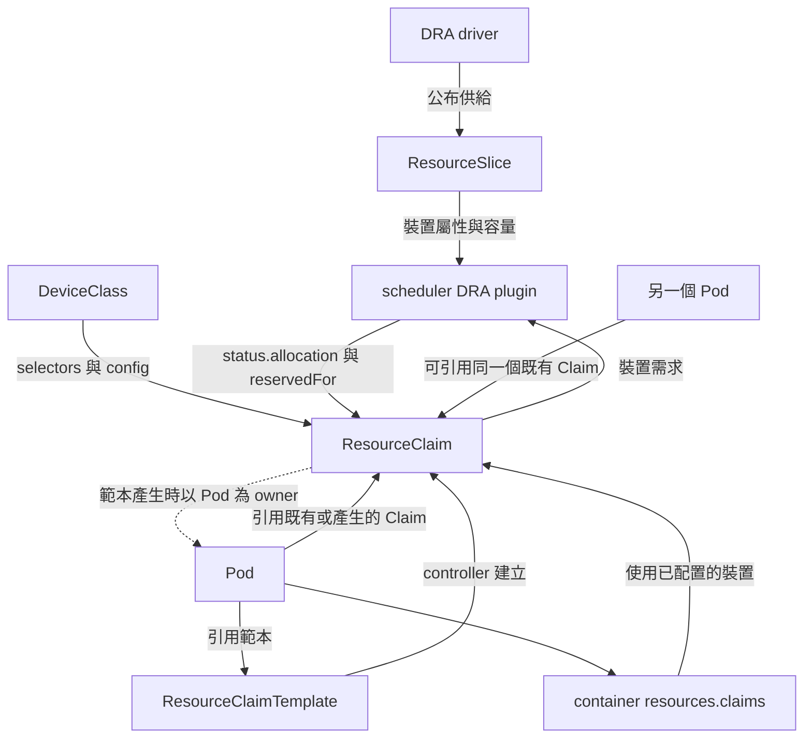
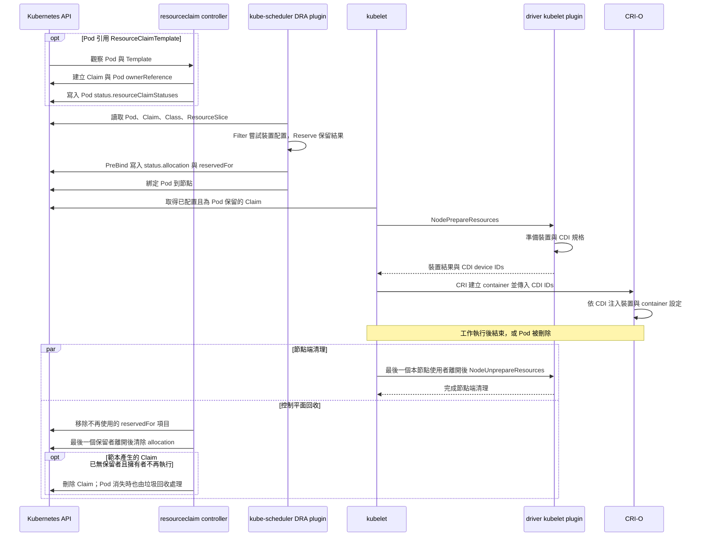

# 1.2 DRA 的資源模型與配置流程

## 本頁要回答的問題

DRA 如何把「工作需要什麼」轉成「container 實際取得哪張 GPU」？先把需求、供給與 runtime 分開：工作透過 Claim 提出需求，driver 公布裝置清單，scheduler 決定配置，節點端 plugin 再準備 container 存取。這些步驟分別留下不同的 API 狀態，才能追查等待、選卡與回收問題。[How DRA Works](https://kubernetes.io/docs/concepts/resource-management/dynamic-resource-allocation/how-dra-works/)

## 背景原理

### 物件如何連接

| 物件或欄位 | 範圍 | 在模型中的角色 |
|---|---|---|
| DeviceClass | 叢集 | 定義可申請裝置的分類；`spec.selectors` 篩裝置，`spec.config` 提供 driver 設定。它不持有裝置清單。 |
| ResourceSlice | 叢集 | driver 公布的供給清單，包含 pool、可存取的節點、裝置的 `attributes` 與 `capacity`；一個 pool 可由多個 Slice 組成。 |
| ResourceClaim | Namespace | 透過 `spec.devices.requests` 提出裝置需求；`spec.devices.config` 附上 driver 設定，`status` 記錄配置結果與使用者。 |
| ResourceClaimTemplate | Namespace | 保存建立 Claim 的範本；一般 Pod 引用時，由 controller 建立屬於該 Pod 的 Claim。 |
| Pod `spec.resourceClaims` | Pod | 以 Pod 內的名稱引用既有 Claim，或引用要產生 Claim 的 Template。 |
| `containers[].resources.claims` | container | 選擇 Pod 宣告的 Claim；可用 `request` 再指定 Claim 中的某個裝置請求。 |

以上是本書使用的一般 Pod 路徑；API 物件關係見 [DRA API Objects](https://kubernetes.io/docs/concepts/resource-management/dynamic-resource-allocation/dra-api/)，container 引用方式見[官方 workload 範例](https://kubernetes.io/docs/tasks/configure-pod-container/assign-resources/allocate-devices-dra/)。



Claim 和 Template 的選擇決定共用方式：要讓幾個 Pod 使用同一筆裝置配置，就明確引用同一個 ResourceClaim；要讓每個 Pod 各自申請，就引用 ResourceClaimTemplate。Template 建立的是各自的 Claim，裝置是否仍可由其他 Claim 共用，則取決於 ResourceSlice 是否允許多重配置。[官方 Claim 選擇說明](https://kubernetes.io/docs/tasks/configure-pod-container/assign-resources/allocate-devices-dra/)、[consumable capacity](https://kubernetes.io/docs/concepts/resource-management/dynamic-resource-allocation/dra-features/#consumable-capacity)

### 從需求到 container



Scheduler 的 `DynamicResources` plugin 在 Filter 嘗試可行配置，在 Reserve 保留結果，於 PreBind 將配置與 Pod 保留關係寫入 Claim，之後才綁定 Pod。`status.allocation.devices.results` 以 `driver`、`pool`、`device` 識別選到的裝置；`status.reservedFor` 記錄可使用該配置的 consumer。[Kubernetes v1.37.0 scheduler 實作](https://raw.githubusercontent.com/kubernetes/kubernetes/v1.37.0/pkg/scheduler/framework/plugins/dynamicresources/dynamicresources.go)

CDI（Container Device Interface）用具名的裝置規格描述 container 需要的裝置節點、掛載與其他設定。Driver 回傳 CDI IDs，kubelet 將它們交給 container runtime；本書使用 CRI-O，由它依 CDI 規格完成注入。CDI 處理的是裝置存取設定，配額的實際效果仍由設定所啟用的機制決定。[DRA structured parameters 設計](https://github.com/kubernetes/enhancements/tree/master/keps/sig-node/4381-dra-structured-parameters)、[kubelet v1.37.0 實作](https://raw.githubusercontent.com/kubernetes/kubernetes/v1.37.0/pkg/kubelet/cm/dra/manager.go)

### 解除配置與刪除的時點

`NodeUnprepareResources` 是節點端撤銷準備，**deallocation** 是清除 Claim 的配置狀態，**deletion** 才是刪除 API 物件。圖中的兩條回收路徑是非同步的分工，不表示 controller 必須等待該 RPC 才刪除 Claim；kubelet 在同一 Claim 還有其他本節點 Pod 使用時，不會先撤銷它的裝置準備。[kubelet v1.37.0 的回收實作](https://raw.githubusercontent.com/kubernetes/kubernetes/v1.37.0/pkg/kubelet/cm/dra/manager.go)

| 情況 | Kubernetes v1.37.0 的 controller 行為 |
|---|---|
| 共用 Claim 還有其他保留者。 | 移除已結束或消失的使用者，保留 `status.allocation`。 |
| scheduler 配置的 Claim 最後一個保留者離開。 | 清除 `status.allocation` 並移除已不需要的刪除保護 finalizer；手動建立的 Claim 物件仍可留下供以後重新配置。 |
| 範本產生的 Claim 沒有保留者，擁有它的 Pod 已進入 `Succeeded` 或 `Failed`。 | controller 可直接刪除 Claim，無須等 Pod 物件也被刪除。 |
| 範本產生的 Claim 所屬 Pod 已被刪除。 | 依 Claim 指向 Pod 的 `ownerReferences` 由垃圾回收處理；controller 也會清理消失使用者的保留關係。 |

這裡依據的是 [`resourceclaim` controller v1.37.0](https://raw.githubusercontent.com/kubernetes/kubernetes/v1.37.0/pkg/controller/resourceclaim/controller.go) 的實際分支：`isPodDone` 也涵蓋「已要求刪除且尚未排到節點」的 Pod。只宣告 `deletionTimestamp`、但仍可能執行的已排程 Pod，不會因此立刻符合這個判斷；同樣地，不能把所有 `reservedFor` 原本就空的 Claim 一律當成待解除配置物件。

## 部署與設定

### 實際的裝置分類

以下是 OOM 基線保存的完整 DeviceClass 查詢結果；管理用 metadata 也原樣保留。它和後續的 Slice 快照來自不同時間，適合閱讀欄位，部署請接續[第 2 章](../02-deploy/README.md)。

```bash
$ kubectl --request-timeout=25s get deviceclass gpu.nvidia.com -o json
```

```json
{
    "apiVersion": "resource.k8s.io/v1",
    "kind": "DeviceClass",
    "metadata": {
        "annotations": {
            "meta.helm.sh/release-name": "dra-driver-nvidia-gpu",
            "meta.helm.sh/release-namespace": "nvidia-dra-driver-gpu"
        },
        "creationTimestamp": "2026-09-23T08:05:12Z",
        "generation": 1,
        "labels": {
            "app.kubernetes.io/managed-by": "Helm"
        },
        "name": "gpu.nvidia.com",
        "resourceVersion": "9860",
        "uid": "75709bf4-1635-4b16-bfd2-8aa49c3bb35b"
    },
    "spec": {
        "extendedResourceName": "nvidia.com/gpu",
        "selectors": [
            {
                "cel": {
                    "expression": "device.driver == 'gpu.nvidia.com' \u0026\u0026 device.attributes['gpu.nvidia.com'].type == 'gpu'"
                }
            }
        ]
    }
}
```

| 參數 | 意義 | 為什麼這樣設 |
|---|---|---|
| `metadata.name: gpu.nvidia.com` | Claim 引用的分類名稱。 | 作為本書整張 GPU 請求的共同入口。 |
| `device.driver` 與 `attributes[...].type` | CEL（Common Expression Language）條件；這裡同時要求 driver 與裝置型別符合。 | 選 NVIDIA driver 公布的 `gpu`，而不把其他型別混進來。 |
| `spec.extendedResourceName` | 讓該 Class 可承接同名 extended resource 請求。 | 提供既有數量請求的銜接；後續章節使用 Claim 明確表達需求。 |
| Helm annotations、管理 label 與其餘 metadata | 安裝歸屬、物件識別與 API 更新資訊。 | 保留實際查詢結果，選卡條件仍以 `spec` 為準。 |

Class 的 selector 與 Claim 的 selector 都必須符合；Class 可附上 `spec.config`，但這份物件沒有附加設定。選取條件和銜接欄位可對照 [NVIDIA v0.5.0 的 chart](https://github.com/kubernetes-sigs/dra-driver-nvidia-gpu/blob/v0.5.0/deployments/helm/dra-driver-nvidia-gpu/templates/deviceclass-gpu.yaml) 與 [Kubernetes v1.37 的欄位定義](https://raw.githubusercontent.com/kubernetes/kubernetes/v1.37.0/staging/src/k8s.io/api/resource/v1/types.go)。

### 實際的裝置清單

這是 HAMi 配額範圍實驗結束、恢復原生 NVIDIA provider 後保存的 `dra-a40` ResourceSlice。以下從 `final-resourceslices.yaml` 抽出該物件，並以獨立的 `...` 行省略管理用 metadata 與 PCI 拓樸屬性；這是觀察節錄，不能直接作為部署 YAML。

```text
apiVersion: resource.k8s.io/v1
kind: ResourceSlice
metadata:
  name: 00000-gpu.nvidia.com-dra-a40-5hng9
  ...
spec:
  devices:
  - attributes:
      addressingMode:
        string: HMM
      architecture:
        string: Ampere
      brand:
        string: Nvidia
      cudaComputeCapability:
        version: 8.6.0
      cudaDriverVersion:
        version: 13.2.0
      driverVersion:
        version: 595.91.7
      productName:
        string: NVIDIA A40
      ...
      type:
        string: gpu
      uuid:
        string: GPU-29ffee3e-bee4-e341-917a-fe7e43e977af
    capacity:
      memory:
        value: 46068Mi
    name: gpu-0
  driver: gpu.nvidia.com
  nodeName: dra-a40
  pool:
    generation: 1
    name: dra-a40
    resourceSliceCount: 1
```

| 參數 | 意義 | 為什麼這樣設 |
|---|---|---|
| `spec.driver`、`spec.nodeName` | 公布資源的 driver，以及此 pool 可用的節點。 | scheduler 知道選到這個本機 GPU 後須前往 `dra-a40`。 |
| `pool.name`、`pool.generation`、`pool.resourceSliceCount` | pool 身分、這一版清單及清單所需的 Slice 數量。 | 避免把不同版本或尚未完整公布的 pool 拼在一起。 |
| `devices[].name: gpu-0` | pool 內的裝置名稱。 | 配置結果以 driver、pool、device 的組合識別裝置。 |
| `attributes.type`、`productName`、`uuid` | 型別、產品名稱與實體 GPU UUID。 | Class 用型別篩選；工作可用型號表達需求，或以 UUID 固定某張卡。 |
| `architecture: Ampere`、`cudaComputeCapability.version: 8.6.0` | 架構名稱與 CUDA compute capability，以字串及語意版本保存。 | 可作為相容條件；它們本身沒有提供工作執行速度的排名。 |
| `driverVersion`、`cudaDriverVersion` | NVIDIA driver 與其 CUDA driver API 版本。 | 協助辨識環境，不能把後者當成 container 內 CUDA runtime 的版本。 |
| `addressingMode`、`brand` | driver 公布的定址模式與品牌屬性；快照值為 `HMM`、`Nvidia`。 | 保留裝置描述；本書的基本請求不以它們篩選。 |
| `capacity.memory.value: 46068Mi` | 此快照公布的 GPU 記憶體總容量。 | 是排程的供給資訊，並非 NVML 即時剩餘 VRAM，也不是可配置 tensor 的大小。 |

未加網域前綴的 `productName`、`memory` 等鍵屬於該 driver 的網域，因此 CEL 讀取型號時使用 `device.attributes["gpu.nvidia.com"].productName`。屬性保存型別資訊，例如 `string`、`version`；容量則使用 Kubernetes quantity。Slice 的容量 `value` 不會隨應用程式配置記憶體而下降，已消耗的容量由 scheduler 另行記帳。[ResourceSlice 與欄位語意](https://raw.githubusercontent.com/kubernetes/kubernetes/v1.37.0/staging/src/k8s.io/api/resource/v1/types.go)

NVML（NVIDIA Management Library）是查詢 GPU 狀態與使用量的介面。本書以它觀測實體 VRAM，用來和 Slice 的總容量、Claim 的申請量對照；這三種數值並不等義。[NVIDIA NVML](https://developer.nvidia.com/management-library-nvml)

第 2.3 節的[一份 A40 ResourceSlice](../02-deploy/dra-driver.md#一份-a40-resourceslice) 列出完整物件與所有欄位的說明。

### 實際的裝置申請

以下完整保留 E1 的 `01-claim.yaml`，包含原始名稱與 label；本節用它對照 API，不另建立一套 workload。

```bash
$ vi 01-claim.yaml
```

```yaml
apiVersion: resource.k8s.io/v1
kind: ResourceClaim
metadata:
  name: a40-shared
  namespace: gpu-oom-lab
  labels:
    app.kubernetes.io/part-of: dra-gpu-oom-lab
spec:
  devices:
    requests:
      - name: gpu
        exactly:
          deviceClassName: gpu.nvidia.com
          allocationMode: ExactCount
          count: 1
          selectors:
            - cel:
                expression: 'device.attributes["gpu.nvidia.com"].productName == "NVIDIA A40"'
```

| 參數 | 意義 | 為什麼這樣設 |
|---|---|---|
| `metadata.name`、`namespace`、`labels` | 原始 Claim 的名稱、Namespace 與識別 label。 | `survivor` 和 `pressure` 都引用 `gpu-oom-lab` 中的 `a40-shared`。 |
| `requests[].name: gpu` | Claim 內部的請求名稱。 | container 可用 `request: gpu` 選取這一筆需求。 |
| `exactly.deviceClassName` | 要使用的 DeviceClass。 | 先取得整張 GPU 的分類與共同條件。 |
| `allocationMode: ExactCount`、`count: 1` | 要求符合條件的一個裝置。 | 取得一張 A40；這裡的 `1` 不是一份 VRAM 配額。 |
| `selectors[].cel.expression` | 對候選裝置求值的條件。 | 限制 `productName` 為 `NVIDIA A40`，不固定 Pod 的節點名稱。 |

部署指令如下；輸出標為預期值，完整操作與實測輸出接續[第 3 章](../03-oom/README.md)。

```bash
$ kubectl apply -f 01-claim.yaml
```

（預期輸出）

```text
resourceclaim.resource.k8s.io/a40-shared created
```

Pod 的 `spec.resourceClaims[].name: gpu` 是 Pod 內的別名，`resourceClaimName: a40-shared` 才是要引用的 API 物件；container 的 `resources.claims[].name: gpu` 對應前者，`request: gpu` 對應 Claim 裡的請求。這些名稱恰好都用 `gpu`，但層級不同。若改用 `resourceClaimTemplateName`，產生的 Claim 名稱會由 controller 填入 Pod 的 `status.resourceClaimStatuses`。[workload 引用方式](https://kubernetes.io/docs/tasks/configure-pod-container/assign-resources/allocate-devices-dra/)

### 需求可以如何延伸

| 欄位 | 意義與使用時機 |
|---|---|
| `requests` | 同一 Claim 所需的裝置請求清單，所有需求都要能滿足。 |
| `exactly` | 一組必須符合的裝置需求。 |
| `firstAvailable` | 有順序的子請求，選其中一個可滿足的候選；與 `exactly` 擇一使用。 |
| `deviceClassName`、`selectors` | 分類條件再加上本次請求條件；CEL 可篩屬性或容量。 |
| `allocationMode`、`count` | `ExactCount` 要指定數量；`All` 要求一個 pool 中所有符合條件的裝置，且至少有一個，`count` 只用於前者。未指定時預設為 `ExactCount` 與一個裝置。 |
| `capacity.requests` | 申請每個被配置裝置需提供的容量；在 `exactly` 或各個 `firstAvailable` 子請求中設定。 |
| `spec.devices.config` | 工作提供的 driver 設定；`requests` 限定適用需求，省略則適用該 Claim 的所有需求。 |

這些欄位的完整定義見 [Kubernetes v1.37.0 API](https://raw.githubusercontent.com/kubernetes/kubernetes/v1.37.0/staging/src/k8s.io/api/resource/v1/types.go)。例如「先 A40，再 RTX 4090」可把兩個各有型號 selector 的需求放入 `firstAvailable`；v1.37 scheduler 也會把候選順序納入節點評分。這是使用者指定的偏好，還會與其他排程條件一起作用，沒有自動量測哪張 GPU 最快。[Prioritized list](https://kubernetes.io/docs/concepts/resource-management/dynamic-resource-allocation/dra-api/#prioritized-list)

更要分清**篩選容量**與**消耗容量**。CEL 篩選總容量足夠的裝置，適合「這張卡至少有 30 GiB」；`capacity.requests.memory: 8Gi` 則表達本次需求要消耗的記帳容量。當 Slice 設定 `allowMultipleAllocations: true` 時，不同 Claim 可以配置同一個裝置，scheduler 依 `requestPolicy` 與既有配置檢查總量；結果寫在 `status.allocation.devices.results[].consumedCapacity`。[Consumable capacity](https://kubernetes.io/docs/concepts/resource-management/dynamic-resource-allocation/dra-features/#consumable-capacity)

E1 沒有這些容量請求，也沒有 VRAM 配額。共用同一個 Claim 的 Pod 使用同一筆配置，不會因為每增加一個 Pod 就再扣一次相同的容量；[第 4 章](../04-isolation/consumable-shares.md)會改用獨立 Claim 驗證容量記帳。[KEP-5075](https://github.com/kubernetes/enhancements/blob/master/keps/sig-scheduling/5075-dra-consumable-capacity/README.md)

### Driver 專屬設定

`opaque.driver` 指定接收設定的 driver，`opaque.parameters` 保存廠商定義的內容。Scheduler 不以這些內容決定裝置是否符合需求；它把 Class 與 Claim 的設定帶入配置結果，由 driver 檢查與執行。[OpaqueDeviceConfiguration 定義](https://raw.githubusercontent.com/kubernetes/kubernetes/v1.37.0/staging/src/k8s.io/api/resource/v1/types.go)

MPS（Multi-Process Service）讓多個 CUDA client process 透過 MPS server 共用 GPU 執行資源。[MPS 說明](https://docs.nvidia.com/deploy/mps/595/when-to-use-mps.html) 下面是 MPS 實驗 `spec.devices.config` 的完整子樹，以 YAML 表示原始 JSON；它不是獨立的部署物件。內嵌的 `GpuConfig` 使用 NVIDIA 的 API 版本，和外層 Kubernetes 的 `resource.k8s.io/v1` 分別描述不同的介面。

```yaml
config:
  - requests: [gpu]
    opaque:
      driver: gpu.nvidia.com
      parameters:
        apiVersion: resource.nvidia.com/v1beta1
        kind: GpuConfig
        sharing:
          strategy: MPS
          mpsConfig:
            defaultActiveThreadPercentage: 100
            defaultPinnedDeviceMemoryLimit: 8Gi
            multiUser: false
```

| 參數 | 意義 | 為什麼這樣設 |
|---|---|---|
| `requests: [gpu]`、`opaque.driver` | 將設定套到 `gpu` 需求，交給 NVIDIA driver。 | 讓這筆裝置需求使用指定的共用機制。 |
| `apiVersion`、`kind`、`sharing.strategy` | NVIDIA 參數型別及 `MPS` 策略。 | 由 driver 辨識與啟用 MPS。 |
| `defaultActiveThreadPercentage: 100` | MPS client 可使用的 active thread 比例上限。 | 原實驗不縮小這項比例；它不代表替 client 保留專用 SM。 |
| `defaultPinnedDeviceMemoryLimit: 8Gi` | MPS client 的裝置記憶體上限。 | 用於觀察每個 CUDA process 的配額邊界，並非整個 Pod 的合計上限。 |
| `multiUser: false` | 不啟用跨使用者 UID 的 MPS 模式。 | 符合這次實驗的使用者模式。 |

欄位可對照 [NVIDIA v0.5.0 `sharing.go`](https://github.com/kubernetes-sigs/dra-driver-nvidia-gpu/blob/v0.5.0/api/nvidia.com/resource/v1beta1/sharing.go)；active thread 與每個 process 記憶體限制的語意見 [MPS 說明](https://docs.nvidia.com/deploy/mps/595/when-to-use-mps.html)。SM（Streaming Multiprocessor）是 GPU 執行工作的運算單元，這項比例上限沒有把 SM 硬體切成互不干擾的分區。

效能實驗的 TimeSlicing Claim 使用以下完整 `opaque.parameters`；同樣是子樹，沒有指定自訂 timeslice 長度。

```yaml
apiVersion: resource.nvidia.com/v1beta1
kind: GpuConfig
sharing:
  strategy: TimeSlicing
```

| 參數 | 意義 | 為什麼這樣設 |
|---|---|---|
| `sharing.strategy: TimeSlicing` | 指定 CUDA time-slicing 共用策略。 | 作為效能比較的 time-slicing 路徑；本身沒有 VRAM 配額。 |

| 設定所在位置 | 適用範圍 |
|---|---|
| Claim `spec.devices.config[].opaque` | 本次 Claim；可用同項的 `requests` 選擇特定需求。 |
| DeviceClass `spec.config[].opaque` | 所有透過該 Class 申請的裝置；Class 設定項沒有 Claim 的 `requests` 欄位。 |

兩處都可以放同樣的 NVIDIA `GpuConfig`，並會保存在 `status.allocation.devices.config`，供 driver 辨識來源及處理。實際啟用條件還要看 driver 的 feature gates，見[技術地圖](gpu-sharing-landscape.md#driver-的功能開關與互斥條件)；配額效果見[第 4 章](../04-isolation/mps.md)，相同工作量的效能比較見[第 5 章](../05-performance/README.md)。[Kubernetes 設定欄位](https://raw.githubusercontent.com/kubernetes/kubernetes/v1.37.0/staging/src/k8s.io/api/resource/v1/types.go)

## 驗證

### Kubernetes 功能成熟度

本書叢集是 **Kubernetes v1.37.0**。下表只列可核對的 v1.37 狀態；「Kubernetes 啟用」和「NVIDIA driver 啟用對應能力」是不同條件。[官方 feature-gates 表](https://kubernetes.io/docs/reference/command-line-tools-reference/feature-gates/)

| 功能 | Kubernetes gate | v1.37 狀態與啟用情形 | 在本書模型中的意義 |
|---|---|---|---|
| 核心 DRA，`resource.k8s.io/v1` | `DynamicResourceAllocation` | GA，已啟用並鎖定。 | 提供 Class、Slice、Claim 與 Template 的基本配置流程。 |
| 候選優先清單 `firstAvailable` | `DRAPrioritizedList` | GA，預設啟用。 | 明確寫出不同候選需求及其優先序。 |
| 可消耗容量 | `DRAConsumableCapacity` | Beta，預設啟用。 | 讓獨立 Claim 可分攤裝置容量。 |
| 裝置 taints | `DRADeviceTaints` | GA，已啟用並鎖定。 | 以裝置層級的 taint 與 toleration 控制使用或驅離。 |
| 可分割裝置 | `DRAPartitionableDevices` | Beta，預設啟用。 | 公布會競爭同一批實體資源的候選分區，以共享計數器限制配置。 |
| 管理存取 | `DRAAdminAccess` | GA，預設啟用。 | `adminAccess` 可申請管理用途的存取，須使用標示 `resource.kubernetes.io/admin-access: "true"` 的 Namespace。 |

核心 API 與優先清單見 [DRA API Objects](https://kubernetes.io/docs/concepts/resource-management/dynamic-resource-allocation/dra-api/)，taints 見[官方說明](https://kubernetes.io/docs/concepts/resource-management/dynamic-resource-allocation/device-taints/)，容量與分區見 [DRA Features](https://kubernetes.io/docs/concepts/resource-management/dynamic-resource-allocation/dra-features/) 及 [KEP-4815](https://github.com/kubernetes/enhancements/blob/master/keps/sig-scheduling/4815-dra-partitionable-devices/README.md)。可分割裝置的 API 不會讓原本沒有 MIG 能力的 GPU 取得硬體分區能力。

2026-10-11 的原始叢集紀錄來自 v1.37.0 API server 的 `/metrics`。以下保留表中的 DRA 開關，以及讓 DeviceClass 承接 extended resource 的 `DRAExtendedResource`；其餘行以 `...` 標示省略。

```bash
$ kubectl get --raw /metrics | grep '^kubernetes_feature_enabled' | grep DRA
```

```text
kubernetes_feature_enabled{name="DRAAdminAccess",stage=""} 1
kubernetes_feature_enabled{name="DRAConsumableCapacity",stage="BETA"} 1
...
kubernetes_feature_enabled{name="DRADeviceTaints",stage=""} 1
kubernetes_feature_enabled{name="DRAExtendedResource",stage=""} 1
...
kubernetes_feature_enabled{name="DRAPartitionableDevices",stage="BETA"} 1
...
kubernetes_feature_enabled{name="DRAPrioritizedList",stage=""} 1
...
```

核心開關的名稱 `DynamicResourceAllocation` 不含連續的 `DRA` 字元，須另行篩選；同一份紀錄中的結果如下。

```bash
$ kubectl get --raw /metrics | grep '^kubernetes_feature_enabled' | grep DynamicResourceAllocation
```

```text
kubernetes_feature_enabled{name="DynamicResourceAllocation",stage=""} 1
```

`stage=""` 代表 GA（stable）；Kubernetes 的 GA 階段常數就是空字串。[v1.37.0 階段定義與 metrics 傳遞](https://raw.githubusercontent.com/kubernetes/kubernetes/v1.37.0/staging/src/k8s.io/component-base/featuregate/feature_gate.go) 數值 `1` 代表啟用，因此表內六項功能與 `DRAExtendedResource` 在這次 API server 紀錄中皆已啟用。[官方 metrics 檢查方式](https://kubernetes.io/docs/tasks/administer-cluster/configure-feature-gates/#check-via-metrics-endpoint)

這份 metrics 證明當日 API server 的有效狀態，driver 設定則要另外查證。本地證據可確認 MPS 階段的 provider 使用 `FEATURE_GATES=MPSSupport=true,`；ConsumableShares 階段另用 `MPSSupport=false,ConsumableShares=true` 與 `CONSUMABLE_SHARES=memory`，不能把這些 driver 設定當成 Kubernetes gate 的值。

讀一份 Claim 時，先看需求的 Class 與 selector，再看數量、容量及配置結果，最後才檢查 driver 設定與 runtime 效果。這個順序能避免把「Claim 已配置」誤讀成「VRAM 已被硬體隔離」，也能分辨等待是供給不足、條件不符，還是裝置準備出了問題。

## 限制

DRA 提供資源描述與配置協定，runtime 配額和故障隔離仍需個別查證。獨立 Claim 的容量請求是否真的限制 CUDA 使用量、同一 Claim 的多個 Pod 是否共用配額帳本，都是[第 4 章](../04-isolation/README.md)要實測的問題；[第 6 章](../06-heterogeneous/README.md)的選卡結果也只證明條件可滿足，不代表選到最快的 GPU。

## 重點整理

- Class 定義條件，Slice 公布供給，Claim 保存需求與配置，Template 建立每個 Pod 的 Claim。
- Scheduler 選裝置與節點，kubelet 呼叫 driver 準備，CRI-O 依 CDI 提供 container 存取。
- Pod 的 Claim 別名、API 物件名稱與 Claim 內請求名稱是不同層級。
- 裝置總容量、申請的記帳容量與實體即時使用量需要分開閱讀。
- 節點端撤銷準備、解除配置與刪除物件各有時點；範本產生的 Claim 可在 Pod 終止後先被刪除。

<!-- nav:start -->
[← 上一頁：1.1 Device Plugin 的限制](device-plugin-limits.md) ｜ [目錄](../README.md) ｜ [下一頁：1.3 GPU 共用技術地圖 →](gpu-sharing-landscape.md)
<!-- nav:end -->
