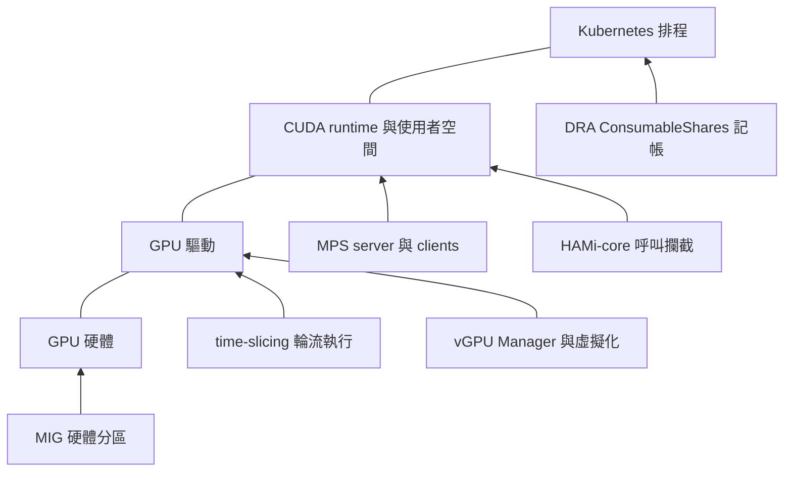

# 1.3 GPU 共用技術地圖

## 本頁要回答的問題

GPU 共用並不是單一機制。有些方法切分硬體，有些控制 CUDA 行程，有些只讓 scheduler 接受更多工作；它們對 VRAM、運算與故障的保證各不相同。本節把這些方法放回作用層級，再界定本書實驗實際能回答的問題。

## 背景原理

先約定比較表中的隔離意義：**運算隔離**看工作是否取得分開的運算資源，或僅有使用量上限；**VRAM 隔離**看是否有獨立容量或配置上限；**故障隔離**看一個工作的 GPU 故障能否影響其他工作。CUDA OOM 是記憶體配置失敗，不能和 fatal GPU fault 或容器遭系統終止混成同一種事件。[MPS 的記憶體與錯誤範圍](https://docs.nvidia.com/deploy/mps/595/when-to-use-mps.html)

下圖以相鄰連線表示軟硬體層次，側邊箭頭表示介入位置。DRA driver 橫跨清單公布與節點準備，Kubernetes 排程層的容量記帳則根據 Claim 與 Slice；圖中的箭頭不表示每個方法都能疊加啟用。

MIG（Multi-Instance GPU）的記憶體路徑在硬體中分區；MPS 提供 CUDA 多行程共用與限制；HAMi-core 則在使用者空間攔截 CUDA 等 API 呼叫。這些機制的作用位置，可分別對照 [MIG 架構](https://docs.nvidia.com/datacenter/tesla/mig-user-guide/introduction.html)、[MPS 說明](https://docs.nvidia.com/deploy/mps/595/when-to-use-mps.html)與 [HAMi-core 設計](https://project-hami.io/docs/v2.8.0/developers/hami-core-design)。

vGPU（virtual GPU）把 GPU 資源提供給虛擬機，其 vGPU Manager 與虛擬機監控器（hypervisor）合作管理存取。它有 time-sliced 與 MIG-backed 等後端，不能把「虛擬 GPU」直接等同於某一種隔離保證。[vGPU 架構](https://docs.nvidia.com/vgpu/sizing/virtual-workstation/latest/overview.html)、[MIG-backed vGPU](https://docs.nvidia.com/ai-enterprise/release-7/latest/infra-software/vgpu/features/mig-backed-vgpu.html)

### 共用方法比較

先比較各方法的隔離能力與作用粒度：

| 方法 | 作用層級 | 運算隔離 | VRAM 隔離 | 故障隔離 | 粒度 |
| --- | --- | --- | --- | --- | --- |
| [time-slicing](https://docs.nvidia.com/datacenter/cloud-native/gpu-operator/latest/gpu-sharing.html) | driver | 輪流執行，沒有專用運算分區。 | 沒有共用名額的容量隔離。 | 名額共用同卡故障範圍。 | 同 GPU 上的 CUDA 工作；Device Plugin 可另外公布 replicas。 |
| [MPS](https://docs.nvidia.com/deploy/mps/595/when-to-use-mps.html) | driver 與使用者空間服務 | 可限制 active thread 比例，未替每個 client 保留專用 SM；工作可並行。 | 可限制每個 CUDA 行程的裝置記憶體，Volta 之後有分開的 GPU 位址空間。 | 有限的錯誤侷限；共享故障 GPU 的 clients 仍可能一起受影響。 | CUDA client 行程。 |
| [MIG](https://docs.nvidia.com/datacenter/tesla/mig-user-guide/introduction.html) | hardware | 分開的運算資源。 | GPU Instance 有獨立的記憶體分區與路徑。 | 提供 instance 間的硬體故障隔離；仍有整張卡的共同故障邊界。 | GPU Instance 與 Compute Instance profile。 |
| [vGPU](https://docs.nvidia.com/vgpu/sizing/virtual-workstation/latest/overview.html) | driver、hypervisor；MIG-backed 路徑另含 hardware | 依 time-sliced 或 MIG-backed 後端。 | vGPU profile 提供固定 frame buffer，由 vGPU Manager 保留。 | 依後端與虛擬化部署；不能僅憑 vGPU 名稱推定硬體故障邊界。 | VM 的 vGPU profile。 |
| [HAMi-core](https://project-hami.io/docs/v2.8.0/core-concepts/gpu-virtualization) | user-space library；HAMi-DRA 另接 scheduler 容量記帳 | 攔截與節流形成軟體使用量限制，沒有專用硬體分區。 | 在被攔截的配置路徑檢查配額；合計範圍取決於共享 cache。 | 未提供 MIG 式硬體分區；本書未測 GPU 故障隔離。 | 裝置 memory、cores 份額及 cache 帳本。 |
| [DRA consumable capacity](https://github.com/kubernetes/enhancements/blob/master/keps/sig-scheduling/5075-dra-consumable-capacity/README.md)，NVIDIA ConsumableShares | scheduler；driver 公布供給政策 | 沒有提供執行期運算隔離。 | 依 Claim 申請量記帳；沒有因此限制 CUDA 的實體配置。 | 沒有增加執行期故障隔離。 | 每個裝置配置的 capacity request；NVIDIA `memory` 政策以 `1Mi` 為步進。 |

再對照硬體需求、DRA 用法與本書的實測範圍；兩表使用相同的列順序：

| 方法 | 硬體或授權需求 | 在 NVIDIA DRA／HAMi-DRA 中的用法 | 本書是否實測 |
| --- | --- | --- | --- |
| [time-slicing](https://docs.nvidia.com/datacenter/cloud-native/gpu-operator/latest/gpu-sharing.html) | 支援 CUDA 的 GPU 與驅動。 | 原生 DRA 可由多個 Pod 引用同一 Claim；`GpuConfig` 策略為 `TimeSlicing`。 | 是，[第 3 章](../03-oom/README.md)的無配額基線、[第 5 章](../05-performance/README.md)的效能比較。 |
| [MPS](https://docs.nvidia.com/deploy/mps/595/when-to-use-mps.html) | 支援 MPS 的 CUDA GPU 與 MPS daemon；本書測 A40。 | `MPSSupport` 加上 Claim 或 Class 的 `GpuConfig`，建立該 Claim 的 MPS 服務。 | 是，[第 4 章](../04-isolation/mps.md)、[第 5 章](../05-performance/README.md)。 |
| [MIG](https://docs.nvidia.com/datacenter/tesla/mig-user-guide/introduction.html) | 必須使用支援 MIG 的 GPU。 | 原生 NVIDIA driver 有 `mig.nvidia.com` Class；`DynamicMIG` 管理動態分區。 | 否；本書硬體不支援 MIG。 |
| [vGPU](https://docs.nvidia.com/vgpu/sizing/virtual-workstation/latest/overview.html) | 支援的 GPU、hypervisor、vGPU 軟體及適用授權。 | 需先建立 vGPU 與客體環境；本書不測原生 DRA 在該環境的行為。 | 否。 |
| [HAMi-core](https://project-hami.io/docs/v2.8.0/core-concepts/gpu-virtualization) | NVIDIA GPU 與相容的 CUDA 呼叫、注入函式庫；此路徑不使用 NVIDIA vGPU 授權。 | HAMi-DRA 公布容量，將配置量轉成環境變數，透過 CDI 掛載 `libvgpu.so`。 | 是，[第 4 章](../04-isolation/hami-dra.md)、[第 5 章](../05-performance/README.md)、[第 6 章](../06-heterogeneous/README.md)。 |
| [DRA consumable capacity](https://github.com/kubernetes/enhancements/blob/master/keps/sig-scheduling/5075-dra-consumable-capacity/README.md)，NVIDIA ConsumableShares | Kubernetes 容量功能與 driver 的對應支援；不要求 MIG。 | `ConsumableShares` 和 `--consumable-shares=memory` 公布多重配置及容量政策，讓獨立 Claim 共用同卡。 | 是，[第 4 章](../04-isolation/consumable-shares.md)。 |

表中的 driver 行為以 [NVIDIA v0.5.0 feature gates](https://github.com/kubernetes-sigs/dra-driver-nvidia-gpu/blob/v0.5.0/pkg/featuregates/featuregates.go)、[容量政策實作](https://raw.githubusercontent.com/kubernetes-sigs/dra-driver-nvidia-gpu/v0.5.0/cmd/gpu-kubelet-plugin/consumable_shares.go)與 [HAMi-DRA v0.1.0 容量及 CDI 實作](https://github.com/Project-HAMi/k8s-dra-driver/blob/v0.1.0/cmd/hami-kubelet-plugin/hami_core.go)核對，MIG 分類可對照 [`deviceclass-mig.yaml`](https://raw.githubusercontent.com/kubernetes-sigs/dra-driver-nvidia-gpu/v0.5.0/deployments/helm/dra-driver-nvidia-gpu/templates/deviceclass-mig.yaml)。vGPU 的 MIG-backed 後端見 [NVIDIA 說明](https://docs.nvidia.com/ai-enterprise/release-7/latest/infra-software/vgpu/features/mig-backed-vgpu.html)，支援硬體與授權分別見[支援清單](https://docs.nvidia.com/vgpu/gpus-supported-by-vgpu.html)及[授權說明](https://docs.nvidia.com/vgpu/latest/grid-licensing-user-guide/intro-to-grid-licensing.html)。

## 部署與設定

### 驅動的功能開關與互斥條件

Kubernetes gate 管理 API 與 scheduler 能力，NVIDIA driver gate 管理裝置準備與清單公布，兩套名稱要分開閱讀。以下固定採用 NVIDIA DRA driver **v0.5.0** 的 `pkg/featuregates/featuregates.go`，不把其他版本的支援狀態套到本書叢集。[v0.5.0 原始碼](https://github.com/kubernetes-sigs/dra-driver-nvidia-gpu/blob/v0.5.0/pkg/featuregates/featuregates.go)

| NVIDIA driver gate | v0.5.0 階段與預設 | 與本頁相關的作用 |
|---|---|---|
| `MPSSupport` | Alpha，`false` | 允許指定 MPS 設定與管理 MPS 服務。 |
| `TimeSlicingSettings` | Alpha，`false` | 允許明確指定 time-slicing 設定；不是「GPU 原本能否輪流執行」的開關。 |
| `ConsumableShares` | Alpha，`false` | 啟用容量與多重配置的公布；還須有有效的 `--consumable-shares` 模式。 |
| `DynamicMIG` | Alpha，`false` | 管理動態 MIG 裝置；另依賴 GPU 的 MIG 能力。 |

`ValidateFeatureGates` 檢查的完整互斥配對與相依條件，見第 2.3 節的[功能開關與相依關係](../02-deploy/dra-driver.md#功能開關與相依關係)。

MPS 與 ConsumableShares 有另一層檢查：`cmd/gpu-kubelet-plugin/device_state.go` 在套用 MPS 設定時，若 consumable shares 已有效啟用，就拒絕該次裝置準備。這不是 `ValidateFeatureGates` 中「兩個布林 gate 不能同時為 true」的配對；本書容量實驗採 `MPSSupport=false,ConsumableShares=true`，與 MPS 實驗分開執行。[裝置準備實作](https://github.com/kubernetes-sigs/dra-driver-nvidia-gpu/blob/v0.5.0/cmd/gpu-kubelet-plugin/device_state.go)

同樣地，`GpuConfig.sharing.strategy` 只選一種策略，`TimeSlicing` 與 `MPS` 有各自的設定型別。`TimeSlicingSettings` 套用整張 GPU 的時間片設定，沒有在每個 Pod 建立一個獨立的硬體時間片控制器。[`sharing.go`](https://github.com/kubernetes-sigs/dra-driver-nvidia-gpu/blob/v0.5.0/api/nvidia.com/resource/v1beta1/sharing.go)、[`device_state.go`](https://github.com/kubernetes-sigs/dra-driver-nvidia-gpu/blob/v0.5.0/cmd/gpu-kubelet-plugin/device_state.go)

Kubernetes 的容量 gate 正式名稱是 **`DRAConsumableCapacity`**；NVIDIA 的正式名稱是 **`ConsumableShares`**。在 v1.37 前者為預設啟用的 Beta，後者在 driver v0.5.0 仍為預設關閉的 Alpha，不能從核心 DRA 已 GA 推得所有共用路徑都已成熟。[Kubernetes feature gates](https://kubernetes.io/docs/reference/command-line-tools-reference/feature-gates/)

## 驗證

### 本書為什麼選這些方法

本書硬體是 A40 與 GeForce RTX 4090。A40 官方規格明列不支援 MIG，RTX 4090 也不在 NVIDIA 的 MIG 支援清單；因此這套硬體無法進行 MIG 對照實驗。[A40 規格](https://images.nvidia.com/content/Solutions/data-center/a40/nvidia-a40-datasheet.pdf)、[MIG 支援清單](https://docs.nvidia.com/datacenter/tesla/mig-user-guide/supported-gpus.html)

RTX 4090 是 Ada Lovelace 的 GeForce GPU，未列在官方 NVIDIA vGPU 支援清單，不能把它視為受支援的 vGPU 測試平台。A40 則列在 vGPU 支援清單中；本書使用 PCI passthrough 將 GPU 直通至 VM，沒有建置 vGPU Manager 與相應授權的 vGPU 環境，所以 A40 的 vGPU 也沒有納入實測。硬體支援和本次是否部署，是不同的範圍限制。[RTX 4090 規格](https://www.nvidia.com/en-us/geforce/graphics-cards/40-series/rtx-4090/)、[vGPU 支援清單](https://docs.nvidia.com/vgpu/gpus-supported-by-vgpu.html)、[vGPU 架構與環境](https://docs.nvidia.com/vgpu/sizing/virtual-workstation/latest/overview.html)

因此，本書先用共用 Claim 觀察沒有 VRAM 配額時的 TimeSlicing 基線，再比較 MPS、HAMi-DRA 的執行期限制，以及 ConsumableShares 的排程容量記帳。HAMi-core 設計說明在此用來解釋攔截位置；原始實驗沒有確認所載入 `libvgpu.so` 的原始碼 commit，不能把網站版本當成該二進位的確切版本。

### 接下來怎麼讀

| 章節 | 用本頁模型追問的問題 |
|---|---|
| [第 3 章](../03-oom/README.md) | 共用 GPU 沒有 VRAM 隔離時，記憶體耗盡如何影響其他工作的新增配置與既有運算？ |
| [第 4 章](../04-isolation/README.md) | 排程記帳、CUDA 配額與實體用量這三層，分別能限制什麼？ |
| [第 5 章](../05-performance/README.md) | 工作量相同時，共用是否改善吞吐量，延遲付出多少代價？ |
| [第 6 章](../06-heterogeneous/README.md) | 不固定節點時，裝置條件與剩餘記帳容量能否引導 A40／RTX 4090 選擇？ |

異質選卡實驗 E4／E4B 驗證的是需求與容量條件，不判定哪張 GPU 最快。`firstAvailable` 的候選順序、CEL 的相容條件與 benchmark 得到的速度，需要分別解讀。

## 限制

軟體配額的合計範圍不能從 Pod 或 Claim 名稱自行推定：MPS 實驗在每行程 `8Gi` 上限下，同一 Pod 的兩個 CUDA 行程合計成功配置 10 GiB。HAMi-DRA 在共享 cache 路徑拒絕超額配置，NVML 觀測的實體用量卻曾達 8292 MiB，超過 8192 MiB 的 Claim；另一項測試中，共用同一 Claim 的兩個 Pod 合計成功配置 9.75 GiB，並保留了一輪停滯結果。詳細邊界與證據由[第 4 章](../04-isolation/results.md)展開。

這些 CUDA 配置與用量觀察沒有證明 GPU 硬體故障隔離。ConsumableShares 的容量限制也只作用於配置記帳，執行中的行程仍可能超過申請量；要避免 OOM，還須確認實體餘量、配額作用範圍與工作型態，不能只看 Claim 是否已配置。

## 重點整理

- MIG、MPS、time-slicing 與 HAMi-core 介入不同層級，隔離保證需要逐項比較。
- MPS 的記憶體上限以 CUDA 行程為單位；HAMi-core 的合計範圍要確認 cache 與實際呼叫路徑。
- ConsumableShares 讓獨立 Claim 分攤記帳容量，沒有因此提供 CUDA 的實體 VRAM 上限。
- Kubernetes gate、driver gate、硬體支援與實際部署都要分開核對。
- 本書實測範圍涵蓋共用、配額、效能與異質選卡，各章保留相應的負面結果與限制。

<!-- nav:start -->
[← 上一頁：1.2 DRA 的資源模型與配置流程](dra-model.md) ｜ [目錄](../README.md) ｜ [下一頁：第 2 章　部署 GPU Operator 與 NVIDIA DRA Driver →](../02-deploy/README.md)
<!-- nav:end -->
