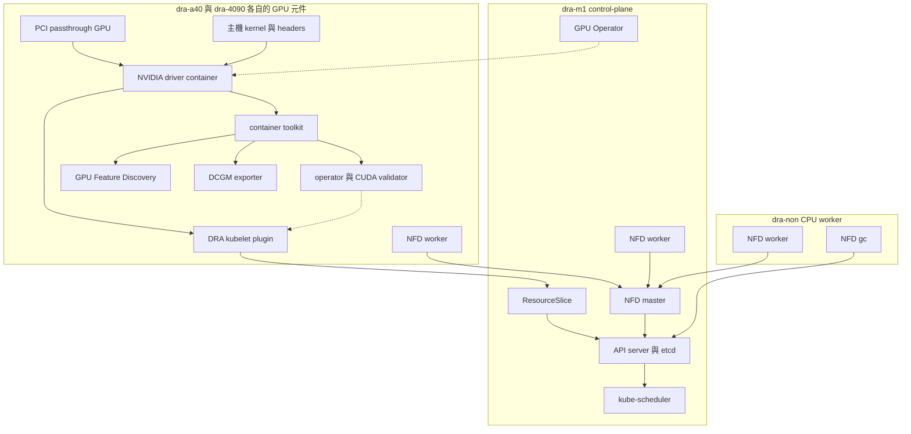

# 第 2 章　部署 GPU Operator 與 NVIDIA DRA Driver

## 本章要回答的問題

一個已經能執行一般 Pod 的 Kubernetes 叢集，還需要哪些元件，才能讓 Pod 透過 ResourceClaim（DRA 的資源申請物件，見[第 1 章](../01-why-dra/dra-model.md)）使用 GPU？本章從 GPU 節點的 kernel 與 PCI 裝置開始，依序安裝 GPU Operator、NVIDIA DRA Driver，最後用兩個 GPU Job 驗證整條路徑。

本章延續已完成的 kubeadm 與 Cilium 叢集。部署重點是讓主機上的 driver、container runtime 與 DRA 裝置分配接起來；GPU 共用、記憶體隔離與效能量測留到後續章節。

## 背景原理

GPU Operator 與 NVIDIA DRA Driver 在這套部署中分工合作：前者管理 GPU 節點上的 NVIDIA driver、container toolkit 與驗證元件，後者透過 kubelet plugin 公布裝置並準備 Pod 所需的 GPU 存取。安裝時先讓 GPU Operator 的 driver container 成功，再安裝指向 `/run/nvidia/driver` 的 DRA Driver。[v0.5.0 DRA 安裝說明](https://github.com/kubernetes-sigs/dra-driver-nvidia-gpu/blob/v0.5.0/site/content/docs/install.md)說明兩者的整合方式，實際參數見 [2.2](gpu-operator.md) 與 [2.3](dra-driver.md)。

下圖按原叢集的實際元件位置繪製。GPU 節點框中的每個元件都分別存在於 `dra-a40` 與 `dra-4090`；實線表示依賴或資料流，虛線表示本章要求的安裝順序。



GPU Operator 與 NFD master 在這次實測排到 `dra-m1`，NFD gc 排到 `dra-non`，NFD worker 則遍布所有節點。這些 Deployment 的位置是當時的排程結果。

## 部署與設定

### 環境版本

下表對照安裝時的設定與後續實測清單。CRI-O 的 `v1.37` 是安裝紀錄中的系列名稱，實測確認為 `1.37.1`；其餘列出的元件版本一致。

| 項目 | 安裝設定 | 實測核對 |
| --- | --- | --- |
| OS | Ubuntu 24.04.3 LTS | 所有節點皆相同 |
| Kernel | GA kernel 6.8 系列 | GPU 節點為 `6.8.0-142-generic`；`dra-m1`、`dra-non` 為 `6.8.0-90-generic` |
| Kubernetes | v1.37.0，使用 kubeadm 建置 | server 與 kubelet 皆為 v1.37.0 |
| Container runtime | CRI-O v1.37 | 所有節點皆為 `cri-o://1.37.1` |
| CNI | Cilium 1.20.2，kube-proxy replacement、native routing、netkit | Cilium Pod image 為 v1.20.2 |
| GPU Operator | v26.7.0 | Operator 與 validator image 皆為 v26.7.0 |
| NVIDIA Driver | 595.91.07 | driver image 為 `595.91.07-ubuntu24.04`，`nvidia-smi` 亦回報 595.91.07 |
| NVIDIA DRA Driver | `dra-driver-nvidia-gpu` 0.5.0 | kubelet plugin image 為 v0.5.0 |

GPU 節點升級到有對應 headers 的 kernel 後，仍維持 6.8 系列；CPU 節點保留較早的 ABI 版本，並未與本章環境衝突。Kernel 的可用 ABI 隨套件索引更新而變動，讀者應核對自己的 `uname -r`，不要把 `6.8.0-142-generic` 當成永久固定的安裝目標。

### 節點角色

所有節點都是 KVM VM。GPU 以 PCI passthrough 交給兩台 GPU VM，RTX 4090 連同它的 Audio function 一起直通；確認 VM 內的實際 PCI 裝置是 [2.1](node-prep.md) 的第一步。

| 節點 | 角色 | GPU | 本章用途 |
| --- | --- | --- | --- |
| `dra-m1` | control-plane | 無 | 提供 Kubernetes 控制平面，執行 `kubectl` 與 Helm |
| `dra-a40` | worker | NVIDIA A40 | 安裝 GPU 節點元件，執行 A40 驗證 Job |
| `dra-4090` | worker | NVIDIA GeForce RTX 4090 | 安裝 GPU 節點元件，執行 RTX 4090 驗證 Job |
| `dra-non` | worker | 無 | 保留一般 CPU 工作節點 |

## 驗證步驟

先確認已建好的叢集所有節點皆為 `Ready`。以下是安裝前的實際輸出，AGE 是當時的節點加入時間。

```console
$ kubectl get no
NAME       STATUS   ROLES           AGE     VERSION
dra-4090   Ready    <none>          3m27s   v1.37.0
dra-a40    Ready    <none>          7m1s    v1.37.0
dra-m1     Ready    control-plane   23m     v1.37.0
dra-non    Ready    <none>          24s     v1.37.0
```

若希望 ROLES 欄位顯示 `worker`，可以沿用以下選用命令。這個 label 用於辨識角色，本章的 GPU 選擇條件仍使用 DRA 的裝置屬性。

```console
$ kubectl label node dra-4090 dra-a40 dra-non node-role.kubernetes.io/worker=
```

| 參數 | 意義 | 為什麼這樣設 |
| --- | --- | --- |
| `node-role.kubernetes.io/worker=` | 加上值為空字串的 worker 角色 label | 讓 `kubectl get no` 的 ROLES 欄位容易辨識，屬於選用步驟 |

接著依序完成以下五頁。每一頁的驗證條件通過後再往下走，尤其要先確認 driver 與 toolkit 就緒，才安裝 DRA Driver。

| 頁面 | 要完成的事 |
| --- | --- |
| [2.1 GPU 節點準備](node-prep.md) | 確認 PCI 裝置，停用 nouveau，核對 headers，完成 kernel 更新與重開機 |
| [2.2 安裝 GPU Operator](gpu-operator.md) | 安裝 driver 與 toolkit，理解 Init 等待，確認兩台節點的 `nvidia-smi` |
| [2.3 安裝 NVIDIA DRA Driver](dra-driver.md) | 設定 driver root 與功能開關，讀懂 DeviceClass 與 ResourceSlice |
| [2.4 第一個 GPU Job](verify.md) | 用 ResourceClaimTemplate 分別申請兩種 GPU，執行 CUDA 檢查並觀察 claim 生命週期 |
| [2.5 疑難排解](troubleshooting.md) | 從真實的 kernel headers 失敗案例辨識問題所在 |

## 驗證結果

2026-10-11 在原叢集執行縮短版，唯讀檢查確認節點、GPU Operator、DRA kubelet plugin、DeviceClass、ResourceSlice 與 Helm values 都通過。A40 與 RTX 4090 Job 各取得符合型號的 GPU，通過 PyTorch CUDA 檢查；兩份產生的 Claim 在刪除 Job 前就已回收，與 Kubernetes v1.37.0 的行為相符。完整輸出與 Claim YAML 見 [2.4](verify.md)，執行與清理結果見[實機驗證紀錄](../../labs/02-setup/VERIFIED.md)。

## 解讀

部署成功包含不同層次的證據：PCI 可見確認硬體已交給 VM，driver Pod 的 `nvidia-smi` 確認 driver 可存取 GPU，ResourceSlice 確認 DRA 已公布裝置，GPU Job 則檢查分配後的 container 能否使用 CUDA。只看到 Helm release 已建立，還不足以判斷後面幾層是否已經就緒。

## 限制

本章驗證整卡分配與 CUDA 可用性，不量測吞吐量、延遲或 GPU 記憶體隔離。VM 的 PCI passthrough、kubeadm、CRI-O 與 Cilium 必須先完成；本章從已能執行一般 Pod 的叢集開始。主機命令針對本次 Ubuntu VM，lab 腳本不自動升級 kernel；`install.sh` 與 `restore.sh` 只供全新部署，這次實機驗證沒有執行它們。

版本表與輸出是這套叢集的紀錄。Pod 名稱 suffix、ResourceSlice 名稱與 AGE 可能隨重建改變，讀者應核對節點、GPU 型號與就緒狀態，而不是要求動態名稱完全相同。

## 動手重現

請使用 [部署驗證套件](../../labs/02-setup/README.md)：新叢集可依序安裝，已有叢集先執行唯讀檢查，再執行兩個 GPU Job。本章完整模式與縮短模式執行相同的檢查。

[實機驗證紀錄](../../labs/02-setup/VERIFIED.md)保存 2026-10-11 於原叢集執行縮短版的結果。完成後使用套件的 `cleanup.sh` 清理驗證資源；它不移除既有 GPU Operator 或 DRA release。

## 重點整理

- 先處理 GPU 節點的 kernel 與 headers，才能讓 GPU Operator 的 driver container 成功啟動。
- 依序確認 driver、toolkit 與 validator，再安裝 NVIDIA DRA Driver。
- 以 DeviceClass、ResourceSlice 與實際 GPU Job，逐層確認 Kubernetes 已能分配與使用 GPU。

<!-- nav:start -->
[← 上一頁：1.3 GPU 共用技術地圖](../01-why-dra/gpu-sharing-landscape.md) ｜ [目錄](../README.md) ｜ [下一頁：2.1 GPU 節點準備 →](node-prep.md)
<!-- nav:end -->
