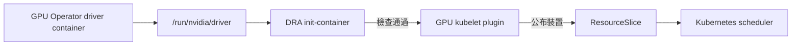

# 2.3 安裝 NVIDIA DRA Driver

## 本頁要回答的問題

GPU Operator 已經載入 driver，為什麼還要安裝 NVIDIA DRA Driver？本頁說明 DRA kubelet plugin 如何找到 driver、公布可供排程的裝置，以及安裝時各項設定的作用。完成後，應能在 GPU 節點看到就緒的 plugin，並讀懂它產生的 ResourceSlice。

## 背景原理

GPU Operator 與 DRA Driver 負責不同階段：前者準備節點上的 NVIDIA driver，後者將裝置公布給 Kubernetes。使用 driver container 時，driver 根目錄是 `/run/nvidia/driver`；DRA Pod 會掛載這個路徑，其 init-container 先檢查 `nvidia-smi` 與 NVML library，再讓 GPU kubelet plugin 啟動。[v0.5.0 driver 路徑設定](https://github.com/kubernetes-sigs/dra-driver-nvidia-gpu/blob/v0.5.0/deployments/helm/dra-driver-nvidia-gpu/values.yaml#L19-L23)、[初始化檢查](https://raw.githubusercontent.com/kubernetes-sigs/dra-driver-nvidia-gpu/v0.5.0/hack/kubelet-plugin-prestart.sh)



GPU kubelet plugin 透過 NVML 取得 GPU 資訊，再將裝置清單發布成 ResourceSlice。未啟用 DynamicMIG 的路徑以節點名稱作為 pool 名稱；原始叢集的兩個 GPU 節點各有自己的 pool。[v0.5.0 公布裝置的實作](https://github.com/kubernetes-sigs/dra-driver-nvidia-gpu/blob/v0.5.0/cmd/gpu-kubelet-plugin/driver.go#L488-L505)

## 部署與設定

### 確認 chart 來源

原始安裝使用 NGC Helm repository。先加入 repository，更新索引並確認版本；下列版本清單是當時保存的實際輸出。

```console
$ helm repo add nvidia-ngc https://helm.ngc.nvidia.com/nvidia

$ helm repo update nvidia-ngc

$ helm search repo nvidia-ngc/dra-driver-nvidia-gpu --versions
NAME                            	CHART VERSION	APP VERSION	DESCRIPTION
nvidia-ngc/dra-driver-nvidia-gpu	0.5.0        	0.5.0      	Official Helm chart for the DRA Driver for NVID...
nvidia-ngc/dra-driver-nvidia-gpu	0.4.1        	0.4.1      	Official Helm chart for the DRA Driver for NVID...
nvidia-ngc/dra-driver-nvidia-gpu	0.4.0        	0.4.0      	Official Helm chart for the DRA Driver for NVID...
```

同一份 chart 也發布在 `oci://registry.k8s.io/dra-driver-nvidia/charts/dra-driver-nvidia-gpu`。NGC 使用 repository 索引，OCI 位址則可直接交給 Helm；本頁沿用原始安裝的 NGC 命令，版本與 values 的含義相同。[v0.5.0 官方 OCI 安裝方式](https://github.com/kubernetes-sigs/dra-driver-nvidia-gpu/blob/v0.5.0/site/content/docs/install.md#L17-L35)

### 安裝命令與參數

先確認上一頁的 driver Pod 已就緒，且在 container 內執行 `nvidia-smi` 成功，再安裝 DRA Driver。`/run/nvidia/driver` 必須已有 driver 內容，否則 plugin 無法使用 NVML；v0.5.0 的 init-container 會留在初始化階段，持續檢查 driver 路徑。[v0.5.0 driver 檢查與重試](https://raw.githubusercontent.com/kubernetes-sigs/dra-driver-nvidia-gpu/v0.5.0/hack/kubelet-plugin-prestart.sh)

```console
$ helm install dra-driver-nvidia-gpu nvidia-ngc/dra-driver-nvidia-gpu \
    --version 0.5.0 \
    --namespace nvidia-dra-driver-gpu --create-namespace \
    --set nvidiaDriverRoot=/run/nvidia/driver \
    --set gpuResourcesEnabledOverride=true \
    --set featureGates.MPSSupport=true \
    --set resources.computeDomains.enabled=false
```

| 參數 | 意義 | 為什麼這樣設 |
| --- | --- | --- |
| `--version 0.5.0` | 固定 chart 與對應應用程式版本。 | 原始叢集使用這個版本，以下功能開關也以此版本為準。 |
| `--namespace nvidia-dra-driver-gpu --create-namespace` | 指定 release 所在 Namespace，必要時建立。 | 與原始安裝一致，後續命令在這裡查詢 plugin。 |
| `nvidiaDriverRoot=/run/nvidia/driver` | 設定主機上的 NVIDIA driver 根目錄；chart 預設為 `/`。 | driver 由 GPU Operator 的 driver container 提供；直接安裝在主機的 driver 才使用 `/`。 |
| `gpuResourcesEnabledOverride=true` | 明確確認要在 chart 中部署 GPU 資源。`resources.gpus.enabled` 已預設為 `true`，但未提供 override 時 chart 會拒絕安裝。 | 上一頁已用 `devicePlugin.enabled=false` 停用傳統 NVIDIA device plugin，避免同一節點有兩套 GPU 分配者。 |
| `featureGates.MPSSupport=true` | 允許 ResourceClaim 的 MPS 共用設定；此 Driver 功能為 Alpha，預設關閉。 | 原始安裝保留後續 MPS 實驗所需能力；整卡 Job 本身不會因此自動啟用 MPS。 |
| `resources.computeDomains.enabled=false` | 關閉 ComputeDomain controller 與對應 kubelet plugin container；chart 預設為 `true`。 | 本叢集的 A40 與 RTX 4090 實驗沒有使用 Multi-Node NVLink 與 IMEX 的 ComputeDomain 資源。 |

override 的檢查在 [v0.5.0 chart 驗證](https://github.com/kubernetes-sigs/dra-driver-nvidia-gpu/blob/v0.5.0/deployments/helm/dra-driver-nvidia-gpu/templates/validation.yaml#L33-L43)；資源預設值在 [values.yaml](https://github.com/kubernetes-sigs/dra-driver-nvidia-gpu/blob/v0.5.0/deployments/helm/dra-driver-nvidia-gpu/values.yaml#L79-L121)。ComputeDomain 用於 Multi-Node NVLink 的資源管理，與一般 GPU allocation 可分別啟用。[NVIDIA ComputeDomain 說明](https://docs.nvidia.com/datacenter/cloud-native/gpu-operator/26.3/dra-intro-install.html#overview)

原始紀錄未保存這次 `helm install` 的輸出，安裝結果以後面的 Pod 狀態確認。

### 等效 values 檔案

原始安裝使用上面的 `--set`。重現套件的 [dra-driver.yaml](../../labs/02-setup/values/dra-driver.yaml) 將相同設定寫成 values 檔案，內容如下；這是 Helm 輸入，不是交給 `kubectl apply` 的 Kubernetes manifest。

```console
$ vi labs/02-setup/values/dra-driver.yaml
```

```yaml
nvidiaDriverRoot: /run/nvidia/driver
gpuResourcesEnabledOverride: true
featureGates:
  MPSSupport: true
resources:
  computeDomains:
    enabled: false
```

| 參數 | 意義 | 為什麼這樣設 |
| --- | --- | --- |
| `nvidiaDriverRoot` | driver 根目錄。 | 對應原始命令的 driver container 路徑。 |
| `gpuResourcesEnabledOverride` | GPU 資源部署的確認。 | 對應原始命令已停用 device plugin 的前提。 |
| `featureGates.MPSSupport` | MPS 功能開關。 | 對應原始命令的 MPS 能力。 |
| `resources.computeDomains.enabled` | ComputeDomain 元件開關。 | 對應原始命令只部署 GPU plugin 的設定。 |

使用 values 的等效命令如下。兩種安裝方式擇一執行；已安裝的叢集直接進行後面的驗證。

```console
$ helm install dra-driver-nvidia-gpu nvidia-ngc/dra-driver-nvidia-gpu \
    --version 0.5.0 \
    --namespace nvidia-dra-driver-gpu --create-namespace \
    -f labs/02-setup/values/dra-driver.yaml
```

### 功能開關與相依關係

v0.5.0 的 `pkg/featuregates/featuregates.go` 定義下列 Driver 專屬功能開關，chart 端的設定位置為 `deployments/helm/dra-driver-nvidia-gpu/values.yaml`。表中的 Alpha 與 Beta 是 **NVIDIA DRA Driver 功能的狀態**；`featureGates: {}` 表示沿用 Driver 的各項預設值，並非把所有開關關閉。[v0.5.0 功能開關定義與預設值](https://github.com/kubernetes-sigs/dra-driver-nvidia-gpu/blob/v0.5.0/pkg/featuregates/featuregates.go#L47-L207)、[chart 的 featureGates 預設值](https://github.com/kubernetes-sigs/dra-driver-nvidia-gpu/blob/v0.5.0/deployments/helm/dra-driver-nvidia-gpu/values.yaml#L109-L121)

| 功能開關 | 預設 | 狀態 | 作用 |
| --- | --- | --- | --- |
| `TimeSlicingSettings` | `false` | Alpha | 允許自訂 time-slicing 設定。 |
| `MPSSupport` | `false` | Alpha | 允許指定 MPS 設定。 |
| `IMEXDaemonsWithDNSNames` | `true` | Beta | IMEX daemon 使用 DNS 名稱。 |
| `PassthroughSupport` | `false` | Alpha | 允許以 `vfio-pci` driver 設定 GPU。 |
| `NVMLDeviceHealthCheck` | `false` | Alpha | 使用 NVML 進行裝置健康檢查。 |
| `DynamicMIG` | `false` | Alpha | 動態管理 MIG 裝置。 |
| `ComputeDomainCliques` | `true` | Beta | 使用 ComputeDomainClique CRD 儲存 daemon 資訊。 |
| `CrashOnNVLinkFabricErrors` | `true` | Beta | 發現 NVLink fabric 錯誤時讓 plugin 結束。 |
| `DeviceMetadata` | `false` | Alpha | 在 workload 中產生已準備裝置的 metadata 檔案。 |
| `FabricManagerPartitioning` | `false` | Alpha | 管理完整 GPU 與 VFIO 裝置的 Fabric Manager partition。 |
| `HostManagedIMEXDaemon` | `false` | Alpha | 允許管理者自行管理主機上的 IMEX daemon。 |
| `DRAListTypeAttributes` | `false` | Alpha | 公布 list 型別的 DRA 裝置屬性；叢集也須啟用同名 Kubernetes 功能開關。 |
| `ConsumableShares` | `false` | Alpha | 配合 `consumableShares` 設定公布可消耗容量與多重分配能力。 |

下列配對不能同時開啟，Driver 啟動時會檢查它們。`DynamicMIG` 分別與 `PassthroughSupport`、`NVMLDeviceHealthCheck`、`MPSSupport` 互斥；`PassthroughSupport` 也與 `NVMLDeviceHealthCheck` 互斥。另外，`ComputeDomainCliques` 需要 `IMEXDaemonsWithDNSNames`，`DeviceMetadata` 需要 `PassthroughSupport`。[v0.5.0 相依與互斥檢查](https://github.com/kubernetes-sigs/dra-driver-nvidia-gpu/blob/v0.5.0/pkg/featuregates/featuregates.go#L250-L278)

`ConsumableShares` 與 `MPSSupport` 的限制發生在準備裝置時：當可消耗共用模式實際啟用，MPS 共用請求會被拒絕。這與前述啟動時的功能開關配對檢查不同。[v0.5.0 MPS 準備裝置的檢查](https://github.com/kubernetes-sigs/dra-driver-nvidia-gpu/blob/v0.5.0/cmd/gpu-kubelet-plugin/device_state.go#L1330-L1339)

## 驗證

安裝後查詢 plugin 的位置與就緒狀態。下面是原始安裝的實際輸出；只有 Pod IP 改成 `<pod-ip>`，其他欄位保留。

```console
$ kubectl -n nvidia-dra-driver-gpu get pods -o wide
NAME                                         READY   STATUS    RESTARTS   AGE   IP            NODE       NOMINATED NODE   READINESS GATES
dra-driver-nvidia-gpu-kubelet-plugin-2c86x   1/1     Running   0          14s   <pod-ip>    dra-a40    <none>           <none>
dra-driver-nvidia-gpu-kubelet-plugin-mwx8w   1/1     Running   0          14s   <pod-ip>   dra-4090   <none>           <none>
```

每個 GPU 節點各有一個 kubelet-plugin Pod，`READY 1/1` 表示 GPU container 就緒。這組設定沒有部署 ComputeDomain controller，也沒有 plugin 的 `compute-domains` container；chart 分別以 `resources.computeDomains.enabled` 決定是否產生它們。[v0.5.0 controller 條件](https://github.com/kubernetes-sigs/dra-driver-nvidia-gpu/blob/v0.5.0/deployments/helm/dra-driver-nvidia-gpu/templates/controller.yaml#L15-L21)、[kubelet-plugin 的 container 條件](https://github.com/kubernetes-sigs/dra-driver-nvidia-gpu/blob/v0.5.0/deployments/helm/dra-driver-nvidia-gpu/templates/kubeletplugin.yaml#L15-L23)

### 三種 DeviceClass

GPU 資源啟用時，chart 會建立以下三個 DeviceClass。它們都選取 `device.driver == 'gpu.nvidia.com'`，再用裝置的 `type` 屬性區分種類；class 存在只代表選取規則已註冊，實際裝置仍須由 ResourceSlice 提供。

| DeviceClass | 選取的 `type` | 意義 |
| --- | --- | --- |
| `gpu.nvidia.com` | `gpu` | 完整實體 GPU，供下一頁整卡 Job 使用。[chart 選取規則](https://github.com/kubernetes-sigs/dra-driver-nvidia-gpu/blob/v0.5.0/deployments/helm/dra-driver-nvidia-gpu/templates/deviceclass-gpu.yaml#L1-L15) |
| `mig.nvidia.com` | `mig` | MIG 裝置，須有對應的硬體與設定。[chart 選取規則](https://raw.githubusercontent.com/kubernetes-sigs/dra-driver-nvidia-gpu/v0.5.0/deployments/helm/dra-driver-nvidia-gpu/templates/deviceclass-mig.yaml) |
| `vfio.gpu.nvidia.com` | `vfio` | VFIO GPU 裝置，供直通用途使用；須啟用對應功能與設定。[chart 選取規則](https://raw.githubusercontent.com/kubernetes-sigs/dra-driver-nvidia-gpu/v0.5.0/deployments/helm/dra-driver-nvidia-gpu/templates/deviceclass-vfio-gpu.yaml) |

### 一份 A40 ResourceSlice

以下是原始叢集保存的 A40 ResourceSlice，由 JSON 轉成等價的 YAML，沒有省略欄位。它是 plugin 自動產生的裝置盤點；讀者查詢自己叢集時，名稱 suffix 與 metadata 會不同。

```yaml
apiVersion: resource.k8s.io/v1
kind: ResourceSlice
metadata:
  creationTimestamp: "2026-09-23T22:17:30Z"
  generateName: 00000-gpu.nvidia.com-dra-a40-
  generation: 1
  name: 00000-gpu.nvidia.com-dra-a40-zg5jz
  ownerReferences:
    - apiVersion: v1
      controller: true
      kind: Node
      name: dra-a40
      uid: ac9f476d-0dd5-4d44-9299-8e298602b175
  resourceVersion: "148082"
  uid: 0691d44d-afea-4643-bfc3-2875d6e2a832
spec:
  devices:
    - attributes:
        addressingMode:
          string: HMM
        architecture:
          string: Ampere
        brand:
          string: Nvidia
        cudaComputeCapability:
          version: 8.6.0
        cudaDriverVersion:
          version: 13.2.0
        driverVersion:
          version: 595.91.7
        productName:
          string: NVIDIA A40
        resource.kubernetes.io/pciBusID:
          string: 0000:0f:00.0
        resource.kubernetes.io/pcieRoot:
          string: pci0000:00
        type:
          string: gpu
        uuid:
          string: GPU-29ffee3e-bee4-e341-917a-fe7e43e977af
      capacity:
        memory:
          value: 46068Mi
      name: gpu-0
  driver: gpu.nvidia.com
  nodeName: dra-a40
  pool:
    generation: 1
    name: dra-a40
    resourceSliceCount: 1
```

下表解釋這份紀錄的所有裝置屬性與容量。GPU 與版本資訊來自 [v0.5.0 的 NVML 查詢](https://github.com/kubernetes-sigs/dra-driver-nvidia-gpu/blob/v0.5.0/cmd/gpu-kubelet-plugin/nvlib.go#L492-L565)，發布型別則由 [裝置屬性實作](https://github.com/kubernetes-sigs/dra-driver-nvidia-gpu/blob/v0.5.0/cmd/gpu-kubelet-plugin/deviceinfo.go#L168-L210) 決定。

`productName` 這類未帶 domain 的名稱，歸屬於 `spec.driver` 的 domain，因此 CEL 透過 `device.attributes["gpu.nvidia.com"].productName` 讀取。PCI 屬性保留完整的 `resource.kubernetes.io/` 前綴，因為它們採用 Kubernetes 共通定義。[Kubernetes v1.37 屬性命名規則](https://github.com/kubernetes/kubernetes/blob/v1.37.0/staging/src/k8s.io/api/resource/v1/types.go#L819-L835)

| 欄位 | 本次值 | 意義 |
| --- | --- | --- |
| `attributes.addressingMode.string` | `HMM` | NVML 回報的 GPU 記憶體定址模式。 |
| `attributes.architecture.string` | `Ampere` | GPU 架構。 |
| `attributes.brand.string` | `Nvidia` | NVML 回報的品牌分類。 |
| `attributes.cudaComputeCapability.version` | `8.6.0` | 裝置的 CUDA compute capability，以版本型別供選取規則使用。 |
| `attributes.cudaDriverVersion.version` | `13.2.0` | NVML 回報的 CUDA Driver 版本；不代表 workload image 內的 CUDA Toolkit 版本。 |
| `attributes.driverVersion.version` | `595.91.7` | 主機 NVIDIA driver 版本的語意化版本格式；安裝紀錄的字串是 `595.91.07`。 |
| `attributes.productName.string` | `NVIDIA A40` | 裝置產品名稱；下一頁依這個字串選取 GPU 型號。 |
| `attributes["resource.kubernetes.io/pciBusID"].string` | `0000:0f:00.0` | GPU 的 PCI 位址。 |
| `attributes["resource.kubernetes.io/pcieRoot"].string` | `pci0000:00` | 裝置所屬 PCIe root，用於辨識 PCIe 拓樸。 |
| `attributes.type.string` | `gpu` | 完整 GPU 類型，符合 `gpu.nvidia.com` class 的選取規則。 |
| `attributes.uuid.string` | `GPU-29ffee3e-bee4-e341-917a-fe7e43e977af` | 這張 GPU 的 UUID。 |
| `capacity.memory.value` | `46068Mi` | NVML 回報的裝置總 VRAM，以 BinarySI quantity 公布。[容量實作](https://github.com/kubernetes-sigs/dra-driver-nvidia-gpu/blob/v0.5.0/cmd/gpu-kubelet-plugin/partitions.go#L29-L42) |

`spec.driver` 指定負責裝置的 Driver，`nodeName` 指出裝置所在節點。`pool.name` 為 `dra-a40`，`pool.generation` 表示 pool 盤點世代；`resourceSliceCount: 1` 表示這一世代的 pool 由一份 ResourceSlice 組成。`devices[].name: gpu-0` 是 pool 內的裝置名稱，完整識別由 Driver、pool、device 三者構成。[Kubernetes v1.37 ResourceSlice API](https://kubernetes.io/docs/reference/kubernetes-api/resource/resource-slice-v1/)

Pod 就緒與 ResourceSlice 出現，分別證明 plugin 已啟動、裝置清單已發布。要確認 workload 真的取得 GPU，還要完成 ResourceClaim 分配與 container 內的 CUDA 呼叫；下一頁用兩個整卡 Job 驗證這條路徑。

`capacity.memory` 是裝置能力的盤點值；本頁設定沒有啟用 `ConsumableShares`，也沒有建立 MPS 共用請求。這個容量欄位本身不會替每個 container 設定 VRAM 上限，後續共用與隔離章節會分開驗證排程記帳與 runtime 限制。[v0.5.0 預設 GPU 設定](https://raw.githubusercontent.com/kubernetes-sigs/dra-driver-nvidia-gpu/v0.5.0/api/nvidia.com/resource/v1beta1/gpuconfig.go)

## 限制

本次安裝保留原始命令與 values，只有 `MPSSupport` 被明確開啟。它允許後續使用 MPS 設定，MPS control daemon 仍須由帶有 MPS 設定的 claim 在準備裝置時啟動。[v0.5.0 MPS 啟動條件](https://github.com/kubernetes-sigs/dra-driver-nvidia-gpu/blob/v0.5.0/cmd/gpu-kubelet-plugin/device_state.go#L1330-L1347)

原始命令沒有設定 `kubeletPlugin.nodeSelector`；plugin 的節點選擇沿用 chart 對 NFD 與 `nvidia.com/gpu.present` 的預設 affinity。NVIDIA 的 Driver Manager 驅逐協調說明則要求 DRA nodeSelector 也使用 `nvidia.com/dra-kubelet-plugin` label，因此本頁的安裝就緒紀錄不足以確認升級時的自動驅逐行為。[v0.5.0 預設 affinity](https://github.com/kubernetes-sigs/dra-driver-nvidia-gpu/blob/v0.5.0/deployments/helm/dra-driver-nvidia-gpu/values.yaml#L319-L352)、[NVIDIA 驅逐協調要求](https://docs.nvidia.com/datacenter/cloud-native/gpu-operator/26.3/dra-intro-install.html#prerequisites)

## 重點整理

- GPU Operator 的 driver container 就緒後，DRA init-container 才能完成 driver 檢查。
- 停用傳統 device plugin 後，再以 override 明確確認 GPU 資源部署。
- 本次只部署 GPU kubelet plugin；DeviceClass 定義選取規則，ResourceSlice 提供實際裝置。
- 功能開關有預設值、相依與互斥關係；MPS 與可消耗共用模式也有準備裝置時的限制。

<!-- nav:start -->
[← 上一頁：2.2 安裝 GPU Operator](gpu-operator.md) ｜ [目錄](../README.md) ｜ [下一頁：2.4 驗證與第一個 GPU Job →](verify.md)
<!-- nav:end -->
