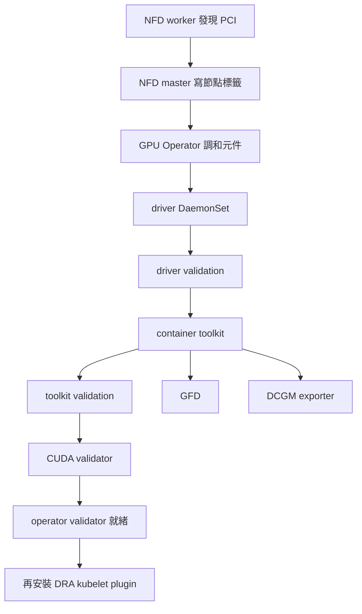

# 2.2 安裝 GPU Operator

## 本頁要回答的問題

GPU Operator 到底安裝哪些東西，為什麼 GPU 已直通卻不能直接跑 CUDA Pod？本頁沿用本次容器安裝驅動的方式，先建立 host 驅動與容器執行期的條件，再把 GPU 分配交給下一頁的 NVIDIA DRA Driver。

## 背景原理

GPU Operator 維持各 GPU 元件的期望狀態；NFD 先找硬體並標示節點，Operator 再把 DaemonSet 放到 GPU 節點。driver 提供 kernel 模組和使用者空間函式庫，toolkit 把容器執行期接到 NVIDIA GPU；validator 用逐段檢查確認這條路徑。[GPU Operator 元件介紹](https://docs.nvidia.com/datacenter/cloud-native/gpu-operator/index.html)



箭頭表示依賴與本頁的驗證順序，不表示所有 Pod 必須逐個建立。Operator 可以先建立它們，但 init container 會等待前面的就緒條件；這也是初次安裝時看到 `Init` 的原因。[v26.7.0 validator 的 init 順序](https://github.com/NVIDIA/gpu-operator/blob/v26.7.0/assets/state-operator-validation/0500_daemonset.yaml)

## 部署與設定

### 標示 DRA 節點

在能管理叢集的命令列執行以下命令。這個標籤同時是後面 Driver Manager 環境變數指定的節點標籤名稱；它與 NFD 的 PCI 硬體標籤用途不同。

```console
$ kubectl label node dra-4090 dra-a40 nvidia.com/dra-kubelet-plugin=true
```

| 參數 | 意義 | 為什麼這樣設 |
| --- | --- | --- |
| `dra-4090 dra-a40` | 要安裝 GPU 驅動及 DRA plugin 的節點 | CPU 節點不需要 GPU 元件 |
| `nvidia.com/dra-kubelet-plugin=true` | DRA plugin 的維運協調標籤 | 對應 Driver Manager 的自訂 GPU Pod eviction 標籤 |

原指南用這個標籤告知 Driver Manager 在驅動維護期間需要協調 DRA plugin。官方舊版獨立安裝範例還把同一標籤放進 DRA chart 的 `kubeletPlugin.nodeSelector`，讓標籤暫停時 plugin 也會離開節點；本頁保留的原安裝命令沒有這項 selector，因此不能僅憑貼標籤就宣稱驅動升級時一定正確驅逐、再啟動 plugin。[GPU Operator 26.3 的獨立 DRA 安裝範例](https://docs.nvidia.com/datacenter/cloud-native/gpu-operator/26.3/dra-intro-install.html)

### 使用原本的 Helm 參數

先完成[節點準備](node-prep.md)，以下命令使用 Bash。原安裝以 `--set` 傳入所有自訂值，並保留本次已使用的 repo 與版本。

```console
$ helm repo add nvidia https://nvidia.github.io/gpu-operator

$ helm repo update

$ helm upgrade --install gpu-operator nvidia/gpu-operator \
    --version v26.7.0 \
    --create-namespace --namespace gpu-operator \
    --set devicePlugin.enabled=false \
    --set driver.enabled=true \
    --set driver.manager.env[0].name=NODE_LABEL_FOR_GPU_POD_EVICTION \
    --set driver.manager.env[0].value="nvidia.com/dra-kubelet-plugin"
```

| 參數 | 意義 | 為什麼這樣設 |
| --- | --- | --- |
| `--version v26.7.0` | 固定 GPU Operator chart | 對應本次部署證據 |
| `--create-namespace --namespace gpu-operator` | 建立並使用元件 Namespace | 與實際 Pod 清單一致 |
| `devicePlugin.enabled=false` | 不部署傳統 NVIDIA device plugin | 後續由 DRA 管理這些 GPU，避免重複分配 |
| `driver.enabled=true` | 由 Operator 的容器安裝驅動 | host 不另外安裝 NVIDIA 套件 |
| `driver.manager.env[0].name` | 自訂 Driver Manager 的環境變數名稱 | 指定 `NODE_LABEL_FOR_GPU_POD_EVICTION` |
| `driver.manager.env[0].value` | Driver Manager 參考的節點標籤鍵 | 對應前一步的 `nvidia.com/dra-kubelet-plugin` |

DRA v0.5.0 chart 要求明確確認 GPU 分配與 NVIDIA device plugin、MIG 管理的互斥關係；因此這裡先把 device plugin 關掉，下一頁再啟動 DRA。[v0.5.0 chart 安裝檢查](https://github.com/kubernetes-sigs/dra-driver-nvidia-gpu/blob/v0.5.0/deployments/helm/dra-driver-nvidia-gpu/templates/validation.yaml)

這組 `v26.7.0` 命令使用 ClusterPolicy 加獨立 DRA Helm release。現行 [26.7 安裝說明](https://docs.nvidia.com/datacenter/cloud-native/gpu-operator/26.7/dra-intro-install.html) 已改寫為 `v26.7.1` 的 GPUCluster 管理方式；不要混用其中的命令、namespace 或 eviction 保證。原安裝的 driver 維護協調限制見 [DRA Driver](dra-driver.md#限制)。

### 等價的 values 檔

以下是 [gpu-operator.yaml](../../labs/02-setup/values/gpu-operator.yaml) 的完整內容，**等價於上面的四個 `--set` 設定**。原實機安裝使用 `--set`；復現套件則使用 values 檔，方便逐項核對。

```console
$ vi labs/02-setup/values/gpu-operator.yaml
```

```yaml
devicePlugin:
  enabled: false
driver:
  enabled: true
  manager:
    env:
      - name: NODE_LABEL_FOR_GPU_POD_EVICTION
        value: nvidia.com/dra-kubelet-plugin
```

| 參數 | 意義 | 為什麼這樣設 |
| --- | --- | --- |
| `devicePlugin.enabled` | 傳統 device plugin 的開關 | 保持 `false` |
| `driver.enabled` | 容器驅動的開關 | 保持 `true` |
| `driver.manager.env` | 原環境變數陣列 | 保留同一名稱和值，不增加別的 chart 覆寫 |

這是 Helm values，不能以 `kubectl apply` 部署。使用 `helm upgrade --install` 的相同 chart、version、release、namespace，並以 `-f labs/02-setup/values/gpu-operator.yaml` 取代那四個 `--set` 即可；完整的新叢集安裝命令由 [install.sh](../../labs/02-setup/scripts/install.sh) 編排。

### 各元件的責任

| 元件 | 做什麼 | 本次出現的位置與等待條件 |
| --- | --- | --- |
| GPU Operator | 依 ClusterPolicy 調和 operand | 本次 Pod 在 dra-m1；不等於 GPU 的分配器 |
| NFD master | 接受節點硬體發現並更新標籤 | 本次在 dra-m1 |
| NFD worker | 掃描該節點硬體 | 四台節點都有，不只 GPU 節點 |
| NFD gc | 清理失效節點的 NFD 資源 | 本次在 dra-non；不是每台各一個 |
| GFD | 發布 NVIDIA GPU 型號等節點特徵 | 兩台 GPU 節點，等待 toolkit-ready |
| container toolkit | 設定 GPU 容器執行期整合 | 兩台 GPU 節點，先等 driver validation |
| driver DaemonSet | 編譯並載入 NVIDIA 驅動 | 兩台 GPU 節點，依賴本頁前的 host 準備 |
| CUDA validator | 執行一次性的 CUDA 測試 | `Completed` 是驗證成功，不能要求它永遠 Running |
| operator validator | 依序檢查 driver、toolkit、CUDA 等條件 | init container 全部通過才 Ready |
| DCGM exporter | 匯出 GPU 遙測指標 | 兩台 GPU 節點，需 driver 與 toolkit 就緒 |

NFD 元件分工可見 [NFD 架構](https://kubernetes-sigs.github.io/node-feature-discovery/master/get-started/introduction.html)；Operator、toolkit 和監測的角色則見 [Operator 元件](https://docs.nvidia.com/datacenter/cloud-native/gpu-operator/index.html)。表中的節點位置是本次快照，不是 chart 保證的固定位置；GFD 標籤與 ResourceSlice 的裝置屬性也不是同一份 API。

## 驗證

### 讀取 Pod 狀態

初次啟動時 driver 容器會下載 headers 並編譯。本次安裝後的實際清單如下，沒有截短：

```console
$ kubectl -n gpu-operator get po
NAME                                                          READY   STATUS      RESTARTS        AGE
gpu-feature-discovery-nc97m                                   1/1     Running     0               16m
gpu-feature-discovery-rm225                                   1/1     Running     0               16m
gpu-operator-7d958d78d9-dj5tb                                 1/1     Running     0               17m
gpu-operator-node-feature-discovery-gc-86d8ddb99b-nksws       1/1     Running     0               17m
gpu-operator-node-feature-discovery-master-775f5ccccc-pxssm   1/1     Running     0               17m
gpu-operator-node-feature-discovery-worker-46dhb              1/1     Running     1               17m
gpu-operator-node-feature-discovery-worker-8h7pm              1/1     Running     1               17m
gpu-operator-node-feature-discovery-worker-8hgfg              1/1     Running     0               17m
gpu-operator-node-feature-discovery-worker-q2z64              1/1     Running     0               17m
nvidia-container-toolkit-daemonset-8gwnq                      1/1     Running     0               16m
nvidia-container-toolkit-daemonset-g9xf6                      1/1     Running     0               16m
nvidia-cuda-validator-vr5h8                                   0/1     Completed   0               3m13s
nvidia-cuda-validator-wv9ph                                   0/1     Completed   0               28s
nvidia-dcgm-exporter-bsgsg                                    0/1     Running     0               16m
nvidia-dcgm-exporter-rr4z7                                    1/1     Running     0               16m
nvidia-driver-daemonset-6r9lr                                 1/1     Running     8 (3m8s ago)    16m
nvidia-driver-daemonset-sw8w9                                 1/1     Running     7 (8m59s ago)   16m
nvidia-operator-validator-2kzr6                               1/1     Running     0               16m
nvidia-operator-validator-chnvh                               1/1     Running     0               16m
```

這個快照不是所有服務已 Ready 的最終畫面：`nvidia-dcgm-exporter-bsgsg` 是 `0/1 Running`，表示行程正在執行，尚未通過 readiness。兩個 `nvidia-cuda-validator` 是 `0/1 Completed`，則代表一次性的 CUDA 驗證已完成；等待部署時應接受這種成功終止狀態。

driver Pod 的 `RESTARTS` 為八次與七次，是指南記錄的舊 kernel headers 問題，不是整卡 DRA 的正常重啟頻率。安裝前先完成 kernel 準備，可避開這個已知失敗原因；若現在仍增加，按[疑難排解](troubleshooting.md)讀前一次容器 log。NFD worker 的重啟也留在實際輸出中，但來源沒有逐一確認它們的原因。

### 在 driver Pod 內確認驅動

Pod 名稱尾碼是本次快照，重新部署會不同。先用當前清單辨識兩台節點對應的 driver Pod；下列原命令與輸出分別確認 4090 和 A40 的驅動已載入。

```console
$ kubectl -n gpu-operator exec -it nvidia-driver-daemonset-6r9lr -- nvidia-smi
+-----------------------------------------------------------------------------------------+
| NVIDIA-SMI 595.91.07              Driver Version: 595.91.07      CUDA Version: 13.2     |
+-----------------------------------------+------------------------+----------------------+
| GPU  Name                 Persistence-M | Bus-Id          Disp.A | Volatile Uncorr. ECC |
| Fan  Temp   Perf          Pwr:Usage/Cap |           Memory-Usage | GPU-Util  Compute M. |
|                                         |                        |               MIG M. |
|=========================================+========================+======================|
|   0  NVIDIA GeForce RTX 4090        On  |   00000000:0E:00.0 Off |                  Off |
|  0%   30C    P8             31W /  450W |       1MiB /  24564MiB |      0%      Default |
|                                         |                        |                  N/A |
+-----------------------------------------+------------------------+----------------------+
```

```console
$ kubectl -n gpu-operator exec -it nvidia-driver-daemonset-sw8w9 -- nvidia-smi
+-----------------------------------------------------------------------------------------+
| NVIDIA-SMI 595.91.07              Driver Version: 595.91.07      CUDA Version: 13.2     |
+-----------------------------------------+------------------------+----------------------+
| GPU  Name                 Persistence-M | Bus-Id          Disp.A | Volatile Uncorr. ECC |
| Fan  Temp   Perf          Pwr:Usage/Cap |           Memory-Usage | GPU-Util  Compute M. |
|                                         |                        |               MIG M. |
|=========================================+========================+======================|
|   0  NVIDIA A40                     On  |   00000000:0F:00.0 Off |                    0 |
|  0%   37C    P8             33W /  300W |       0MiB /  46068MiB |      0%      Default |
|                                         |                        |                  N/A |
+-----------------------------------------+------------------------+----------------------+
```

| 參數 | 意義 | 為什麼這樣設 |
| --- | --- | --- |
| `-n gpu-operator` | driver Pod 的 Namespace | 不需 SSH 執行 nvidia-smi |
| `exec -it ... -- nvidia-smi` | 在驅動容器內執行 GPU 工具 | 使用 driver 提供的執行環境 |
| `Driver Version` | 目前載入的驅動版本 | 本次是 `595.91.07` |
| `CUDA Version` | 驅動宣告的 CUDA 相容能力 | `13.2` 不代表每個 workload 都安裝了 CUDA 13.2 |

CUDA driver 與 CUDA runtime 的版本可不同，本次 PyTorch 映像檔使用 CUDA 12.4；這裡不應把 nvidia-smi 的 `CUDA Version` 當成容器內的 toolkit 版本。[nvidia-smi 欄位定義](https://docs.nvidia.com/deploy/nvidia-smi/index.html)、[NVIDIA CUDA 相容性](https://docs.nvidia.com/deploy/cuda-compatibility/minor-version-compatibility.html)

繼續安裝前，應確認長時間服務的 Pod 都通過 Ready、CUDA validator 成功 Completed，且兩台 driver Pod 的 `nvidia-smi` 都成功。此時 host 驅動與容器整合才算完成；下一頁再安裝 kubelet plugin 並檢查 ResourceSlice，確認 GPU 已透過 DRA 對排程器發布。

`Running`、`Ready`、`Completed` 要連同元件用途判讀。DCGM exporter 的 `Running` 不足以當作就緒條件，CUDA validator 的 `Completed` 卻正是成功條件；本次的安裝與唯讀驗證腳本以這個區分等待。

## 重點整理

- GPU Operator 準備驅動、容器整合和驗證；DRA 負責後續裝置發布與分配。
- 保留 `devicePlugin.enabled=false`，不要把同一組 GPU 同時交給兩種分配器。
- 先完成 driver 與 toolkit 的就緒檢查，再安裝指向 `/run/nvidia/driver` 的 DRA plugin。

<!-- nav:start -->
[← 上一頁：2.1 GPU 節點準備](node-prep.md) ｜ [目錄](../README.md) ｜ [下一頁：2.3 安裝 NVIDIA DRA Driver →](dra-driver.md)
<!-- nav:end -->
