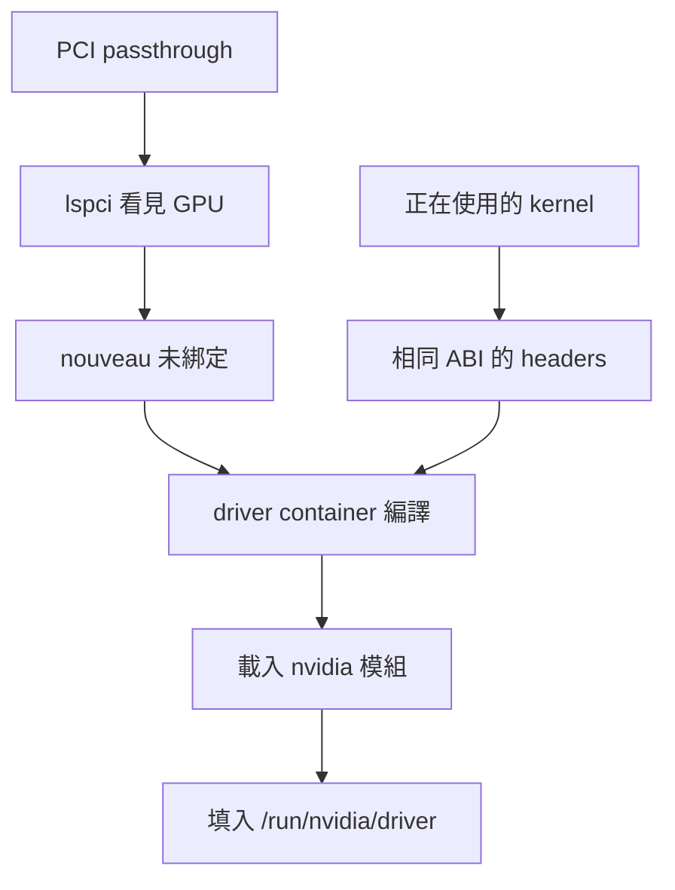

# 2.1 GPU 節點準備

## 本頁要回答的問題

GPU 已直通進 VM，為什麼 driver container 仍可能啟動失敗？本頁把硬體可見、kernel module 綁定和可取得的 kernel headers 分開檢查，讓 GPU Operator 啟動時有完整的編譯條件。以下主機命令只在 `dra-a40`、`dra-4090` 執行；`kubectl drain` 與 `uncordon` 則在能管理叢集的命令列執行。

## 背景原理

GPU Operator 以 container 安裝本次的 NVIDIA driver，並把 driver 模組載入節點正在使用的 kernel。Container 自己的檔案系統無法取代主機的 kernel；因此它要取得與 `uname -r` 完全一致的 headers，才能編譯相符模組。這是本次一般 driver container 的條件；不要把它延伸成所有預先編譯 driver image 都會現場編譯。[一般與預先編譯 driver container](https://docs.nvidia.com/datacenter/cloud-native/gpu-operator/latest/precompiled-drivers.html)



## 部署與設定

### 確認硬體可見

先檢查 4090 的顯示與音訊功能，以及 A40 的 3D controller。以下是原環境的實際輸出；VM 內看到的 PCI bus 編號由直通後的虛擬 PCI 拓撲決定，不必與實體主機相同。

```console
# 在 dra-4090 上執行
$ lspci -nnk | grep -A3 -i nvidia
0e:00.0 VGA compatible controller [0300]: NVIDIA Corporation AD102 [GeForce RTX 4090] [10de:2684] (rev a1)
	Subsystem: Micro-Star International Co., Ltd. [MSI] AD102 [GeForce RTX 4090] [1462:5102]
	Kernel modules: nvidiafb
0f:00.0 Audio device [0403]: NVIDIA Corporation AD102 High Definition Audio Controller [10de:22ba] (rev a1)
	Subsystem: Micro-Star International Co., Ltd. [MSI] AD102 High Definition Audio Controller [1462:5102]
```

```console
# 在 dra-a40 上執行
$ lspci -nnk | grep -A3 -i nvidia
0f:00.0 3D controller [0302]: NVIDIA Corporation GA102GL [A40] [10de:2235] (rev a1)
	Subsystem: NVIDIA Corporation GA102GL [A40] [10de:145a]
	Kernel modules: nvidiafb
```

| 參數 | 意義 | 為什麼這樣設 |
| --- | --- | --- |
| `lspci -nnk` | 列出 PCI 裝置、數字識別碼與 kernel driver 資訊 | 同時確認 GPU 型號和目前綁定情況 |
| `grep -A3 -i nvidia` | 找 NVIDIA，連同後續資訊列印 | 保留 subsystem 和 kernel 模組資訊 |
| `VGA compatible controller` 與 `Audio device` | 4090 的 GPU 與音訊 PCI function | 本次兩個功能一起直通 |
| `3D controller` | A40 的 GPU function | 沒有桌面顯示功能仍可做 CUDA 運算 |

這兩段沒有 `Kernel driver in use:`，表示這次檢查時尚無 driver 綁定 GPU。`Kernel modules: nvidiafb` 只列候選模組，不能據此說 NVIDIA CUDA driver 已載入；本次沒有列出 `nouveau`。[lspci 選項](https://manpages.ubuntu.com/manpages/noble/man8/lspci.8.html)

### 停用 nouveau

`nouveau` 和 NVIDIA driver 可能競爭同一張 PCI 裝置。即使目前沒有載入，後續 kernel 套件可能把它帶進來，所以先建立 blacklist，再更新 initramfs。這是本次指南已使用的主機設定；driver 尚未裝好前，先完成兩台 GPU 節點。

```console
$ sudo tee /etc/modprobe.d/blacklist-nouveau.conf > /dev/null <<'EOF'
blacklist nouveau
options nouveau modeset=0
EOF
```

| 參數 | 意義 | 為什麼這樣設 |
| --- | --- | --- |
| `blacklist nouveau` | 不讓模組別名自動載入 nouveau | 避免先綁定 GPU |
| `options nouveau modeset=0` | 停用 nouveau 的 modesetting | 避免開機階段啟用它 |
| `tee ... > /dev/null` | 寫入有權限限制的設定檔 | 以 `sudo` 寫檔，省略重複回顯 |

NVIDIA 的疑難排解也把已載入 nouveau 列為阻礙 driver 就緒的原因。[GPU Operator 疑難排解](https://docs.nvidia.com/datacenter/cloud-native/gpu-operator/26.3/troubleshooting.html#gpu-operator-pods-are-stuck-in-init)

### 核對 headers 是否仍可下載

先更新套件索引，再檢查正在使用的 kernel。以下實際輸出中的 `Installed` 與 `Candidate` 看似相同，卻只列 `/var/lib/dpkg/status`；那只是主機已安裝套件的紀錄，不能證明 driver container 可以從 archive 下載同一 ABI 的 headers。

```console
$ sudo apt update
$ apt-cache policy linux-headers-$(uname -r)
linux-headers-6.8.0-90-generic:
  Installed: 6.8.0-90.91
  Candidate: 6.8.0-90.91
  Version table:
 *** 6.8.0-90.91 100
        100 /var/lib/dpkg/status
```

| 參數 | 意義 | 為什麼這樣設 |
| --- | --- | --- |
| `sudo apt update` | 更新可用套件索引 | 避免用舊索引判斷可下載版本 |
| `linux-headers-$(uname -r)` | 目前 kernel 的完整版本與 flavor | 編譯目標必須與主機 kernel 相同 |
| `apt-cache policy` | 顯示已安裝與可下載來源 | 要看到 archive 來源，不能只看到本地狀態 |

在這次舊 kernel 的情況下，查到的新 headers 如下。這是當時的索引快照，不代表以後永遠只有這幾個 ABI；應以你自己的套件來源為準。

```console
$ apt-cache search --names-only '^linux-headers-6\.8\.0-[0-9]+-generic$' | sort -V | tail -3
linux-headers-6.8.0-138-generic - Linux kernel headers for version 6.8.0 on 64 bit x86 SMP
linux-headers-6.8.0-139-generic - Linux kernel headers for version 6.8.0 on 64 bit x86 SMP
linux-headers-6.8.0-142-generic - Linux kernel headers for version 6.8.0 on 64 bit x86 SMP
```

### 只升級原有 kernel meta 套件

先識別原本使用的 meta 套件，再確認 Kubernetes 套件已 hold。這次不做 `full-upgrade`，以免把 kubelet、CRI-O 等叢集元件一起改版；`linux-virtual` 與 `linux-generic` 應按原安裝選擇，不能隨手互換。

```console
$ apt list --installed 2>/dev/null | grep -E '^linux-(generic|virtual|image-generic|image-virtual)[/-]'
```

```console
$ apt-mark showhold
```

如果沒有列出 `kubelet`、`kubeadm`、`kubectl`，先執行指南中的 hold 命令。這個命令沒有留存輸出。

```console
$ sudo apt-mark hold kubelet kubeadm kubectl
```

以下以原本已安裝 `linux-virtual` 為例；若前一步列的是 `linux-generic`，使用相同的原有 meta 套件。若沒有任何 kernel meta 套件，指南使用 `sudo apt install -y linux-virtual` 建立後續更新的依賴關係。

```console
$ sudo apt install --only-upgrade -y linux-virtual
```

```console
$ sudo apt install -y linux-virtual
```

| 參數 | 意義 | 為什麼這樣設 |
| --- | --- | --- |
| `--only-upgrade` | 只更新已安裝的指定套件 | 沿用原 kernel meta 套件 |
| `linux-virtual` | VM 的 kernel meta 套件 | 本次採用的精簡 kernel 路徑 |
| `apt-mark hold` | 防止指定 kube 套件被一般更新帶動 | 維持既有的 Kubernetes 版本 |
| `-y` | 接受 apt 的套件確認 | 保留原命令的非互動用法 |

`linux-generic` 可能帶入 `linux-modules-extra`，其中包含 nouveau；因此 blacklist 不能只因現在看不到模組而省略。把它套用到所有已安裝 kernel 的 initramfs：

```console
$ sudo update-initramfs -u -k all
```

| 參數 | 意義 | 為什麼這樣設 |
| --- | --- | --- |
| `-u` | 更新既有 initramfs | 納入新的模組設定 |
| `-k all` | 處理所有已安裝 kernel | 避免開到另一個 kernel 時漏掉 blacklist |

### Drain 與重新開機

每次只處理一台 GPU 節點。`drain` 先停止新排程並驅逐一般 Pod，DaemonSet 留在節點上；`--delete-emptydir-data` 允許刪除 Pod 的暫存資料，執行前要知道節點上有哪些工作。[安全 drain 節點](https://kubernetes.io/docs/tasks/administer-cluster/safely-drain-node/)

```console
# 在 dra-m1 上執行
$ kubectl drain dra-a40 --ignore-daemonsets --delete-emptydir-data
```

```console
# 在 dra-a40 上執行
$ sudo reboot
```

| 參數 | 意義 | 為什麼這樣設 |
| --- | --- | --- |
| `dra-a40` | 本次逐台維護的目標 | 先完成一台，再對 dra-4090 重複 |
| `--ignore-daemonsets` | 不要求移除 DaemonSet Pod | 讓節點維運流程可繼續 |
| `--delete-emptydir-data` | 允許刪除 emptyDir 資料 | 原環境採用的 drain 條件 |

## 驗證

重新開機後，在 GPU 節點檢查 kernel、headers 來源及 nouveau；以下命令沒有留存一組連續的成功輸出，因此只列驗證方式。

```console
$ uname -r
$ apt-cache policy linux-headers-$(uname -r)
$ lsmod | grep nouveau
```

`lsmod | grep nouveau` 沒有輸出是這裡希望看到的結果；此時 grep 的非零 exit code 表示沒有符合項目，不是安裝失敗。確認節點回到 `Ready`，再恢復排程。

```console
# 在 dra-m1 上執行
$ kubectl uncordon dra-a40
```

對 `dra-4090` 重複相同流程，並把 drain、uncordon 的節點名換成 `dra-4090`。

### 通過條件

| 檢查 | 通過條件 |
| --- | --- |
| `lspci` | VM 看見對應 GPU，4090 同時看見音訊 function |
| `uname -r` | 正在使用 archive 仍可提供 headers 的 kernel |
| `apt-cache policy` | Version table 有 `archive.ubuntu.com`、`security.ubuntu.com` 或對應鏡站來源 |
| `lsmod` | 沒有已載入的 nouveau |
| Kubernetes Node | 重新開機後 `Ready`，uncordon 後可排程 |

本次 GPU 節點後來的實機快照是 `6.8.0-142-generic`，仍屬 GA 6.8 系列；它不是讀者應永久釘住的最新 ABI。原環境使用 Cilium netkit，需 kernel 至少 6.8；可對照 [Cilium netkit 條件](https://docs.cilium.io/en/stable/operations/performance/tuning/#netkit-mode)。

在主機已裝 headers，與 driver container 能下載 headers，是不同條件。這次失敗的重點正是 kernel 仍停留在舊 ABI，而新啟動的 driver container 只能使用當下的套件索引；升級後必須真正重新開機，`apt install` 本身不會替換正在使用的 kernel。

之後 unattended-upgrades 若安裝新 kernel，仍要安排重新開機與上述驗證；舊 kernel 對應 headers 何時停止提供，取決於當下的 archive 或鏡站。先在兩台 GPU 節點完成本頁，再依 [GPU Operator](gpu-operator.md) 的順序安裝；headers 找不到的原始錯誤見[疑難排解](troubleshooting.md#找不到-kernel-headers)。

## 重點整理

- 先確認 PCI 裝置，再檢查 driver 綁定，最後才是 container 內的 driver 工具。
- Headers 的 ABI 與 flavor 必須匹配正在使用的 kernel，並且可以從 archive 取得。
- 沿用原有 kernel meta 套件，hold kube 套件，更新 initramfs 後逐台 drain、重新開機、驗證、uncordon。

<!-- nav:start -->
[← 上一頁：第 2 章　部署 GPU Operator 與 NVIDIA DRA Driver](README.md) ｜ [目錄](../README.md) ｜ [下一頁：2.2 安裝 GPU Operator →](gpu-operator.md)
<!-- nav:end -->
