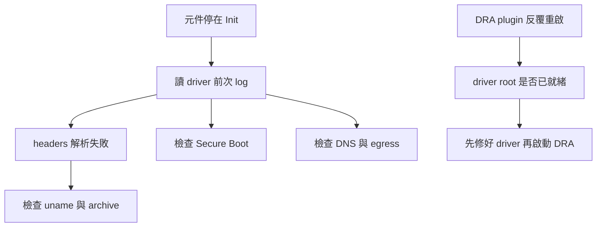

# 2.5 疑難排解

## 本頁要回答的問題

當多個 GPU Pod 卡住時，應從哪一層開始排查？本頁先保留本次確實遇到的 kernel headers 失敗，再說明指南中的 driver-root、Secure Boot 和 egress 檢查；沒有實際 log 的情況會明確區分，不把可能原因當成已重現的事故。

## 背景原理

其他元件的 `Init` 通常只是等待上游。先判斷 driver 是否已編譯、載入，再檢查 toolkit 和 DRA 能否找到驅動函式庫，比逐一重啟所有 Pod 更容易定位故障。[GPU Operator 的 Init 排查](https://docs.nvidia.com/datacenter/cloud-native/gpu-operator/26.3/troubleshooting.html#gpu-operator-pods-are-stuck-in-init)



## 部署與設定

排查前先取得當前 Pod 名稱，並辨識它所在的節點。本頁的 `<nvidia-driver-daemonset-pod>`、`<kubelet-plugin-pod>` 必須換成實際名稱再執行；不要連同角括號貼進 shell。

## 驗證

### 找不到 kernel headers

本次症狀是 `nvidia-driver-daemonset` 反覆重啟，其餘元件停在 `Init`。以下保留指南中的完整錯誤輸出：

```console
$ kubectl -n gpu-operator logs <nvidia-driver-daemonset-pod> -c nvidia-driver-ctr
========== NVIDIA Software Installer ==========

Starting installation of NVIDIA driver version 595.91.07 for Linux kernel version 6.8.0-90-generic

Unloading NVIDIA driver kernel modules...
Unmounting NVIDIA driver rootfs...
Updating the package cache...
Resolving Linux kernel version...
Unloading NVIDIA driver kernel modules...
Unmounting NVIDIA driver rootfs...
Could not resolve Linux kernel version
```

| 參數 | 意義 | 為什麼這樣設 |
| --- | --- | --- |
| `logs <...> -c nvidia-driver-ctr` | 讀指定 driver 容器的 log | 避免讀到 init container 或其他元件 |
| `595.91.07` | 這次準備安裝的驅動 | 與部署版本相同 |
| `6.8.0-90-generic` | 失敗時正在使用的 kernel | 對應 headers 已無可下載的 archive 來源 |

這次錯誤出現在 `Resolving Linux kernel version`，還沒進到載入 NVIDIA 模組的階段。依[核對 headers](node-prep.md#核對-headers-是否仍可下載)及[只升級原有 kernel meta 套件](node-prep.md#只升級原有-kernel-meta-套件)，檢查來源、更新 kernel、更新 initramfs、逐台 drain 和重新開機，最後驗證與 uncordon。

節點回來後 DaemonSet 會再嘗試啟動 driver Pod。若要讀上一次容器的錯誤，可執行以下額外的唯讀命令；本頁沒有另存其輸出。

```console
$ kubectl -n gpu-operator logs <nvidia-driver-daemonset-pod> -c nvidia-driver-ctr --previous
```

指南也提到修好 kernel 後，可以刪除單一失敗 driver Pod，讓 DaemonSet 重建以縮短 backoff 等待。它不是根因修復；在 host 尚未修好時重建，仍會遇到相同錯誤。

### DRA 先於 driver root 啟動

指南記錄的安裝順序警告是：`nvidiaDriverRoot=/run/nvidia/driver` 要等驅動容器成功後才有可用內容；過早安裝可能使 plugin 找不到 NVML 而反覆重啟。來源沒有留存這個情況的實際錯誤 log，本頁因此不提供偽造的 NVML CrashLoopBackOff 輸出。[v0.5.0 driver root 設定](https://github.com/kubernetes-sigs/dra-driver-nvidia-gpu/blob/v0.5.0/deployments/helm/dra-driver-nvidia-gpu/values.yaml)

```console
$ kubectl -n nvidia-dra-driver-gpu get pods -o wide
$ kubectl -n nvidia-dra-driver-gpu logs <kubelet-plugin-pod> --all-containers=true --previous
```

先依 [GPU Operator 驗證](gpu-operator.md#在-driver-pod-內確認驅動)，確認兩台 driver 的 nvidia-smi 成功，再檢查 DRA release 的 `nvidiaDriverRoot` 是否與容器驅動位置相符。不要把尚未建立的目錄問題，誤認成 ResourceClaim 的 CEL 表達式錯誤。

### Secure Boot

指南提供的 host 檢查命令是 `mokutil --sb-state`。若它顯示 `EFI variables are not supported`，該 VM 的開機方式沒有可用的 EFI Secure Boot 狀態；若有啟用 Secure Boot，應檢查模組簽章與 kernel log，指南指出可能見到 `Key was rejected by service`。這些是診斷條件，來源沒有記錄本次由 Secure Boot 導致失敗。[Ubuntu Secure Boot 與模組簽章](https://documentation.ubuntu.com/security/security-features/platform-protections/secure-boot/)

```console
$ mokutil --sb-state
```

### DNS 與 egress

驅動容器需要取得套件索引與 headers。指南使用下列一次性的 busybox Pod 檢查 DNS 和 HTTP egress；保留原命令，結束時 `--rm` 會移除診斷 Pod。

```console
$ kubectl run nettest --rm -it --image=busybox:1.36 --restart=Never -- \
    sh -c 'nslookup archive.ubuntu.com && wget -q -T5 -O /dev/null http://archive.ubuntu.com/ubuntu/ && echo EGRESS_OK'
```

| 參數 | 意義 | 為什麼這樣設 |
| --- | --- | --- |
| `busybox:1.36` | 原指南的網路診斷映像檔 | 執行 nslookup 與 wget，不是 GPU workload |
| `--rm -it --restart=Never` | 一次性互動 Pod | 完成後刪除，不建立反覆重啟工作 |
| `nslookup archive.ubuntu.com` | 檢查套件站的 DNS | 排除名稱解析失敗 |
| `wget -q -T5 -O /dev/null` | 限時讀取套件站 HTTP | 檢查基本 egress，不保留下載內容 |
| `&& echo EGRESS_OK` | 前兩項成功才印出標記 | 避免只憑 Pod 能啟動就判斷網路通過 |

（預期輸出；指南沒有留存該診斷 Pod 的完整輸出，DNS 明細省略）

```text
...
EGRESS_OK
```

指南另以 dmesg 是否出現 `NVRM` 判斷 driver 是否已進到模組載入階段。這個線索應與 driver log 一起使用；沒有 `NVRM` 不是對所有 kernel log 設定都適用的充分證明。

busybox 的 DNS／HTTP 成功只能排除該 Pod 的基本連線問題，不能替每個 image registry、apt 鏡站或驅動容器的所有網路路徑做保證。

### 排查順序

| 症狀或檢查 | 本次可核對的結果 | 下一步 |
| --- | --- | --- |
| `Could not resolve Linux kernel version` | 實際 driver log，舊 kernel headers 不在可用索引 | 修正 host kernel 和 archive 條件 |
| 其他元件 `Init` | 原安裝清單及指南描述 | 先查 driver，等待其完成 |
| DRA 找不到 NVML | 只有安裝順序警告，沒有實際 trace | 檢查 driver root 與 driver 就緒狀態 |
| Secure Boot 或 egress | 只有排查命令與判讀條件 | 用當前環境結果判斷，不能當作本次事故 |

本次已證實的根因是 kernel 與可下載 headers 不匹配。GPU Operator 清單中的重啟次數是這段失敗歷史；安裝成功後仍要重新檢查 Ready 與 nvidia-smi，不能只看總重啟次數是否歸零。

## 重點整理

- 先讀 driver log，沿 driver、toolkit、DRA 的依賴方向查問題。
- 本次 headers 錯誤需要更新並真正重新開機，重啟 Pod 不會改變 host kernel。
- 分清實際錯誤輸出、來源警告與診斷條件，修復後重新跑部署與 CUDA 驗證。

<!-- nav:start -->
[← 上一頁：2.4 驗證與第一個 GPU Job](verify.md) ｜ [目錄](../README.md) ｜ [下一頁：第 3 章　共用 GPU 時的 OOM 行為 →](../03-oom/README.md)
<!-- nav:end -->
