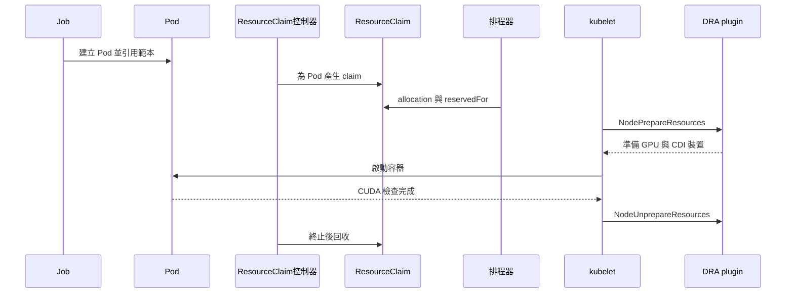

# 2.4 驗證與第一個 GPU Job

## 本頁要回答的問題

DeviceClass 與 ResourceSlice 出現後，怎麼證明容器真的取得 GPU？本頁先保留部署指南的 API 查詢，再用兩個新的整卡 Job，分別選 A40 與 RTX 4090，執行 `nvidia-smi -L` 和 PyTorch CUDA 檢查。

## 背景原理

ResourceClaimTemplate 只定義需求，Kubernetes 會為每個引用它的 Pod 產生一份 ResourceClaim。排程器從 ResourceSlice 找到符合 DeviceClass 和 CEL 的裝置，把 allocation 與 reservation 寫入 claim；kubelet 再請 DRA plugin 準備裝置，容器才能啟動。[Kubernetes DRA API 物件](https://kubernetes.io/docs/concepts/resource-management/dynamic-resource-allocation/dra-api/)、[DRA 執行流程](https://kubernetes.io/docs/concepts/resource-management/dynamic-resource-allocation/how-dra-works/)



圖中最後一步的回收由 ResourceClaim 控制器處理，不是 Job 自己直接刪除 claim；Kubernetes v1.37.0 會辨識已終止 Pod。下方 lab 另外刪除 Job 與 Pod，觀察所有物件最後消失的順序。

## 部署與設定

### 先讀部署盤點

以下三段是原安裝指南的實際輸出，沒有截短。`DeviceClass` 是選取規則，並不等於該種類的裝置真的存在；本次 A40、4090 不提供 MIG 裝置，整卡驗證使用 `gpu.nvidia.com`；它們不在官方 MIG 支援清單中。[NVIDIA MIG 支援 GPU](https://docs.nvidia.com/datacenter/tesla/mig-user-guide/supported-gpus.html)

```console
$ kubectl get deviceclass
NAME                  AGE
gpu.nvidia.com        25s
mig.nvidia.com        25s
vfio.gpu.nvidia.com   25s
```

```console
$ kubectl get resourceslices
NAME                                  NODE       DRIVER           POOL       AGE
00000-gpu.nvidia.com-dra-4090-vbl22   dra-4090   gpu.nvidia.com   dra-4090   26s
00000-gpu.nvidia.com-dra-a40-rngfm    dra-a40    gpu.nvidia.com   dra-a40    26s
```

```console
$ kubectl get resourceslices -o custom-columns=\
'NAME:.metadata.name,NODE:.spec.nodeName,DRIVER:.spec.driver,DEVICES:.spec.devices[*].name'
NAME                                  NODE       DRIVER           DEVICES
00000-gpu.nvidia.com-dra-4090-vbl22   dra-4090   gpu.nvidia.com   gpu-0
00000-gpu.nvidia.com-dra-a40-rngfm    dra-a40    gpu.nvidia.com   gpu-0
```

| 參數 | 意義 | 為什麼這樣設 |
| --- | --- | --- |
| `get deviceclass` | 列出可引用的裝置類別 | 確認 chart 已註冊三種選取規則 |
| `get resourceslices` | 列出 driver 公布的實際裝置清單 | 確認每個 GPU 節點都已發布 |
| `custom-columns` | 顯示名稱、節點、driver 與 devices 名稱 | 看到兩台各一張 `gpu-0`，而不是只看物件數量 |

這份安裝初期清單與前頁後續 ResourceSlice 快照的名稱尾碼不同，是物件重建後的盤點；節點、driver、型號與容量仍相同。名稱尾碼是生成資訊，不能用它當作跨次執行的固定 GPU 身分。

### 選擇自動或手動驗證

以下完整 YAML 與[復現套件](../../labs/02-setup/README.md)一致。**自動路線**直接執行下方 `run.sh`，由腳本完成 apply、快照與放行；**手動路線**依序編輯並 apply 這六個檔案，再執行「手動放行」的命令。不要先建立 Job 又呼叫 run.sh，它會拒絕覆寫已有工作。

2026-10-11 的[實機驗證紀錄](../../labs/02-setup/VERIFIED.md)使用自動路線，一次 apply 整個 manifests 目錄。下方依檔案分開說明，六行 `created` 都取自該次實際輸出。

兩條路線都先確認 GPU 空閒。手動路線在儲存庫根目錄執行：

```console
$ OUT_DIR=labs/02-setup/out/manual-idle-a40 bash labs/common/gpu-idle-check.sh dra-a40
$ OUT_DIR=labs/02-setup/out/manual-idle-rtx4090 bash labs/common/gpu-idle-check.sh dra-4090
```

GPU 空閒檢查透過 `gpu-operator` driver Pod 讀 nvidia-smi，不假定能 SSH 到節點。它也檢查已分配的 GPU claims，有其他使用者的工作時要等工作完成。

### 建立 Namespace

```console
$ vi labs/02-setup/manifests/00-namespace.yaml
```

```yaml
apiVersion: v1
kind: Namespace
metadata:
  name: gpu-setup-lab
  labels:
    app.kubernetes.io/part-of: dra-book
    app.kubernetes.io/component: setup
```

```console
$ kubectl apply -f labs/02-setup/manifests/00-namespace.yaml
```

```text
namespace/gpu-setup-lab created
```

| 參數 | 意義 | 為什麼這樣設 |
| --- | --- | --- |
| `metadata.name` | 驗證專用 Namespace | 把工作限制在 gpu-setup-lab |
| `app.kubernetes.io/part-of` | 資源歸屬標籤 | 讓清理只選 dra-book |
| `app.kubernetes.io/component` | 角色標籤 | 區分設定、allocation 與 smoke 工作 |

### A40 範本

```console
$ vi labs/02-setup/manifests/01-a40-claim-template.yaml
```

```yaml
apiVersion: resource.k8s.io/v1
kind: ResourceClaimTemplate
metadata:
  name: a40-whole-gpu
  labels:
    app.kubernetes.io/part-of: dra-book
    app.kubernetes.io/component: a40-allocation
  namespace: gpu-setup-lab
spec:
  metadata:
    labels:
      app.kubernetes.io/part-of: dra-book
      app.kubernetes.io/component: a40-allocation
  spec:
    devices:
      requests:
      - name: gpu
        exactly:
          deviceClassName: gpu.nvidia.com
          allocationMode: ExactCount
          count: 1
          selectors:
          - cel:
              expression: 'device.attributes["gpu.nvidia.com"].productName == "NVIDIA A40"'
```

```console
$ kubectl apply -f labs/02-setup/manifests/01-a40-claim-template.yaml
```

```text
resourceclaimtemplate.resource.k8s.io/a40-whole-gpu created
```

| 參數 | 意義 | 為什麼這樣設 |
| --- | --- | --- |
| `spec.metadata.labels` | 生成 claim 的標籤 | 讓每份 claim 也能安全清理 |
| `spec.spec.devices.requests` | 每份 claim 的裝置需求 | 範本的 spec 內再包一層 ResourceClaim spec |
| `deviceClassName` | 選整卡 DeviceClass | 使用 gpu.nvidia.com |
| `allocationMode: ExactCount` 與 `count: 1` | 申請一張裝置 | 本頁每個 Pod 各一張整卡 |
| `productName` CEL | 限定 NVIDIA A40 | 用實際 ResourceSlice 屬性選型號 |

### RTX 4090 範本

```console
$ vi labs/02-setup/manifests/02-rtx4090-claim-template.yaml
```

```yaml
apiVersion: resource.k8s.io/v1
kind: ResourceClaimTemplate
metadata:
  name: rtx4090-whole-gpu
  labels:
    app.kubernetes.io/part-of: dra-book
    app.kubernetes.io/component: rtx4090-allocation
  namespace: gpu-setup-lab
spec:
  metadata:
    labels:
      app.kubernetes.io/part-of: dra-book
      app.kubernetes.io/component: rtx4090-allocation
  spec:
    devices:
      requests:
      - name: gpu
        exactly:
          deviceClassName: gpu.nvidia.com
          allocationMode: ExactCount
          count: 1
          selectors:
          - cel:
              expression: 'device.attributes["gpu.nvidia.com"].productName == "NVIDIA GeForce RTX 4090"'
```

```console
$ kubectl apply -f labs/02-setup/manifests/02-rtx4090-claim-template.yaml
```

```text
resourceclaimtemplate.resource.k8s.io/rtx4090-whole-gpu created
```

| 參數 | 意義 | 為什麼這樣設 |
| --- | --- | --- |
| RTX 4090 範本 | 同 A40，只差 productName 與名稱 | 用獨立範本選 NVIDIA GeForce RTX 4090 |

### 檢查程式

```console
$ vi labs/02-setup/manifests/03-workload.yaml
```

```yaml
# Generated from workload/gpu_smoke.py; see README.md.
apiVersion: v1
kind: ConfigMap
metadata:
  name: gpu-setup-workload
  labels:
    app.kubernetes.io/part-of: dra-book
    app.kubernetes.io/component: cuda-check
  namespace: gpu-setup-lab
data:
  gpu_smoke.py: |
    """Hold the allocated GPU until run.sh has saved the claim, then check CUDA."""

    from pathlib import Path
    import subprocess
    import sys
    import time


    def main():
        deadline = time.monotonic() + 600
        marker = Path("/tmp/dra-book-start")
        print("WAITING_FOR_CLAIM_SNAPSHOT", flush=True)
        while not marker.exists():
            if time.monotonic() >= deadline:
                raise TimeoutError("run.sh did not release the claim snapshot barrier")
            time.sleep(0.2)
        subprocess.run(["nvidia-smi", "-L"], check=True)
        subprocess.run([sys.executable, "-c", 'import torch; assert torch.cuda.is_available(); print("PYTORCH_CUDA_OK", torch.cuda.get_device_name(0))'], check=True)


    if __name__ == "__main__":
        main()
```

```console
$ kubectl apply -f labs/02-setup/manifests/03-workload.yaml
```

```text
configmap/gpu-setup-workload created
```

| 參數 | 意義 | 為什麼這樣設 |
| --- | --- | --- |
| `gpu_smoke.py` | 由 workload 目錄產生的程式 | 完整提供容器內執行的內容 |
| `/tmp/dra-book-start` | 快照完成後的放行標記 | 防止短工作在 allocation 快照前就結束 |
| `600` 秒 | 同步等待上限 | 腳本中斷時不會永久佔住 GPU，這是 lab 政策 |
| `nvidia-smi -L` | 列出容器可見 GPU | 確認 DRA 已準備裝置 |
| `torch.cuda.is_available()` | 一行 CUDA 可用性檢查 | 失敗就非零退出，成功印出型號 |

### A40 Job

```console
$ vi labs/02-setup/manifests/04-gpu-smoke-a40.yaml
```

```yaml
apiVersion: batch/v1
kind: Job
metadata:
  name: gpu-smoke-a40
  labels:
    app.kubernetes.io/part-of: dra-book
    app.kubernetes.io/component: a40-smoke
  namespace: gpu-setup-lab
spec:
  backoffLimit: 0
  template:
    metadata:
      labels:
        app.kubernetes.io/part-of: dra-book
        app.kubernetes.io/component: a40-smoke
    spec:
      restartPolicy: Never
      automountServiceAccountToken: false
      tolerations:
      - key: nvidia.com/gpu
        operator: Exists
        effect: NoSchedule
      resourceClaims:
      - name: gpu
        resourceClaimTemplateName: a40-whole-gpu
      containers:
      - name: workload
        image: pytorch/pytorch:2.5.1-cuda12.4-cudnn9-runtime@sha256:c8268a92a69bd500f8be0e665b2630ee006dadaf7bfbc24249141b15ff622755
        imagePullPolicy: IfNotPresent
        command:
        - python
        - -u
        - /opt/lab/gpu_smoke.py
        env:
        - name: PYTORCH_NO_CUDA_MEMORY_CACHING
          value: '1'
        - name: OMP_NUM_THREADS
          value: '1'
        resources:
          claims:
          - name: gpu
        volumeMounts:
        - name: workload
          mountPath: /opt/lab
          readOnly: true
      volumes:
      - name: workload
        configMap:
          name: gpu-setup-workload
```

```console
$ kubectl apply -f labs/02-setup/manifests/04-gpu-smoke-a40.yaml
```

```text
job.batch/gpu-smoke-a40 created
```

| 參數 | 意義 | 為什麼這樣設 |
| --- | --- | --- |
| `backoffLimit: 0` 與 `restartPolicy: Never` | 失敗不重新建立或重啟 workload | 第一次失敗保留診斷狀態 |
| `automountServiceAccountToken: false` | 不掛入 Pod 的 API 權杖 | 容器本身不管理叢集 |
| `tolerations` | 接受 nvidia.com/gpu 的 NoSchedule taint | 與原 GPU workload 相同 |
| `resourceClaimTemplateName` | Pod 各自產生 claim | 此 Job 不與其他 Pod 共用 claim |
| `resources.claims` | 把 Pod 的 claim 交給 workload 容器 | 容器才取得已準備的 GPU |
| `image` 與 `IfNotPresent` | 相同 PyTorch tag 和 digest | 重用原實驗的映像檔內容 |
| `PYTORCH_NO_CUDA_MEMORY_CACHING` 與 `OMP_NUM_THREADS` | 原 workload 的環境值 | 保留原映像檔的檢查條件 |
| `configMap` 與唯讀掛載 | 把檢查程式掛到 /opt/lab | 不另外建立 workload image |

### RTX 4090 Job

```console
$ vi labs/02-setup/manifests/05-gpu-smoke-rtx4090.yaml
```

```yaml
apiVersion: batch/v1
kind: Job
metadata:
  name: gpu-smoke-rtx4090
  labels:
    app.kubernetes.io/part-of: dra-book
    app.kubernetes.io/component: rtx4090-smoke
  namespace: gpu-setup-lab
spec:
  backoffLimit: 0
  template:
    metadata:
      labels:
        app.kubernetes.io/part-of: dra-book
        app.kubernetes.io/component: rtx4090-smoke
    spec:
      restartPolicy: Never
      automountServiceAccountToken: false
      tolerations:
      - key: nvidia.com/gpu
        operator: Exists
        effect: NoSchedule
      resourceClaims:
      - name: gpu
        resourceClaimTemplateName: rtx4090-whole-gpu
      containers:
      - name: workload
        image: pytorch/pytorch:2.5.1-cuda12.4-cudnn9-runtime@sha256:c8268a92a69bd500f8be0e665b2630ee006dadaf7bfbc24249141b15ff622755
        imagePullPolicy: IfNotPresent
        command:
        - python
        - -u
        - /opt/lab/gpu_smoke.py
        env:
        - name: PYTORCH_NO_CUDA_MEMORY_CACHING
          value: '1'
        - name: OMP_NUM_THREADS
          value: '1'
        resources:
          claims:
          - name: gpu
        volumeMounts:
        - name: workload
          mountPath: /opt/lab
          readOnly: true
      volumes:
      - name: workload
        configMap:
          name: gpu-setup-workload
```

```console
$ kubectl apply -f labs/02-setup/manifests/05-gpu-smoke-rtx4090.yaml
```

```text
job.batch/gpu-smoke-rtx4090 created
```

| 參數 | 意義 | 為什麼這樣設 |
| --- | --- | --- |
| RTX 4090 Job | 同 A40，只差 productName 與名稱 | 型號由 rtx4090-whole-gpu 範本選取；Job 與角色標籤改用 rtx4090 |

PyTorch 映像檔來自原實驗的 tag 與實際 digest，A40 和後續 4090 工作都已使用相同內容。`IfNotPresent` 可利用現有快取；這不保證快取永遠存在，若被清掉仍可能拉取相同 image。上述 Job 不設定 `ttlSecondsAfterFinished`，讓腳本掌握何時保存 Pod 與 logs、何時刪除 Job。[Job 完成後的管理](https://kubernetes.io/docs/concepts/workloads/controllers/job/)

| 原物件或部署來源 | 本頁名稱 | 對應方式 |
| --- | --- | --- |
| 原整卡需求 `a40-shared` | `a40-whole-gpu` | 沿用 A40 productName、gpu.nvidia.com 和一張整卡的條件，改為本頁要求的 per-Pod 範本 |
| 原 workload `survivor`、`pressure` | `gpu-smoke-a40` | 沿用 PyTorch image、taint toleration 與環境值；本頁新增 CUDA smoke，不重跑 OOM 工作 |
| 後續 4090 workload 使用的相同 image digest | `gpu-smoke-rtx4090` | 使用 4090 productName 的獨立範本與相同 smoke 檢查 |
| 原安裝指南沒有 ResourceClaimTemplate 或 smoke Job | `gpu-setup-lab` 中的新物件 | 這是部署後的新增驗證，實際執行結果見下方 |

## 驗證

### 自動執行與收集

自動路線不需要先執行上述手動 apply：

```console
$ bash labs/02-setup/scripts/verify.sh smoke-verify
$ SMOKE=1 bash labs/02-setup/scripts/run.sh smoke-20261011
$ bash labs/02-setup/scripts/collect.sh smoke-20261011
$ python3 labs/02-setup/analysis/summarize.py labs/02-setup/out/smoke-20261011
```

兩台各先跑空閒檢查，再等待 claim allocation 與 Pod Ready；保存 allocation 的 YAML/JSON 後才放行 workload。Job 完成後再次查詢 claim、保存 logs 和 events，然後以 Background 傳播刪 Job，持續記錄 Pod 與 claim 的最終狀態。完整模式不加 `SMOKE=1`，其驗證內容相同。

該次唯讀檢查的完整輸出如下。兩個 release 的必要設定都與 values 檔相符；GPU Operator 額外的 `dcgmExporter` 覆寫值是後續為監控加入，列為 INFO。

```text
PASS: inventory
Helm user values: gpu-operator
INFO: additional Helm user value: dcgmExporter
PASS: values
Helm user values: dra-driver-nvidia-gpu
PASS: values
```

### 手動放行

如果選擇手動 apply，兩個 Job 此時會等在快照標記。用 Pod 的 `status.resourceClaimStatuses` 找實際 claim 名稱，不自行猜尾碼；以下 loop 先保存兩張卡的 allocation，再分別放行。

```console
$ mkdir -p labs/02-setup/out/manual
$ for role in a40 rtx4090; do
    kubectl -n gpu-setup-lab wait pods -l job-name=gpu-smoke-$role --for=create --timeout=300s
    pod=$(kubectl -n gpu-setup-lab get pods -l job-name=gpu-smoke-$role -o jsonpath='{.items[0].metadata.name}')
    kubectl -n gpu-setup-lab wait pod/$pod --for=condition=Ready --timeout=300s
    claim=$(kubectl -n gpu-setup-lab get pod "$pod" -o jsonpath='{.status.resourceClaimStatuses[?(@.name=="gpu")].resourceClaimName}')
    kubectl -n gpu-setup-lab get resourceclaim "$claim" -o yaml > labs/02-setup/out/manual/$role-claim-allocated.yaml
  done
$ for role in a40 rtx4090; do
    pod=$(kubectl -n gpu-setup-lab get pods -l job-name=gpu-smoke-$role -o jsonpath='{.items[0].metadata.name}')
    kubectl -n gpu-setup-lab exec "$pod" -c workload -- python -c 'from pathlib import Path; Path("/tmp/dra-book-start").touch()'
    kubectl -n gpu-setup-lab wait job/gpu-smoke-$role --for=condition=Complete --timeout=300s
    kubectl -n gpu-setup-lab logs "$pod" -c workload
  done
$ kubectl -n gpu-setup-lab get resourceclaims
$ kubectl -n gpu-setup-lab get events
$ kubectl -n gpu-setup-lab delete jobs -l app.kubernetes.io/part-of=dra-book --cascade=background
```

`--for=create` 先等 Job 控制器建立 Pod，避免剛 apply 就索引空清單；接著才等待 Ready 並保存 allocation。[kubectl wait 說明](https://kubernetes.io/docs/reference/kubectl/generated/kubectl_wait/)

要完整記錄 claim 消失的觀察時間與 summary.json，使用自動路線；手動路線結束後可呼叫 cleanup.sh 清理其他已標示物件。

### 觀察 claim 生命週期

產生的 claim 名稱以 **Pod 名稱、Pod 的 claim 引用名稱及隨機尾碼** 組成，而不是只用 ResourceClaimTemplate 名稱。讀 `status.resourceClaimStatuses[].resourceClaimName` 才能找到這次實際產生的 claim，`ownerReferences` 則指向 Pod。[v1.37.0 ResourceClaim 控制器](https://raw.githubusercontent.com/kubernetes/kubernetes/v1.37.0/pkg/controller/resourceclaim/controller.go)

以下是實機執行中保存的 A40 claim，完整保留原始 YAML。kubectl 會將長字串換行，因此這份查詢輸出的 CEL 保留原樣；上方可編輯的範本則使用單行、單引號字串。

```yaml
apiVersion: resource.k8s.io/v1
kind: ResourceClaim
metadata:
  annotations:
    resource.kubernetes.io/pod-claim-name: gpu
  creationTimestamp: "2026-10-11T11:49:36Z"
  finalizers:
  - resource.kubernetes.io/delete-protection
  generateName: gpu-smoke-a40-v5p7w-gpu-
  labels:
    app.kubernetes.io/component: a40-allocation
    app.kubernetes.io/part-of: dra-book
  name: gpu-smoke-a40-v5p7w-gpu-5rnbh
  namespace: gpu-setup-lab
  ownerReferences:
  - apiVersion: v1
    controller: true
    kind: Pod
    name: gpu-smoke-a40-v5p7w
    uid: 3dd29733-78c4-4008-aade-24e2033e11c9
  resourceVersion: "4349557"
  uid: 638195d7-c6ac-43b1-b24d-067bfdf9037b
spec:
  devices:
    requests:
    - exactly:
        allocationMode: ExactCount
        count: 1
        deviceClassName: gpu.nvidia.com
        selectors:
        - cel:
            expression: device.attributes["gpu.nvidia.com"].productName == "NVIDIA
              A40"
      name: gpu
status:
  allocation:
    allocationTimestamp: "2026-10-11T11:49:36Z"
    devices:
      results:
      - device: gpu-0
        driver: gpu.nvidia.com
        pool: dra-a40
        request: gpu
    nodeSelector:
      nodeSelectorTerms:
      - matchFields:
        - key: metadata.name
          operator: In
          values:
          - dra-a40
  reservedFor:
  - name: gpu-smoke-a40-v5p7w
    resource: pods
    uid: 3dd29733-78c4-4008-aade-24e2033e11c9
```

| 欄位 | 實際值 | 如何解讀 |
| --- | --- | --- |
| `apiVersion`、`kind` | resource.k8s.io/v1、ResourceClaim | 這是由範本產生的 claim 物件 |
| `metadata.generateName`、`name` | gpu-smoke-a40-v5p7w-gpu- 加尾碼 5rnbh | Pod 名稱是 gpu-smoke-a40-v5p7w，Pod 內的 claim 引用名是 gpu；尾碼由 API server 產生 |
| `metadata.annotations` | resource.kubernetes.io/pod-claim-name: gpu | 將生成 claim 對回 Pod 的 `spec.resourceClaims[].name`，不是範本名稱 |
| `metadata.finalizers` | resource.kubernetes.io/delete-protection | 內建刪除保護；控制器解除使用與 allocation 後才移除，避免仍有分配時直接刪除 claim |
| `metadata.ownerReferences` | v1 Pod、controller: true、Pod 名稱與 UID | 生成 claim 的控制 owner 是該 Pod；UID 區分同名的不同 Pod，讓控制器辨識歸屬並回收 |
| `metadata.namespace`、`labels` | gpu-setup-lab、dra-book、a40-allocation | Namespace 與範本傳下來的角色標籤，供收集與限定清理範圍 |
| `metadata.creationTimestamp` | 2026-10-11T11:49:36Z | API server 記錄的建立時間 |
| `metadata.uid`、`resourceVersion` | claim 的 UID、4349557 | UID 識別這個 claim；resourceVersion 是物件版本，不能當作時間或效能數值 |
| `spec.devices.requests` | name: gpu、ExactCount、count: 1、gpu.nvidia.com 與 A40 CEL | 從範本複製的整卡需求，與 allocation 的 request 名稱相接 |
| `status.allocation.allocationTimestamp` | 2026-10-11T11:49:36Z | 這次分配結果記錄的時間 |
| `status.allocation.devices.results` | request: gpu、driver: gpu.nvidia.com、pool: dra-a40、device: gpu-0 | gpu 這項需求分配到 dra-a40 pool 內的 gpu-0；driver、pool、device 合起來識別裝置 |
| `status.allocation.nodeSelector` | metadata.name In [dra-a40] | 此 allocation 只能在 dra-a40 使用；這是分配結果的節點約束，不是 Job 預先指定 nodeName |
| `status.reservedFor` | resource: pods、Pod 名稱與 UID | 允許使用此 allocation 的 consumer 是該 Pod，並不是只要同 Namespace 就能共用 |

`allocation` 描述裝置，`reservedFor` 描述誰能使用它；兩者不能互相替代。Pod 的 `status.resourceClaimStatuses` 則記錄引用名與實際 claim 名的對應，腳本將它保存在 `*-pod-allocated.json`。[v1.37.0 ResourceClaim API 定義](https://raw.githubusercontent.com/kubernetes/kubernetes/v1.37.0/staging/src/k8s.io/api/resource/v1/types.go)、[生成 claim 的 annotation 與 owner 設定](https://raw.githubusercontent.com/kubernetes/kubernetes/v1.37.0/pkg/controller/resourceclaim/controller.go)、[物件 metadata 定義](https://raw.githubusercontent.com/kubernetes/kubernetes/v1.37.0/staging/src/k8s.io/apimachinery/pkg/apis/meta/v1/types.go)

在 **Kubernetes v1.37.0**，kubelet 先在容器停止後呼叫 `NodeUnprepareResources`，然後更新 Pod 的終止狀態。ResourceClaim 控制器看到 Pod `Succeeded` 或 `Failed`，移除其 reservation；沒有 consumer 時清除 allocation 與內建刪除保護，並主動刪除由該 Pod 產生的 claim，**不必等 Job 刪掉 Pod 物件**。[kubelet 的 unprepare 順序](https://raw.githubusercontent.com/kubernetes/kubernetes/v1.37.0/pkg/kubelet/kubelet.go)、[claim 終止後的回收](https://raw.githubusercontent.com/kubernetes/kubernetes/v1.37.0/pkg/controller/resourceclaim/controller.go)

官方 [ResourceClaimTemplate 說明](https://kubernetes.io/docs/concepts/resource-management/dynamic-resource-allocation/dra-api/)也說明生成 claim 隨 Pod 生命週期回收。Job 通常仍保留成功 Pod 供讀 logs；刪 Job 的 Background 傳播再非同步刪除 Pod 和其他相依物件。[Job 說明](https://kubernetes.io/docs/concepts/workloads/controllers/job/)、[Background 回收](https://kubernetes.io/docs/concepts/architecture/garbage-collection/)

### 實機結果

2026-10-11 的兩個 Job 都完成，下列 logs 沒有截短。第一行是快照屏障，接著是容器內 `nvidia-smi -L` 看到的 GPU，最後是 PyTorch CUDA 成功標記；執行與清理紀錄見[實機驗證紀錄](../../labs/02-setup/VERIFIED.md)。

A40 Pod `gpu-smoke-a40-v5p7w`：

```text
WAITING_FOR_CLAIM_SNAPSHOT
GPU 0: NVIDIA A40 (UUID: GPU-29ffee3e-bee4-e341-917a-fe7e43e977af)
PYTORCH_CUDA_OK NVIDIA A40
```

RTX 4090 Pod `gpu-smoke-rtx4090-9b9rw`：

```text
WAITING_FOR_CLAIM_SNAPSHOT
GPU 0: NVIDIA GeForce RTX 4090 (UUID: GPU-0c6a9ee3-89b0-d48f-de2c-758c2cedcd1e)
PYTORCH_CUDA_OK NVIDIA GeForce RTX 4090
```

`summary.json` 經 summarize.py 輸出的實際表格：

| node | GPU | claim allocated | claim deleted after Pod deletion | pytorch CUDA ok |
| --- | --- | --- | --- | --- |
| dra-a40 | NVIDIA A40 | yes | earlier | yes |
| dra-4090 | NVIDIA GeForce RTX 4090 | yes | earlier | yes |

兩份 claim 都有 `claim_absent_before_job_deletion: true`：Job 完成後、腳本發出刪除 Job 請求前，就已查不到生成 claim；完成後的 claim YAML 為空、JSON 為 `{}`。因此摘要記為 `earlier`，符合 v1.37.0 在 Pod 終止後回收 claim 的行為，並不表示 claim 必須等 Pod 物件刪除才消失。

摘要也能呈現較晚觀察到 claim 消失的 `yes`，或未觀察到最終刪除的 `no`。刪除時間戳是第一次成功查詢到 NotFound 的時間，不能當作 API 的精確刪除時間；腳本遇到 API 錯誤會保存失敗，不把查詢失敗當作物件已刪除。

同時看到型號正確的 allocation、容器內 GPU 列表和 CUDA 成功標記，才完成端到端驗證；本檢查驗證 CUDA 初始化可用，後續的共用、隔離與效能另行驗證。保留 out 目錄後可執行 cleanup.sh 清理 Namespace 中其餘已標示物件；它不移除 GPU Operator 或 DRA Driver。

## 重點整理

- DeviceClass 與 ResourceSlice 確認裝置發布，GPU Job 確認分配後的容器可用。
- 使用兩份型號範本，讓每個 Pod 都取得自己的整卡 claim，並保存真實生成名稱。
- Kubernetes v1.37.0 可在 Pod 終止後、Pod 物件刪除前回收 claim；用實際觀察區分回收時點。

<!-- nav:start -->
[← 上一頁：2.3 安裝 NVIDIA DRA Driver](dra-driver.md) ｜ [目錄](../README.md) ｜ [下一頁：2.5 疑難排解 →](troubleshooting.md)
<!-- nav:end -->
