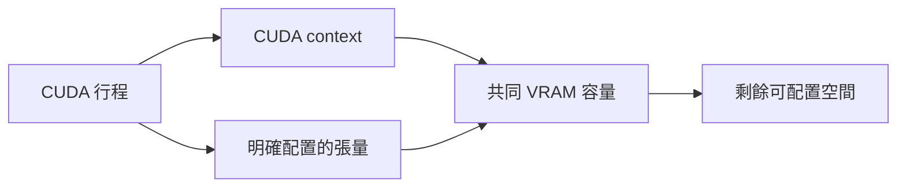
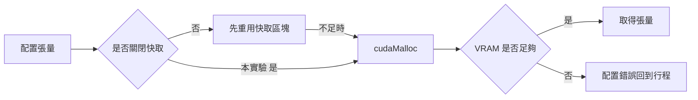
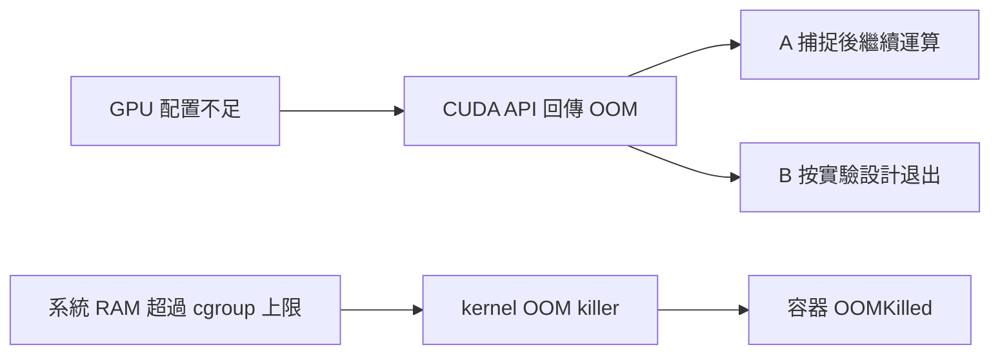
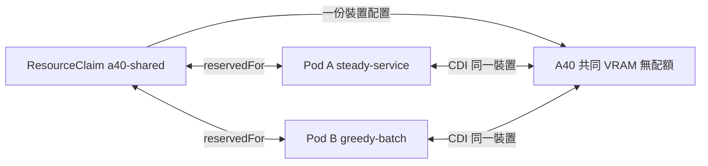
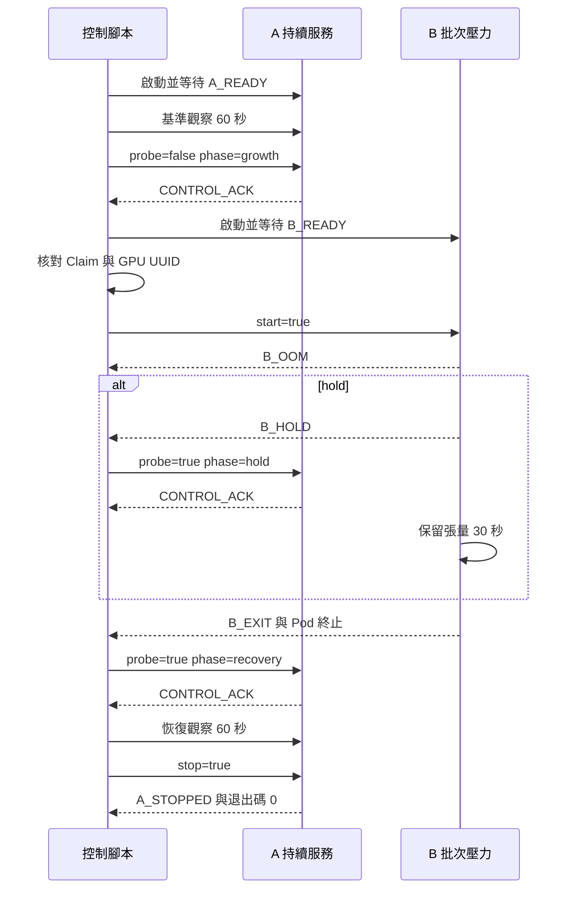
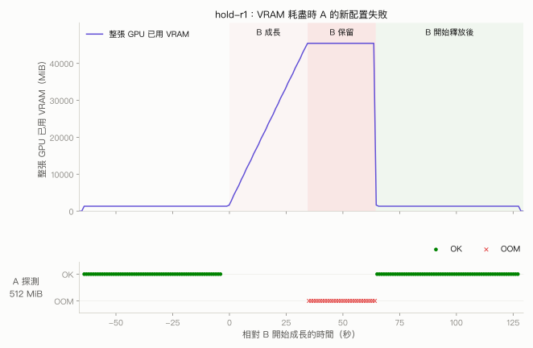
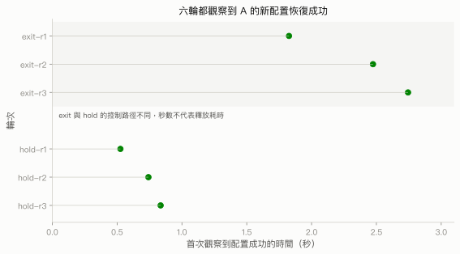

# 第 3 章　共用 GPU 時的 OOM 行為

## 本章要回答的問題

兩個 Pod 共用同一顆 GPU，若其中一個耗盡 VRAM，另一個還能使用已配置的張量運算嗎？它能再配置新的 GPU 記憶體嗎？本章把這兩件事分開觀察，並核對容器的終止原因，避免將 CUDA OOM 與 Kubernetes `OOMKilled` 混為一談。

實驗在 `dra-a40` 的 NVIDIA A40 上，讓 A 保留固定張量、B 持續配置到 OOM，再比較 B 立即退出與暫時保留張量的兩種模式。原始六輪結果顯示：A 的既有運算沒有記錄到錯誤，但 B 保留 VRAM 時，A 的新配置全部失敗；B 釋放後才恢復。這是沒有 VRAM 配額的共同容量競爭，不能當作隔離有效的證據。

## 背景原理

### 張量以外也會使用 VRAM

CUDA 行程先建立 CUDA context，才在裝置上配置張量並提交 kernel。context 與執行所需資源也會占用 GPU 記憶體，因此「程式保留的張量總量」不等於「整顆 GPU 的實際用量」。[CUDA 12.4.1 的 context 說明](https://docs.nvidia.com/cuda/archive/12.4.1/cuda-driver-api/driver-vs-runtime-api.html)指出，runtime 的 primary context 由同一行程內的使用者共用，context 本身可能耗用 device memory 等資源。



本實驗以 `tensor_bytes` 計算 B 保留的張量，用 `nvidia-smi` 觀察整顆 GPU，另以 `torch.cuda.mem_get_info()` 記錄 CUDA 看到的可用容量。三個來源回答不同問題，不能用張量總量直接推算其他行程或 context 的用量。

### 為何關閉 PyTorch 記憶體快取

PyTorch 預設 caching allocator 會保存已向 CUDA 取得的區塊，以便之後重用；張量被刪除時，未使用的快取仍可能出現在 `nvidia-smi` 用量裡。這讓「Python 物件已刪除」與「記憶體已回到驅動」不必然同步。[PyTorch v2.5.1 的 CUDA 說明](https://github.com/pytorch/pytorch/blob/v2.5.1/docs/source/notes/cuda.rst#memory-management)說明 allocator、`memory_allocated()`、`memory_reserved()` 與關閉快取的環境變數。

本章設定 `PYTORCH_NO_CUDA_MEMORY_CACHING=1`，讓工作負載每次 `torch.empty(..., device='cuda')` 都直接走實際 CUDA 配置，避免探測重用自己的快取。[v2.5.1 allocator 原始碼](https://raw.githubusercontent.com/pytorch/pytorch/v2.5.1/c10/cuda/CUDACachingAllocator.cpp)的 `forceUncachedAllocator()` 明確選擇直接 `cudaMalloc`，釋放則呼叫 `cudaFree`；OOM 因而在驅動配置路徑上被觀察到。這個條件讓本次容易解讀，但不代表啟用快取的模型服務會有相同門檻或延遲。



原始日誌中的 `allocated_bytes`、`reserved_bytes` 在關閉快取時為 0，不能據此認定行程沒有用 VRAM。本章的張量大小來自明確的配置計數，物理用量來自 GPU 取樣；日誌中的 allocator 統計僅保留供對照。

### CUDA OOM 與容器 OOMKilled

CUDA 配置失敗時，API 將錯誤回傳給呼叫行程；程式可捕捉該錯誤並繼續做不需要新配置的工作。[CUDA 記憶體管理 API](https://docs.nvidia.com/cuda/cuda-runtime-api/cuda_runtime_api/group__CUDART__MEMORY.html)列出 `cudaMalloc` 的 `cudaErrorMemoryAllocation`。本實驗只在張量配置處將相符的 `RuntimeError` 正規化成 `torch.OutOfMemoryError`，不把 kernel 錯誤當成可忽略的配置 OOM。

Kubernetes 的 `resources.limits.memory` 約束系統 RAM。超過 cgroup 記憶體上限可能觸發 Linux OOM killer，容器被終止後可見 `reason: OOMKilled` 與退出碼 137；這個機制不提供本實驗所需的 VRAM 配額。[Kubernetes 記憶體限制範例](https://kubernetes.io/docs/tasks/configure-pod-container/assign-memory-resource/#exceed-a-containers-memory-limit)同時展示這些狀態。退出碼 137 本身不足以辨識原因，仍要核對 `reason`、事件與容器日誌。

| 比較項目 | CUDA OOM | Kubernetes OOMKilled |
|---|---|---|
| 受限資源 | GPU 可配置記憶體 | 容器所用系統 RAM |
| 觸發路徑 | CUDA 配置 API 回傳錯誤 | cgroup RAM 上限與 kernel OOM killer |
| 行程是否一定被終止 | 由程式的錯誤處理決定 | 容器中的行程被終止 |
| 本實驗的觀察方式 | `B_OOM`、`A_PROBE_OOM` 事件 | Pod 終止狀態與 events |
| 本次 B 的結果 | 程式主動回傳退出碼 1，reason 為 `Error` | 原六輪未記錄到 `OOMKilled` |



### 一個 Claim 如何讓兩個 Pod 共用裝置

A、B 都在 Pod 的 `resourceClaims` 引用 `a40-shared`，容器再透過 `resources.claims` 使用其中的 `gpu` request。因此這是同一份裝置配置的兩個使用者，沒有為 B 建立另一份 Claim。Kubernetes 的[裝置配置流程](https://kubernetes.io/docs/concepts/resource-management/dynamic-resource-allocation/how-dra-works/#workflow-for-kubernetes)說明 scheduler 配置與 kubelet／driver 準備裝置的分工；本次保存的 Claim 只有一筆 `gpu-0` allocation，`reservedFor` 同時列出兩個 Pod。

NVIDIA DRA v0.5.0 的 kubelet plugin 將已準備的裝置轉為 `CDIDeviceIDs`，容器 runtime 依 CDI 注入所需的 GPU 存取，兩個容器因此看到同一顆 A40。[v0.5.0 裝置準備原始碼](https://raw.githubusercontent.com/kubernetes-sigs/dra-driver-nvidia-gpu/v0.5.0/cmd/gpu-kubelet-plugin/device_state.go)的 `GetClaimDeviceName` 與 `CDIDeviceIDs` 串起這個路徑。本次 A／B 的 `READY` 日誌都核對到 `GPU-29ffee3e-bee4-e341-917a-fe7e43e977af`。



Claim 與 DeviceClass 都沒有附加分享設定時，v0.5.0 的[預設 GpuConfig](https://raw.githubusercontent.com/kubernetes-sigs/dra-driver-nvidia-gpu/v0.5.0/api/nvidia.com/resource/v1beta1/gpuconfig.go)只設定型別，`sharing` 為空；[`IsTimeSlicing` 與 `IsMps`](https://github.com/kubernetes-sigs/dra-driver-nvidia-gpu/blob/v0.5.0/api/nvidia.com/resource/v1beta1/sharing.go#L94-L108)對空設定均回傳 false。這表示沿用 GPU 驅動的一般多行程排程，不會自動啟用 MPS 或設定 VRAM 配額，也沒有顯式調整 time-slicing interval。原始 GPU 取樣記錄的 `compute_mode` 是 `Default`；它是 GPU 的 compute mode，不能當成已設定 `sharing.strategy: TimeSlicing` 的證據。

## 部署與設定

### 環境與命名

原始環境為 Kubernetes v1.37.0、NVIDIA DRA v0.5.0、NVIDIA driver 595.91.07、PyTorch 2.5.1+cu124，CUDA runtime 為 12.4。Kubernetes 版本見 [version.json](../../data/e1/version.json)，PyTorch 與 CUDA 版本見 A／B 的 `READY` 日誌；復現套件以實際 imageID 固定 digest。

| 原物件 | 復現套件名稱 | 選擇原因 |
|---|---|---|
| Namespace `gpu-oom-lab` | `gpu-oom-lab` | 已描述實驗用途 |
| ResourceClaim `a40-shared` | `a40-shared` | 已描述 GPU 型號與共用配置 |
| Pod `survivor` | Job `steady-service` 的 Pod | A 模擬持續服務，仍以 Job 承載批次觀察 |
| Pod `pressure` | Job `greedy-batch` 的 Pod | B 持續占用 VRAM，角色明確 |
| ConfigMap `gpu-oom-code` | `gpu-oom-workload` | 保存工作負載程式 |

工作負載的 `--role survivor|pressure` 與事件名稱維持原樣，因此同一份分析可處理原始資料和新的 Job 日誌。物件統一帶 `app.kubernetes.io/part-of: dra-book`，並用 component 區分角色；命名與 Job 包裝改變，張量、環境變數、資源需求和共用 Claim 語意維持相同。

以下在 `labs/03-oom/` 查看來源 YAML，Namespace、Claim 與 Job 都展示完整內容，工作負載 ConfigMap 則由 generator 產生。部署命令採用 2026-10-11 在原叢集執行的 `smoke-20261011` 縮短版；原始六輪使用 `kubectl create`，這套 Job 復現流程使用 `kubectl apply`，詳見[實機驗證紀錄](../../labs/03-oom/VERIFIED.md)。

腳本先渲染 YAML，再分階段套用保存的 JSON；Namespace 與 ConfigMap 合併在 `base.json`，B 的逐輪設定則保存在 `hold-r1/`。下方輸出取自同日以修正後腳本重跑的 `smoke-20261011-r2`；完整控制順序由 `scripts/run.sh` 執行，後面的 Claim 與日誌片段仍來自原始六輪資料。

### Namespace

```sh
$ vi manifests/00-namespace.yaml
```

```yaml
apiVersion: v1
kind: Namespace
metadata:
  name: gpu-oom-lab
  labels:
    app.kubernetes.io/part-of: dra-book
    app.kubernetes.io/component: oom-lab
```

| 參數 | 意義 | 為什麼這樣設 |
|---|---|---|
| `metadata.name` | 物件的 Namespace | 用 `gpu-oom-lab` 集中本實驗資源 |
| 兩個 labels | 所屬套件與 component | 讓收集與清理限定到本實驗物件 |

以下是 `smoke-20261011-r2` 的實際輸出。

```console
$ kubectl apply -f out/smoke-20261011-r2/base.json
namespace/gpu-oom-lab created
configmap/gpu-oom-workload created
```

### 工作負載 ConfigMap

工作負載由 `configMapGenerator` 讀取 [workload.py](../../labs/03-oom/workload/workload.py)，生成 `gpu-oom-workload`，兩個 Job 掛載同一份程式。generator 的完整設定列在[由同一份程式產生設定](#由同一份程式產生設定)，配置、探測與 OOM 處理則在後面的關鍵路徑逐段說明。

生成的程式內容以來源檔案為準，無須另外維護一份 ConfigMap YAML。縮短版將 Namespace 與生成的 ConfigMap 一起套用，上面的 `base.json` 輸出包含這兩個物件。

### 共用 ResourceClaim

```sh
$ vi manifests/01-claim.yaml
```

```yaml
apiVersion: resource.k8s.io/v1
kind: ResourceClaim
metadata:
  name: a40-shared
  namespace: gpu-oom-lab
  labels:
    app.kubernetes.io/part-of: dra-book
    app.kubernetes.io/component: shared-gpu
spec:
  devices:
    requests:
    - name: gpu
      exactly:
        deviceClassName: gpu.nvidia.com
        allocationMode: ExactCount
        count: 1
        selectors:
        - cel:
            expression: 'device.attributes["gpu.nvidia.com"].productName == "NVIDIA A40"'
```

| 參數 | 意義 | 為什麼這樣設 |
|---|---|---|
| `deviceClassName: gpu.nvidia.com` | 使用 NVIDIA DRA 公布的 GPU 類別 | 與原始實驗相同 |
| `allocationMode: ExactCount`、`count: 1` | 取得一個裝置 | A／B 共用同一份 allocation |
| CEL `productName == "NVIDIA A40"` | 篩選 GPU 型號 | 固定本章的 A40 情境 |
| request 名稱 `gpu` | Claim 內的申請名稱 | 和容器的 `resources.claims[].request` 相接 |
| 未附加 GpuConfig | 使用上述空 sharing 的預設路徑 | 觀察沒有 VRAM 配額的競爭 |

以下是 `smoke-20261011-r2` 的實際輸出。

```console
$ kubectl apply -f out/smoke-20261011-r2/claim-manifest.json
resourceclaim.resource.k8s.io/a40-shared created
```

### A 的持續服務角色

```sh
$ vi manifests/02-steady-service.yaml
```

```yaml
apiVersion: batch/v1
kind: Job
metadata:
  name: steady-service
  namespace: gpu-oom-lab
  labels:
    app.kubernetes.io/part-of: dra-book
    app.kubernetes.io/component: steady-service
spec:
  backoffLimit: 0
  template:
    metadata:
      labels:
        app.kubernetes.io/part-of: dra-book
        app.kubernetes.io/component: steady-service
    spec:
      restartPolicy: Never
      terminationGracePeriodSeconds: 15
      automountServiceAccountToken: false
      tolerations:
      - key: nvidia.com/gpu
        operator: Exists
        effect: NoSchedule
      resourceClaims:
      - name: gpu
        resourceClaimName: a40-shared
      containers:
      - name: workload
        image: pytorch/pytorch:2.5.1-cuda12.4-cudnn9-runtime@sha256:c8268a92a69bd500f8be0e665b2630ee006dadaf7bfbc24249141b15ff622755
        imagePullPolicy: IfNotPresent
        command:
        - python
        - -u
        - /opt/lab/workload.py
        args:
        - --role
        - survivor
        env:
        - name: PYTORCH_NO_CUDA_MEMORY_CACHING
          value: '1'
        - name: OMP_NUM_THREADS
          value: '1'
        resources:
          requests:
            cpu: '2'
            memory: 4Gi
          limits:
            cpu: '2'
            memory: 4Gi
          claims:
          - name: gpu
            request: gpu
        volumeMounts:
        - name: code
          mountPath: /opt/lab
          readOnly: true
      volumes:
      - name: code
        configMap:
          name: gpu-oom-workload
```

| 參數 | 意義 | 為什麼這樣設 |
|---|---|---|
| `--role survivor` | 啟動 A 的工作負載 | 保留原始事件名稱與分析介面 |
| `PYTORCH_NO_CUDA_MEMORY_CACHING=1` | 關閉配置快取 | 每次探測都走真實 CUDA 配置 |
| `OMP_NUM_THREADS=1` | 限定 OpenMP 執行緒 | 與原環境相同 |
| image tag 加 digest | 固定實際映像檔內容 | digest 來自原 Pod 的 imageID |
| `resourceClaims` 與 `resources.claims` | Pod 引用 Claim，容器使用 `gpu` request | 確保兩個容器連到同一裝置配置 |
| GPU `NoSchedule` toleration | 容許排到有 GPU taint 的節點 | 與原始 Pod 相同，不繞過 scheduler |
| CPU request／limit `2`、RAM request／limit `4Gi` | 系統資源需求與上限 | 沿用原設定；RAM 上限不代表 VRAM 配額 |
| `restartPolicy: Never`、`backoffLimit: 0` | 容器不重啟，Job 不重試 | 一個退出結果對應一輪資料 |
| grace period `15`、不掛載 ServiceAccount token | 停止寬限期與憑證掛載行為 | 沿用原 Pod，CUDA 程式不呼叫 Kubernetes API |
| 唯讀 `/opt/lab` 掛載 | 載入 ConfigMap 程式 | 控制檔另放在容器 `/tmp` |

以下是 `smoke-20261011-r2` 的實際輸出。

```console
$ kubectl apply -f out/smoke-20261011-r2/steady-service-manifest.json
job.batch/steady-service created
```

`A_READY` 表示固定張量已配置且暖身運算通過，與 Kubernetes Ready condition 回答的問題不同。腳本以這個事件作為基準觀察的起點，之後明確關閉新配置探測並等待 `CONTROL_ACK`，才建立 B。

### B 的批次壓力角色

```sh
$ vi manifests/03-greedy-batch.yaml
```

```yaml
apiVersion: batch/v1
kind: Job
metadata:
  name: greedy-batch
  namespace: gpu-oom-lab
  labels:
    app.kubernetes.io/part-of: dra-book
    app.kubernetes.io/component: greedy-batch
spec:
  backoffLimit: 0
  template:
    metadata:
      labels:
        app.kubernetes.io/part-of: dra-book
        app.kubernetes.io/component: greedy-batch
    spec:
      restartPolicy: Never
      terminationGracePeriodSeconds: 15
      automountServiceAccountToken: false
      tolerations:
      - key: nvidia.com/gpu
        operator: Exists
        effect: NoSchedule
      resourceClaims:
      - name: gpu
        resourceClaimName: a40-shared
      containers:
      - name: workload
        image: pytorch/pytorch:2.5.1-cuda12.4-cudnn9-runtime@sha256:c8268a92a69bd500f8be0e665b2630ee006dadaf7bfbc24249141b15ff622755
        imagePullPolicy: IfNotPresent
        command:
        - python
        - -u
        - /opt/lab/workload.py
        args:
        - --role
        - pressure
        env:
        - name: OOM_MODE
          value: exit
        - name: PYTORCH_NO_CUDA_MEMORY_CACHING
          value: '1'
        - name: OMP_NUM_THREADS
          value: '1'
        resources:
          requests:
            cpu: '2'
            memory: 4Gi
          limits:
            cpu: '2'
            memory: 4Gi
          claims:
          - name: gpu
            request: gpu
        volumeMounts:
        - name: code
          mountPath: /opt/lab
          readOnly: true
      volumes:
      - name: code
        configMap:
          name: gpu-oom-workload
```

| 參數 | 意義 | 為什麼這樣設 |
|---|---|---|
| `--role pressure` | 啟動 B 的工作負載 | 持續保留已配置區塊直到 OOM |
| `OOM_MODE=exit` | OOM 後立即退出 | 腳本逐輪改成 `exit` 或 `hold`；其餘內容相同 |
| 相同 image、env、RAM／CPU、toleration、Claim 與掛載 | 和 A 相同的執行條件 | 差別集中在工作負載角色與 OOM 後行為 |
| `backoffLimit: 0` | 預期退出碼 1 不重試 | B 的 Failed Job 是要收集的結果 |

以下是 `smoke-20261011-r2` 的實際輸出。

```console
$ kubectl apply -f out/smoke-20261011-r2/hold-r1/greedy-batch-manifest.json
job.batch/greedy-batch created
```

B 發出 `B_READY` 後會等容器內的 `start` 控制命令，並不在建立時立刻耗盡 VRAM。此時腳本核對 A／B 的 GPU UUID、Claim allocation 與兩個 `reservedFor`，再讓 B 成長。

[`backoffLimit` 的失敗處理](https://kubernetes.io/docs/concepts/workloads/controllers/job/#pod-backoff-failure-policy)決定 Job 是否再次建立 Pod。本章設為 0，讓 B 的預期非零退出保留為單次 Failed 結果，日誌和終止狀態收集完成後才清理。

### 由同一份程式產生設定

實際復現使用以下完整 Kustomization。因為程式位於相鄰 `workload/`，渲染需要允許跨出 `manifests/` 的檔案讀取；`disableNameSuffixHash` 固定 ConfigMap 名稱，Job 就能分階段套用。

```sh
$ vi manifests/kustomization.yaml
```

```yaml
apiVersion: kustomize.config.k8s.io/v1beta1
kind: Kustomization
namespace: gpu-oom-lab
resources:
  - 00-namespace.yaml
  - 01-claim.yaml
  - 02-steady-service.yaml
  - 03-greedy-batch.yaml
configMapGenerator:
  - name: gpu-oom-workload
    files:
      - workload.py=../workload/workload.py
    options:
      labels:
        app.kubernetes.io/part-of: dra-book
        app.kubernetes.io/component: workload-code
generatorOptions:
  disableNameSuffixHash: true
```

| 參數 | 意義 | 為什麼這樣設 |
|---|---|---|
| `resources` | Namespace、Claim 與兩個 Job | 將完整物件保存在純 YAML |
| `configMapGenerator.files` | 從 `../workload/workload.py` 產生資料 | 工作負載只維護一份 |
| `disableNameSuffixHash: true` | 固定生成物件的名稱 | 分階段套用時使用相同 ConfigMap 引用 |
| generator 的兩個 labels | 生成物件的所屬與角色 | 和其他物件採用相同清理規則 |

```sh
$ kubectl kustomize manifests --load-restrictor=LoadRestrictionsNone > /tmp/gpu-oom-manifests.yaml
$ bash scripts/run.sh
```

腳本保存渲染結果，再分別 `kubectl apply -f` 到各階段；一次套用所有物件會略過基準觀察，所以完整六輪請使用腳本。

### 原始共用配置的證據

下列節錄來自 `hold-r1` 保存的 [claim.json](../../data/e1/raw/hold-r1/claim.json)，仍使用原 Pod 名稱。這是原執行中取得的快照；省略 allocation、spec 與 metadata，以 `...` 標記，完整潔淨副本可由連結查看。

```sh
$ kubectl -n gpu-oom-lab get resourceclaim a40-shared -o json
```

```text
...
    "reservedFor": [
      {
        "name": "survivor",
        "resource": "pods",
        "uid": "52203274-1e30-4953-b45f-6a7c31810c80"
      },
      {
        "name": "pressure",
        "resource": "pods",
        "uid": "268d1677-023f-499b-8113-a5952dd5977d"
      }
    ]
  }
}
```

這裡的 `reservedFor` 是共用同一 Claim 的直接證據，A／B `READY` 中相同的 GPU UUID 則確認容器內看到的裝置。兩者都成立，才進行本章的記憶體競爭觀察。

## 實驗設計

### 階段與時間

A 保留 1 GiB 的 `uint8` 張量，每個迴圈做原地加一、減一與 GPU 同步，核對開頭、中間、末尾三個位置。迴圈目標每秒執行一次；啟用 probe 時，運算後再配置 512 MiB 暫時張量，成功就刪除，失敗就記錄事件後繼續。

B 每次配置 256 MiB，完成歸零與同步後保留張量引用，等待 0.2 秒再增加下一塊。exit 模式遇到 OOM 立即走退出路徑；hold 模式保留所有張量 30 秒才退出。兩種模式各三輪，原始控制流程如下；成長保護期限 120 秒、A 的整輪保護期限 600 秒是防卡住的界線，不是實測耗時。



原始 `run.py` 在 A_READY 後觀察基準 60 秒，關閉探測並等待 ACK，才啟動 B。成長時 A 繼續使用既有張量，但暫停新配置，讓 B 的 OOM 門檻不受暫時探測張量影響。hold 的探測開始稍晚於 `B_HOLD`，因為控制腳本需要看見事件、送出命令並收到 ACK；`hold-r3` 因此只有 29 個有效探測，不能補成 30。

B 的 `B_EXIT` 是開始離開保留引用的程式路徑，CRI `finishedAt` 是容器實際終止時間，兩者不是同一事件。恢復觀察在偵測 B 已終止且 A 確認恢復命令後開始，持續 60 秒；`phases.json` 記錄控制端的階段切換，分析壓力窗口仍用 B 的實際事件時間。

### 工作負載的關鍵路徑

配置函式建立 `uint8` 張量、歸零並同步，確保真正使用 GPU 記憶體。它只在下列明確錯誤文字時正規化例外，其他 CUDA 錯誤仍往外傳遞；完整程式見 [workload.py](../../labs/03-oom/workload/workload.py)，以下節錄關鍵路徑。

```python
tensor = self.torch.empty(nbytes, dtype=self.torch.uint8, device='cuda')
# 配置例外的判斷位於 try 的 except 中。
if not isinstance(exc, self.oom_error) and str(exc).split('\n', 1)[0] == 'CUDA error: out of memory':
    raise self.oom_error(str(exc)) from exc
```

A 的 probe 用另一個暫時張量，OOM 時只發出事件；原本的 resident 張量仍交給下一次 compute。成功時先同步，再刪除引用，關閉快取使該配置不會留在 caching allocator。

```python
try:
    probe = gpu.allocate(probe_bytes)
except gpu.oom_error as exc:
    emit('A_PROBE_OOM', phase=phase, error=str(exc), **gpu.stats())
else:
    gpu.release(probe)
    del probe
    emit('A_PROBE_OK', phase=phase, probe_bytes=probe_bytes,
         **gpu.stats())
```

B 用 `blocks` 保存全部張量引用，OOM 本身不會清空已成功的配置。hold 模式在發出 `B_HOLD` 後等待；最後發出 `B_EXIT` 並回傳 1，才讓函式與行程終止釋放引用。

```python
blocks.append(gpu.allocate(block_bytes))
# 上述配置在 except gpu.oom_error 中失敗時：
emit('B_OOM', mode=mode, error=str(exc), blocks=len(blocks),
     tensor_bytes=len(blocks) * block_bytes, **gpu.stats())
# hold 分支發出 B_HOLD 並等待 hold_seconds；完整分支見 workload.py。
emit('B_EXIT', expected_exit_code=1, mode=mode)
return 1
```

事件日誌同時帶 UTC、monotonic、role 與 event，並立即 flush。分析用 UTC 對齊 A、B、控制端與 GPU 取樣；同一 B 行程內的 monotonic 則可核對 hold 是否持續足夠時間。

```python
row = {'utc': dt.datetime.now(dt.timezone.utc).isoformat(),
       'monotonic': self.monotonic(), 'role': self.role,
       'event': event, **fields}
print(json.dumps(row, ensure_ascii=False), file=self.stream, flush=True)
```

### 指標如何計算

[analysis/analyze.py](../../labs/03-oom/analysis/analyze.py)保留原始分析的窗口與百分位數定義。`trial.json` 提供觀察期與退出狀態，兩個 `*-final.json` 可獨立核對 Pod 終止資訊，exit 沒有 hold 窗口的欄位留空。

| 指標 | 計算方式 | 判讀範圍 |
|---|---|---|
| B OOM 時張量 MiB | 第一個 `B_OOM.tensor_bytes / 1024**2` | B 明確保留的張量，不包含 context |
| hold probe OOM／OK | 在 `B_HOLD.utc` 至較早的 `B_EXIT.utc`／`finishedAt` 之間，且 `phase=hold` 的 A 探測事件數 | 排除退出後已釋放的成功配置 |
| 配置恢復秒數 | 從較晚的 `B_EXIT.utc`／`finishedAt` 算到第一個不早於該時間的 `A_PROBE_OK` | CRI 可能只有整秒精度；包含探測與控制延遲 |
| A 運算錯誤 | `CUDA_ERROR` 加 `A_INTEGRITY_ERROR` 次數 | 取樣核對失敗或其他 CUDA 錯誤，不含可捕捉的 probe OOM |
| A／B 退出碼 | 保存的容器 termination `exitCode` | 並核對 reason 與 restartCount |
| p95 延遲倍率 | hold 的 `A_COMPUTE.latency_ms` p95 除以 baseline p95 | 只看既有張量運算、同步與核對，不包含 probe 配置時間 |
| p95 | 排序後以位置 `(n-1)*0.95` 在相鄰值線性插值 | 表格的倍率與恢復秒數顯示至小數三位 |
| 完整性 | OOM、UUID、階段順序、基準與恢復觀察、終止事件、無重啟及取樣皆有有效證據 | `complete=False` 的輪次不能當作完成的結果 |

## 結果

### 六輪的精確值

下表由保存於 [data/e1/raw](../../data/e1/README.md) 的原始日誌重算；[summary-original.csv](../../data/e1/summary-original.csv)保留原始對照，[summary.csv](../../data/e1/summary.csv)是移除文字判讀欄位的重算版本。張量 MiB 保留整數，恢復秒數與 p95 倍率統一顯示至小數三位，圖表也讀取同一份資料。

| 輪次 | B 張量 MiB | hold 探測 OOM | hold 探測 OK | 恢復秒數 | A 運算錯誤 | A 退出碼 | B 退出碼 | hold p95 倍率 |
|---|---:|---:|---:|---:|---:|---:|---:|---:|
| exit-r1 | 43776 | 未測 | 未測 | 1.826 | 0 | 0 | 1 | 未測 |
| exit-r2 | 43776 | 未測 | 未測 | 2.474 | 0 | 0 | 1 | 未測 |
| exit-r3 | 43776 | 未測 | 未測 | 2.744 | 0 | 0 | 1 | 未測 |
| hold-r1 | 43776 | 30 | 0 | 0.525 | 0 | 0 | 1 | 0.993 |
| hold-r2 | 43776 | 30 | 0 | 0.741 | 0 | 0 | 1 | 0.961 |
| hold-r3 | 43776 | 29 | 0 | 0.836 | 0 | 0 | 1 | 1.002 |

六輪 B 都保留 171 個區塊，即 43,776 MiB（42.75 GiB），OOM 時 CUDA 回報剩餘 64.5 MiB，無法再接受 256 MiB 區塊或 A 的 512 MiB 探測。這個張量總量來自 `B_OOM`，不等於整顆 GPU 用量；取樣的 `total_mib` 是 46,068 MiB，CUDA 日誌的 `device_total_bytes` 換算為 45,490 MiB，也不能混用兩種總容量。

exit 的「未測」表示沒有穩定的 hold 壓力窗口，不是 OOM 次數為零。hold 三輪的 A 探測均只有 OOM，既有運算錯誤則是零；原 Pod 終止快照也顯示 A 為 `Completed`／0，B 為 `Error`／1。

### 一輪中的成長與釋放



圖中採用 `hold-r1`：取樣沒有錯誤列，成長、hold、釋放與恢復都有資料，且 hold 有完整的 30 個探測事件。陰影邊界取自 B 的 `B_GROW`、`B_HOLD`、`B_EXIT`，橫軸以 B 開始成長為零；負值部分是成長前的基準。上圖顯示整張 GPU 已用 VRAM，下方短圖共用時間軸，呈現 A 的 512 MiB 探測；綠色實心點為 OK，紅色叉號為 OOM，兩種結果都有圖例。

B 成長時 VRAM 用量上升，A 的 probe 已關閉，所以沒有探測標記。進入 hold 後，用量維持高位，A 的新配置全部 OOM；B_EXIT 後 GPU 用量下降，A 的 OK 探測重新出現。這條時間線把「OOM 被捕捉」「記憶體仍被保留」「真正退出後恢復」分成不同事件。

以下兩列來自 [hold-r1/a.jsonl](../../data/e1/raw/hold-r1/a.jsonl)，顯示同一 hold 迴圈先完成既有運算，再記錄新配置 OOM；後續列以 `...` 省略。

```text
{"utc": "2026-10-06T06:37:19.501551+00:00", "monotonic": 1118464.349836322, "role": "survivor", "event": "A_COMPUTE", "phase": "hold", "latency_ms": 7.841557031497359, "allocated_bytes": 0, "reserved_bytes": 0, "device_free_bytes": 67633152, "device_total_bytes": 47699722240}
{"utc": "2026-10-06T06:37:19.502428+00:00", "monotonic": 1118464.35070946, "role": "survivor", "event": "A_PROBE_OOM", "phase": "hold", "error": "CUDA error: out of memory\nCUDA kernel errors might be asynchronously reported at some other API call, so the stacktrace below might be incorrect.\nFor debugging consider passing CUDA_LAUNCH_BLOCKING=1\nCompile with `TORCH_USE_CUDA_DSA` to enable device-side assertions.\n", "allocated_bytes": 0, "reserved_bytes": 0, "device_free_bytes": 67633152, "device_total_bytes": 47699722240}
...
```

### 六輪的恢復觀察



exit 三輪首次觀察到成功的時間為 1.826、2.474、2.744 秒，hold 為 0.525、0.741、0.836 秒。兩組控制路徑不同：hold 在 B 退出前已打開 A probe，exit 則在偵測退出後才重新啟用，因此不能從圖上推論 hold 讓驅動釋放得更快。這些值回答的是「多久觀察到新的配置成功」，不是釋放本身花多久。

## 解讀

這個實驗得到兩個分開的觀察。首先，本次單純的 CUDA 配置 OOM 沒有讓 A 的既有張量運算記錄到錯誤，B 保留記憶體時 A 還能計算並回報探測失敗。其次，A 的存活並不代表它能取得新的 VRAM：hold 的 OK 都是零，服務若在下一步需要更大的 activation 或工作空間，仍可能遇到配置失敗。

共用 ResourceClaim 解決了「讓兩個 Pod 取得同一裝置配置」，沒有在這條路徑上把 VRAM 分成各自的配額。Kubernetes 的 CPU／RAM limits 也沒有替 GPU 記憶體加上本次需要的邊界；B 可以把共同可用空間占到 A 的 probe 無法成功。B 釋放後 A 恢復，說明這次影響跟著可用容量變化，仍不足以證明任何硬體故障隔離。

hold p95 倍率接近基準，只能描述這個原地加減、同步和三點核對迴圈。B 在 hold 時沒有持續執行模型 kernel，A 的配置失敗時間也不包含在 `A_COMPUTE.latency_ms` 裡，所以本章沒有用這個倍率比較共享方案的服務效能或吞吐量。下一章才會加入不同隔離機制，檢查它們把邊界放在哪裡。

## 限制

- 本次只測 NVIDIA A40 與上述軟體版本，沒有 VRAM 配額或硬體故障隔離，也沒有比較共享方案效能、模型吞吐量或 Kubeflow。
- 關閉 caching allocator 改變一般 PyTorch 服務的記憶體重用方式；正式服務啟用快取時，配置門檻、釋放行為與配置延遲都需要重新觀察。
- A 使用固定張量的原地運算，只核對三個位置，不能證明整份資料完整。原始證據也不能用空的 Xid 紀錄證明驅動沒有故障；本章沒有製造硬體故障或致命 kernel 錯誤。
- 探測目標每秒一次，控制握手與 kubectl 都有延遲；hold 次數與恢復秒數是觀察結果，不能提升成更細的釋放時間精度。原正式 GPU 取樣是逐次呼叫後等待約一秒，新套件依固定要求改為連續 500 ms，兩者的取樣密度不同。
- 復現套件改用 Job 並固定 image digest；主結果仍是原始 Pod 的六輪實測。2026-10-11 的縮短版在原叢集核對了核心行為，只包含一輪 hold，沒有重做完整六輪或擴大測試情境。

## 動手復現

[復現套件](../../labs/03-oom/README.md)提供完整 run、collect、cleanup 與離線分析。`SMOKE=1` 只執行 hold 一輪，仍保留基準 60 秒、hold 30 秒及恢復觀察 60 秒，讓新配置 OOM 與釋放後恢復都有可觀察窗口；完整模式是 exit、hold 各三輪。

```sh
$ cd labs/03-oom
$ SMOKE=1 bash scripts/run.sh smoke-a40
$ python3 analysis/analyze.py out/smoke-a40
$ bash scripts/cleanup.sh smoke-a40
```

2026-10-11 在原叢集執行 `smoke-20261011` 縮短版，B 在 OOM 時保留 43,776 MiB，A 在 hold 期間記錄 30 次 OOM、0 次 OK，重現本章核心結果。B 退出後首次配置成功為 0.847 秒，hold p95 倍率為 0.994，完整輸出與清理結果見[實機驗證紀錄](../../labs/03-oom/VERIFIED.md)。

離線重算不需要 GPU 或叢集，可在 repository 根目錄執行：

```sh
$ python3 labs/03-oom/analysis/analyze.py data/e1/raw --output /tmp/e1-analysis
```

## 重點整理

共用 GPU 時，要分別觀察既有運算、新配置與容器狀態。本章的 A 保留張量後仍能運算，但在 B 保留 VRAM 的壓力窗口內，新配置全部 OOM；B 退出釋放後才重新成功。

CUDA OOM 是可由程式處理的配置錯誤，本次 B 的退出碼 1 是工作負載主動回傳的結果；`OOMKilled` 則要沿系統 RAM 與容器終止狀態判讀。DRA 共用 Claim、CDI 裝置存取與 VRAM 配額各有不同責任，這一章只有前兩者，下一章再檢查隔離邊界。

<!-- nav:start -->
[← 上一頁：2.5 疑難排解](../02-deploy/troubleshooting.md) ｜ [目錄](../README.md) ｜ [下一頁：第 4 章　防止 OOM：三層隔離模型 →](../04-isolation/README.md)
<!-- nav:end -->
