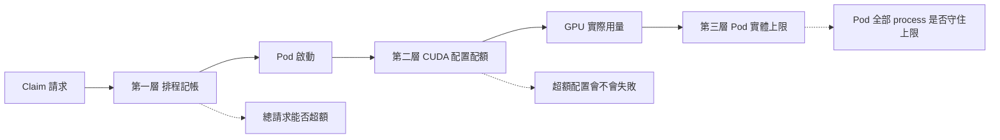
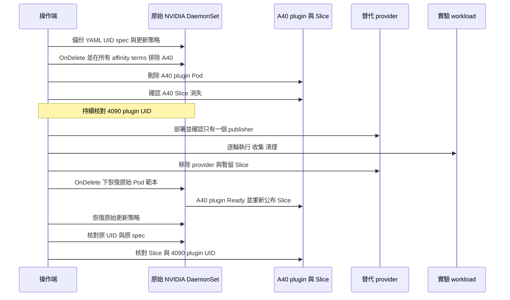
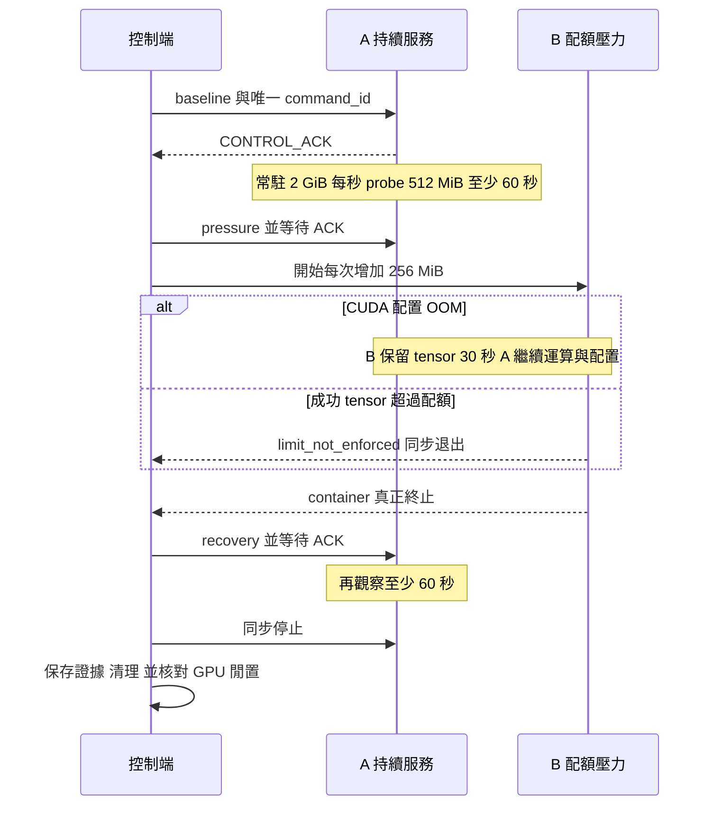
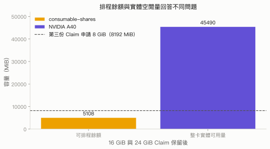

# 第 4 章　防止 OOM：三層隔離模型

## 本章要回答的問題

上一章已看到，共用一張 GPU 時，一個 workload 的新配置可能受另一個 workload 影響。本章進一步問：在 Claim 中宣告「8 GiB」，究竟限制了 scheduler 的帳本、CUDA 的配置呼叫，還是整個 Pod 的實體 VRAM？這三個問題必須分別驗證，才能判斷一個方案防住了哪一種 OOM。

本章比較 ConsumableShares、MPS 與 HAMi-DRA。先建立共同的觀察方法，再沿著各方案的設定與原始碼解釋結果；完整跨方案比較見[第 4.5 節](results.md)。

## 背景原理

### 三層隔離模型

排程時，ResourceClaim 是資源請求；執行時，CUDA process 才真正配置 GPU 記憶體。宣告量、程式保留的 tensor 量與 NVML 量到的實體用量，因此可以不同。下圖把需要回答的問題放在發生的位置，箭頭表示工作流程，不表示前一層通過就能保證後一層。

| 層次 | 定義 | 本章如何驗證 | 不能由這一層推得的結論 |
|---|---|---|---|
| 排程記帳 | scheduler 依已配置的容量，拒絕超過公布總量的新 allocation。 | 檢查 Claim、`consumedCapacity`、Pending 與釋放後配置。 | 尚未使用的請求量已占住實體 VRAM。 |
| runtime 配額 | 指定範圍內的 CUDA 記憶體配置超過配額時失敗。 | 逐步增加 tensor，區分配置 OOM 與成功超額。 | 配額範圍一定是整個 Pod，或涵蓋全部實體負擔。 |
| 實體上限 | Pod 全部 CUDA process 的實體用量合計不超過請求量。 | 先建立 PID 到 Pod 的身分關係，再合計實體 process 用量。 | 整卡 NVML 峰值就是單一 Pod 用量。 |

Kubernetes 的 [DRA consumable capacity](https://kubernetes.io/docs/concepts/resource-management/dynamic-resource-allocation/dra-features/#consumable-capacity)處理第一層；NVIDIA 的 [MPS device memory limit](https://docs.nvidia.com/deploy/mps/595/when-to-use-mps.html#mps-device-memory-limit)處理每個 client 的 CUDA 配置。HAMi-DRA v0.1.0 則把 Claim 的消耗容量轉成 container 中的記憶體限制與共享 cache 設定，見[固定版本原始碼](https://github.com/Project-HAMi/k8s-dra-driver/blob/v0.1.0/cmd/hami-kubelet-plugin/hami_core.go#L214-L244)。實體上限要另外量測，不能只由這些設定欄位推得。

### 方案與層次的對照

| 方案 | 排程記帳 | runtime 配額 | Pod 的嚴格實體上限 |
|---|---|---|---|
| ConsumableShares | 獨立 Claim 扣除 VRAM 容量；本次已驗證。 | 本次 CUDA 路徑沒有強制配額，B 成功超額。 | 沒有提供此保證。 |
| MPS | 本次 A、B 共用 Claim，沒有 VRAM `capacity.requests`。 | 每個 CUDA client 有配額；本次驗證 single-process 邊界。 | 同一 Pod 的多個 client 可以合計超過單一 client 配額。 |
| HAMi-DRA | 獨立 Claim 申請容量。 | 本次配置路徑與共享 cache 有限制。 | 仍須核對實體 process 用量，不能把共享 cache 當成實體分割。 |

這個對照限定於本章的版本與測試路徑。ConsumableShares 的原始資料與判定見[第 4.1 節](consumable-shares.md)，MPS 見[第 4.2 節](mps.md)，HAMi-DRA 的配置與多個 process 範圍分別見[第 4.3 節](hami-dra.md)及[第 4.4 節](hami-vs-mps.md)。

## 部署與設定

### 共用環境與 Claim 拓撲

原始量測固定在 `dra-a40`，GPU UUID 為 `GPU-29ffee3e-bee4-e341-917a-fe7e43e977af`。Kubernetes v1.37.0、CRI-O 1.37.1、NVIDIA DRA v0.5.0、GPU Operator v26.7.0、driver 595.91.07、PyTorch 2.5.1+cu124 與 CUDA runtime 12.4 的版本證據存放於 [data/e2](../../data/e2/README.md)；MPS 在 2026-10-06 完成，ConsumableShares 在 2026-10-07 完成。重現 image 固定原實際 digest，完整輸入列在各方案頁面。

MPS 的 A、B 引用同一份 Claim，使它們進入同一個 MPS server；容量方案的 A、B 各用一份獨立 Claim，讓 scheduler 為每個 allocation 記帳。記帳測試則是三個獨立 Claim，各以一個 sleeper Pod 觸發配置。套件以 Job 承載觀察工作，保留原本的 Claim 共享關係、CUDA 程式、參數與環境變數。

| 原物件角色 | 重現套件名稱 | 保留的語意 |
|---|---|---|
| runtime Pod `survivor` | Job `steady-service` | A 持續運算與新配置 probe。 |
| runtime Pod `pressure` | Job `quota-pressure` | B 測 single-process 邊界或同 Pod dual-process。 |
| 記帳 Pod `a`／`b`／`c` | `capacity-resident`／`capacity-release`／`capacity-waiter` | 依序占住、釋放、等待記帳容量。 |
| MPS 共用 Claim | `a40-shared-mps` | A、B 仍引用同一個 allocation。 |
| 容量方案的 A／B Claim | `steady-gpu`／`pressure-gpu` | A、B 各有自己的 allocation。 |
| 原 workload ConfigMap | `isolation-code` | 由一份共用 generator 產生原始程式。 |

### 只讓一個 provider 公布目標 GPU

> **僅限專用實驗叢集。以下流程會修改原始 NVIDIA DaemonSet、刪除 A40 plugin Pod 與暫留的 ResourceSlice。先停止目標 GPU 的工作並清理 Claim，完整保留備份；勿在正式服務節點執行。**

MPS 直接使用原始 NVIDIA provider。ConsumableShares 與 HAMi-DRA 改用不同設定或替代 provider，因此先從原始 DaemonSet 排除 A40；同一時間只能有一個 provider 公布這張 GPU，避免同一份實體容量出現在彼此獨立的裝置帳本。即使使用相同 `gpu.nvidia.com` driver 名稱，也必須先停止舊 plugin，才啟動替代 plugin。

原始 DaemonSet 是 `nvidia-dra-driver-gpu/dra-driver-nvidia-gpu-kubelet-plugin`，selector 為 `dra-driver-nvidia-gpu-component=kubelet-plugin`。`nodeSelectorTerms` 是 OR 關係，因此要在每一個原始 term 加上 `metadata.name NotIn [dra-a40]`，只新增一個 term 會放寬條件。先改成 `OnDelete`，則範本變更不會主動把 4090 的既有 plugin 替換；[DaemonSet 更新策略說明](https://kubernetes.io/docs/tasks/manage-daemon/update-daemon-set/#daemonset-update-strategy)說明這個策略要由操作端刪除既有 Pod 才更新。

這次原始 Slice 由 Node 持有，plugin Pod 消失不代表 Slice 一定一起刪除。腳本確認原 plugin 與替代 provider 都不存在、沒有相關 Claim、GPU 為 `Default` 且沒有 compute process、用量最多 64 MiB，再核對 Slice UID、spec 與 Node owner，才清除暫留的目標 Slice。所有刪除都有 UID／resourceVersion 前置條件；外部修改、受保護 UID 改變或身分不符會停止。

還原採兩階段，先在 `OnDelete` 下恢復原範本，等 A40 plugin Ready 且原始 Slice 的裝置、屬性與容量回復，再恢復原始更新策略。最後核對同一個 DaemonSet UID 與備份 spec，略過由 API server 管理的範本 metadata 欄位；Slice 的 pool generation 可以因重新公布而改變。可執行腳本與中斷復原方式見 [provider 工具](../../labs/04-isolation/provider/README.md)。

## 實驗設計

### 容量記帳測試

依序建立 16 GiB、24 GiB、8 GiB 的三份 Claim，讓前兩個 sleeper Job Ready 後再建立第三個。A40 在 ResourceSlice 公布的容量是 46,068 MiB，前兩份共保留 40,960 MiB 後只剩 5,108 MiB，不夠第三份的 8,192 MiB。這些工作只列出 GPU 並休眠，不建立 CUDA context，所以可以同時看到「實體 VRAM 幾乎空著」與「scheduler 的可分配餘額不足」。儲存第三個 Pending 的 Claim、Pod 與真實 scheduler event，再釋放 24 GiB 的工作和 Claim，驗證第三個取得 allocation。

### CUDA runtime 測試

A 先保留 2 GiB tensor，每秒做原地運算，再嘗試新的 512 MiB 配置並釋放它。Baseline 至少 60 秒後，B 每次保留新的 256 MiB tensor、間隔 0.2 秒，直到 CUDA 配置 OOM 或成功 tensor 超額；真正 OOM 時，B 同步後保留成功 tensor 30 秒，讓 A 持續 probe。B container 真正退出後，A 再觀察至少 60 秒，最後同步並正常退出。

| 參數 | 意義 | 為什麼這樣設 |
|---|---|---|
| A 常駐 2 GiB、probe 512 MiB／秒 | 分別觀察既有運算與新配置。 | 讓「還活著」和「還能配置」有不同證據。 |
| B 步長 256 MiB、間隔 0.2 秒 | 逐步接近配置邊界。 | 保留每次成功配置與失敗事件，不把細度當成精確負擔量。 |
| OOM 後保留 30 秒 | 保持 B 的成功 tensor 存在。 | 計算 A 在共同 hold 窗口的成功／OOM 次數。 |
| baseline 與 recovery 各至少 60 秒 | 建立前後觀察窗口。 | recovery 從 B container 真正退出後計時。 |
| `PYTORCH_NO_CUDA_MEMORY_CACHING=1` | 停用 PyTorch GPU 記憶體 cache。 | 避免已釋放 tensor 仍由 allocator cache 影響 probe。 |
| 不設定 PyTorch memory fraction | 不加入 workload 自訂配置上限。 | 讓配額失敗歸因於待測方案。 |

Single-process 邊界測試的安全規則以該 CUDA client 成功保留的 tensor 合計為準：一旦超過宣告配額，記錄 `B_LIMIT_EXCEEDED`，同步退出，不再故意耗盡實體 GPU。這個停止是量測工具的保護，結果必須記為「限制未強制執行」，不能算成配額有效；此時也沒有 30 秒 hold，應比較 A 的整段 pressure phase 而不是 hold 次數。MPS dual-process 測試則讓兩個 client 各到 5 GiB 目標後保留，配額檢查仍在各 client 內執行；它刻意用有限的 10 GiB 合計量檢查 Pod 範圍，不會因 Pod 合計超過 8 GiB 而觸發這個 single-process 停止條件。

每個正式條件重複三輪，且每輪都使用新 Claim。先儲存日誌與 API 快照，再讓 CUDA process 同步退出、Pod 消失、Claim 釋放，核對沒有 compute process 與殘留配額服務後才開始下一輪；這避免上一輪的 tensor、Claim 記帳或 MPS server 污染下一輪結果。

## 結果

容量帳本與配置配額各自通過不同的測試。ConsumableShares 的第三份 Claim 會等待，但它沒有擋住 B 的 8.25 GiB 成功 tensor；MPS 的單一 process 會遇到配置 OOM，同一 Pod 的 dual-process 卻能各保留 5 GiB。這些結果由[共用分析程式](../../labs/04-isolation/common/analysis/analyze.py)重算原始日誌、API 與 GPU 取樣得到。

| 觀察 | 原實驗結果 | 所回答的層次 |
|---|---|---|
| ConsumableShares 第三份 8 GiB Claim | 16 + 24 GiB 已配置時 Pending，釋放 24 GiB 後配置。 | 排程記帳。 |
| ConsumableShares B 的 8 GiB Claim | 成功 tensor 達 8.25 GiB，工具安全停止。 | runtime 配額沒有強制上限。 |
| MPS 每個 client 8 GiB | single-process 7.5 GiB 後配置 OOM。 | 每個 client 的 runtime 配額。 |
| MPS 同 Pod 兩個 client | 各 5 GiB，合計 10 GiB。 | 不能推成整個 Pod 的 8 GiB 上限。 |

記帳與 runtime 的精確逐輪表分別見 [ConsumableShares 結果](consumable-shares.md#結果)及 [MPS 結果](mps.md#驗證與結果)。整卡 NVML 只用於觀察共同裝置，Pod 的實體上限必須以已識別的 process 量另算；HAMi-DRA 的共享 cache 與實體用量比較見[第 4.4 節](hami-vs-mps.md)。

## 解讀

排程記帳減少的是「過多宣告量被同時排進來」；runtime 配額控制的是「指定 client 或共享紀錄內的配置量」。只有同時知道限制範圍、配置路徑與實體負擔，才能回答 Pod 是否守住請求上限。一次配置 OOM、一個 Pending Claim 或一個正常 exit code，單獨都不足以證明三層隔離都有效。

## 限制

正式量測固定在 A40、這組版本與 PyTorch tensor 配置路徑，未覆蓋 CUDA Async、Managed memory 或 VMM。MPS 的 4090 行為、不同 Claim 是否共用服務、致命故障與不可信 workload 隔離都未實測；這裡的正常退出也不能用來推論強制終止安全。完整結果以各方案頁面的限制為準。

原始 NVML 時間序列每次查詢後等待 1 秒，間隔還包含查詢時間；重現套件改用 driver Pod 內的 500 ms 連續取樣。兩者只能看到離散時刻，tensor 步長也不是實體負擔的精確量尺。不同方法使用不同 Claim 拓撲，這個實驗比較它們提供哪一層限制，沒有量測效能優劣。

## 動手重現

從[隔離重現套件](../../labs/04-isolation/README.md)依序執行 MPS（原生 provider）、ConsumableShares 與 HAMi-DRA（各自切換 provider，跑完立即還原）；完整命令、收集與清理見各方案 README。共用程式與分析讓兩種方法使用相同的 CUDA 配置路徑，`SMOKE=1` 只減少案例的重複次數，保留關鍵觀察窗口。

2026-10-12 在原叢集執行的縮短版重現了本章三種方案的關鍵結果：MPS single-process 在 8 GiB 前 OOM、同 Pod dual-process 合計 10 GiB；ConsumableShares 的第三份 Claim 先 Pending、B 成功配置 8.25 GiB；HAMi-DRA 的 NVML 實體用量在 single-process、同 container dual-process 與跨 Pod 共用 Claim 三個案例分別為 7,986、8,292、10,596 MiB（跨 Pod 的成功 tensor 合計為 9.75 GiB），都與原始實驗相同。逐項輸出、provider 切換與還原的核對見[實機驗證紀錄](../../labs/04-isolation/VERIFIED.md)。本章的數值來自原始量測，公開重算資料存放在 [data/e2](../../data/e2/README.md)。

### 章節導覽

| 頁面 | 重點 |
|---|---|
| [4.1 ConsumableShares](consumable-shares.md) | 容量公布、scheduler 記帳、Pending 與成功超額。 |
| [4.2 MPS](mps.md) | CUDA context、Hyper-Q、MPS server 與每個 process 的配額。 |
| [4.3 HAMi-DRA](hami-dra.md) | Claim 容量如何接到 container 內的配置限制。 |
| [4.4 HAMi-DRA 與 MPS](hami-vs-mps.md) | 多個 process、共享 cache 與實體用量的範圍。 |
| [4.5 結果與判讀](results.md) | 把三層模型與逐輪結果放在一起比較。 |

## 重點整理

Claim 宣告量、CUDA 成功 tensor 量與 Pod 實體用量是三個不同觀察對象。先驗證排程記帳，再驗證 runtime 配額的範圍，最後核對全部 process 的實體總量，才能說清楚「防止 OOM」實際提供了什麼。所有比較都以同一份 workload、明確時間窗口與完整清理為前提。

<!-- nav:start -->
[← 上一頁：第 3 章　共用 GPU 時的 OOM 行為](../03-oom/README.md) ｜ [目錄](../README.md) ｜ [下一頁：4.1 ConsumableShares：排程記帳 →](consumable-shares.md)
<!-- nav:end -->
