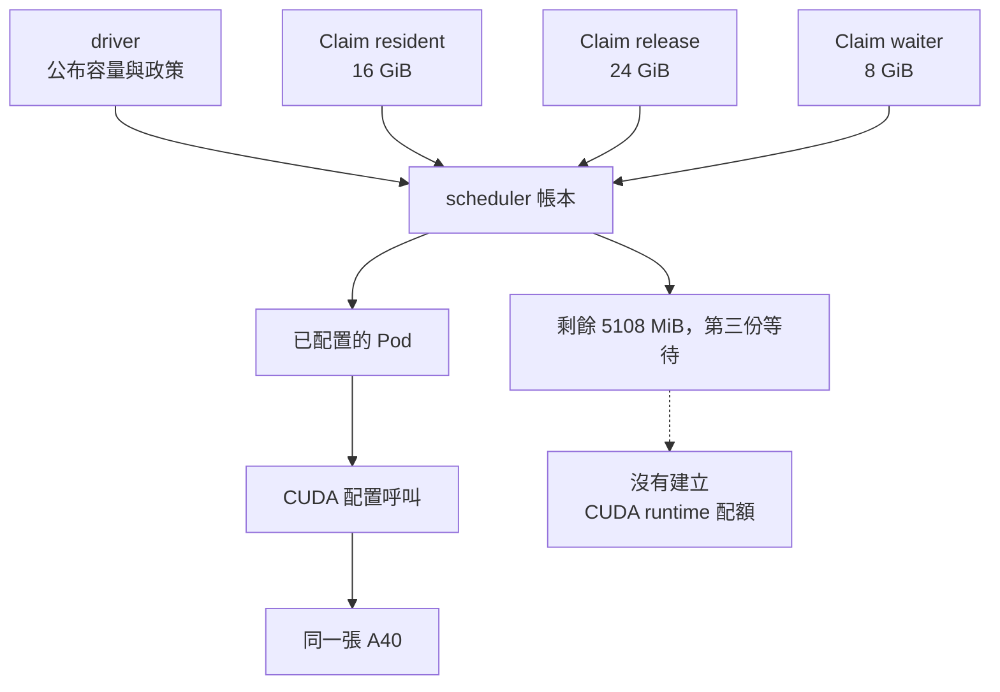
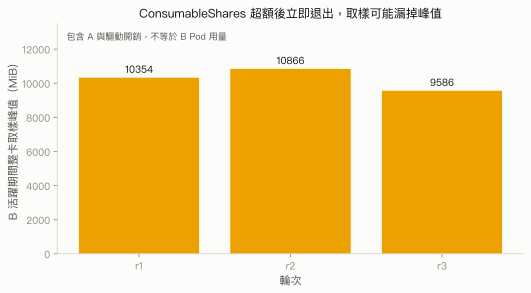

# 4.1 ConsumableShares：排程記帳

## 本頁要回答的問題

ResourceClaim 申請 8 GiB，是否就代表 container 只能配置 8 GiB VRAM？本頁先驗證 scheduler 是否依 Claim 記帳，再讓 CUDA process 真的增加 tensor。結果是 ConsumableShares 能拒絕超過公布容量的新 allocation，但這次設定沒有強制 CUDA 配置上限。

## 背景原理

### Kubernetes 的容量消耗是排程帳本

一般裝置 allocation 以整個裝置為單位；consumable capacity 則讓同一個裝置允許多份 allocation，並為每個容量維度記錄消耗量。Driver 在 ResourceSlice 的裝置設定 `allowMultipleAllocations: true`，再公布例如 `capacity.memory.value` 與 `requestPolicy`；Claim 在 `spec.devices.requests[].exactly.capacity.requests.memory` 指定需求。[DRA 容量消耗說明](https://kubernetes.io/docs/concepts/resource-management/dynamic-resource-allocation/dra-features/#consumable-capacity)



| 欄位 | 意義 | 本次設定的效果 |
|---|---|---|
| `allowMultipleAllocations` | 同一裝置允許多份 allocation。 | 每份獨立 Claim 都可以選到 `gpu-0`。 |
| `capacity.memory.value` | driver 公布的容量總量。 | scheduler 以它作為容量帳本的上限。 |
| `requestPolicy.default` | Claim 沒有指定該容量時的預設消耗量。 | 本次是整張卡的公布容量，省略 memory 不會變成免費共享。 |
| `requestPolicy.validRange.min/max/step` | 可接受的配置範圍與粒度。 | 本次最小 1 MiB、最大 46,068 MiB、步長 1 MiB。 |
| Claim 的 `capacity.requests.memory` | workload 提出的容量需求。 | 本次所有 GiB 請求都落在公布的粒度上。 |
| allocation 的 `consumedCapacity.memory` | scheduler 按容量政策實際記帳的量。 | 本次和請求量相同；一般情況不可只加總原始請求字串。 |
| allocation 的 `shareID` | 共享裝置上各 allocation 的識別碼。 | 區分同一 driver／pool／device 的不同配置。 |

Scheduler 將已配置及本次排程過程中的消耗量納入判斷，不依 NVML 的即時 free 決定帳本餘額。容量政策可以讓實際消耗量向上對齊粒度；剩餘量由 allocation 狀態推算，不會把 ResourceSlice 的公布總量改寫成目前餘額。`shareID` 區分 allocation，同一份 Claim 被多個 Pod 引用仍是同一份配置，不會按 Pod 數自動再扣容量。設計依據見 [KEP 5075](https://raw.githubusercontent.com/kubernetes/enhancements/master/keps/sig-scheduling/5075-dra-consumable-capacity/README.md)。

本叢集 Kubernetes **v1.37.0** 的 `DRAConsumableCapacity` 為 **beta、預設啟用**；它自 v1.36 起轉為 beta，並非因 DRA 基礎功能已穩定就自動變成 GA。這個判定同時核對了[官方功能頁](https://kubernetes.io/docs/concepts/resource-management/dynamic-resource-allocation/dra-features/#consumable-capacity)與 [v1.37.0 的 feature gate 原始碼](https://raw.githubusercontent.com/kubernetes/kubernetes/v1.37.0/pkg/features/kube_features.go)。

### NVIDIA v0.5.0 如何公布 memory

Kubernetes 的 `DRAConsumableCapacity` 與 NVIDIA driver 的 `ConsumableShares` 是兩個不同 gate。Driver v0.5.0 將後者列為 alpha、預設關閉，須明確啟用；`CONSUMABLE_SHARES` 的預設值則是 `disabled`。本次使用 `FEATURE_GATES=MPSSupport=false,ConsumableShares=true` 和 `CONSUMABLE_SHARES=memory`。[driver gate 定義](https://raw.githubusercontent.com/kubernetes-sigs/dra-driver-nvidia-gpu/v0.5.0/pkg/featuregates/featuregates.go)、[命令列與環境變數介面](https://raw.githubusercontent.com/kubernetes-sigs/dra-driver-nvidia-gpu/v0.5.0/cmd/gpu-kubelet-plugin/main.go)

`cmd/gpu-kubelet-plugin/consumable_shares.go` 第 29 至 38 行實際檢查 gate 與選項，不是只看環境變數名稱：

```go
func isConsumableSharesEnabled(config *Config) bool {
	if !featuregates.Enabled(featuregates.ConsumableShares) {
		return false
	}
	if config == nil || config.flags == nil {
		return false
	}
	sharesOption := strings.TrimSpace(config.flags.consumableShares)
	return sharesOption != "" && sharesOption != "disabled"
}
```

同檔第 40 至 66 行先設 `AllowMultipleAllocations`，以 1 MiB 為步長把裝置容量向下對齊，避免 max／default 不符合 API 的粒度要求。`memory` 分支在第 80 至 89 行把預設需求設為對齊後的總容量，最小需求為一個步長；以下是該分支的完整內容。[v0.5.0 容量政策實作](https://raw.githubusercontent.com/kubernetes-sigs/dra-driver-nvidia-gpu/v0.5.0/cmd/gpu-kubelet-plugin/consumable_shares.go)

```go
	case "memory":
		memCap.RequestPolicy = &resourceapi.CapacityRequestPolicy{
			Default: new(maxMem.DeepCopy()),
			ValidRange: &resourceapi.CapacityRequestPolicyRange{
				Min:  new(step.DeepCopy()),
				Max:  new(maxMem.DeepCopy()),
				Step: new(step.DeepCopy()),
			},
		}
		dev.Capacity["memory"] = memCap
```

這段程式設定的是 ResourceSlice 的容量與政策。它沒有在這個分支建立 CUDA 記憶體限制；後面的實驗會直接驗證 CUDA 配置是否受限，不能只由 `memory` 這個選項推論。

v0.5.0 在 MPS 裝置準備路徑另有明確拒絕：當 Claim 選擇 MPS、`MPSSupport` 已啟用且有效的 ConsumableShares 也已啟用時，會回傳 `MPS sharing is not supported when consumable shares is enabled`。這是**MPS Claim 準備與有效容量共享的互斥**，不能簡化成兩個 gate 的布林值永遠不能同時為 true；原始判斷在 `cmd/gpu-kubelet-plugin/device_state.go` 第 1331 至 1334 行。[固定版本的拒絕路徑](https://raw.githubusercontent.com/kubernetes-sigs/dra-driver-nvidia-gpu/v0.5.0/cmd/gpu-kubelet-plugin/device_state.go)

```go
	if featuregates.Enabled(featuregates.MPSSupport) && config.IsMps() {
		if isConsumableSharesEnabled(s.config) {
			return nil, fmt.Errorf("MPS sharing is not supported when consumable shares is enabled")
		}
```

## 部署與設定

### 原始環境與名稱

量測在 2026-10-07 的 `dra-a40`，Kubernetes v1.37.0、NVIDIA DRA v0.5.0、driver 595.91.07，PyTorch 2.5.1+cu124 與 CUDA runtime 12.4。完整版本投影見 [versions-consumable-shares.json](../../data/e2/versions-consumable-shares.json)，workload 與 provider 皆以原實際 image digest 固定。以下從 `labs/04-isolation/` 查看完整來源；手動套用輸出均標為預期，正式的分階段控制由 `scripts/run.sh` 完成，套用前會在 workload JSON 加上 `app.kubernetes.io/instance: <run-id>`，供收集與清理核對執行身分。

| 原物件 | 重現名稱 | 語意 |
|---|---|---|
| A40 專用 provider Pod `e2-consumable-provider` | DaemonSet `a40-consumable-provider` 的 Pod | 只在 A40 公布容量，使用原 ServiceAccount、env 與掛載。 |
| 記帳 Claim／Pod `a` | Claim `capacity-resident-gpu`／Job `capacity-resident` | 先占住 16 GiB 記帳量。 |
| 記帳 Claim／Pod `b` | Claim `capacity-release-gpu`／Job `capacity-release` | 先占住、再釋放 24 GiB。 |
| 記帳 Claim／Pod `c` | Claim `capacity-waiter-gpu`／Job `capacity-waiter` | 8 GiB 請求先等候，再取得 allocation。 |
| Claim `survivor-gpu`／Pod `survivor` | Claim `steady-gpu`／Job `steady-service` | A 的 4 GiB 請求與持續服務。 |
| Claim `pressure-gpu`／Pod `pressure` | Claim `pressure-gpu`／Job `quota-pressure` | B 的 8 GiB 請求與配置邊界。 |
| 各輪獨立 Namespace | `gpu-isolation-lab` | 每輪完整清理後重用，保留新 Claim。 |

本次原 provider 是一個 Pod，套件改為 A40-only DaemonSet 以便明確安裝與移除。保留五個原始 node affinity OR terms，每一個增加 `metadata.name In [dra-a40]`，因此不會把原硬體條件放寬；image 保留 tag 並加上實測 digest。Namespace、label 與 ConfigMap generator 是和 MPS 共用的，完整內容見 [共用 Namespace 與 workload](mps.md#namespace-與-workload)。

### 先切換 provider

> **僅限專用實驗叢集。先停止 A40 的工作並清理 Claim，備份原始 DaemonSet、UID 與更新策略；勿在正式服務節點執行。**

先以 [provider 工具](../../labs/04-isolation/provider/README.md)備份，將原始 DaemonSet 改為 `OnDelete` 並從每個 affinity term 排除 A40，刪除 A40 plugin 後確認原 Slice 已消失。4090 plugin 的 UID 必須保持相同，才可部署下方替代 provider；`install-provider.sh` 把這些步驟連在一起，並要求 `I_UNDERSTAND_THIS_CHANGES_THE_CLUSTER=1`。

#### A40 專用 provider

Namespace 與替代 provider 合成下列完整多物件 YAML。各物件與原分開的 manifests 等值；既有 Kustomization 仍由安裝腳本使用，這裡以階段分組方便閱讀。

```console
$ vi consumable-shares/manifests/provider/provider.yaml
```

```yaml
apiVersion: v1
kind: Namespace
metadata: {name: gpu-isolation-lab, labels: {app.kubernetes.io/part-of: dra-book, app.kubernetes.io/component: isolation-lab}}
---
apiVersion: apps/v1
kind: DaemonSet
metadata:
  name: a40-consumable-provider
  namespace: nvidia-dra-driver-gpu
  labels: {app.kubernetes.io/part-of: dra-book, app.kubernetes.io/component: consumable-provider}
spec:
  selector: {matchLabels: {app.kubernetes.io/part-of: dra-book, app.kubernetes.io/component: consumable-provider}}
  updateStrategy: {type: OnDelete}
  template:
    metadata: {labels: {app.kubernetes.io/part-of: dra-book, app.kubernetes.io/component: consumable-provider}}
    spec:
      affinity:
        nodeAffinity:
          requiredDuringSchedulingIgnoredDuringExecution:
            nodeSelectorTerms:
            - matchExpressions:
              - {key: feature.node.kubernetes.io/pci-10de.present, operator: In, values: ['true']}
              matchFields:
              - {key: metadata.name, operator: In, values: [dra-a40]}
            - matchExpressions:
              - {key: feature.node.kubernetes.io/pci-0302_10de.present, operator: In, values: ['true']}
              matchFields:
              - {key: metadata.name, operator: In, values: [dra-a40]}
            - matchExpressions:
              - {key: feature.node.kubernetes.io/pci-0300_10de.present, operator: In, values: ['true']}
              matchFields:
              - {key: metadata.name, operator: In, values: [dra-a40]}
            - matchExpressions:
              - {key: feature.node.kubernetes.io/cpu-model.vendor_id, operator: In, values: [NVIDIA]}
              matchFields:
              - {key: metadata.name, operator: In, values: [dra-a40]}
            - matchExpressions:
              - {key: nvidia.com/gpu.present, operator: In, values: ['true']}
              matchFields:
              - {key: metadata.name, operator: In, values: [dra-a40]}
      containers:
      - args:
        - |-
          # Conditionally mask the params file to prevent this container from
          # recreating any missing GPU device nodes. This is necessary, for
          # example, when running under nvkind to limit the set GPUs governed
          # by the plugin even though it has cgroup access to all of them.
          if [ "${MASK_NVIDIA_DRIVER_PARAMS}" = "true" ]; then
            cp /proc/driver/nvidia/params /root/gpu-params
            sed -i 's/^ModifyDeviceFiles: 1$/ModifyDeviceFiles: 0/' /root/gpu-params
            mount --bind /root/gpu-params /proc/driver/nvidia/params
          fi
          gpu-kubelet-plugin -v $(LOG_VERBOSITY)
        command: [bash, -c]
        env:
        - {name: HTTP_ENDPOINT, value: ':8080'}
        - {name: METRICS_PATH, value: /metrics}
        - {name: LOG_VERBOSITY, value: '4'}
        - {name: MASK_NVIDIA_DRIVER_PARAMS}
        - {name: NVIDIA_DRIVER_ROOT, value: /run/nvidia/driver}
        - {name: NVIDIA_VISIBLE_DEVICES, value: void}
        - {name: CDI_ROOT, value: /var/run/cdi}
        - {name: NVIDIA_MIG_CONFIG_DEVICES, value: all}
        - {name: NODE_NAME, valueFrom: {fieldRef: {apiVersion: v1, fieldPath: spec.nodeName}}}
        - {name: NAMESPACE, valueFrom: {fieldRef: {apiVersion: v1, fieldPath: metadata.namespace}}}
        - {name: SERVICE_ACCOUNT_NAME, valueFrom: {fieldRef: {apiVersion: v1, fieldPath: spec.serviceAccountName}}}
        - {name: IMAGE_NAME, value: 'nvcr.io/nvidia/dra-driver-nvidia-gpu:v0.5.0'}
        - {name: IMAGE_PULL_POLICY, value: IfNotPresent}
        - {name: FEATURE_GATES, value: 'MPSSupport=false,ConsumableShares=true'}
        - {name: KUBELET_REGISTRAR_DIRECTORY_PATH, value: /var/lib/kubelet/plugins_registry}
        - {name: KUBELET_PLUGINS_DIRECTORY_PATH, value: /var/lib/kubelet/plugins}
        - {name: HEALTHCHECK_PORT, value: '51516'}
        - {name: CONSUMABLE_SHARES, value: memory}
        image: nvcr.io/nvidia/dra-driver-nvidia-gpu:v0.5.0@sha256:2f76a02532bea530418693bcf382f2094cb40dc8466cefdbb9af923a232e738b
        imagePullPolicy: IfNotPresent
        livenessProbe:
          failureThreshold: 3
          grpc: {port: 51516, service: liveness}
          periodSeconds: 30
          successThreshold: 1
          timeoutSeconds: 10
        name: gpus
        resources: {}
        securityContext: {privileged: true}
        startupProbe:
          failureThreshold: 600
          grpc: {port: 51516, service: liveness}
          periodSeconds: 1
          successThreshold: 1
          timeoutSeconds: 10
        terminationMessagePath: /dev/termination-log
        terminationMessagePolicy: File
        volumeMounts:
        - {mountPath: /var/lib/kubelet/plugins_registry, name: plugins-registry}
        - {mountPath: /var/lib/kubelet/plugins, mountPropagation: Bidirectional, name: plugins}
        - {mountPath: /var/run/cdi, name: cdi}
        - {mountPath: /driver-root, mountPropagation: HostToContainer, name: driver-root}
      dnsPolicy: ClusterFirst
      initContainers:
      - command: [bash, /usr/bin/kubelet-plugin-prestart.sh]
        env:
        - {name: NVIDIA_DRIVER_ROOT, value: /run/nvidia/driver}
        - {name: NVIDIA_VISIBLE_DEVICES, value: void}
        - {name: KUBELET_REGISTRAR_DIRECTORY_PATH, value: /var/lib/kubelet/plugins_registry}
        - {name: KUBELET_PLUGINS_DIRECTORY_PATH, value: /var/lib/kubelet/plugins}
        image: nvcr.io/nvidia/dra-driver-nvidia-gpu:v0.5.0@sha256:2f76a02532bea530418693bcf382f2094cb40dc8466cefdbb9af923a232e738b
        imagePullPolicy: IfNotPresent
        name: init-container
        resources: {}
        securityContext: {privileged: true}
        terminationMessagePath: /dev/termination-log
        terminationMessagePolicy: File
        volumeMounts:
        - {mountPath: /driver-root-parent, mountPropagation: HostToContainer, name: driver-root-parent}
      priorityClassName: system-node-critical
      restartPolicy: Always
      schedulerName: default-scheduler
      securityContext: {}
      serviceAccountName: dra-driver-nvidia-gpu-service-account-kubeletplugin
      terminationGracePeriodSeconds: 30
      tolerations:
      - {effect: NoSchedule, key: nvidia.com/gpu, operator: Exists}
      volumes:
      - {hostPath: {path: /var/lib/kubelet/plugins_registry, type: ''}, name: plugins-registry}
      - {hostPath: {path: /var/lib/kubelet/plugins, type: ''}, name: plugins}
      - {hostPath: {path: /var/run/cdi, type: ''}, name: cdi}
      - {hostPath: {path: /run/nvidia, type: DirectoryOrCreate}, name: driver-root-parent}
      - {hostPath: {path: /run/nvidia/driver, type: DirectoryOrCreate}, name: driver-root}
```

| 參數 | 意義 | 為什麼這樣設 |
|---|---|---|
| `OnDelete`、五個 affinity terms 的 `metadata.name In [dra-a40]` | 只在原硬體條件符合的 A40 建立 plugin。 | 固定實驗 GPU，避免自動滾動更新其他節點。 |
| provider 與 initContainer 的 tag 加 `@sha256:2f76…738b` | 固定原實際 image。 | 保留 v0.5.0 tag 並鎖定內容。 |
| `FEATURE_GATES=MPSSupport=false,ConsumableShares=true` | 啟用容量共享，停用本 provider 的 MPS。 | 符合原實驗部署。 |
| `CONSUMABLE_SHARES=memory` | 公布 memory 容量政策。 | 用容量記帳而非只給共享次數。 |
| `serviceAccountName`、`system-node-critical`、privileged | 沿用原 plugin 的權限與優先權。 | 裝置準備及 kubelet 掛載需要原本的權限。 |
| `NVIDIA_DRIVER_ROOT=/run/nvidia/driver` 與 driver-root 掛載 | 保留 GPU Operator 的 driver root。 | NVIDIA 工具與 library 來自節點 driver。 |
| plugins／registry／CDI 掛載與 mount propagation | 保留原 kubelet plugin、註冊與 CDI 路徑。 | 讓裝置準備結果能交給 runtime。 |
| 其餘 env、gRPC probe、prestart 與容忍條件 | 保留原 provider Pod 設定。 | 只改 workload 包裝、名稱、label 與節點限制。 |

（預期輸出）

```console
$ kubectl apply -f consumable-shares/manifests/provider/provider.yaml
namespace/gpu-isolation-lab created
daemonset.apps/a40-consumable-provider created
```

### 重用原始 ServiceAccount 與 RBAC

上述 DaemonSet 沿用 `dra-driver-nvidia-gpu-service-account-kubeletplugin`，位於 `nvidia-dra-driver-gpu`。原實驗沒有另建 ServiceAccount 或 RBAC，本套件也直接重用第 2 章已部署的物件；安裝前會讀取原 ClusterRole 與 Binding，核對 ServiceAccount、roleRef 和下表必要權限，沒有改寫原始物件。[v0.5.0 chart 的完整 RBAC 範本](https://raw.githubusercontent.com/kubernetes-sigs/dra-driver-nvidia-gpu/v0.5.0/deployments/helm/dra-driver-nvidia-gpu/templates/rbac-kubeletplugin.yaml)

| API group 與資源 | 原 kubelet plugin 的必要 verbs | 用途 |
|---|---|---|
| `resource.nvidia.com/computedomains` | get、list、watch | 讀取 driver 的 ComputeDomain 資源。 |
| `resource.k8s.io/resourceclaims` | get、list、watch | 讀取 Claim 配置。 |
| `resource.k8s.io/resourceslices` | get、list、watch、create、update、delete | 公布與維護裝置容量。 |
| core `nodes` | get、list、watch、update、patch | 節點與裝置公布所需操作。 |
| core `pods` | get、list、watch | 讀取 workload 資訊。 |

### 實際公布的容量

第一輪原始 ResourceSlice 的 `gpu-0` 有 `allowMultipleAllocations: true`。下面節錄實際 API 輸出的容量區塊；前後以 `...` 標示省略，完整 A40 Slice 存放在 [resourceslices.json](../../data/e2/raw/consumable-accounting-r1/resourceslices.json)。這是 driver 的輸出，不是要另外套用的 manifest。

```sh
$ kubectl get resourceslices -o yaml
```

```yaml
...
      capacity:
        memory:
          requestPolicy:
            default: 46068Mi
            validRange:
              max: 46068Mi
              min: 1Mi
              step: 1Mi
          value: 46068Mi
      name: gpu-0
...
```

| 參數 | 意義 | 為什麼這樣設 |
|---|---|---|
| `value: 46068Mi` | 公布容量 46,068 MiB。 | 沿用 driver 的裝置容量，不等於可保留的 tensor 大小。 |
| `default: 46068Mi` | 未指定 memory 時消耗整個公布量。 | 明確請求容量才會留下可供其他 Claim 使用的記帳餘額。 |
| `min: 1Mi`、`max: 46068Mi`、`step: 1Mi` | 記帳範圍與粒度。 | 符合 driver 的 `memory` 政策。 |

### 依序建立三組記帳物件

每份 Claim 與引用它的 sleeper Job 放在同一份 YAML。三組必須依序建立：16 GiB 的 resident Ready 後，才建立 24 GiB 的 release；release Ready 後，才建立 8 GiB 的 waiter。每組都選同一個 GPU UUID、`count: 1`，只執行 `nvidia-smi -L; sleep 3600`，不建立 CUDA tensor。

#### 占住 16 GiB

```console
$ vi consumable-shares/manifests/accounting/resident.yaml
```

```yaml
apiVersion: resource.k8s.io/v1
kind: ResourceClaim
metadata:
  name: capacity-resident-gpu
  namespace: gpu-isolation-lab
  labels: {app.kubernetes.io/part-of: dra-book, app.kubernetes.io/component: capacity-resident-gpu}
spec:
  devices:
    requests:
    - name: gpu
      exactly:
        deviceClassName: gpu.nvidia.com
        allocationMode: ExactCount
        count: 1
        selectors:
        - {cel: {expression: 'device.attributes["gpu.nvidia.com"].uuid == "GPU-29ffee3e-bee4-e341-917a-fe7e43e977af"'}}
        capacity: {requests: {memory: 16Gi}}
---
apiVersion: batch/v1
kind: Job
metadata: {name: capacity-resident, namespace: gpu-isolation-lab, labels: {app.kubernetes.io/part-of: dra-book, app.kubernetes.io/component: capacity-resident}}
spec:
  backoffLimit: 0
  template:
    metadata: {labels: {app.kubernetes.io/part-of: dra-book, app.kubernetes.io/component: capacity-resident}}
    spec:
      restartPolicy: Never
      automountServiceAccountToken: false
      tolerations:
      - {key: nvidia.com/gpu, operator: Exists, effect: NoSchedule}
      resourceClaims:
      - {name: gpu, resourceClaimName: capacity-resident-gpu}
      containers:
      - name: workload
        image: docker.io/pytorch/pytorch:2.5.1-cuda12.4-cudnn9-runtime@sha256:c8268a92a69bd500f8be0e665b2630ee006dadaf7bfbc24249141b15ff622755
        command: [bash, -c, nvidia-smi -L; sleep 3600]
        resources: {requests: {cpu: 50m, memory: 64Mi}, limits: {cpu: 50m, memory: 256Mi}, claims: [{name: gpu, request: gpu}]}
```

（預期輸出）

```console
$ kubectl apply -f consumable-shares/manifests/accounting/resident.yaml
resourceclaim.resource.k8s.io/capacity-resident-gpu created
job.batch/capacity-resident created
```

```console
$ kubectl -n gpu-isolation-lab wait pods -l app.kubernetes.io/component=capacity-resident --for=condition=Ready --timeout=300s
```

#### 再占住 24 GiB

```console
$ vi consumable-shares/manifests/accounting/release.yaml
```

```yaml
apiVersion: resource.k8s.io/v1
kind: ResourceClaim
metadata:
  name: capacity-release-gpu
  namespace: gpu-isolation-lab
  labels: {app.kubernetes.io/part-of: dra-book, app.kubernetes.io/component: capacity-release-gpu}
spec:
  devices:
    requests:
    - name: gpu
      exactly:
        deviceClassName: gpu.nvidia.com
        allocationMode: ExactCount
        count: 1
        selectors:
        - {cel: {expression: 'device.attributes["gpu.nvidia.com"].uuid == "GPU-29ffee3e-bee4-e341-917a-fe7e43e977af"'}}
        capacity: {requests: {memory: 24Gi}}
---
apiVersion: batch/v1
kind: Job
metadata: {name: capacity-release, namespace: gpu-isolation-lab, labels: {app.kubernetes.io/part-of: dra-book, app.kubernetes.io/component: capacity-release}}
spec:
  backoffLimit: 0
  template:
    metadata: {labels: {app.kubernetes.io/part-of: dra-book, app.kubernetes.io/component: capacity-release}}
    spec:
      restartPolicy: Never
      automountServiceAccountToken: false
      tolerations:
      - {key: nvidia.com/gpu, operator: Exists, effect: NoSchedule}
      resourceClaims:
      - {name: gpu, resourceClaimName: capacity-release-gpu}
      containers:
      - name: workload
        image: docker.io/pytorch/pytorch:2.5.1-cuda12.4-cudnn9-runtime@sha256:c8268a92a69bd500f8be0e665b2630ee006dadaf7bfbc24249141b15ff622755
        command: [bash, -c, nvidia-smi -L; sleep 3600]
        resources: {requests: {cpu: 50m, memory: 64Mi}, limits: {cpu: 50m, memory: 256Mi}, claims: [{name: gpu, request: gpu}]}
```

（預期輸出）

```console
$ kubectl apply -f consumable-shares/manifests/accounting/release.yaml
resourceclaim.resource.k8s.io/capacity-release-gpu created
job.batch/capacity-release created
```

```console
$ kubectl -n gpu-isolation-lab wait pods -l app.kubernetes.io/component=capacity-release --for=condition=Ready --timeout=300s
```

#### 最後申請 8 GiB

```console
$ vi consumable-shares/manifests/accounting/waiter.yaml
```

```yaml
apiVersion: resource.k8s.io/v1
kind: ResourceClaim
metadata:
  name: capacity-waiter-gpu
  namespace: gpu-isolation-lab
  labels: {app.kubernetes.io/part-of: dra-book, app.kubernetes.io/component: capacity-waiter-gpu}
spec:
  devices:
    requests:
    - name: gpu
      exactly:
        deviceClassName: gpu.nvidia.com
        allocationMode: ExactCount
        count: 1
        selectors:
        - {cel: {expression: 'device.attributes["gpu.nvidia.com"].uuid == "GPU-29ffee3e-bee4-e341-917a-fe7e43e977af"'}}
        capacity: {requests: {memory: 8Gi}}
---
apiVersion: batch/v1
kind: Job
metadata: {name: capacity-waiter, namespace: gpu-isolation-lab, labels: {app.kubernetes.io/part-of: dra-book, app.kubernetes.io/component: capacity-waiter}}
spec:
  backoffLimit: 0
  template:
    metadata: {labels: {app.kubernetes.io/part-of: dra-book, app.kubernetes.io/component: capacity-waiter}}
    spec:
      restartPolicy: Never
      automountServiceAccountToken: false
      tolerations:
      - {key: nvidia.com/gpu, operator: Exists, effect: NoSchedule}
      resourceClaims:
      - {name: gpu, resourceClaimName: capacity-waiter-gpu}
      containers:
      - name: workload
        image: docker.io/pytorch/pytorch:2.5.1-cuda12.4-cudnn9-runtime@sha256:c8268a92a69bd500f8be0e665b2630ee006dadaf7bfbc24249141b15ff622755
        command: [bash, -c, nvidia-smi -L; sleep 3600]
        resources: {requests: {cpu: 50m, memory: 64Mi}, limits: {cpu: 50m, memory: 256Mi}, claims: [{name: gpu, request: gpu}]}
```

（預期輸出）

```console
$ kubectl apply -f consumable-shares/manifests/accounting/waiter.yaml
resourceclaim.resource.k8s.io/capacity-waiter-gpu created
job.batch/capacity-waiter created
```

| 參數 | 意義 | 為什麼這樣設 |
|---|---|---|
| resident 的 `memory: 16Gi` | 第一份記帳量。 | 在釋放測試中保持占用。 |
| release 的 `memory: 24Gi` | 第二份記帳量。 | 讓前兩份合計 40 GiB，再觀察釋放後的變化。 |
| waiter 的 `memory: 8Gi` | 第三份請求量。 | 超過當時帳本餘額，應先等待 allocation。 |
| UUID selector、`ExactCount`、`count: 1` | 三份 Claim 指向同一張 A40。 | 排除改排另一張 GPU 的情況。 |
| Job 的 `resourceClaims` 與 container `resources.claims` | 分別引用該組 Claim 的 `gpu` request。 | sleeper 觸發 allocation，但不配置 CUDA tensor。 |
| `cpu: 50m`、memory request／limit `64Mi`／`256Mi` | 原 sleeper 的 CPU 與 RAM。 | 保留原測試條件，避免以 CPU 或 RAM 不足解釋 Pending。 |
| `backoffLimit: 0`、`restartPolicy: Never` | 不重試或自動重啟。 | 保留單次執行證據。 |

釋放時先儲存 release Job 日誌，再刪除 Job、等待其 Pod 消失，最後刪除 Claim；完整等待、取證與清理由 `consumable-shares/scripts/run.sh` 執行。不能一次套用三組來取代這個順序。

### CUDA runtime 的兩組物件

記帳測試清理後才開始 runtime 測試。A、B 各有自己的 Claim；先建立 A 與 B 並確認 READY，A 完成 baseline 後才讓 B 開始配置壓力；兩組共同使用前述 ConfigMap。以下是每個階段的完整輸入，實際 ACK、取樣與 recovery 由 runner 控制。

#### A 的持續服務

```console
$ vi consumable-shares/manifests/runtime/steady-service.yaml
```

```yaml
apiVersion: resource.k8s.io/v1
kind: ResourceClaim
metadata: {name: steady-gpu, namespace: gpu-isolation-lab, labels: {app.kubernetes.io/part-of: dra-book, app.kubernetes.io/component: steady-gpu}}
spec:
  devices:
    requests:
    - name: gpu
      exactly:
        deviceClassName: gpu.nvidia.com
        allocationMode: ExactCount
        count: 1
        selectors:
        - {cel: {expression: 'device.attributes["gpu.nvidia.com"].uuid == "GPU-29ffee3e-bee4-e341-917a-fe7e43e977af"'}}
        capacity: {requests: {memory: 4Gi}}
---
apiVersion: batch/v1
kind: Job
metadata: {name: steady-service, namespace: gpu-isolation-lab, labels: {app.kubernetes.io/part-of: dra-book, app.kubernetes.io/component: steady-service}}
spec:
  backoffLimit: 0
  template:
    metadata: {labels: {app.kubernetes.io/part-of: dra-book, app.kubernetes.io/component: steady-service}}
    spec:
      restartPolicy: Never
      terminationGracePeriodSeconds: 120
      automountServiceAccountToken: false
      tolerations: [{key: nvidia.com/gpu, operator: Exists, effect: NoSchedule}]
      resourceClaims: [{name: gpu, resourceClaimName: steady-gpu}]
      containers:
      - name: workload
        image: docker.io/pytorch/pytorch:2.5.1-cuda12.4-cudnn9-runtime@sha256:c8268a92a69bd500f8be0e665b2630ee006dadaf7bfbc24249141b15ff622755
        imagePullPolicy: IfNotPresent
        command: [python, -u, /opt/lab/isolation_workload.py]
        args: [--role, survivor, --quota-gib, '4']
        env:
        - {name: PYTORCH_NO_CUDA_MEMORY_CACHING, value: '1'}
        - {name: OMP_NUM_THREADS, value: '1'}
        - {name: POD_NAME, valueFrom: {fieldRef: {fieldPath: metadata.name}}}
        securityContext: {runAsUser: 0, runAsGroup: 0}
        resources: {requests: {cpu: '2', memory: 4Gi}, limits: {cpu: '2', memory: 4Gi}, claims: [{name: gpu, request: gpu}]}
        volumeMounts: [{name: code, mountPath: /opt/lab, readOnly: true}]
      volumes: [{name: code, configMap: {name: isolation-code}}]
```

（預期輸出）

```console
$ kubectl apply -f consumable-shares/manifests/runtime/steady-service.yaml
resourceclaim.resource.k8s.io/steady-gpu created
job.batch/steady-service created
```

#### B 的配置壓力

```console
$ vi consumable-shares/manifests/runtime/quota-pressure.yaml
```

```yaml
apiVersion: resource.k8s.io/v1
kind: ResourceClaim
metadata: {name: pressure-gpu, namespace: gpu-isolation-lab, labels: {app.kubernetes.io/part-of: dra-book, app.kubernetes.io/component: pressure-gpu}}
spec:
  devices:
    requests:
    - name: gpu
      exactly:
        deviceClassName: gpu.nvidia.com
        allocationMode: ExactCount
        count: 1
        selectors:
        - {cel: {expression: 'device.attributes["gpu.nvidia.com"].uuid == "GPU-29ffee3e-bee4-e341-917a-fe7e43e977af"'}}
        capacity: {requests: {memory: 8Gi}}
---
apiVersion: batch/v1
kind: Job
metadata: {name: quota-pressure, namespace: gpu-isolation-lab, labels: {app.kubernetes.io/part-of: dra-book, app.kubernetes.io/component: quota-pressure}}
spec:
  backoffLimit: 0
  template:
    metadata: {labels: {app.kubernetes.io/part-of: dra-book, app.kubernetes.io/component: quota-pressure}}
    spec:
      restartPolicy: Never
      terminationGracePeriodSeconds: 120
      automountServiceAccountToken: false
      tolerations: [{key: nvidia.com/gpu, operator: Exists, effect: NoSchedule}]
      resourceClaims: [{name: gpu, resourceClaimName: pressure-gpu}]
      containers:
      - name: workload
        image: docker.io/pytorch/pytorch:2.5.1-cuda12.4-cudnn9-runtime@sha256:c8268a92a69bd500f8be0e665b2630ee006dadaf7bfbc24249141b15ff622755
        imagePullPolicy: IfNotPresent
        command: [python, -u, /opt/lab/isolation_workload.py]
        args: [--role, pressure, --quota-gib, '8']
        env:
        - {name: PYTORCH_NO_CUDA_MEMORY_CACHING, value: '1'}
        - {name: OMP_NUM_THREADS, value: '1'}
        - {name: POD_NAME, valueFrom: {fieldRef: {fieldPath: metadata.name}}}
        securityContext: {runAsUser: 0, runAsGroup: 0}
        resources: {requests: {cpu: '2', memory: 4Gi}, limits: {cpu: '2', memory: 4Gi}, claims: [{name: gpu, request: gpu}]}
        volumeMounts: [{name: code, mountPath: /opt/lab, readOnly: true}]
      volumes: [{name: code, configMap: {name: isolation-code}}]
```

（預期輸出）

```console
$ kubectl apply -f consumable-shares/manifests/runtime/quota-pressure.yaml
resourceclaim.resource.k8s.io/pressure-gpu created
job.batch/quota-pressure created
```

| 參數 | 意義 | 為什麼這樣設 |
|---|---|---|
| A 的 `capacity.requests.memory: 4Gi`、`--role survivor` | A 的記帳請求與持續服務。 | 保留 2 GiB 並 probe 新的 512 MiB 配置。 |
| B 的 `capacity.requests.memory: 8Gi`、`--role pressure` | B 的記帳請求與配置壓力。 | 每次增加 256 MiB，驗證是否有 runtime 上限。 |
| A／B 的 `--quota-gib 4`／`8` | workload 記錄與安全停止依據。 | 這是程式參數，本身不會讓 driver 強制 CUDA 配額。 |
| 同一 UUID、兩份 `resourceClaimName` | A、B 各自取得同一裝置上的 allocation。 | 檢驗 ConsumableShares 的容量共享。 |
| pinned PyTorch image、`PYTORCH_NO_CUDA_MEMORY_CACHING=1`、`OMP_NUM_THREADS=1` | 固定原 CUDA workload 與 cache 條件。 | 不混入 image 或 CPU thread 變化。 |
| UID／GID 0、CPU 2、RAM 4 GiB | 原 container 使用者與資源。 | 保持原 runtime 條件；RAM limit 不是 VRAM limit。 |
| `terminationGracePeriodSeconds: 120`、`backoffLimit: 0` | 留出同步退出時間且不重跑。 | 保留實際退出與錯誤證據。 |
| `/opt/lab` 的唯讀 ConfigMap、`POD_NAME` | 共用程式入口與事件身分。 | 將每個 CUDA 事件對回實驗 Job。 |

## 驗證

### 記帳判定與釋放

記帳測試記錄第三個 Claim 未配置、Pod 沒有 nodeName、狀態 Pending 與完整 `FailedScheduling` event。事件必須包含 DRA 的配置失敗，而不是 CPU 或 RAM 不足；接著先收集 release Job 日誌，刪除該 Job 並等 Pod 消失，再刪除 24 GiB Claim，等第三個 Job Ready 並記錄新 allocation。原始三輪的 release Pod 日誌因刪除後才讀取而遺失，這不影響 API 的記帳證據；套件改為先收集再刪除。

第一輪原始事件訊息如下，全文來自 [events-before-release.json](../../data/e2/raw/consumable-accounting-r1/events-before-release.json)，沒有裁切。這裡保留原物件名稱，避免把已完成的量測誤寫成新命名物件的輸出。

```text
0/4 nodes are available: 1 node(s) had untolerated taint(s), 3 cannot allocate all claims. preemption: 0/4 nodes are available: 4 Preemption is not helpful for scheduling.
```

在 [claims-before-release.json](../../data/e2/raw/consumable-accounting-r1/claims-before-release.json) 可以看到 `a` 和 `b` 的 `consumedCapacity.memory` 分別為 `16Gi` 與 `24Gi`，同為 `gpu.nvidia.com/dra-a40/gpu-0`，`shareID` 不同；`c` 沒有 allocation。釋放後的 [claims-after-release.json](../../data/e2/raw/consumable-accounting-r1/claims-after-release.json) 則只有 `a`、`c`，`c` 的 allocation 消耗 `8Gi`。這組轉變是 scheduler 記帳的證據。

### CUDA 判定

Runner 先確認兩份 allocation 與 A、B 日誌的 CUDA UUID 相符，完成 A 的 baseline 後才讓 B 開始配置。B 超額就同步正常退出，不會故意耗盡整卡；recovery 從 B container 實際退出後開始。第一輪的兩個完整事件來自 [task-b.log](../../data/e2/raw/consumable-boundary-8g-r1/task-b.log)：

```json
{"utc": "2026-10-07T02:09:31.420379+00:00", "monotonic": 1188796.268657451, "role": "pressure", "event": "B_LIMIT_EXCEEDED", "pid": 1, "uid": 0, "client_id": "main", "pod_name": "pressure", "tensor_bytes": 8858370048, "quota_bytes": 8589934592}
{"utc": "2026-10-07T02:09:31.420411+00:00", "monotonic": 1188796.26868779, "role": "pressure", "event": "B_EXIT", "pid": 1, "uid": 0, "client_id": "main", "pod_name": "pressure", "outcome": "limit_not_enforced", "tensor_bytes": 8858370048}
```

這兩行的 `tensor_bytes` 是 8.25 GiB，`quota_bytes` 是 8 GiB。`B_EXIT.outcome` 明確是 `limit_not_enforced`，CUDA OOM 次數為零，不能把正常退出誤寫成配額限制成功。

## 結果

### 5108 MiB 帳本餘額與 45490 MiB 實體空閒

以下由[共用分析程式](../../labs/04-isolation/common/analysis/analyze.py)對三輪原始 API 與 GPU 快照重算，精確值見 [accounting.csv](../../data/e2/accounting.csv)。46,068 − 40,960 = 5,108 MiB，不足第三份 8 GiB；釋放 24 GiB 後只剩 16 + 8 GiB 已配置，帳本餘額變成 21,492 MiB。


| 輪次 | 公布 MiB | 釋放前記帳 MiB | 記帳餘額 MiB | 同時實體空閒 MiB | 釋放後記帳 MiB | 釋放後餘額 MiB | 第三份 Claim |
|---|---:|---:|---:|---:|---:|---:|---|
| r1 | 46,068 | 40,960 | 5,108 | 45,490 | 24,576 | 21,492 | Pending → allocated |
| r2 | 46,068 | 40,960 | 5,108 | 45,490 | 24,576 | 21,492 | Pending → allocated |
| r3 | 46,068 | 40,960 | 5,108 | 45,490 | 24,576 | 21,492 | Pending → allocated |

實體空閒量沒有預先扣掉 Claim 請求量，因為 sleeper 沒有真的配置 CUDA tensor。公布容量也包含 driver 保留的部分，不能直接當成 workload 可保留的 tensor 總量。

### 8 GiB Claim 仍可保留 8.25 GiB tensor

三輪 B 都成功配置 33 個 256 MiB 區塊，結果一致為 `limit_not_enforced`。下表的 A probe 次數計算**整段 pressure phase**，包含 B 增長時間；B 超額後立即退出，所以沒有共同 hold 窗口，也不套用 MPS 的 30 次 hold probe 統計。精確值見 [runtime.csv](../../data/e2/runtime.csv)。

| 輪次 | B Claim GiB | B 成功 tensor GiB | CUDA OOM | A 成功 probe | A probe OOM | A 運算錯誤 | A／B exit code |
|---|---:|---:|---:|---:|---:|---:|---|
| r1 | 8 | 8.25 | 0 | 10 | 0 | 0 | 0／0 |
| r2 | 8 | 8.25 | 0 | 9 | 0 | 0 | 0／0 |
| r3 | 8 | 8.25 | 0 | 9 | 0 | 0 | 0／0 |

### B 活躍期間的整卡 NVML 峰值

取樣窗口從最早的 `B_GROW` 到最早的 `B_EXIT`，僅保留查詢開始與完成都落在窗口內的 GPU 樣本。NVML 是整卡觀察，包含 A、B 與 driver 負擔，不能標成 B Pod 的實體量。原始 `gpu-during.txt` 已在 B 退出後取得，只剩 A，故峰值必須由 `gpu-metrics.jsonl` 時間序列重算。



| 輪次 | 取樣峰值用量 MiB | 取樣最小空閒 MiB | 落在窗口內的樣本 |
|---|---:|---:|---:|
| r1 | 10,354 | 35,137 | 6 |
| r2 | 10,866 | 34,625 | 6 |
| r3 | 9,586 | 35,905 | 5 |

## 重點整理

ConsumableShares 的 `capacity.requests` 限制了 scheduler 可以同時配置的總請求量，但本次 8 GiB Claim 沒有強制 CUDA 的 8 GiB 上限。A 在這次有限壓力中仍能配置與運算，只代表本次觀察通過，不能推成已避免整卡耗盡時的干擾；更多適用限制見[第四章限制](README.md#限制)。

完成後先收集與清理 workload，再執行 [uninstall-provider.sh](../../labs/04-isolation/consumable-shares/scripts/uninstall-provider.sh)，移除替代 provider 與暫留 ResourceSlice，在 `OnDelete` 下恢復原範本，等 A40 Ready 後才恢復原始更新策略，最後核對原 UID／spec／ResourceSlice 與 4090 plugin UID。完整重現、縮短模式和中斷處理見[實驗 README](../../labs/04-isolation/consumable-shares/README.md)；[實機驗證紀錄](../../labs/04-isolation/VERIFIED.md)收錄 2026-10-12 在原叢集重現 Pending、釋放後配置與 runtime 超過宣告量的結果，也包含 provider 還原核對。

<!-- nav:start -->
[← 上一頁：第 4 章　防止 OOM：三層隔離模型](README.md) ｜ [目錄](../README.md) ｜ [下一頁：4.2 MPS：每個 process 的 VRAM 上限 →](mps.md)
<!-- nav:end -->
