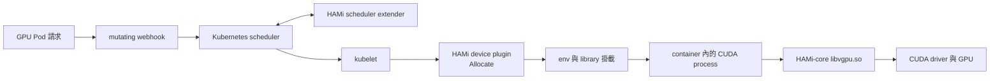
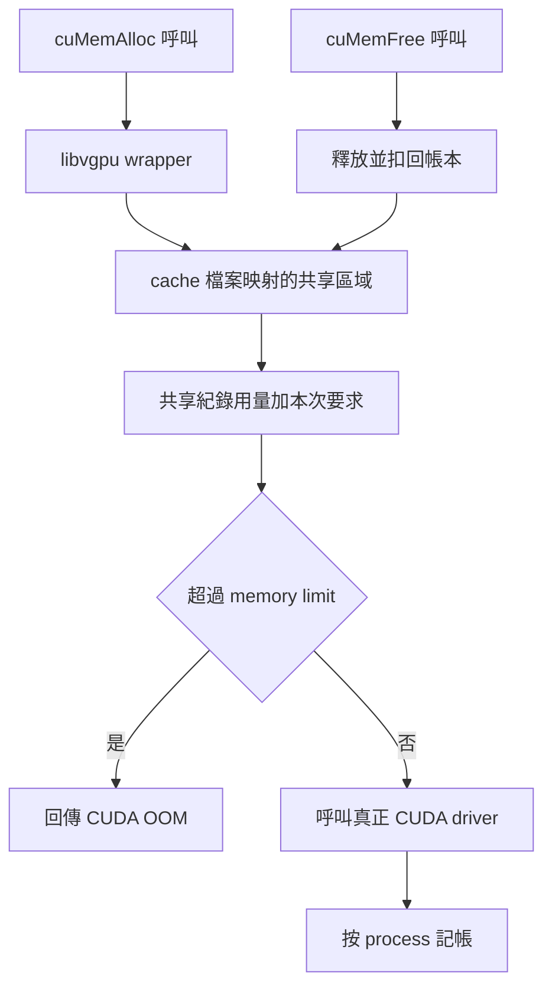
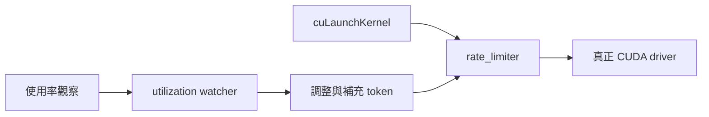
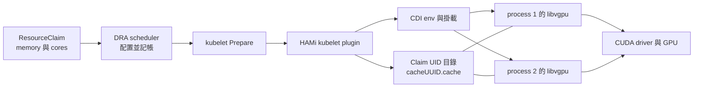
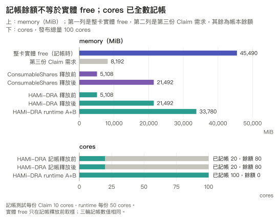
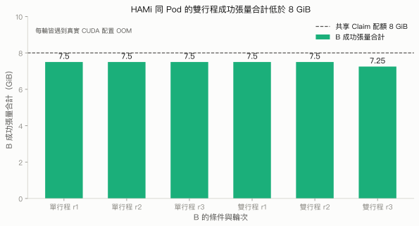
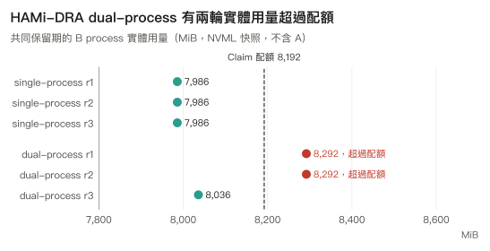
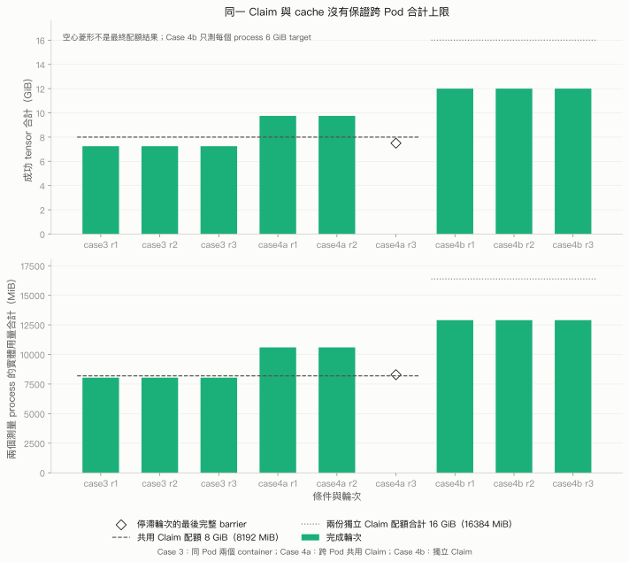

# 4.3 HAMi-DRA：攔截 CUDA 呼叫的配額

## 本頁要回答的問題

HAMi-DRA 同時公布 memory／cores 容量，並把配額注入 container；這兩件事如何接起來？本頁先追蹤 `ResourceClaim` 到 `libvgpu.so` 的路徑，再用 single-process、同一 container 內的 dual-process、同一 Pod 內的兩個 container 與跨 Pod 的量測檢查配額範圍。結論需要分開看：排程記帳成立，不代表共享 Claim 或共享 cache 就有嚴格的實體 VRAM 總額上限。

## 背景原理

### Classic HAMi 的接入路徑

Classic HAMi 把 Kubernetes 控制面與 container 內的虛擬化元件接在一起。Mutating webhook 改寫需要 GPU 的 Pod，scheduler extender 根據 GPU 需求與節點裝置狀態協助選擇，device plugin 在 `Allocate` 回應中注入環境變數與掛載；應用 process 載入 HAMi-core 後，才在 CUDA／NVML API 路徑上看見配額。這個架構見 [HAMi v2.6.0 的專案說明][classic-readme]，具體的 library、cache 與 preload 掛載可追到 [v2.10.0 device plugin 的 Allocate][classic-allocate]；這兩個版本是架構參考，不是本次 HAMi-DRA 的部署版本。



HAMi-core 是每個應用 process 中的攔截 library，不是另外一個代替應用執行 kernel 的 GPU server。Classic 的 Allocate 可以掛入 `/etc/ld.so.preload`，使動態連結器載入 `/usr/local/vgpu/libvgpu.so`；也可透過 `LD_PRELOAD` 接入同一類攔截路徑。本次 DRA 的實際證據是 **ld.so.preload 掛載與 process maps**，不是另設 `LD_PRELOAD` 的推測。[Classic 注入原始碼][classic-allocate]、[HAMi-core 的 preload 說明][core-preload]、[DRA CDI edits][dra-cdi]、[本次 runtime hooks](../../data/e2/hami/raw/hami-scope-8g-r1/runtime-hooks.json)

### Library 身分與原始碼的界線

本次 provider 使用 `docker.io/projecthami/k8s-dra-driver:v0.1.0`，觀察到的 image digest 為 `sha256:ae7e844acbd099a109bfa84296905ea941eed292a7991c06e2eeee443457ede3`。Container 與 host 的 `libvgpu.so` SHA256 均為 `56fc0944896337cc0ee439cbc7364105ccac11e8dc38add6a3dc467cea34b18f`；重現套件固定這個 provider digest，並核對安裝後的 library hash。[image 與 hooks 證據](../../data/e2/hami/SOURCES.md)、[provider 安裝檢查](../../labs/04-isolation/hami-dra/scripts/install-provider.sh)

HAMi-DRA 的 build recipe 會建置 HAMi-core submodule，但本次留下的 hash 沒有附上該 binary 的 source commit，不能僅憑 digest 或檔名把它對到某一版 HAMi-core。以下以可開啟的固定 commit `5496322f2fb3e71bf1eca014fba3c9bc59ab8ffd` 解釋 API、共享記帳與 throttling 實作；它是原始碼參考，**尚未證明就是本次 binary 的來源**。NVML 與 context 的補充說明另標示 `b216ba1be1b8e21488d1c7370ed3357b3049aad1`，不混合成同一快照。[HAMi-DRA build recipe][dra-build]、[固定 HAMi-core 記憶體攔截][core-memory]、[補充 NVML 快照][core-nvml]、[補充 context 快照][core-context]

### 記憶體配置如何計量

固定快照的 `libvgpu.c` 攔截 `dlsym`，對已註冊的 CUDA／NVML 符號回傳 wrapper，其他符號交回原本的解析路徑。載入 library 只是接入條件，真正的覆蓋範圍仍取決於註冊表、編譯選項及各 API 的包裝內容；例如 NVML hooks 有 `HOOK_NVML_ENABLE` 條件。[hook 註冊與符號解析][core-hooks]

`libvgpu.so` 包裝 CUDA driver API，把 `cuMemAlloc_v2` 送入 `allocate_raw`、把 `cuMemFree_v2` 送入 `free_raw`。成功配置後，`add_chunk` 記錄區塊並增加本 process 的資料用量；釋放時移除紀錄並扣回。固定快照也有 Managed、Pitch、async allocation 與 VMM 的包裝路徑，覆蓋程度必須逐一讀函式，不能由一個 `cuMemAlloc` 結果推得全部 API 都已驗證。[cuMemAlloc 與 cuMemFree 包裝][core-memory]、[區塊記帳][core-allocator]、[按 process 加減用量][core-process-account]、[async 與 VMM 包裝][core-memory-api]

核心 `oom_check` 取共享紀錄中的 GPU 記憶體量，加上本次要求量，與限制比較；必要時清除 dead process 紀錄後再檢查。這是軟體帳本與呼叫攔截，沒有把實體 VRAM 分割成只能存放某個 Pod 資料的硬體區域。[allocate_raw 與 oom_check][core-allocator]



共享區域由 `CUDA_DEVICE_MEMORY_SHARED_CACHE` 指定的檔案建立並映射。`try_create_shrreg` 用 `open` 開啟 cache，再以 `mmap` 的 `MAP_SHARED` 建立共享映射；初次建立時讀入 indexed memory／SM env，既有區域則檢查設定一致性。區域內的 process slot 包含 `pid`、`hostpid`、context／module／data／total 記帳及另存的 NVML `monitorused`；`get_gpu_memory_usage` 合計 `used.total` 並加上 `initial_offset`，不是直接把 monitor 的實體量當成配額用量。[cache 映射][core-cache]、[env 讀取][core-limit-env]、[用量合計][core-account]、[共享資料結構][core-shared-header]

`CUDA_DEVICE_MEMORY_LIMIT_0` 決定本次 container 可見 GPU 0 的 memory limit；它和 scheduler 的 `consumedCapacity` 是不同層次，只有 provider 將已配置容量轉成 env 時才接起來。同一 cache 的路徑、device／inode 及 maps 是本次要核對的身分證據；是否跨 Pod 真正合計，仍要靠後面的範圍實驗判斷。[DRA 配額轉換][dra-env]

HAMi-core 也包裝 `nvmlDeviceGetMemoryInfo` 及 v2。補充的固定 `b216ba1` 快照先呼叫真正 NVML，再令 `actual_limit=min(limit, physical_total)`；有正值配額時，回傳 `total=actual_limit`、`used=min(usage, actual_limit)`、`free=total-used`。另存的 `monitorused` 並未代入這個公式，因此 container 內的 total／free 是配額與軟體帳本視圖，不能作為實體 VRAM 沒有超額的證明。本次實體量從**未注入 HAMi 的 GPU Operator driver Pod**取得，再以 host PID 對照到 CUDA client。[NVML 的 memory-info 包裝][core-nvml]、[本次取樣分析](../../labs/04-isolation/common/analysis/hami.py)

不能把共享帳本當成完整、即時的 driver 實體帳本。補充快照會估計並記錄部分 primary context 用量，但其他 context 建立路徑有只轉交的包裝；driver 的額外負擔、繞過已覆蓋 hooks 的配置，以及本次未測的 async／VMM 路徑，都需要另外驗證。這些差異解釋了**為何 hook 配額不足以保證實體上限**，但本次沒有逐項歸因，不能斷言 100 MiB 的超額全部來自某一種 context overhead。[context 用量估計][core-context-estimate]、[context 包裝][core-context]、[實體量測與限制](#限制)

### SM 比例如何 throttle

HAMi-DRA 把 Claim 的 cores 轉成 `CUDA_DEVICE_SM_LIMIT_0`；本次 A、B runtime 都是 `50`。HAMi-core 的 utilization watcher 讀取 NVML process 使用率，以 host PID 配對共享紀錄，再依目標與觀察值調整 token。`cuLaunchKernel` 與 `cuLaunchKernelEx` 在 `pidfound==1` 時呼叫 `rate_limiter`；該函式在 token 為負數時短暫睡眠並重試，提交前以 grid 數扣除額度，watcher 的 `change_token` 再補充或調整。[cuLaunchKernel 與 Ex 包裝][core-launch]、[watcher 與 rate_limiter][core-watcher]、[DRA cores 轉換][dra-env]

固定快照在 SM limit 為 0、至少 100 或控制關閉時可略過這個 limiter，cooperative launch 包裝也未呼叫相同路徑。這是根據使用率回饋延後 kernel launch，不能等同為預留固定比例的實體 SM，也不能概括成所有提交 API 都受同一限制。[throttling 與 launch 的覆蓋範圍][core-watcher]、[launch 包裝][core-launch]



本頁的 workload 是記憶體邊界測試，沒有量測 `50` 的吞吐量、SM 公平性或 throttling 精度。在 cores 的 scheduler 記帳上已驗證，SM-limit 的效能效果仍是另一個問題；相關固定工作量比較見[第 5 章](../05-performance/README.md)。

### DRA 如何取代 classic 控制元件

HAMi-DRA v0.1.0 是以 NVIDIA DRA driver 為基礎的 fork，沿用並修改 kubelet plugin／CDI 路徑，加入 `HAMiCoreSupport` 功能開關。本次只啟用這條路徑，`MPSSupport`、`TimeSlicingSettings`、`DynamicMIG`、`ComputeDomainCliques` 與 `PassthroughSupport` 都關閉；原始碼也把這些共享路徑視為互斥。它在每張 GPU 的 `ResourceSlice` 公布可消耗的 `memory` 與 `cores`，允許多份 allocation，再於 Prepare 時將該 Claim 的消耗量轉成 library env。[HAMi-DRA 原始碼][dra-main]、[功能開關][dra-gates]、[容量公布][dra-capacity]



Prepare 先處理 `/usr/local/vgpu/claims/<claimUID>/`，再以 `uuid.New()` 產生 cache basename，組成 `<cacheUUID>.cache`。這個 UUID **不是** allocation 的 `shareID`；本次 API 與 runtime hooks 的值也不同，不能以 shareID 推導 cache 路徑。Unprepare 則移除該 Claim 的目錄。[Prepare 與 Unprepare][dra-prepare]、[原始配置與 hooks](../../data/e2/hami/raw/hami-scope-8g-r1/claims-allocated.json)

CDI 掛入 Claim 目錄、`libvgpu.so`、`/etc/ld.so.preload` 與 `/tmp/vgpulock`，並注入 memory、SM 與 shared-cache env。DRA 的 scheduler／ResourceClaim 已處理裝置配置與容量記帳，kubelet Prepare／CDI 已處理 container 接入；本次因此沒有另部署 classic HAMi scheduler extender、webhook 或 device plugin。[DRA CDI edits][dra-cdi]、[provider 部署](#部署與設定)

下表與輸出取自 E2 dual-process 第一輪的 `runtime-hooks.json`。A 與 B 各有獨立 Claim，所以 cache 路徑不同；B 內的兩個 child 則觀察到同一路徑。GPU 裝置由 DRA／CDI 準備，`NVIDIA_VISIBLE_DEVICES=void` 不表示 Job 沒有 GPU；它也是 provider 與 workload 證據中的實際值。

| env 或掛載 | A | B | 意義 |
|---|---|---|---|
| `CUDA_DEVICE_MEMORY_LIMIT_0` | `4096m` | `8192m` | Claim 的 memory bytes 換成 MiB 值與 `m` 後綴。 |
| `CUDA_DEVICE_SM_LIMIT_0` | `50` | `50` | 各 Claim 消耗 50 cores。 |
| `CUDA_DEVICE_MEMORY_SHARED_CACHE` | `/usr/local/vgpu/claims/0d84fc0b-cbef-4fea-acd5-4ea047d90490/e38db06f-a2c1-46ee-985f-e0e6a5c90bf1.cache` | `/usr/local/vgpu/claims/7deb1e3f-13a6-4ab3-b72f-b49d479537d1/95a8ce23-d3b4-4fb4-80be-60f38622f7bc.cache` | 各 process 用此檔案尋找共享區域。 |
| `NVIDIA_VISIBLE_DEVICES` | `void` | `void` | 與原始 runtime hooks 相符。 |
| `/etc/ld.so.preload` | `/usr/local/vgpu/libvgpu.so` | `/usr/local/vgpu/libvgpu.so` | 動態載入攔截 library。 |

實際輸出節錄如下，只保留 B 的配額 env 與 preload，其他欄位以 `...` 表示省略；此處的 UUID 是原始輪次身分，不應寫死到新的 Job。

```text
...
"NVIDIA_VISIBLE_DEVICES": "void",
...
"CUDA_DEVICE_MEMORY_SHARED_CACHE": "/usr/local/vgpu/claims/7deb1e3f-13a6-4ab3-b72f-b49d479537d1/95a8ce23-d3b4-4fb4-80be-60f38622f7bc.cache",
"CUDA_DEVICE_SM_LIMIT_0": "50",
"CUDA_DEVICE_MEMORY_LIMIT_0": "8192m"
...
"preload": "/usr/local/vgpu/libvgpu.so\n"
...
```

## 部署與設定

<!-- hami-deployment:start -->
### 原始環境與名稱

原始節點為 `dra-a40`，GPU UUID 是 `GPU-29ffee3e-bee4-e341-917a-fe7e43e977af`；Kubernetes v1.37.0、NVIDIA driver 595.91.07 與 PyTorch 2.5.1／CUDA 12.4 的條件沿用第四章前半。HAMi provider 用固定 digest，workload 用 `docker.io/pytorch/pytorch:2.5.1-cuda12.4-cudnn9-runtime@sha256:c8268a92a69bd500f8be0e665b2630ee006dadaf7bfbc24249141b15ff622755`，不更換原始執行的 CUDA 配置路徑。[E2 HAMi 環境與來源](../../data/e2/hami/SOURCES.md)

下表把原始物件名稱對到角色名稱。Pod 改為 `backoffLimit: 0`、`restartPolicy: Never` 的 Job，controller 產生的 Pod 名稱會另記錄到輸出；Claim 拓撲、container 數與 CUDA child 的數量維持原始設計。

| 原始物件或角色 | 重現套件名稱 | 保留的關係 |
|---|---|---|
| `e2-hami-provider` | `a40-hami-provider` DaemonSet | 只接管 A40，沿用原 ServiceAccount 與硬體 affinity。 |
| `e2-hami-gpu-20261007`、`e2b-20261007t060500z-gpu` | `hami-core-gpu.project-hami.io` | 採 E2 的 driver／type selector；名稱與第 5 章預設相同。 |
| `a` Claim／`a` Pod | `capacity-resident-gpu`／`capacity-resident` | 16 GiB、10 cores。 |
| `b` Claim／`b` Pod | `capacity-release-gpu`／`capacity-release` | 24 GiB、10 cores，作為釋放對象。 |
| `c` Claim／`c` Pod | `capacity-waiter-gpu`／`capacity-waiter` | 8 GiB、10 cores，等候記帳餘額。 |
| `survivor-gpu`／`survivor` | `steady-gpu`／`steady-service` | 獨立 4 GiB、50 cores Claim。 |
| `pressure-gpu`／`pressure` | `pressure-gpu`／`quota-pressure` | 獨立 8 GiB、50 cores Claim；single-process 或同一 container 內的 dual-process。 |
| case3 `quota-0`／`both` | `container-scope-gpu`／`container-scope-pressure` | 一個 Claim，一個 Pod，兩個 container。 |
| case4a `quota-0`／`pod-0`、`pod-1` | `pod-shared-gpu`／`scope-primary`、`scope-secondary` | 一個 Claim，兩個 Pod。 |
| case4b `quota-0`、`quota-1`／`pod-0`、`pod-1` | `worker-primary-gpu`、`worker-secondary-gpu`／`scope-primary`、`scope-secondary` | 每個 Pod 各有一個 Claim。 |

### 先切換 A40 provider

> **警告：安裝與解除安裝會修改原始 NVIDIA DaemonSet、替換 A40 plugin，並建立或移除節點上的 HAMi 路徑。只在專用實驗叢集、GPU 閒置且所有相關 Claim 已清理時執行。**

沿用[第四章的切換流程](README.md#只讓一個-provider-公布目標-gpu)與 [provider 共用腳本](../../labs/04-isolation/provider/README.md)。安裝先保存原 DaemonSet UID／spec、A40 與受保護的 4090 plugin 身分，將每個 affinity term 排除 A40，再安裝替代 provider；解除安裝必須使用同一個 provider run-id。

```bash
$ export I_UNDERSTAND_THIS_CHANGES_THE_CLUSTER=1
$ bash labs/04-isolation/hami-dra/scripts/install-provider.sh hami-provider-20261012-r2
```

以下按步驟合併完整 YAML，用行內映射縮短重複欄位，註解標出各輸入檔。內容與套件逐欄相同；實際執行請用腳本，讓它完成備份、身分檢查、Prepare 順序與收集。下方的 apply 區塊說明腳本送出的物件，輸出節錄自原叢集的縮短版，以 `...` 標示中間省略的等待或取樣。

### Provider RBAC 與 DeviceClass

Provider 沿用 `dra-driver-nvidia-gpu-service-account-kubeletplugin`，另建立可辨識的 ClusterRole／ClusterRoleBinding；安裝會核對原 NVIDIA RBAC 規則與 ServiceAccount 關係。DaemonSet 保留原硬體 affinity，每個 term 再限定 `dra-a40`；DeviceClass 採 E2 的 driver／type selector，名稱與第 5 章預設相同。

```bash
$ vi labs/04-isolation/hami-dra/manifests/provider/{rbac,daemonset,deviceclass}.yaml
```

```yaml
# manifests/provider/rbac.yaml
apiVersion: rbac.authorization.k8s.io/v1
kind: ClusterRole
metadata: {name: a40-hami-provider, labels: {app.kubernetes.io/part-of: dra-book, app.kubernetes.io/component: hami-provider-rbac}}
rules:
  - {apiGroups: [resource.nvidia.com], resources: [computedomains], verbs: [get, list, watch]}
  - {apiGroups: [resource.k8s.io], resources: [resourceclaims], verbs: [get, list, watch]}
  - {apiGroups: [resource.k8s.io], resources: [resourceslices], verbs: [get, list, watch, create, update, delete]}
  - {apiGroups: [''], resources: [nodes], verbs: [get, list, watch, update, patch]}
  - {apiGroups: [''], resources: [pods], verbs: [get, list, watch]}
---
apiVersion: rbac.authorization.k8s.io/v1
kind: ClusterRoleBinding
metadata: {name: a40-hami-provider, labels: {app.kubernetes.io/part-of: dra-book, app.kubernetes.io/component: hami-provider-rbac}}
subjects:
  - {kind: ServiceAccount, name: dra-driver-nvidia-gpu-service-account-kubeletplugin, namespace: nvidia-dra-driver-gpu}
roleRef: {apiGroup: rbac.authorization.k8s.io, kind: ClusterRole, name: a40-hami-provider}
---
# manifests/provider/daemonset.yaml
apiVersion: apps/v1
kind: DaemonSet
metadata: {name: a40-hami-provider, namespace: nvidia-dra-driver-gpu, labels: {app.kubernetes.io/part-of: dra-book, app.kubernetes.io/component: hami-provider}}
spec:
  selector: {matchLabels: {app.kubernetes.io/part-of: dra-book, app.kubernetes.io/component: hami-provider}}
  updateStrategy: {type: OnDelete}
  template:
    metadata: {labels: {app.kubernetes.io/part-of: dra-book, app.kubernetes.io/component: hami-provider}}
    spec:
      affinity:
        nodeAffinity:
          requiredDuringSchedulingIgnoredDuringExecution:
            nodeSelectorTerms:
              - matchExpressions: [{key: feature.node.kubernetes.io/pci-10de.present, operator: In, values: ['true']}]
                matchFields: [{key: metadata.name, operator: In, values: [dra-a40]}]
              - matchExpressions: [{key: feature.node.kubernetes.io/pci-0302_10de.present, operator: In, values: ['true']}]
                matchFields: [{key: metadata.name, operator: In, values: [dra-a40]}]
              - matchExpressions: [{key: feature.node.kubernetes.io/pci-0300_10de.present, operator: In, values: ['true']}]
                matchFields: [{key: metadata.name, operator: In, values: [dra-a40]}]
              - matchExpressions: [{key: feature.node.kubernetes.io/cpu-model.vendor_id, operator: In, values: [NVIDIA]}]
                matchFields: [{key: metadata.name, operator: In, values: [dra-a40]}]
              - matchExpressions: [{key: nvidia.com/gpu.present, operator: In, values: ['true']}]
                matchFields: [{key: metadata.name, operator: In, values: [dra-a40]}]
      containers:
        - args: [exec hami-kubelet-plugin -v 4]
          command: [bash, -c]
          env:
            - {name: HTTP_ENDPOINT, value: ':8080'}
            - {name: METRICS_PATH, value: /metrics}
            - {name: LOG_VERBOSITY, value: '4'}
            - {name: MASK_NVIDIA_DRIVER_PARAMS}
            - {name: NVIDIA_DRIVER_ROOT, value: /run/nvidia/driver}
            - {name: NVIDIA_VISIBLE_DEVICES, value: void}
            - {name: CDI_ROOT, value: /var/run/cdi}
            - {name: NVIDIA_MIG_CONFIG_DEVICES, value: all}
            - {name: NODE_NAME, valueFrom: {fieldRef: {apiVersion: v1, fieldPath: spec.nodeName}}}
            - {name: NAMESPACE, valueFrom: {fieldRef: {apiVersion: v1, fieldPath: metadata.namespace}}}
            - {name: SERVICE_ACCOUNT_NAME, valueFrom: {fieldRef: {apiVersion: v1, fieldPath: spec.serviceAccountName}}}
            - {name: IMAGE_NAME, value: 'docker.io/projecthami/k8s-dra-driver:v0.1.0'}
            - {name: IMAGE_PULL_POLICY, value: IfNotPresent}
            - {name: FEATURE_GATES, value: 'HAMiCoreSupport=true,MPSSupport=false,TimeSlicingSettings=false,DynamicMIG=false,ComputeDomainCliques=false,PassthroughSupport=false'}
            - {name: KUBELET_REGISTRAR_DIRECTORY_PATH, value: /var/lib/kubelet/plugins_registry}
            - {name: KUBELET_PLUGINS_DIRECTORY_PATH, value: /var/lib/kubelet/plugins}
            - {name: HEALTHCHECK_PORT, value: '51516'}
          image: docker.io/projecthami/k8s-dra-driver:v0.1.0@sha256:ae7e844acbd099a109bfa84296905ea941eed292a7991c06e2eeee443457ede3
          imagePullPolicy: IfNotPresent
          livenessProbe: {failureThreshold: 3, grpc: {port: 51516, service: liveness}, periodSeconds: 30, successThreshold: 1, timeoutSeconds: 10}
          name: gpus
          resources: {}
          securityContext: {privileged: true}
          startupProbe: {failureThreshold: 600, grpc: {port: 51516, service: liveness}, periodSeconds: 1, successThreshold: 1, timeoutSeconds: 10}
          terminationMessagePath: /dev/termination-log
          terminationMessagePolicy: File
          volumeMounts:
            - {mountPath: /var/lib/kubelet/plugins_registry, name: plugins-registry}
            - {mountPath: /var/lib/kubelet/plugins, mountPropagation: Bidirectional, name: plugins}
            - {mountPath: /var/run/cdi, name: cdi}
            - {mountPath: /driver-root, mountPropagation: HostToContainer, name: driver-root}
            - {name: host-vgpu, mountPath: /usr/local/vgpu}
            - {name: host-tmp, mountPath: /tmp}
          lifecycle:
            postStart: {exec: {command: [/bin/bash, -c, /usr/bin/vgpu-init.sh /usr/local/vgpu/]}}
      dnsPolicy: ClusterFirst
      initContainers:
        - command: [bash, /usr/bin/kubelet-plugin-prestart.sh]
          env:
            - {name: NVIDIA_DRIVER_ROOT, value: /run/nvidia/driver}
            - {name: NVIDIA_VISIBLE_DEVICES, value: void}
            - {name: KUBELET_REGISTRAR_DIRECTORY_PATH, value: /var/lib/kubelet/plugins_registry}
            - {name: KUBELET_PLUGINS_DIRECTORY_PATH, value: /var/lib/kubelet/plugins}
          image: docker.io/projecthami/k8s-dra-driver:v0.1.0@sha256:ae7e844acbd099a109bfa84296905ea941eed292a7991c06e2eeee443457ede3
          imagePullPolicy: IfNotPresent
          name: init-container
          resources: {}
          securityContext: {privileged: true}
          terminationMessagePath: /dev/termination-log
          terminationMessagePolicy: File
          volumeMounts: [{mountPath: /driver-root-parent, mountPropagation: HostToContainer, name: driver-root-parent}]
      priorityClassName: system-node-critical
      restartPolicy: Always
      schedulerName: default-scheduler
      securityContext: {}
      serviceAccountName: dra-driver-nvidia-gpu-service-account-kubeletplugin
      terminationGracePeriodSeconds: 30
      tolerations: [{effect: NoSchedule, key: nvidia.com/gpu, operator: Exists}]
      volumes:
        - {hostPath: {path: /var/lib/kubelet/plugins_registry, type: ''}, name: plugins-registry}
        - {hostPath: {path: /var/lib/kubelet/plugins, type: ''}, name: plugins}
        - {hostPath: {path: /var/run/cdi, type: ''}, name: cdi}
        - {hostPath: {path: /run/nvidia, type: DirectoryOrCreate}, name: driver-root-parent}
        - {hostPath: {path: /run/nvidia/driver, type: DirectoryOrCreate}, name: driver-root}
        - {name: host-vgpu, hostPath: {path: /usr/local/vgpu, type: DirectoryOrCreate}}
        - {name: host-tmp, hostPath: {path: /tmp, type: Directory}}
---
# manifests/provider/deviceclass.yaml
apiVersion: resource.k8s.io/v1
kind: DeviceClass
metadata: {name: hami-core-gpu.project-hami.io, labels: {app.kubernetes.io/part-of: dra-book, app.kubernetes.io/component: hami-device-class}}
spec:
  selectors: [{cel: {expression: 'device.driver == "hami-core-gpu.project-hami.io" && device.attributes["hami-core-gpu.project-hami.io"].type == "hami-gpu"'}}]
```

| 參數 | 意義 | 為什麼這樣設 |
|---|---|---|
| `image` 與 `IMAGE_NAME` | image 固定 digest；env 保留 E2 的 tag。 | 固定 binary，保留原 provider 的 env。 |
| `FEATURE_GATES` | 啟用 `HAMiCoreSupport`，關閉其他共享路徑。 | 避免混入 MPS 或 time-slicing。 |
| `affinity`、`OnDelete` | 只在 A40 接管，明確控制 Pod 替換。 | 保護其他節點的原 plugin。 |
| `volumeMounts`、`postStart` | 掛入 kubelet／CDI／driver／vgpu／tmp，初始化 hooks。 | 配合 Prepare 與 container 注入。 |
| `rules`、`subjects`、CEL | 沿用所需權限與 ServiceAccount，選 HAMi GPU。 | 不接管原 RBAC，讓 Claim 選中替代 provider。 |

安裝腳本渲染並補入本次操作標記，完成排除原 provider 後，才送出這組物件：

```console
$ kubectl apply -f labs/04-isolation/out/hami-provider-20261012-r2/provider-expected.json
clusterrole.rbac.authorization.k8s.io/a40-hami-provider created
clusterrolebinding.rbac.authorization.k8s.io/a40-hami-provider created
daemonset.apps/a40-hami-provider created
deviceclass.resource.k8s.io/hami-core-gpu.project-hami.io created
HAMi provider verified. DeviceClass: hami-core-gpu.project-hami.io. Use the same provider-run-id for uninstall.
```

### 共用 Namespace 與 workload generator

Namespace 與 E2 workload 沿用 [common 套件](../../labs/04-isolation/common/README.md)，完整 Namespace／generator 見 [MPS 部署](mps.md#namespace-與-workload)。下列 generator 產生 scope 的 ConfigMap，完整程式見 [base_workload.py](../../labs/04-isolation/hami-dra/workload/base_workload.py) 與 [hami_scope_workload.py](../../labs/04-isolation/hami-dra/workload/hami_scope_workload.py)，不展開其 data。

```bash
$ vi labs/04-isolation/hami-dra/workload/kustomization.yaml
```

```yaml
apiVersion: kustomize.config.k8s.io/v1beta1
kind: Kustomization
namespace: gpu-isolation-lab
configMapGenerator:
- name: hami-scope-code
  files:
  - base_workload.py
  - hami_scope_workload.py
generatorOptions:
  disableNameSuffixHash: true
  labels:
    app.kubernetes.io/part-of: dra-book
    app.kubernetes.io/component: hami-scope-code
```

| 參數 | 意義 | 為什麼這樣設 |
|---|---|---|
| `files` | 原始 scope 與 base workload。 | 保留每步 256 MiB 配置、OOM 分支與同步 barrier。 |
| `disableNameSuffixHash`、`labels` | 固定 ConfigMap 名稱並標記用途。 | Job 掛載同名 code；清理只碰套件物件。 |

`ScopeState.step` 保留成功配置的 tensor，OOM 後同步並記錄狀態；`snapshot` 檢查 round 再同步。Host controller 收齊兩個 client 的快照後取得未注入 HAMi 的 NVML，因此只把完整 barrier 上的 tensor 與實體用量配成一組。

### 記帳的三份 Claim 與 Job

這組 sleeper 不建立 CUDA context，只用 allocation 與 scheduler 事件驗證帳本。三份 Claim 依序申請 16、24、8 GiB，各 10 cores；第三份保持 Pending，釋放 24 GiB 的 Job 與 Claim 後才取得配置。

```bash
$ vi labs/04-isolation/hami-dra/manifests/accounting/[0-9]*.yaml
```

```yaml
# manifests/accounting/00-capacity-resident-gpu.yaml
apiVersion: resource.k8s.io/v1
kind: ResourceClaim
metadata: {name: capacity-resident-gpu, namespace: gpu-isolation-lab, labels: {app.kubernetes.io/part-of: dra-book, app.kubernetes.io/component: capacity-resident-gpu}}
spec:
  devices:
    requests:
      - name: gpu
        exactly: {deviceClassName: hami-core-gpu.project-hami.io, allocationMode: ExactCount, count: 1,
          selectors: [{cel: {expression: 'device.attributes["hami-core-gpu.project-hami.io"].uuid == "GPU-29ffee3e-bee4-e341-917a-fe7e43e977af"'}}],
          capacity: {requests: {memory: 16Gi, cores: 10}}}
---
# manifests/accounting/01-capacity-resident.yaml
apiVersion: batch/v1
kind: Job
metadata: {name: capacity-resident, namespace: gpu-isolation-lab, labels: {app.kubernetes.io/part-of: dra-book, app.kubernetes.io/component: capacity-resident}}
spec:
  backoffLimit: 0
  template:
    metadata: {labels: {app.kubernetes.io/part-of: dra-book, app.kubernetes.io/component: capacity-resident}}
    spec:
      restartPolicy: Never
      automountServiceAccountToken: false
      tolerations: [{key: nvidia.com/gpu, operator: Exists, effect: NoSchedule}]
      resourceClaims: [{name: gpu, resourceClaimName: capacity-resident-gpu}]
      containers:
        - name: workload
          image: docker.io/pytorch/pytorch:2.5.1-cuda12.4-cudnn9-runtime@sha256:c8268a92a69bd500f8be0e665b2630ee006dadaf7bfbc24249141b15ff622755
          command: [bash, -c, nvidia-smi -L; sleep 3600]
          resources: {requests: {cpu: 50m, memory: 64Mi}, limits: {cpu: 50m, memory: 256Mi}, claims: [{name: gpu, request: gpu}]}
---
# manifests/accounting/02-capacity-release-gpu.yaml
apiVersion: resource.k8s.io/v1
kind: ResourceClaim
metadata: {name: capacity-release-gpu, namespace: gpu-isolation-lab, labels: {app.kubernetes.io/part-of: dra-book, app.kubernetes.io/component: capacity-release-gpu}}
spec:
  devices:
    requests:
      - name: gpu
        exactly: {deviceClassName: hami-core-gpu.project-hami.io, allocationMode: ExactCount, count: 1,
          selectors: [{cel: {expression: 'device.attributes["hami-core-gpu.project-hami.io"].uuid == "GPU-29ffee3e-bee4-e341-917a-fe7e43e977af"'}}],
          capacity: {requests: {memory: 24Gi, cores: 10}}}
---
# manifests/accounting/03-capacity-release.yaml
apiVersion: batch/v1
kind: Job
metadata: {name: capacity-release, namespace: gpu-isolation-lab, labels: {app.kubernetes.io/part-of: dra-book, app.kubernetes.io/component: capacity-release}}
spec:
  backoffLimit: 0
  template:
    metadata: {labels: {app.kubernetes.io/part-of: dra-book, app.kubernetes.io/component: capacity-release}}
    spec:
      restartPolicy: Never
      automountServiceAccountToken: false
      tolerations: [{key: nvidia.com/gpu, operator: Exists, effect: NoSchedule}]
      resourceClaims: [{name: gpu, resourceClaimName: capacity-release-gpu}]
      containers:
        - name: workload
          image: docker.io/pytorch/pytorch:2.5.1-cuda12.4-cudnn9-runtime@sha256:c8268a92a69bd500f8be0e665b2630ee006dadaf7bfbc24249141b15ff622755
          command: [bash, -c, nvidia-smi -L; sleep 3600]
          resources: {requests: {cpu: 50m, memory: 64Mi}, limits: {cpu: 50m, memory: 256Mi}, claims: [{name: gpu, request: gpu}]}
---
# manifests/accounting/04-capacity-waiter-gpu.yaml
apiVersion: resource.k8s.io/v1
kind: ResourceClaim
metadata: {name: capacity-waiter-gpu, namespace: gpu-isolation-lab, labels: {app.kubernetes.io/part-of: dra-book, app.kubernetes.io/component: capacity-waiter-gpu}}
spec:
  devices:
    requests:
      - name: gpu
        exactly: {deviceClassName: hami-core-gpu.project-hami.io, allocationMode: ExactCount, count: 1,
          selectors: [{cel: {expression: 'device.attributes["hami-core-gpu.project-hami.io"].uuid == "GPU-29ffee3e-bee4-e341-917a-fe7e43e977af"'}}],
          capacity: {requests: {memory: 8Gi, cores: 10}}}
---
# manifests/accounting/05-capacity-waiter.yaml
apiVersion: batch/v1
kind: Job
metadata: {name: capacity-waiter, namespace: gpu-isolation-lab, labels: {app.kubernetes.io/part-of: dra-book, app.kubernetes.io/component: capacity-waiter}}
spec:
  backoffLimit: 0
  template:
    metadata: {labels: {app.kubernetes.io/part-of: dra-book, app.kubernetes.io/component: capacity-waiter}}
    spec:
      restartPolicy: Never
      automountServiceAccountToken: false
      tolerations: [{key: nvidia.com/gpu, operator: Exists, effect: NoSchedule}]
      resourceClaims: [{name: gpu, resourceClaimName: capacity-waiter-gpu}]
      containers:
        - name: workload
          image: docker.io/pytorch/pytorch:2.5.1-cuda12.4-cudnn9-runtime@sha256:c8268a92a69bd500f8be0e665b2630ee006dadaf7bfbc24249141b15ff622755
          command: [bash, -c, nvidia-smi -L; sleep 3600]
          resources: {requests: {cpu: 50m, memory: 64Mi}, limits: {cpu: 50m, memory: 256Mi}, claims: [{name: gpu, request: gpu}]}
```

| 參數 | 意義 | 為什麼這樣設 |
|---|---|---|
| `memory`、`cores` | 三份不同 memory 請求，各 10 cores。 | 分開核對兩種容量。 |
| UUID selector、`resourceClaims` | 所有 Job 綁到 A40 的指定 Claim。 | 確認第三份等候的是同張 GPU 的餘額。 |
| `sleep 3600`、`backoffLimit: 0` | 保持配置、不重試。 | 觀察 Pending 與釋放，避免重跑掩蓋狀態。 |

腳本逐一送出與等待，下面合併列出這組建立回應，省略等待與中間觀察：

```console
$ kubectl apply -k labs/04-isolation/hami-dra/manifests/accounting
namespace/gpu-isolation-lab created
configmap/isolation-code created
resourceclaim.resource.k8s.io/capacity-resident-gpu created
job.batch/capacity-resident created
...
resourceclaim.resource.k8s.io/capacity-release-gpu created
job.batch/capacity-release created
...
resourceclaim.resource.k8s.io/capacity-waiter-gpu created
job.batch/capacity-waiter created
```

### Runtime 的獨立 Claim 與 Job

A 申請 4 GiB／50 cores，B 申請 8 GiB／50 cores。以下同一區塊列齊輸入檔；最後兩份 `quota-pressure` 是**互斥版本**，`single/` 與 `dual-process/` kustomization 各選一份，不能把此閱讀用合併區塊整份 apply。每輪都先讓 A 開始，再啟動 B，結束並清理後才切換版本。

```bash
$ vi labs/04-isolation/hami-dra/manifests/runtime/[0-9]*.yaml
```

```yaml
# manifests/runtime/00-steady-gpu.yaml
apiVersion: resource.k8s.io/v1
kind: ResourceClaim
metadata: {name: steady-gpu, namespace: gpu-isolation-lab, labels: {app.kubernetes.io/part-of: dra-book, app.kubernetes.io/component: steady-gpu}}
spec:
  devices:
    requests:
      - name: gpu
        exactly: {deviceClassName: hami-core-gpu.project-hami.io, allocationMode: ExactCount, count: 1,
          selectors: [{cel: {expression: 'device.attributes["hami-core-gpu.project-hami.io"].uuid == "GPU-29ffee3e-bee4-e341-917a-fe7e43e977af"'}}],
          capacity: {requests: {memory: 4Gi, cores: 50}}}
---
# manifests/runtime/01-pressure-gpu.yaml
apiVersion: resource.k8s.io/v1
kind: ResourceClaim
metadata: {name: pressure-gpu, namespace: gpu-isolation-lab, labels: {app.kubernetes.io/part-of: dra-book, app.kubernetes.io/component: pressure-gpu}}
spec:
  devices:
    requests:
      - name: gpu
        exactly: {deviceClassName: hami-core-gpu.project-hami.io, allocationMode: ExactCount, count: 1,
          selectors: [{cel: {expression: 'device.attributes["hami-core-gpu.project-hami.io"].uuid == "GPU-29ffee3e-bee4-e341-917a-fe7e43e977af"'}}],
          capacity: {requests: {memory: 8Gi, cores: 50}}}
---
# manifests/runtime/02-steady-service.yaml
apiVersion: batch/v1
kind: Job
metadata: {name: steady-service, namespace: gpu-isolation-lab, labels: {app.kubernetes.io/part-of: dra-book, app.kubernetes.io/component: steady-service}}
spec:
  backoffLimit: 0
  template:
    metadata: {labels: {app.kubernetes.io/part-of: dra-book, app.kubernetes.io/component: steady-service}}
    spec:
      restartPolicy: Never
      terminationGracePeriodSeconds: 120
      automountServiceAccountToken: false
      tolerations: [{key: nvidia.com/gpu, operator: Exists, effect: NoSchedule}]
      resourceClaims: [{name: gpu, resourceClaimName: steady-gpu}]
      containers:
        - name: workload
          image: docker.io/pytorch/pytorch:2.5.1-cuda12.4-cudnn9-runtime@sha256:c8268a92a69bd500f8be0e665b2630ee006dadaf7bfbc24249141b15ff622755
          imagePullPolicy: IfNotPresent
          command: [python, -u, /opt/lab/isolation_workload.py]
          args: [--role, survivor, --quota-gib, '4']
          env:
            - {name: PYTORCH_NO_CUDA_MEMORY_CACHING, value: '1'}
            - {name: OMP_NUM_THREADS, value: '1'}
            - {name: POD_NAME, valueFrom: {fieldRef: {fieldPath: metadata.name}}}
          securityContext: {runAsUser: 0, runAsGroup: 0}
          resources: {requests: {cpu: '2', memory: 4Gi}, limits: {cpu: '2', memory: 4Gi}, claims: [{name: gpu, request: gpu}]}
          volumeMounts: [{name: code, mountPath: /opt/lab, readOnly: true}]
      volumes: [{name: code, configMap: {name: isolation-code}}]
---
# manifests/runtime/03-quota-pressure.yaml
apiVersion: batch/v1
kind: Job
metadata: {name: quota-pressure, namespace: gpu-isolation-lab, labels: {app.kubernetes.io/part-of: dra-book, app.kubernetes.io/component: quota-pressure}}
spec:
  backoffLimit: 0
  template:
    metadata: {labels: {app.kubernetes.io/part-of: dra-book, app.kubernetes.io/component: quota-pressure}}
    spec:
      restartPolicy: Never
      terminationGracePeriodSeconds: 120
      automountServiceAccountToken: false
      tolerations: [{key: nvidia.com/gpu, operator: Exists, effect: NoSchedule}]
      resourceClaims: [{name: gpu, resourceClaimName: pressure-gpu}]
      containers:
        - name: workload
          image: docker.io/pytorch/pytorch:2.5.1-cuda12.4-cudnn9-runtime@sha256:c8268a92a69bd500f8be0e665b2630ee006dadaf7bfbc24249141b15ff622755
          imagePullPolicy: IfNotPresent
          command: [python, -u, /opt/lab/isolation_workload.py]
          args: [--role, pressure, --quota-gib, '8']
          env:
            - {name: PYTORCH_NO_CUDA_MEMORY_CACHING, value: '1'}
            - {name: OMP_NUM_THREADS, value: '1'}
            - {name: POD_NAME, valueFrom: {fieldRef: {fieldPath: metadata.name}}}
          securityContext: {runAsUser: 0, runAsGroup: 0}
          resources: {requests: {cpu: '2', memory: 4Gi}, limits: {cpu: '2', memory: 4Gi}, claims: [{name: gpu, request: gpu}]}
          volumeMounts: [{name: code, mountPath: /opt/lab, readOnly: true}]
      volumes: [{name: code, configMap: {name: isolation-code}}]
---
# manifests/runtime/04-dual-pressure.yaml
apiVersion: batch/v1
kind: Job
metadata: {name: quota-pressure, namespace: gpu-isolation-lab, labels: {app.kubernetes.io/part-of: dra-book, app.kubernetes.io/component: quota-pressure}}
spec:
  backoffLimit: 0
  template:
    metadata: {labels: {app.kubernetes.io/part-of: dra-book, app.kubernetes.io/component: quota-pressure}}
    spec:
      restartPolicy: Never
      terminationGracePeriodSeconds: 120
      automountServiceAccountToken: false
      tolerations: [{key: nvidia.com/gpu, operator: Exists, effect: NoSchedule}]
      resourceClaims: [{name: gpu, resourceClaimName: pressure-gpu}]
      containers:
        - name: workload
          image: docker.io/pytorch/pytorch:2.5.1-cuda12.4-cudnn9-runtime@sha256:c8268a92a69bd500f8be0e665b2630ee006dadaf7bfbc24249141b15ff622755
          imagePullPolicy: IfNotPresent
          command: [python, -u, /opt/lab/capacity_workload.py]
          args: [--role, scope, --quota-gib, '8']
          env:
            - {name: PYTORCH_NO_CUDA_MEMORY_CACHING, value: '1'}
            - {name: OMP_NUM_THREADS, value: '1'}
            - {name: POD_NAME, valueFrom: {fieldRef: {fieldPath: metadata.name}}}
          securityContext: {runAsUser: 0, runAsGroup: 0}
          resources: {requests: {cpu: '2', memory: 4Gi}, limits: {cpu: '2', memory: 4Gi}, claims: [{name: gpu, request: gpu}]}
          volumeMounts: [{name: code, mountPath: /opt/lab, readOnly: true}]
      volumes: [{name: code, configMap: {name: isolation-code}}]
```

| 參數 | 意義 | 為什麼這樣設 |
|---|---|---|
| 兩份 Claim | memory 各 4／8 GiB，cores 各 50。 | 保留 A／B 獨立配額與 100 cores 記帳。 |
| `isolation_workload.py` | A 的 survivor 與 single-process B 的 pressure。 | A 持續 probe，B 逐步碰配額。 |
| `capacity_workload.py --role scope` | parent 啟動兩個 CUDA child。 | 檢查同一 container 內多個 process 的合計範圍。 |
| cache／thread env、CPU／RAM | 停用 PyTorch CUDA caching，固定 thread 與 container 資源。 | 沿用原始配置路徑；container memory 是 CPU RAM。 |

single-process 組合的建立回應如下；dual-process 輪次使用 `runtime/dual-process`，Claim 與 Job 名稱相同。Overlay 讀取上層與共用目錄的 YAML，因此先用 `LoadRestrictionsNone` render 再送出。省略取樣啟動行：

```console
$ kubectl kustomize labs/04-isolation/hami-dra/manifests/runtime/single --load-restrictor=LoadRestrictionsNone | kubectl apply -f -
namespace/gpu-isolation-lab unchanged
configmap/isolation-code created
resourceclaim.resource.k8s.io/pressure-gpu created
resourceclaim.resource.k8s.io/steady-gpu created
job.batch/steady-service created
...
job.batch/quota-pressure created
```

### Scope 的 container 與 Pod 拓撲

三個 case 的差異只在下表；其他 env、workload 與每步 256 MiB 的 barrier 流程相同。以下各 case 都列完整 Claim／Job，`__RUN_ID__`、`__REPEAT__` 由 runner 替換，控制目錄先建立，再按 case4a 的 Prepare 順序送出 Job。

| case | 拓撲 | Claim memory 與 cores | client 目標 |
|---|---|---|---|
| case3 | 一個 Pod、兩個 container，共用 Claim | 一份 8 GiB／50 cores | 每個 6 GiB |
| case4a | 兩個 Pod、各一 container，共用 Claim | 一份 8 GiB／50 cores | 每個 6 GiB |
| case4b | 兩個 Pod、各一 container，各有 Claim | 每份 8 GiB／50 cores | 每個 6 GiB |

共用參數的意義如下；三輪量測與圖表見[配額範圍結果](#跨-container-與跨-pod-的配額範圍)。

| 參數 | 意義 | 為什麼這樣設 |
|---|---|---|
| `resourceClaims` | 保留上表的 Claim 拓撲。 | 只改待測的 container／Pod 邊界。 |
| `worker-0/1`、`control-0/1` | 分開 client 身分與命令／ACK 目錄。 | 在同一配置 barrier 上取樣。 |
| `hostPath`、`type: Directory` | 使用 runner 預先建立的控制目錄。 | 記錄身分後才同步與清理。 |

#### Case3 同一 Pod 內的兩個 container

```bash
$ vi labs/04-isolation/hami-dra/manifests/scope/case3/[0-9]*.yaml
```

```yaml
# manifests/scope/case3/00-container-scope-gpu.yaml
apiVersion: resource.k8s.io/v1
kind: ResourceClaim
metadata: {name: container-scope-gpu, namespace: gpu-isolation-lab, labels: {app.kubernetes.io/part-of: dra-book, app.kubernetes.io/component: container-scope-gpu}}
spec:
  devices:
    requests:
      - name: gpu
        exactly: {deviceClassName: hami-core-gpu.project-hami.io, allocationMode: ExactCount, count: 1,
          selectors: [{cel: {expression: 'device.attributes["hami-core-gpu.project-hami.io"].uuid == "GPU-29ffee3e-bee4-e341-917a-fe7e43e977af"'}}],
          capacity: {requests: {memory: 8Gi, cores: 50}}}
---
# manifests/scope/case3/02-container-scope-pressure.yaml
apiVersion: batch/v1
kind: Job
metadata: {name: container-scope-pressure, namespace: gpu-isolation-lab, labels: {app.kubernetes.io/part-of: dra-book, app.kubernetes.io/component: container-scope-pressure}}
spec:
  backoffLimit: 0
  template:
    metadata: {labels: {app.kubernetes.io/part-of: dra-book, app.kubernetes.io/component: container-scope-pressure}}
    spec:
      restartPolicy: Never
      terminationGracePeriodSeconds: 120
      automountServiceAccountToken: false
      tolerations: [{key: nvidia.com/gpu, operator: Exists, effect: NoSchedule}]
      resourceClaims: [{name: gpu, resourceClaimName: container-scope-gpu}]
      containers:
        - name: worker-0
          image: docker.io/pytorch/pytorch:2.5.1-cuda12.4-cudnn9-runtime@sha256:c8268a92a69bd500f8be0e665b2630ee006dadaf7bfbc24249141b15ff622755
          imagePullPolicy: IfNotPresent
          command: [python, -u, /opt/lab/hami_scope_workload.py]
          args: [--client-id, '0', --control-dir, /opt/e2b-control]
          env:
            - {name: PYTORCH_NO_CUDA_MEMORY_CACHING, value: '1'}
            - {name: OMP_NUM_THREADS, value: '1'}
            - {name: EXPERIMENT_RUN, value: __RUN_ID__}
            - {name: CONTAINER_NAME, value: worker-0}
            - {name: POD_NAME, valueFrom: {fieldRef: {fieldPath: metadata.name}}}
            - {name: POD_UID, valueFrom: {fieldRef: {fieldPath: metadata.uid}}}
          securityContext: {runAsUser: 0, runAsGroup: 0}
          resources: {requests: {cpu: '2', memory: 4Gi}, limits: {cpu: '2', memory: 4Gi}, claims: [{name: gpu, request: gpu}]}
          volumeMounts: [{name: code, mountPath: /opt/lab, readOnly: true}, {name: control-0, mountPath: /opt/e2b-control}]
        - name: worker-1
          image: docker.io/pytorch/pytorch:2.5.1-cuda12.4-cudnn9-runtime@sha256:c8268a92a69bd500f8be0e665b2630ee006dadaf7bfbc24249141b15ff622755
          imagePullPolicy: IfNotPresent
          command: [python, -u, /opt/lab/hami_scope_workload.py]
          args: [--client-id, '1', --control-dir, /opt/e2b-control]
          env:
            - {name: PYTORCH_NO_CUDA_MEMORY_CACHING, value: '1'}
            - {name: OMP_NUM_THREADS, value: '1'}
            - {name: EXPERIMENT_RUN, value: __RUN_ID__}
            - {name: CONTAINER_NAME, value: worker-1}
            - {name: POD_NAME, valueFrom: {fieldRef: {fieldPath: metadata.name}}}
            - {name: POD_UID, valueFrom: {fieldRef: {fieldPath: metadata.uid}}}
          securityContext: {runAsUser: 0, runAsGroup: 0}
          resources: {requests: {cpu: '2', memory: 4Gi}, limits: {cpu: '2', memory: 4Gi}, claims: [{name: gpu, request: gpu}]}
          volumeMounts: [{name: code, mountPath: /opt/lab, readOnly: true}, {name: control-1, mountPath: /opt/e2b-control}]
      volumes:
        - {name: code, configMap: {name: hami-scope-code}}
        - {name: control-0, hostPath: {path: /var/tmp/dra-hami-__RUN_ID__-case3-r__REPEAT__/0, type: Directory}}
        - {name: control-1, hostPath: {path: /var/tmp/dra-hami-__RUN_ID__-case3-r__REPEAT__/1, type: Directory}}
```

#### Case4a 跨 Pod 共用 Claim

```bash
$ vi labs/04-isolation/hami-dra/manifests/scope/case4a/[0-9]*.yaml
```

```yaml
# manifests/scope/case4a/00-pod-shared-gpu.yaml
apiVersion: resource.k8s.io/v1
kind: ResourceClaim
metadata: {name: pod-shared-gpu, namespace: gpu-isolation-lab, labels: {app.kubernetes.io/part-of: dra-book, app.kubernetes.io/component: pod-shared-gpu}}
spec:
  devices:
    requests:
      - name: gpu
        exactly: {deviceClassName: hami-core-gpu.project-hami.io, allocationMode: ExactCount, count: 1,
          selectors: [{cel: {expression: 'device.attributes["hami-core-gpu.project-hami.io"].uuid == "GPU-29ffee3e-bee4-e341-917a-fe7e43e977af"'}}],
          capacity: {requests: {memory: 8Gi, cores: 50}}}
---
# manifests/scope/case4a/02-scope-primary.yaml
apiVersion: batch/v1
kind: Job
metadata: {name: scope-primary, namespace: gpu-isolation-lab, labels: {app.kubernetes.io/part-of: dra-book, app.kubernetes.io/component: scope-primary}}
spec:
  backoffLimit: 0
  template:
    metadata: {labels: {app.kubernetes.io/part-of: dra-book, app.kubernetes.io/component: scope-primary}}
    spec:
      restartPolicy: Never
      terminationGracePeriodSeconds: 120
      automountServiceAccountToken: false
      tolerations: [{key: nvidia.com/gpu, operator: Exists, effect: NoSchedule}]
      resourceClaims: [{name: gpu, resourceClaimName: pod-shared-gpu}]
      containers:
        - name: worker-0
          image: docker.io/pytorch/pytorch:2.5.1-cuda12.4-cudnn9-runtime@sha256:c8268a92a69bd500f8be0e665b2630ee006dadaf7bfbc24249141b15ff622755
          imagePullPolicy: IfNotPresent
          command: [python, -u, /opt/lab/hami_scope_workload.py]
          args: [--client-id, '0', --control-dir, /opt/e2b-control]
          env:
            - {name: PYTORCH_NO_CUDA_MEMORY_CACHING, value: '1'}
            - {name: OMP_NUM_THREADS, value: '1'}
            - {name: EXPERIMENT_RUN, value: __RUN_ID__}
            - {name: CONTAINER_NAME, value: worker-0}
            - {name: POD_NAME, valueFrom: {fieldRef: {fieldPath: metadata.name}}}
            - {name: POD_UID, valueFrom: {fieldRef: {fieldPath: metadata.uid}}}
          securityContext: {runAsUser: 0, runAsGroup: 0}
          resources: {requests: {cpu: '2', memory: 4Gi}, limits: {cpu: '2', memory: 4Gi}, claims: [{name: gpu, request: gpu}]}
          volumeMounts: [{name: code, mountPath: /opt/lab, readOnly: true}, {name: control-0, mountPath: /opt/e2b-control}]
      volumes: [{name: code, configMap: {name: hami-scope-code}}, {name: control-0, hostPath: {path: /var/tmp/dra-hami-__RUN_ID__-case4a-r__REPEAT__/0, type: Directory}}]
---
# manifests/scope/case4a/02-scope-secondary.yaml
apiVersion: batch/v1
kind: Job
metadata: {name: scope-secondary, namespace: gpu-isolation-lab, labels: {app.kubernetes.io/part-of: dra-book, app.kubernetes.io/component: scope-secondary}}
spec:
  backoffLimit: 0
  template:
    metadata: {labels: {app.kubernetes.io/part-of: dra-book, app.kubernetes.io/component: scope-secondary}}
    spec:
      restartPolicy: Never
      terminationGracePeriodSeconds: 120
      automountServiceAccountToken: false
      tolerations: [{key: nvidia.com/gpu, operator: Exists, effect: NoSchedule}]
      resourceClaims: [{name: gpu, resourceClaimName: pod-shared-gpu}]
      containers:
        - name: worker-1
          image: docker.io/pytorch/pytorch:2.5.1-cuda12.4-cudnn9-runtime@sha256:c8268a92a69bd500f8be0e665b2630ee006dadaf7bfbc24249141b15ff622755
          imagePullPolicy: IfNotPresent
          command: [python, -u, /opt/lab/hami_scope_workload.py]
          args: [--client-id, '1', --control-dir, /opt/e2b-control]
          env:
            - {name: PYTORCH_NO_CUDA_MEMORY_CACHING, value: '1'}
            - {name: OMP_NUM_THREADS, value: '1'}
            - {name: EXPERIMENT_RUN, value: __RUN_ID__}
            - {name: CONTAINER_NAME, value: worker-1}
            - {name: POD_NAME, valueFrom: {fieldRef: {fieldPath: metadata.name}}}
            - {name: POD_UID, valueFrom: {fieldRef: {fieldPath: metadata.uid}}}
          securityContext: {runAsUser: 0, runAsGroup: 0}
          resources: {requests: {cpu: '2', memory: 4Gi}, limits: {cpu: '2', memory: 4Gi}, claims: [{name: gpu, request: gpu}]}
          volumeMounts: [{name: code, mountPath: /opt/lab, readOnly: true}, {name: control-1, mountPath: /opt/e2b-control}]
      volumes: [{name: code, configMap: {name: hami-scope-code}}, {name: control-1, hostPath: {path: /var/tmp/dra-hami-__RUN_ID__-case4a-r__REPEAT__/1, type: Directory}}]
```

#### Case4b 跨 Pod 獨立 Claim

```bash
$ vi labs/04-isolation/hami-dra/manifests/scope/case4b/[0-9]*.yaml
```

```yaml
# manifests/scope/case4b/00-worker-primary-gpu.yaml
apiVersion: resource.k8s.io/v1
kind: ResourceClaim
metadata: {name: worker-primary-gpu, namespace: gpu-isolation-lab, labels: {app.kubernetes.io/part-of: dra-book, app.kubernetes.io/component: worker-primary-gpu}}
spec:
  devices:
    requests:
      - name: gpu
        exactly: {deviceClassName: hami-core-gpu.project-hami.io, allocationMode: ExactCount, count: 1,
          selectors: [{cel: {expression: 'device.attributes["hami-core-gpu.project-hami.io"].uuid == "GPU-29ffee3e-bee4-e341-917a-fe7e43e977af"'}}],
          capacity: {requests: {memory: 8Gi, cores: 50}}}
---
# manifests/scope/case4b/01-worker-secondary-gpu.yaml
apiVersion: resource.k8s.io/v1
kind: ResourceClaim
metadata: {name: worker-secondary-gpu, namespace: gpu-isolation-lab, labels: {app.kubernetes.io/part-of: dra-book, app.kubernetes.io/component: worker-secondary-gpu}}
spec:
  devices:
    requests:
      - name: gpu
        exactly: {deviceClassName: hami-core-gpu.project-hami.io, allocationMode: ExactCount, count: 1,
          selectors: [{cel: {expression: 'device.attributes["hami-core-gpu.project-hami.io"].uuid == "GPU-29ffee3e-bee4-e341-917a-fe7e43e977af"'}}],
          capacity: {requests: {memory: 8Gi, cores: 50}}}
---
# manifests/scope/case4b/02-scope-primary.yaml
apiVersion: batch/v1
kind: Job
metadata: {name: scope-primary, namespace: gpu-isolation-lab, labels: {app.kubernetes.io/part-of: dra-book, app.kubernetes.io/component: scope-primary}}
spec:
  backoffLimit: 0
  template:
    metadata: {labels: {app.kubernetes.io/part-of: dra-book, app.kubernetes.io/component: scope-primary}}
    spec:
      restartPolicy: Never
      terminationGracePeriodSeconds: 120
      automountServiceAccountToken: false
      tolerations: [{key: nvidia.com/gpu, operator: Exists, effect: NoSchedule}]
      resourceClaims: [{name: gpu, resourceClaimName: worker-primary-gpu}]
      containers:
        - name: worker-0
          image: docker.io/pytorch/pytorch:2.5.1-cuda12.4-cudnn9-runtime@sha256:c8268a92a69bd500f8be0e665b2630ee006dadaf7bfbc24249141b15ff622755
          imagePullPolicy: IfNotPresent
          command: [python, -u, /opt/lab/hami_scope_workload.py]
          args: [--client-id, '0', --control-dir, /opt/e2b-control]
          env:
            - {name: PYTORCH_NO_CUDA_MEMORY_CACHING, value: '1'}
            - {name: OMP_NUM_THREADS, value: '1'}
            - {name: EXPERIMENT_RUN, value: __RUN_ID__}
            - {name: CONTAINER_NAME, value: worker-0}
            - {name: POD_NAME, valueFrom: {fieldRef: {fieldPath: metadata.name}}}
            - {name: POD_UID, valueFrom: {fieldRef: {fieldPath: metadata.uid}}}
          securityContext: {runAsUser: 0, runAsGroup: 0}
          resources: {requests: {cpu: '2', memory: 4Gi}, limits: {cpu: '2', memory: 4Gi}, claims: [{name: gpu, request: gpu}]}
          volumeMounts: [{name: code, mountPath: /opt/lab, readOnly: true}, {name: control-0, mountPath: /opt/e2b-control}]
      volumes: [{name: code, configMap: {name: hami-scope-code}}, {name: control-0, hostPath: {path: /var/tmp/dra-hami-__RUN_ID__-case4b-r__REPEAT__/0, type: Directory}}]
---
# manifests/scope/case4b/02-scope-secondary.yaml
apiVersion: batch/v1
kind: Job
metadata: {name: scope-secondary, namespace: gpu-isolation-lab, labels: {app.kubernetes.io/part-of: dra-book, app.kubernetes.io/component: scope-secondary}}
spec:
  backoffLimit: 0
  template:
    metadata: {labels: {app.kubernetes.io/part-of: dra-book, app.kubernetes.io/component: scope-secondary}}
    spec:
      restartPolicy: Never
      terminationGracePeriodSeconds: 120
      automountServiceAccountToken: false
      tolerations: [{key: nvidia.com/gpu, operator: Exists, effect: NoSchedule}]
      resourceClaims: [{name: gpu, resourceClaimName: worker-secondary-gpu}]
      containers:
        - name: worker-1
          image: docker.io/pytorch/pytorch:2.5.1-cuda12.4-cudnn9-runtime@sha256:c8268a92a69bd500f8be0e665b2630ee006dadaf7bfbc24249141b15ff622755
          imagePullPolicy: IfNotPresent
          command: [python, -u, /opt/lab/hami_scope_workload.py]
          args: [--client-id, '1', --control-dir, /opt/e2b-control]
          env:
            - {name: PYTORCH_NO_CUDA_MEMORY_CACHING, value: '1'}
            - {name: OMP_NUM_THREADS, value: '1'}
            - {name: EXPERIMENT_RUN, value: __RUN_ID__}
            - {name: CONTAINER_NAME, value: worker-1}
            - {name: POD_NAME, valueFrom: {fieldRef: {fieldPath: metadata.name}}}
            - {name: POD_UID, valueFrom: {fieldRef: {fieldPath: metadata.uid}}}
          securityContext: {runAsUser: 0, runAsGroup: 0}
          resources: {requests: {cpu: '2', memory: 4Gi}, limits: {cpu: '2', memory: 4Gi}, claims: [{name: gpu, request: gpu}]}
          volumeMounts: [{name: code, mountPath: /opt/lab, readOnly: true}, {name: control-1, mountPath: /opt/e2b-control}]
      volumes: [{name: code, configMap: {name: hami-scope-code}}, {name: control-1, hostPath: {path: /var/tmp/dra-hami-__RUN_ID__-case4b-r__REPEAT__/1, type: Directory}}]
```

#### 執行 scope

三組 YAML 都交給 runner 送出：它以 `LoadRestrictionsNone` render，代換控制路徑與 run labels，再依 Prepare 順序 apply Claim 與 Job。Case4a 必須等第一個 Pod 就緒才建立第二個 Pod，因此不能把整組範本一次 apply。完整 scope 模式會執行三個 case：

```bash
$ MODE=scope bash labs/04-isolation/hami-dra/scripts/run.sh hami-scope-full
```

| 參數 | 意義 | 為什麼這樣設 |
|---|---|---|
| `MODE=scope` | 依序執行 case3、case4a、case4b，各三輪。 | 保留 E2B 的拓撲、barrier 與收集流程。 |
| `MODE=scope SMOKE=1` | 只執行 case4a 一輪。 | 可單獨檢查跨 Pod 共用 Claim 的接入路徑。 |

原叢集此次縮短版使用預設 runtime 模式，先執行 single／dual-process，再執行 case4a。下面只節錄 case4a 的建立回應，以 `...` 省略前兩個 case 與共用 ConfigMap 回應；case3／case4b 沒有新的建立回應，兩者結果仍來自原始 E2B 三輪資料：

```console
$ SMOKE=1 bash labs/04-isolation/hami-dra/scripts/run.sh hami-smoke-20261012-r2
...
namespace/gpu-isolation-lab unchanged
configmap/hami-scope-code created
...
resourceclaim.resource.k8s.io/pod-shared-gpu created
job.batch/scope-primary created
job.batch/scope-secondary created
```

各 case 的收集與中斷清理方式見[套件說明](../../labs/04-isolation/hami-dra/README.md)。

### Host 路徑與解除安裝

Provider 建立 `/usr/local/vgpu/libvgpu.so`、`ld.so.preload`、`claims/` 與 `/tmp/vgpulock`；plugin 目錄 `/var/lib/kubelet/plugins/hami-core-gpu.project-hami.io/` 另有 `nvidia-cdi-hook`、`checkpoint.json`、`cp.lock`、`pu.lock`。控制目錄 `/var/tmp/dra-hami-<run-id>-<case>-r<repeat>/` 屬於 scope 測試，由 workload 清理處理，必須先確認 CUDA container 退出。

Host 操作透過固定 PyTorch image 的 helper，不要求 SSH 或 host Python。腳本核對 Pod UID、node、image、host root 掛載與 labels，再 chroot 到 `/host` 處理白名單；下列是 helper 的建立命令，產生的 Pod 名稱保存在輸出：

```bash
$ kubectl -n nvidia-dra-driver-gpu debug node/dra-a40 --profile=sysadmin --image=docker.io/pytorch/pytorch:2.5.1-cuda12.4-cudnn9-runtime@sha256:c8268a92a69bd500f8be0e665b2630ee006dadaf7bfbc24249141b15ff622755 --image-pull-policy=IfNotPresent --attach=false --container=hami-host-helper --env=NVIDIA_VISIBLE_DEVICES=void -- bash -c 'sleep 3600'
```

| 參數 | 意義 | 為什麼這樣設 |
|---|---|---|
| `node/dra-a40`、`--profile=sysadmin` | 接觸指定節點的 host root。 | 只在有 guard 的 provider 操作取得所需權限。 |
| `--image`、`--attach=false` | 固定 digest，先保留 helper 再 exec。 | 腳本核對身分後操作，最後刪除 helper。 |
| `--image-pull-policy=IfNotPresent`、`--env=NVIDIA_VISIBLE_DEVICES=void` | 重用節點已有的固定 image，不掛入 GPU。 | helper 只操作 host 檔案。 |
| `bash -c 'sleep 3600'` | 在背景保留 helper，供後續 exec 使用。 | 腳本完成後會提早清除，不把存活時間當成量測結果。 |

解除安裝先拒絕剩餘 Claim、核對 GPU 閒置與物件 UID／spec；移除 HAMi provider 與 ResourceSlice 後，**立即重用 `../provider/restore.sh` 還原並驗證原 DaemonSet UID／spec、原生 ResourceSlice 與受保護 plugin UID**，再清理 DeviceClass、附加 RBAC 與 host 路徑。已知 runtime 檔案仍須通過類型、擁有者及 checkpoint 無 prepared Claim 等檢查；未知檔案會保留並報錯，host 清理失敗不會阻擋已完成的 provider 還原。[解除安裝](../../labs/04-isolation/hami-dra/scripts/uninstall-provider.sh)、[host 清理](../../labs/04-isolation/hami-dra/scripts/host.py)

```bash
$ bash labs/04-isolation/hami-dra/scripts/cleanup.sh hami-smoke-20261012-r2
$ bash labs/04-isolation/hami-dra/scripts/uninstall-provider.sh hami-provider-20261012-r2
```

原叢集此次解除安裝曾因未識別的 `pu.lock` 停止，當時原 provider 尚未還原；同一備份的手動還原與後續 host 清理完成，紀錄見[實機驗證紀錄](../../labs/04-isolation/VERIFIED.md#hami-draprovider-切換窗-2)。目前腳本已調整上述順序與白名單；後續第五章縮短版已用同一組腳本完成解除安裝，並核對原生 DaemonSet 與 host 路徑恢復，見[效能實機驗證紀錄](../../labs/05-performance/VERIFIED.md#hami-模式)。Host 的 `/etc/ld.so.preload` 不曾改動，其他 provider 的 `/var/run/cdi` 保留。[原始清理證據](../../data/e2b/provider-evidence/host-restored-clean.json)

<!-- hami-deployment:end -->

## 實驗設計

E2 先用沒有 CUDA context 的 sleeper 做記帳測試：依序請求 16 GiB／10 cores、24 GiB／10 cores，再送出 8 GiB／10 cores；第三份應等候，刪除 24 GiB 的 Job 與 Claim 後才配置。Runtime 則固定 A 為 4 GiB／50 cores、B 為 8 GiB／50 cores，A 長駐 2 GiB 並持續配置／運算，B 每次增長 256 MiB。Single-process 遇到 CUDA OOM 後保留 tensor；同一 container 內的 dual-process 由未使用 CUDA 的 parent 啟動兩個 child，各自目標 5 GiB，兩者都 OOM 或達到工具停止條件後共同保留 30 秒。[E2 參數與來源](../../data/e2/hami/SOURCES.md)、[A 與 single-process workload](../../labs/04-isolation/common/workload/isolation_workload.py)、[同一 container 內的 dual-process workload](../../labs/04-isolation/common/workload/capacity_workload.py)

E2B 沒有 A，每個 client 的目標改為 6 GiB，仍逐次增長 256 MiB。兩個 client 在 host 控制的 barrier 中各做一步配置，再一起提供 CUDA 配額視圖、cache 身分、host PID 與實體 NVML 快照；它取消 E2 的「合計超過 8 GiB 即安全停止」條件，才能觀察跨 Pod 的超額。Case3 是一個 Pod 的兩個 container 引用同一 Claim；case4a 是兩個 Pod 引用同一 Claim；case4b 則是兩個 Pod 各有一份 Claim。[E2B 設計與原始資料](../../data/e2b/SOURCES.md)、[barrier workload](../../labs/04-isolation/hami-dra/workload/hami_scope_workload.py)

Case4a 先讓第一個 Pod 完成 Prepare，再建立第二個 Pod；這是原始測試的接入順序。Case4a 第三輪在下一個配置 barrier 停滯，STOP／正常終止未成功，後續 recovery 有 exit code 137 的 `Error` container；它不是 `OOMKilled`，也不是配額上限測值。分析器保留停滯狀態與最後完整 barrier，缺少的最終 tensor 量、OOM 總數與最終 NVML 值維持空值。[停滯與 recovery 證據](../../data/e2b/raw/case4a-r3/recovery/terminated-pods.json)

## 結果

以下表格保留原始三輪資料。原叢集縮短版在清理驗證後的最終摘要如下；只節錄各 run 的最後判定，省略重複與中間收集輸出。`complete=True` 表示量測與 workload 清理證據完整，不表示 provider 解除安裝也已通過。

```console
$ MODE=accounting SMOKE=1 bash labs/04-isolation/hami-dra/scripts/run.sh hami-acct-smoke-20261012-r2
...
accounting-r1: accounting; complete=True
$ SMOKE=1 bash labs/04-isolation/hami-dra/scripts/run.sh hami-smoke-20261012-r2
...
case4a-r1: shared_allocation_limit_exceeded; complete=True
dual-process-r1: allocation_oom; complete=True
single-r1: allocation_oom; complete=True
```

### Memory 與 cores 的帳本

原始 A40 的 ResourceSlice 公布 46,068 MiB 與 100 cores。記帳測試的前兩份 Claim 消耗 40,960 MiB／20 cores，留下 5,108 MiB／80 cores；第三份的 8,192 MiB 不足以排入。釋放 24 GiB 後，16 GiB 與 8 GiB 合計 24,576 MiB，餘額成為 21,492 MiB；兩份各 10 cores，所以 cores 仍是已用 20、剩餘 80。[記帳原始摘要](../../data/e2/hami/accounting.csv)



| 時點 | memory 已記帳 MiB | memory 餘額 MiB | cores 已記帳 | cores 餘額 | 實體 free MiB |
|---|---:|---:|---:|---:|---:|
| 記帳第三份 Claim 等候 | 40,960 | 5,108 | 20 | 80 | 45,490 |
| 釋放 24 GiB 後 | 24,576 | 21,492 | 20 | 80 | 未在此表對照 |
| runtime A 與 B 配置後 | 12,288 | 33,780 | 100 | 0 | 見各輪取樣 |

Runtime 使用不同參數：A、B 各消耗 50 cores，已把 100 cores 全數記帳，所以 memory 帳本仍剩 33,780 MiB 時，cores 餘額已是 0。這個數字是容量帳本，不是 SM 被硬體切成兩半的量測；第三份請求是否可排入，要看 memory、cores 與 request policy，不能只看 VRAM free。

### Single-process 與同一 container 內的 dual-process

Single-process 在成功保留 7.5 GiB tensor 後，下一個區塊回傳 CUDA OOM；共同保留窗口的 B 實體 process 用量為 7,986 MiB。Dual-process 的成功 tensor 合計為 7.5、7.5、7.25 GiB，兩個 child 各自 OOM；前兩輪 B 的實體合計各為 8,292 MiB，超過 8,192 MiB 配額，第三輪為 8,036 MiB。這些結果佐證本次同一 container 內路徑的共享配置計量，卻已否證前兩輪的嚴格 Pod 實體上限。[逐輪 runtime 摘要](../../data/e2/hami/runtime.csv)



| B 條件與輪次 | client 0 GiB | client 1 GiB | tensor 合計 GiB | CUDA OOM 次數 | A hold 成功 probe |
|---|---:|---:|---:|---:|---:|
| single-process r1 | 7.5 | 不適用 | 7.5 | 1 | 30 |
| single-process r2 | 7.5 | 不適用 | 7.5 | 1 | 30 |
| single-process r3 | 7.5 | 不適用 | 7.5 | 1 | 30 |
| dual-process r1 | 3.75 | 3.75 | 7.5 | 2 | 30 |
| dual-process r2 | 3.75 | 3.75 | 7.5 | 2 | 30 |
| dual-process r3 | 3.5 | 3.75 | 7.25 | 2 | 29 |



| B 條件與輪次 | B NVML process 合計 MiB | 配額 MiB | 整卡有效樣本峰值 MiB | 整卡最小 free MiB |
|---|---:|---:|---:|---:|
| single-process r1 | 7,986 | 8,192 | 10,354 | 35,137 |
| single-process r2 | 7,986 | 8,192 | 10,354 | 35,137 |
| single-process r3 | 7,986 | 8,192 | 10,354 | 35,137 |
| dual-process r1 | 8,292 | 8,192 | 10,665 | 34,826 |
| dual-process r2 | 8,292 | 8,192 | 10,665 | 34,826 |
| dual-process r3 | 8,036 | 8,192 | 10,409 | 35,082 |

B process 合計是共同保留時的 PID 快照，整卡峰值則來自 B 活躍期間的有效取樣，兩者不能混用。三輪 dual-process 的總量差異也沒有完成內部原因歸因，不能把第三輪較低值說成配額突然恢復正確。取樣與 host PID 核對細節見 [HAMi 分析器](../../labs/04-isolation/common/analysis/hami.py)。

A 在六輪共同保留窗口合計 179 次成功 probe，沒有配置 OOM 或運算錯誤；A、B 與 child 均正常退出。這證明本次有限記憶體壓力沒有使 A 的 probe 失敗，沒有測整卡耗盡或 fatal fault。精確分窗口比較見[三種方法的 A 穩定性](results.md#a-在有限壓力中仍可配置與運算)。

### 跨 container 與跨 Pod 的配額範圍

E2B 的兩個 client 都以 6 GiB 為目標。Case3 的三輪在 tensor 合計 7.25 GiB 後各自 OOM；case4a 的兩個完整輪次卻到 9.75 GiB，只有另一個 client 配置 OOM。Case4b 各自到達 6 GiB 目標，合計 12 GiB，沒有 OOM；它證明這個目標內的獨立路徑，不是已找到各 Claim 的 8 GiB 上限。[E2B 逐輪摘要](../../data/e2b/summary.csv)



| 條件與輪次 | client 0 GiB | client 1 GiB | tensor 合計 GiB | CUDA OOM 次數 | NVML process 合計 MiB | 狀態 |
|---|---:|---:|---:|---:|---:|---|
| case3 同一 Pod 內的兩個 container r1 | 3.5 | 3.75 | 7.25 | 2 | 8,036 | 完整 |
| case3 同一 Pod 內的兩個 container r2 | 3.75 | 3.5 | 7.25 | 2 | 8,036 | 完整 |
| case3 同一 Pod 內的兩個 container r3 | 3.5 | 3.75 | 7.25 | 2 | 8,036 | 完整 |
| case4a 兩個 Pod 共用 Claim r1 | 6 | 3.75 | 9.75 | 1 | 10,596 | 完整 |
| case4a 兩個 Pod 共用 Claim r2 | 3.75 | 6 | 9.75 | 1 | 10,596 | 完整 |
| case4a 兩個 Pod 共用 Claim r3 | 3.75＊ | 3.75＊ | 7.5＊ | 未取得最終值 | 8,292＊ | 停滯 |
| case4b 兩個 Pod 獨立 Claim r1 | 6 | 6 | 12 | 0 | 12,900 | 到達目標 |
| case4b 兩個 Pod 獨立 Claim r2 | 6 | 6 | 12 | 0 | 12,900 | 到達目標 |
| case4b 兩個 Pod 獨立 Claim r3 | 6 | 6 | 12 | 0 | 12,900 | 到達目標 |

＊停滯輪次只列最後完整 barrier，**不是最終配額結果**，也不納入已完成輪次的邊界統計。後續 worker 0 有更晚的日誌，但缺少另一個 client 與完整 NVML barrier，不能拼成同步測值；圖中停滯輪次以空心點標示最後完整 barrier，並直接標註「停滯：最後完整 barrier」。

Case3 與 case4a 都核對到兩個 client 的 cache 路徑、device／inode 相同，且 maps 載入同一 hash 的 `libvgpu.so`。Case4b 的 Claim UID、cache 路徑與 inode 則不同。因此「相同 cache 檔案必然形成可靠的跨 Pod 總額上限」已不符合 case4a 的量測；**造成超額的內部機制尚未證明，第三輪停滯也未解釋**。[cache 身分與 library 檢查](../../data/e2b/summary.json)

一個待驗的**推測**是 PID namespace 內的 process 識別可能影響共享 slot：參考快照的 `init_proc_slot_withlock` 用 `getpid()` 配對，雖另有 `hostpid`，不能因此假設所有更新都以 host PID 唯一識別。要確認此推測，須先取得本次 binary 的來源，再追蹤兩個 client 的 slot、namespace PID／host PID 與每次配置的帳本更新；目前沒有這份追蹤，不能把它寫成 case4a 的原因，更不能用來解釋停滯。[固定 slot 初始化函式][core-shared]

## 解讀

HAMi-DRA 把兩層接在一起：DRA capacity 管申請量，container 內的 HAMi-core 管本次覆蓋到的配置與啟動路徑。E2 的 single-process、同一 container 內的 dual-process，以及 E2B 的同一 Pod 內的兩個 container 都觀察到配置限制；這比只看 Claim Pending 更接近 runtime 驗證，但不等同為第三層的嚴格 Pod 實體上限。

兩個反例各自限制了結論。E2 dual-process 前兩輪的實體量超過配額，說明攔截帳本不能代替實體觀察；E2B 跨 Pod 共用 Claim 的兩輪 tensor 超額，則說明 Claim／cache 的身分相同也不能取代範圍測試。若要進一步提出內部機制的推測，需同時取得 binary 對應 commit、共享區域每筆 process 紀錄、各 process 對同一 cache 的映射與更新軌跡；目前證據不足以選定原因。

## 限制

本次只測 A40 與固定的 PyTorch 配置 workload，沒有驗證 CUDA Async、Managed memory、VMM 或自訂 allocator；原始碼有包裝不代表該 API 已通過本實驗。Library 來源 commit 未知，也沒有逐項拆出 context、driver、allocator 等負擔，所以不能給出通用的實體安全餘量或超額公式。

SM-limit 的 throttling 效果、跨 workload 公平性、致命 GPU 故障與不可信工作繞過 hook 都沒有測。Case4a 只有兩輪完整、一輪停滯，且接入順序未做排列對照；case4b 在 6 GiB 目標停止，沒有測各 Claim 的最大邊界。E2B 沒有 A，不能把它的 scope 結果納入 E2 的 A 穩定性結論。

GPU 取樣仍是離散快照。新套件使用 driver Pod 的 500 ms 取樣，scope 另保留配置 barrier 上的 host PID 快照；兩者都不能保證捕捉瞬間峰值。原始 scope workload 中的異常路徑保留原樣，controller 遇到 timeout 會保存資料並報失敗，不自動把缺少的正常終止或 cleanup 判為成功。

## 動手重現

完整命令、收集方式與安全還原見 [HAMi-DRA 套件](../../labs/04-isolation/hami-dra/README.md)。先以有 guard 的 provider 腳本備份並切換 A40，再分別執行 accounting、runtime、scope；結束後先清除 Job 與 Claim，再移除 HAMi provider、還原原始 provider，最後清理 host 路徑。縮短版只跑 runtime single-process、dual-process 及 scope case4a，各一輪；它是接入與控制流程的檢查，不會取代完整範圍矩陣。

原叢集縮短版的[實機驗證紀錄](../../labs/04-isolation/VERIFIED.md)已包含 HAMi：記帳、single-process、dual-process 與 case4a 均重現原始數值。完整三輪結果仍取自 E2／E2B；此次縮短版沒有重跑 case3、case4b 或停滯輪次。

## 重點整理

HAMi-DRA 的 memory／cores 帳本與 libvgpu 配額有明確的對應關係，但共享 cache 是需要驗證的軟體範圍。這次同一 Pod 內的配置路徑受限，實體量仍可能超額；跨 Pod 共用 Claim 更有兩輪 tensor 超額及一輪未解釋的停滯。部署時應同時核對 Claim、cache、process、API 與實體餘量，再決定能否用於實際 Task。

[classic-readme]: https://github.com/Project-HAMi/HAMi/tree/v2.6.0
[classic-allocate]: https://github.com/Project-HAMi/HAMi/blob/v2.10.0/pkg/device-plugin/nvidiadevice/nvinternal/plugin/server.go
[dra-main]: https://github.com/Project-HAMi/k8s-dra-driver/blob/v0.1.0/README.md
[dra-build]: https://github.com/Project-HAMi/k8s-dra-driver/blob/v0.1.0/deploy/container/Dockerfile
[dra-gates]: https://github.com/Project-HAMi/k8s-dra-driver/blob/v0.1.0/pkg/featuregates/featuregates.go
[dra-capacity]: https://github.com/Project-HAMi/k8s-dra-driver/blob/v0.1.0/cmd/hami-kubelet-plugin/hami_core.go#L50-L111
[dra-env]: https://github.com/Project-HAMi/k8s-dra-driver/blob/v0.1.0/cmd/hami-kubelet-plugin/hami_core.go#L184-L244
[dra-prepare]: https://github.com/Project-HAMi/k8s-dra-driver/blob/v0.1.0/cmd/hami-kubelet-plugin/hami_core.go#L196-L281
[dra-cdi]: https://github.com/Project-HAMi/k8s-dra-driver/blob/v0.1.0/cmd/hami-kubelet-plugin/hami_core.go#L248-L275
[core-memory]: https://github.com/Project-HAMi/HAMi-core/blob/5496322f2fb3e71bf1eca014fba3c9bc59ab8ffd/src/cuda/memory.c
[core-memory-api]: https://github.com/Project-HAMi/HAMi-core/blob/5496322f2fb3e71bf1eca014fba3c9bc59ab8ffd/src/cuda/memory.c
[core-allocator]: https://github.com/Project-HAMi/HAMi-core/blob/5496322f2fb3e71bf1eca014fba3c9bc59ab8ffd/src/allocator/allocator.c
[core-shared]: https://github.com/Project-HAMi/HAMi-core/blob/5496322f2fb3e71bf1eca014fba3c9bc59ab8ffd/src/multiprocess/multiprocess_memory_limit.c
[core-shared-header]: https://raw.githubusercontent.com/Project-HAMi/HAMi-core/5496322f2fb3e71bf1eca014fba3c9bc59ab8ffd/src/multiprocess/multiprocess_memory_limit.h
[core-nvml]: https://github.com/Project-HAMi/HAMi-core/blob/b216ba1be1b8e21488d1c7370ed3357b3049aad1/src/nvml/hook.c
[core-watcher]: https://github.com/Project-HAMi/HAMi-core/blob/5496322f2fb3e71bf1eca014fba3c9bc59ab8ffd/src/multiprocess/multiprocess_utilization_watcher.c
[core-context]: https://raw.githubusercontent.com/Project-HAMi/HAMi-core/b216ba1be1b8e21488d1c7370ed3357b3049aad1/src/cuda/context.c
[core-context-estimate]: https://raw.githubusercontent.com/Project-HAMi/HAMi-core/b216ba1be1b8e21488d1c7370ed3357b3049aad1/src/utils.c
[core-preload]: https://github.com/Project-HAMi/HAMi-core/tree/c0f9da6e14c0841039c9c89622a3f442d3bf10de
[core-hooks]: https://github.com/Project-HAMi/HAMi-core/blob/5496322f2fb3e71bf1eca014fba3c9bc59ab8ffd/src/libvgpu.c
[core-cache]: https://github.com/Project-HAMi/HAMi-core/blob/5496322f2fb3e71bf1eca014fba3c9bc59ab8ffd/src/multiprocess/multiprocess_memory_limit.c
[core-limit-env]: https://github.com/Project-HAMi/HAMi-core/blob/5496322f2fb3e71bf1eca014fba3c9bc59ab8ffd/src/multiprocess/multiprocess_memory_limit.c
[core-account]: https://github.com/Project-HAMi/HAMi-core/blob/5496322f2fb3e71bf1eca014fba3c9bc59ab8ffd/src/multiprocess/multiprocess_memory_limit.c
[core-process-account]: https://github.com/Project-HAMi/HAMi-core/blob/5496322f2fb3e71bf1eca014fba3c9bc59ab8ffd/src/multiprocess/multiprocess_memory_limit.c
[core-launch]: https://github.com/Project-HAMi/HAMi-core/blob/5496322f2fb3e71bf1eca014fba3c9bc59ab8ffd/src/cuda/memory.c

<!-- nav:start -->
[← 上一頁：4.2 MPS：每個 process 的 VRAM 上限](mps.md) ｜ [目錄](../README.md) ｜ [下一頁：4.4 HAMi 與 MPS 的差異 →](hami-vs-mps.md)
<!-- nav:end -->
