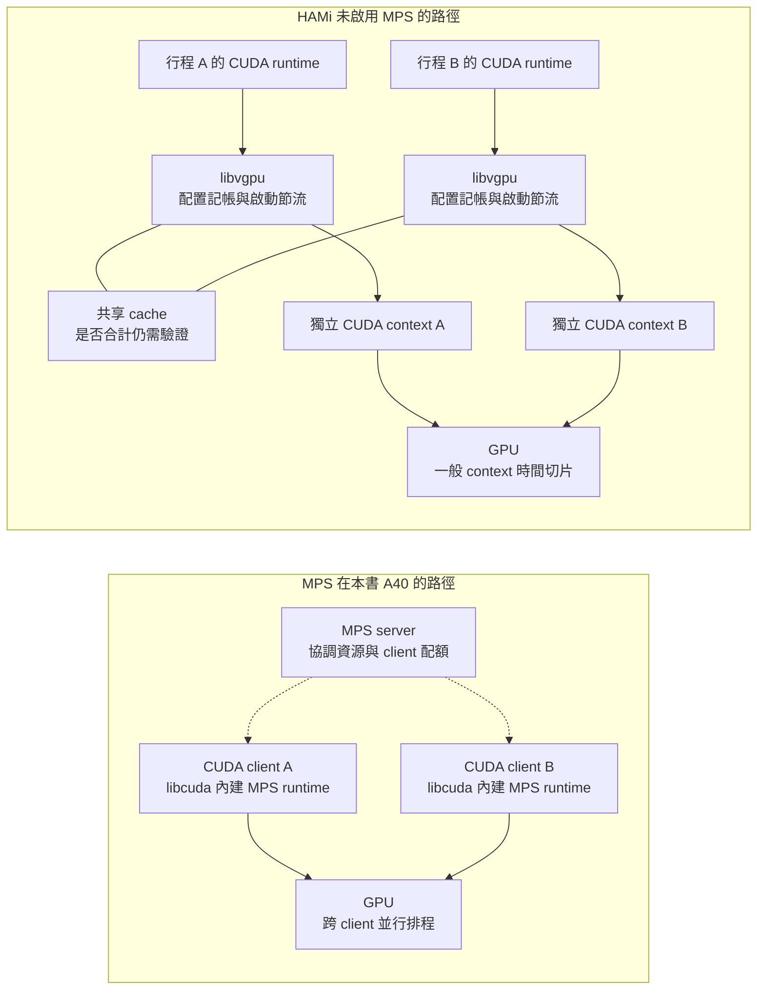

# 4.4 HAMi 與 MPS 的差異

## 本頁要回答的問題

在 8 GiB 的配額下，MPS 與 HAMi 都讓本次單行程在成功保留 7.5 GiB 張量後遇到配置 OOM（配額也計入張量以外的 CUDA 配置），為什麼同 Pod 雙行程的結果不同？差別在限制所在的位置、計量範圍與執行路徑。本頁比較本書使用的 MPS 設定與 HAMi-DRA v0.1.0，不把它們視為相同的硬體分割。

## 背景原理

MPS 的 CUDA client runtime 內建於 `libcuda.so`，server 協調共用排程資源，讓不同 client 的 kernel 有機會並行。HAMi 則把 `libvgpu.so` 載入每個應用行程，在 CUDA driver API 前做配置記帳與啟動節流；本次 HAMi provider 沒有啟用 MPS，CUDA context 仍分開。[MPS 架構][mps-arch]、[一般跨 context 規則][cuda-context]、[HAMi 的準備路徑][hami-path]

MPS 圖中的虛線是管理關係。Volta 起 client 各有 GPU 位址空間，直接提交工作；不能把 A40 畫成所有 kernel 都先由 server 轉送，或所有行程共用單一 context。HAMi 的共享 cache 是軟體紀錄，亦不能把相同路徑或 inode 畫成已證明的跨 Pod 總額保證。[NVIDIA 的 Volta 說明][mps-arch]、[E2B 原始資料][e2b]

## 部署與設定

MPS 使用原 NVIDIA provider、`MPSSupport` 與 Claim 的 `GpuConfig`，A、B 引用同一個 allocation；本次沒有提出 memory capacity 請求。HAMi-DRA 使用替代 provider 的 `HAMiCoreSupport`，E2 runtime 的 A、B 各有獨立 memory／cores Claim，CDI 將消耗容量轉成容器配額；完整 YAML 與切換命令分別見 [MPS 部署](mps.md#部署與設定)和 [HAMi-DRA 部署](hami-dra.md#部署與設定)。

## 驗證

### 兩種路徑的差異

每一格都標出官方依據或本次量測。HAMi 的核心實作說明與實際 binary 的來源界線見 [HAMi-core 版本與證據](hami-dra.md#函式庫身分與原始碼的界線)；下表不假設已由 library hash 找到對應 source commit。

| 比較項目 | MPS | HAMi-DRA |
|---|---|---|
| 強制執行的位置 | CUDA driver 的 MPS client／server 路徑；client 超出 memory limit 時，CUDA 配置回傳 OOM。[官方記憶體限制][mps-memory] | 容器內每個行程載入的 user-space `libvgpu.so` 攔截配置呼叫；DRA Prepare 提供限制值與掛載。[CDI edits][hami-cdi]、[本次配置結果][hami-result] |
| CUDA context 與 kernel | server 協調跨 client 排程，允許 kernel 並行；A40 client 仍有各自的 GPU 位址空間，並非合併為單一 context。[官方架構][mps-arch] | 本次沒有 MPS，保留分開的 context，以一般 context 時間切片路徑共用 GPU；libvgpu 不提供 MPS 的跨 client 排程。[本次功能開關][hami-path]、[CUDA 規則][cuda-context] |
| 記憶體語意與範圍 | 每個 CUDA client 行程的上限，包含 CUDA 內部 device allocations；本次同 Pod 兩個 client 各到 5 GiB，合計 10 GiB。[官方語意][mps-memory]、[量測][mps-result] | 本次共享 cache 下，同容器雙行程與同 Pod 雙容器合計配置受限；跨 Pod 即使共用 Claim 和 inode 仍達 9.75 GiB，不能概括成可靠的 per-Claim 上限。[E2 結果][hami-result]、[E2B][e2b] |
| 運算限制 | `CUDA_MPS_ACTIVE_THREAD_PERCENTAGE`／control provisioning 限制 client 可用執行緒量；動態 provisioning 不預留專用 SM。本次比例為 100，未測節流效果。[官方 provisioning][mps-provision]、[control 讀回][mps-control] | `CUDA_DEVICE_SM_LIMIT_0=50` 來自本次 cores allocation，HAMi-core 在 kernel launch 路徑以 watcher／token 邏輯節流；50 不表示固定取得一半實體 SM，第四章未量測此設定的效能效果。[CDI 轉換][hami-cap-env]、[機制與限制][hami-core] |
| scheduler 記帳 | 本次 Claim 沒有 `capacity.requests.memory`，未提供 VRAM 消耗帳本。[完整 Claim][mps-deploy] | 公布 memory／cores capacity，獨立 Claim 按 `consumedCapacity` 記帳；同一 Claim 被多個 Pod 引用仍只有該 allocation。[容量原始碼][hami-capacity]、[本次 API 與結果][hami-accounting] |
| 故障隔離 | CPU 端 API error 回到呼叫 client；Volta MPS 的 fatal GPU fault 仍可能通知同一受影響 GPU 的其他 client。本次僅驗證配置 OOM 時 A 正常。[官方故障範圍][mps-fault]、[A 量測][mps-stability] | E2 配額 OOM 時 A 的 179 次探測成功；E2B 有一輪停滯。未注入 fatal fault，不能由攔截函式庫推得故障隔離。[E2 結果][hami-result]、[E2B][e2b] |
| 繞過風險 | 配額作用於已加入 MPS 的 client，沒有靠 preload 攔截；本次未測不可信工作能否避開接入設定。[MPS 連線][mps-arch]、[本次限制][mps-limits] | 限制依賴函式庫確實載入及呼叫路徑被覆蓋，這是軟體邊界；本次沒有測移除 hook、替換函式庫或其他配置 API。[掛載與來源][hami-cdi]、[本次限制][hami-limits] |
| `nvidia-smi` 可觀察性 | 本次快照同時列出 server 與 client，須以 control 清單核對身分；server 那列不是整卡合計。[原始快照][mps-observe] | 容器內 NVML／CUDA total 可以是配額視圖，實體用量由未注入 HAMi 的 driver Pod 取得，再以 host PID 核對。[原始 hooks 與用量][hami-result] |
| 接入需求 | 本次需要啟用 MPS 的 NVIDIA DRA driver、daemon 的 pipe／shm 掛載，以及相同 UID 的 client；`multiUser` 為 false。[完整設定與準備][mps-deploy] | 本次需要 DRA capacity、HAMi provider、可載入 libvgpu 的容器及 host 路徑掛載；沿用既有 NVIDIA ServiceAccount，沒有另部署 classic HAMi scheduler／webhook。[本次部署][hami-deploy] |
| 本書量測的問題 | 單行程配額邊界、同 Pod 雙行程合計量與 A 的持續配置／運算；本頁資料沒有量測 MPS 吞吐量。[MPS 實驗][mps-result] | memory／cores 記帳、單行程及共享紀錄的配置範圍、B 實體用量與 E2 的 A 穩定性；E2B 測容器／Pod 邊界，沒有 A。[HAMi E2][hami-result]、[E2B][e2b] |

上述記憶體範圍可與實測張量邊界對照；圖中的 MPS 配額是每個 client，不能把雙行程合計當成同一個 Pod 上限。

### 從工作形態選擇驗證路徑

- Task 只有一個 CUDA client：可先評估 MPS，核對實際 server limit、client 身分與其他 client 的最大合計需求。[本次單行程量測][mps-result]
- Task 在同一個 Pod 內有多個 CUDA 行程：可評估 HAMi-DRA，重跑該應用的 cache 身分、配置 API 與實體行程合計；本次雙行程的實體超額要保留 headroom。[本次同 Pod 量測][hami-result]
- 多個 Pod 共用同一個 Claim：本次 HAMi 結果不足以把它當成可靠的總額配額。獨立 Claim 可讓容量分開記帳，但 E2B 的 6 GiB 目標控制尚未驗證各 Claim 的 8 GiB 上界。[E2B][e2b]
- 需要效能、致命故障或不可信工作隔離：分別測量，不能以第四章的 CUDA OOM 結果替代。固定工作量的效能比較見[第 5 章](../05-performance/README.md)。

## 重點整理

MPS 的限制以 CUDA client 為範圍，HAMi 的限制經由容器內的函式庫與共享紀錄接線。兩者在單行程量測得到相同張量邊界，並不代表多行程、跨 Pod、實體負擔與故障行為也相同；下一頁將把三層限制與精確結果放在一起判讀。

[mps-arch]: https://docs.nvidia.com/deploy/mps/595/architecture.html
[cuda-context]: https://docs.nvidia.com/cuda/archive/12.4.0/cuda-c-programming-guide/index.html#concurrent-kernel-execution
[mps-memory]: https://docs.nvidia.com/deploy/mps/595/when-to-use-mps.html#mps-device-memory-limit
[mps-provision]: https://docs.nvidia.com/deploy/mps/595/when-to-use-mps.html#dynamic-execution-resource-provisioning
[mps-fault]: https://docs.nvidia.com/deploy/mps/595/when-to-use-mps.html#memory-protection-and-error-containment
[mps-result]: mps.md#單行程邊界與雙行程合計量
[mps-control]: mps.md#先確認限制與-client-身分
[mps-stability]: mps.md#a-在共同保留窗口仍可配置與運算
[mps-deploy]: mps.md#部署與設定
[mps-observe]: mps.md#nvml-行程列表要和-mps-身分對照
[mps-limits]: mps.md#限制
[hami-path]: hami-dra.md#dra-如何取代-classic-控制元件
[hami-cdi]: https://github.com/Project-HAMi/k8s-dra-driver/blob/v0.1.0/cmd/hami-kubelet-plugin/hami_core.go#L248-L275
[hami-cap-env]: https://github.com/Project-HAMi/k8s-dra-driver/blob/v0.1.0/cmd/hami-kubelet-plugin/hami_core.go#L184-L244
[hami-capacity]: https://github.com/Project-HAMi/k8s-dra-driver/blob/v0.1.0/cmd/hami-kubelet-plugin/hami_core.go#L50-L111
[hami-result]: hami-dra.md#結果
[hami-accounting]: hami-dra.md#memory-與-cores-的帳本
[hami-core]: hami-dra.md#sm-比例如何節流
[hami-deploy]: hami-dra.md#部署與設定
[hami-limits]: hami-dra.md#限制
[e2b]: ../../data/e2b/SOURCES.md

<!-- nav:start -->
[← 上一頁：4.3 HAMi-DRA：攔截 CUDA 呼叫的配額](hami-dra.md) ｜ [目錄](../README.md) ｜ [下一頁：4.5 三種方案的比較與容量觀測 →](results.md)
<!-- nav:end -->
