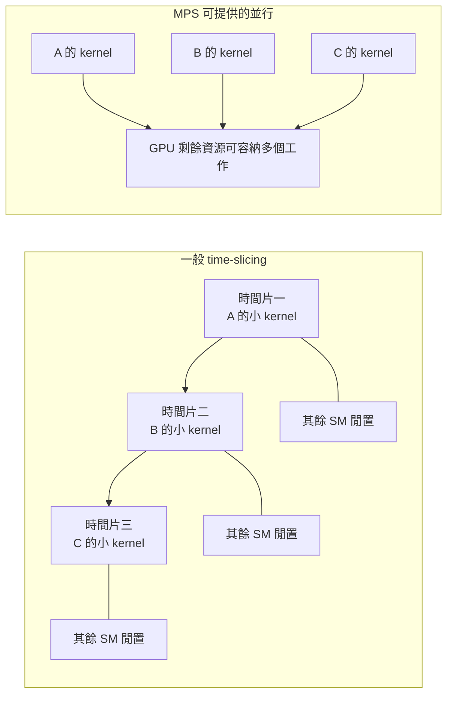
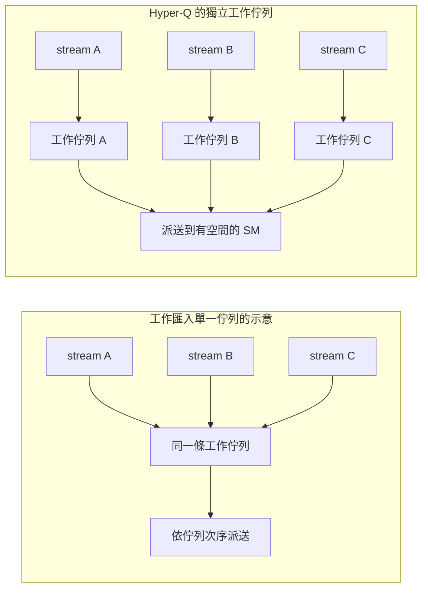
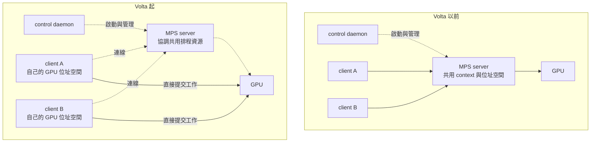
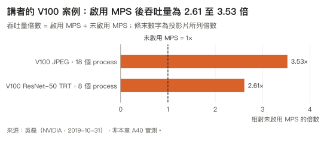
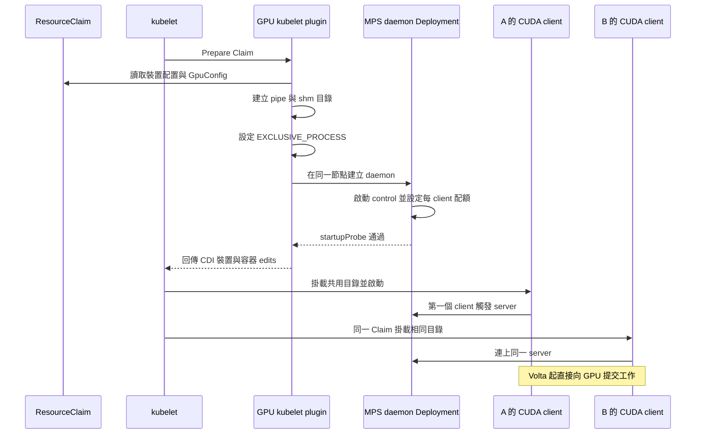
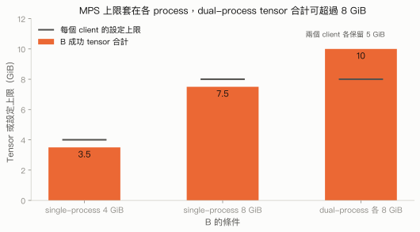
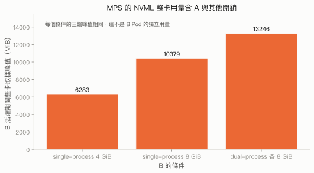

# 4.2 MPS：每個行程的 VRAM 上限

## 本頁要回答的問題

MPS 能讓多個 CUDA 行程並行，也能在 GPU 記憶體配置時拒絕超額要求；這兩個能力如何接上 ResourceClaim？本頁從 CUDA context、Hyper-Q 與 MPS 架構一路追到 NVIDIA DRA driver 的裝置準備，再用單行程與雙行程實驗確認配額範圍。關鍵結果是：每行程設定 `8Gi` 時，單行程 B 在成功保留 7.5 GiB 張量後遇到 CUDA OOM，但同一 Pod 的兩個 CUDA 行程合計能保留 10 GiB。

## 背景原理

### CUDA context 與時間切片

CUDA context 保存某個 GPU 執行環境的狀態，包括記憶體配置、kernel 啟動、位址對應與相關物件。CUDA Driver API 可以明確建立 context，Runtime API 則會代為管理；多個 CPU 執行緒可以使用同一個行程的 primary context，因此「執行緒變多」和「CUDA 行程變多」不等價。[CUDA 12.4 的 context 說明](https://docs.nvidia.com/cuda/archive/12.4.0/cuda-c-best-practices-guide/index.html#multiple-contexts)

一般的多行程共用 GPU 會產生分開的 context，GPU 輪流服務它們的工作。若每個行程只提交很小的 kernel，輪到某個 context 的時間片內，其餘運算資源仍可能閒置；增加行程數不會自動讓這些工作同時填滿 GPU。MPS 提供跨行程的並行路徑，減少這種輪流執行與 context 切換的成本。[CUDA 12.4 的跨 context 執行規則](https://docs.nvidia.com/cuda/archive/12.4.0/cuda-c-programming-guide/index.html#concurrent-kernel-execution)



圖中是假設每個工作都很小的示意，沒有設定時間片長度，也沒有保證每個 kernel 都會重疊。要判斷效能收益，仍須量測工作本身的資源需求與執行時間；本頁後半部的實驗測的是記憶體配額，不是吞吐量。

### Hyper-Q 為何能填補空檔

CUDA stream 是依序執行命令的軟體抽象，driver 將 stream 對應到 GPU 的硬體工作佇列。Hyper-Q 讓多條工作佇列有機會並行排程，減少彼此獨立的工作被同一條佇列阻塞；MPS 則讓多個行程也能使用這條並行路徑。[NVIDIA R595 的 stream 與工作佇列說明](https://docs.nvidia.com/deploy/mps/595/architecture.html)



「有多條佇列」只代表增加並行的機會。另一個 kernel 的 thread block 必須能放進現有硬體資源，包含暫存器、shared memory 與 block 槽位；若一個工作已經耗盡資源，MPS 也無法憑空增加容量。吳磊的 Hyper-Q 說明與 CUDA 的並行規則都保留這個條件。[2019 年分享第 12 頁](https://www.nvidia.cn/content/dam/en-zz/zh_cn/assets/webinars/31oct2019c/20191031_MPS_davidwu.pdf#page=12)、[CUDA 並行說明](https://docs.nvidia.com/cuda/archive/12.4.0/cuda-c-programming-guide/index.html#concurrent-kernel-execution)

### MPS 的三個元件與架構演變

MPS client runtime 內建在 `libcuda.so`，應用程式照常呼叫 CUDA API。`nvidia-cuda-mps-control` 是管理連線與 server 生命週期的 control daemon；`nvidia-cuda-mps-server` 管理 client 共用的 GPU 排程資源。第一個 client 連線時，daemon 才按需啟動 server，兩者不是同一個行程。[NVIDIA R595 的元件定義](https://docs.nvidia.com/deploy/mps/595/index.html)、[server 啟動順序](https://docs.nvidia.com/deploy/mps/595/architecture.html)



「所有 client 共用 server 的一個 context」適合說明早期架構，不能直接套用到本書的 A40。Volta 起，每個 client 有自己的 GPU 位址空間，而且直接向 GPU 提交工作，server 留在共用資源的協調路徑，沒有逐筆轉送所有 kernel。[NVIDIA R595 的 Volta 架構](https://docs.nvidia.com/deploy/mps/595/architecture.html)

Volta MPS 的 client 可透過 `CUDA_MPS_ACTIVE_THREAD_PERCENTAGE` 限制可用執行緒比例，透過 `CUDA_MPS_PINNED_DEVICE_MEM_LIMIT` 限制可由 CUDA API 配置的 GPU 記憶體。client 的環境變數可以進一步降低 server 給它的上限；`PinnedDevice` 在此指裝置記憶體限制，不能解讀成只限制 CPU 端的 page-locked memory。[R595 的資源限制介面](https://docs.nvidia.com/deploy/mps/595/appendix-tools-and-interface-reference.html#environment-variables)

R595 說明的連線上限是：使用 Volta MPS 預設 `CUDA_DEVICE_MAX_CONNECTIONS=2` 時，每個 server、每張裝置最多 **60 個 client CUDA context**。這是 context 數，不是 Pod 數；提高每個 client 的連線需求，會減少可容納的 client。2019 年投影片記錄的 Volta 上限是 48，屬於當時條件，本頁採用與原叢集驅動同系列的 R595 說明。[R595 的連線限制](https://docs.nvidia.com/deploy/mps/595/when-to-use-mps.html#client-server-connection-limits)

### 配置失敗與致命 GPU 故障的差別

CUDA 記憶體配置超過 MPS 上限時，呼叫會回報 OOM；這種配置失敗要和 fatal GPU fault 分開判定。Volta MPS 雖有分開的 GPU 位址空間，共用故障 GPU 的 client 仍可能一起收到致命錯誤，server 進入 `FAULT`，拒絕新的連線；受影響的 client 全部退出後，server 才能重建相應的 GPU context。Volta 以前的 server 則會在致命故障後關閉。[NVIDIA 的錯誤侷限範圍](https://docs.nvidia.com/deploy/mps/595/when-to-use-mps.html#memory-protection-and-error-containment)、[server 狀態](https://docs.nvidia.com/deploy/mps/595/architecture.html)

因此，清理前必須讓 client 完成 CUDA 同步。直接以訊號終止仍有 GPU 工作的 client，可能讓 server 與其他 client 停滯或發生未定義行為；本實驗讓工作負載自己同步並正常退出，沒有以強制終止來驗證故障隔離。[NVIDIA 的 client 終止條件](https://docs.nvidia.com/deploy/mps/595/when-to-use-mps.html#client-early-termination)

### 哪些工作可能受惠

MPS 適合單一行程不足以填滿 GPU 的工作，例如 grid 的 block 數很少，或 strong scaling 後每個行程的工作量縮小。它可以讓其他行程使用空檔，收益取決於實際負載；已經占滿 GPU 的 kernel、記憶體頻寬或容量，並不會因為啟用 MPS 而多出資源。[NVIDIA 的適用條件](https://docs.nvidia.com/deploy/mps/595/when-to-use-mps.html#identifying-candidate-applications)

吳磊（NVIDIA）在 **2019 年 10 月 31 日**的〈如何使用 MPS 提升 GPU 計算收益〉提供三個例子。Titan V 的小 kernel 每行程只啟動一條執行緒，單行程約 3.5 秒；同時啟動兩個、四個行程，關閉 MPS 時每行程耗時約增為兩倍、四倍，啟用後則仍約 3.5 秒。這個例子呈現的是空閒 SM 能否接上其他行程的工作。[分享第 3 與第 27 頁](https://www.nvidia.cn/content/dam/en-zz/zh_cn/assets/webinars/31oct2019c/20191031_MPS_davidwu.pdf#page=27)

V100 的另外兩個案例則展示應用程式吞吐量：Fastvideo SDK 做 JPEG 縮放，TensorRT 做 ResNet-50 推論。以下表格與圖形是**講者的歷史結果**，沒有納入本書 A40 的隔離測試，也不代表本書工作負載會得到相同倍數。[分享第 31 至第 35 頁](https://www.nvidia.cn/content/dam/en-zz/zh_cn/assets/webinars/31oct2019c/20191031_MPS_davidwu.pdf#page=31)



| 講者案例 | GPU 與工作 | 行程數 | 關閉 MPS | 啟用 MPS | 投影片吞吐量倍數 |
| --- | --- | ---: | ---: | ---: | ---: |
| JPEG 縮放 | V100 16GB，1920×1080 縮成 480×270 | 18 | 1009 FPS | 3558 FPS | 3.53× |
| TensorRT ResNet-50 | V100 16GB，batch 1、FP16 | 8 | 588 張／秒 | 1538 張／秒 | 2.61× |

ResNet-50 同一組比較的單次推論延遲從 13.6 ms 降至 5.2 ms。圖的長度按吞吐量相除，標示保留投影片所列倍數；ResNet-50 表列整數相除為 1538 ÷ 588 ≈ 2.62，與投影片的 2.61 有些微差異。這裡保留來源的兩種數值，不把它們當成相同的四捨五入結果；不同工具、GPU 與工作型態的絕對值，也不能直接合併比較。

## 部署與設定

### NVIDIA DRA 如何將配額接到 Claim

本書沿用[第 2.3 節](../02-deploy/dra-driver.md)的 NVIDIA DRA driver **v0.5.0**，安裝時已明確啟用 `MPSSupport=true`；這個 driver gate 在該版本仍是預設關閉的 Alpha。MPS 使用既有的原生 provider，不需要切換 A40 的 provider；但 driver 仍會在準備 Claim 時修改該卡的 compute mode。[v0.5.0 的功能開關](https://raw.githubusercontent.com/kubernetes-sigs/dra-driver-nvidia-gpu/v0.5.0/pkg/featuregates/featuregates.go)

Claim 的 `spec.devices.config` 放入 opaque `GpuConfig`，以 `sharing.strategy: MPS` 選擇策略。以下是 `api/nvidia.com/resource/v1beta1/sharing.go` 第 80 至 92 行的型別定義；**逐裝置覆寫的實際 YAML 鍵是 `defaultPerDevicePinnedMemoryLimit`**。[v0.5.0 的 MpsConfig 型別](https://github.com/kubernetes-sigs/dra-driver-nvidia-gpu/blob/v0.5.0/api/nvidia.com/resource/v1beta1/sharing.go#L80-L92)

```go
// MpsConfig provides the configuring for an MPS control daemon.
type MpsConfig struct {
	DefaultActiveThreadPercentage *int `json:"defaultActiveThreadPercentage,omitempty"`
	// DefaultPinnedDeviceMemoryLimit represents the pinned memory limit to be applied for all devices.
	// This can be overridden for specific devices by specifying an associated entry DefaultPerDevicePinnedMemoryLimit for the device.
	DefaultPinnedDeviceMemoryLimit *resource.Quantity `json:"defaultPinnedDeviceMemoryLimit,omitempty"`
	// DefaultPerDevicePinnedMemoryLimit represents the pinned memory limit per device associated with an MPS daemon.
	// This is defined as a map of device index or UUI to a memory limit and overrides a setting applied using DefaultPinnedDeviceMemoryLimit.
	DefaultPerDevicePinnedMemoryLimit MpsPerDevicePinnedMemoryLimit `json:"defaultPerDevicePinnedMemoryLimit,omitempty"`
	// MultiUser controls if the nvidia-cuda-mps-control daemon should be started in Multi user mode, which allows sharing between users with different uids.
	// If not provided it will default to not enabled.
	MultiUser *bool `json:"multiUser,omitempty"`
}
```

| 參數 | 意義 | 為什麼這樣設 |
| --- | --- | --- |
| `sharing.strategy: MPS` | 選用 MPS 的準備路徑。 | 讓同一 Claim 的 A、B 成為同一組 MPS client。 |
| `defaultActiveThreadPercentage: 100` | 對新 client 設定可用執行緒比例的預設上限。 | 保留原始條件，沒有另外限制運算比例；100 不代表為某個 client 保留整張卡的 SM。 |
| `defaultPinnedDeviceMemoryLimit: 8Gi` | 對這組裝置的每個 client 設定記憶體上限。 | 比較單行程與雙行程的配額範圍；另以 `4Gi` 測不同邊界。 |
| `defaultPerDevicePinnedMemoryLimit` | 以這組裝置的索引或 UUID 指定覆寫值。 | 多裝置 Claim 可用；本實驗只選一張 A40，沒有設定覆寫。 |
| `multiUser: false` | 不啟用跨 UID 的 MPS server。 | A、B 與 server 都使用 UID 0，避免混入不同使用者的連線條件。 |

driver 先套用預設記憶體值，再以逐裝置設定覆寫；`Normalize` 將索引對應成 UUID，記憶體 Quantity 除以 `1024×1024` 後產生 MPS 所需的 `M` 單位字串。因此 `8Gi` 會轉成 `8192M`，實際查詢則可顯示 `8G`。這個值傳給 MPS control 命令，沒有在 scheduler 提交 `capacity.requests.memory`。[v0.5.0 的限制值轉換](https://github.com/kubernetes-sigs/dra-driver-nvidia-gpu/blob/v0.5.0/api/nvidia.com/resource/v1beta1/sharing.go#L191-L239)

### Prepare 建立的是哪一個服務

`cmd/gpu-kubelet-plugin/device_state.go` 第 1331 至 1353 行先確認 gate 與策略，讀取 MPS 設定，再呼叫 `Start`、等待就緒，最後取得 CDI edits。若有效啟用 ConsumableShares，這條 MPS 準備路徑會拒絕執行；本頁沒有把兩種配額機制疊在一起。[v0.5.0 的裝置準備路徑](https://raw.githubusercontent.com/kubernetes-sigs/dra-driver-nvidia-gpu/v0.5.0/cmd/gpu-kubelet-plugin/device_state.go)

MPS daemon 的識別值結合 Claim UID 與這組裝置 UUID 的雜湊。因此它屬於 **Claim 的裝置群組**，同一 Claim 的第二個 Pod 沿用已準備的服務，沒有各自建立另一個 server；這也不能推導成「獨立 Claim 會自動加入同一個 server」。下列完整函式出自 `cmd/gpu-kubelet-plugin/sharing.go` 第 184 至 188 行。[v0.5.0 的 daemon 識別](https://raw.githubusercontent.com/kubernetes-sigs/dra-driver-nvidia-gpu/v0.5.0/cmd/gpu-kubelet-plugin/sharing.go)

```go
func (m *MpsManager) GetMpsControlDaemonID(claimUID string, devices UUIDProvider) string {
	combined := strings.Join(devices.UUIDs(), ",")
	hash := sha256.Sum256([]byte(combined))
	return fmt.Sprintf("%s-%s", claimUID, hex.EncodeToString(hash[:])[:5])
}
```

driver 在自己的 Namespace 建立單一副本的 Deployment，而不是把 daemon 塞入工作負載的 Pod。範本將它固定到準備 Claim 的節點，使用 `hostPID: true` 與 privileged 容器；本叢集實際位於 `nvidia-dra-driver-gpu` Namespace、`dra-a40` 節點。daemon 使用 driver 的映像檔，但 NVIDIA 工具與函式庫來自掛載的 driver root。[v0.5.0 的 Deployment 範本](https://raw.githubusercontent.com/kubernetes-sigs/dra-driver-nvidia-gpu/v0.5.0/templates/mps-control-daemon.tmpl.yaml)

本叢集的 driver root 是 `/run/nvidia/driver`，範本把它掛入 `/driver-root`，偵測到 shell 後以 `chroot` 啟動 `nvidia-cuda-mps-control`。driver 另在 `/var/lib/kubelet/plugins/gpu.nvidia.com/mps/<daemon-id>/` 建立 `pipe`、`shm`、`log`，將 `shm` 掛成 tmpfs；daemon 內分別對應到 driver-root 中的 `/tmp/nvidia-mps`、`/dev/shm` 與 `/var/log/nvidia-mps`。這些共用路徑把分開的容器接到同一個 MPS 服務。[建立目錄與服務](https://raw.githubusercontent.com/kubernetes-sigs/dra-driver-nvidia-gpu/v0.5.0/cmd/gpu-kubelet-plugin/sharing.go)、[driver-root 掛載與啟動](https://raw.githubusercontent.com/kubernetes-sigs/dra-driver-nvidia-gpu/v0.5.0/templates/mps-control-daemon.tmpl.yaml)



### CDI 接線與 compute mode

以下完整方法出自 `cmd/gpu-kubelet-plugin/sharing.go` 第 406 至 426 行。CDI 給 client 容器的 MPS 環境變數是 `CUDA_MPS_PIPE_DIRECTORY=/tmp/nvidia-mps`，並把該 daemon 的 host 目錄掛到 `/dev/shm` 與 `/tmp/nvidia-mps`；此方法沒有向每個 client 注入上述兩個限制環境變數，配額由 daemon 的 control 命令設定。[v0.5.0 的 CDI edits](https://raw.githubusercontent.com/kubernetes-sigs/dra-driver-nvidia-gpu/v0.5.0/cmd/gpu-kubelet-plugin/sharing.go)

```go
func (m *MpsControlDaemon) GetCDIContainerEdits() *cdiapi.ContainerEdits {
	return &cdiapi.ContainerEdits{
		ContainerEdits: &cdispec.ContainerEdits{
			Env: []string{
				fmt.Sprintf("CUDA_MPS_PIPE_DIRECTORY=%s", "/tmp/nvidia-mps"),
			},
			Mounts: []*cdispec.Mount{
				{
					ContainerPath: "/dev/shm",
					HostPath:      m.shmDir,
					Options:       []string{"rw", "nosuid", "nodev", "bind"},
				},
				{
					ContainerPath: "/tmp/nvidia-mps",
					HostPath:      m.pipeDir,
					Options:       []string{"rw", "nosuid", "nodev", "bind"},
				},
			},
		},
	}
}
```

啟動服務前，driver 以 NVML 將這組完整 GPU 設成 `EXCLUSIVE_PROCESS`；這符合 NVIDIA 讓 MPS server 統一協調 GPU 存取的建議。停止服務時，`Stop` 刪除 Deployment，把 GPU 改回 `DEFAULT`，再卸載共享記憶體並移除目錄；本實驗逐輪核對這些結果，才開始下一輪。[v0.5.0 的啟動與清理](https://raw.githubusercontent.com/kubernetes-sigs/dra-driver-nvidia-gpu/v0.5.0/cmd/gpu-kubelet-plugin/sharing.go)、[NVIDIA 的 compute mode 建議](https://docs.nvidia.com/deploy/mps/595/when-to-use-mps.html#gpu-compute-modes)

### 部署輸入與物件名稱

以下在 `labs/04-isolation/` 閱讀與準備 YAML。原始實驗使用 Pod，復現套件改用 `restartPolicy: Never`、`backoffLimit: 0` 的 Job，保留映像檔、CUDA 工作與共用 Claim 的語意；單行程與雙行程 B 是不同輪次的替代輸入，不能同時部署。以下將同一階段的等值物件合成完整多物件 YAML；建立輸出取自原叢集縮短版中逐一套用這些物件的紀錄。每輪的啟動、等待、取樣與停止由 `mps/scripts/run.sh` 控制，套用前會在分階段 JSON 加上 `app.kubernetes.io/instance: <run-id>`，供收集與清理核對執行身分。

| 原始物件 | 復現物件 | 角色 |
| --- | --- | --- |
| 每輪 `e2-mps-...` Namespace | `gpu-isolation-lab` | 逐輪清理的實驗空間 |
| ResourceClaim `shared-mps` | `a40-shared-mps` | A 與 B 共用的 A40 配置 |
| Pod `survivor` | Job `steady-service` | A 的持續運算與新增配置探測 |
| Pod `pressure` | Job `quota-pressure` | B 的單行程或雙行程配額測試 |
| ConfigMap `isolation-code` | ConfigMap `isolation-code` | 共用工作負載程式 |

#### Namespace 與工作負載

```console
$ vi common/manifests/00-namespace.yaml
```

```yaml
apiVersion: v1
kind: Namespace
metadata:
  name: gpu-isolation-lab
  labels:
    app.kubernetes.io/part-of: dra-book
    app.kubernetes.io/component: isolation-lab
```

| 參數 | 意義 | 為什麼這樣設 |
| --- | --- | --- |
| Namespace 與 `part-of: dra-book` label | 本套件的空間與物件身分。 | 清理僅刪除帶此 label 的物件，並確認 Namespace 沒有外部內容。 |

```console
$ kubectl apply -f common/manifests/00-namespace.yaml
namespace/gpu-isolation-lab created
```

工作負載 ConfigMap 由 [Kustomization](../../labs/04-isolation/common/workload/kustomization.yaml) 產生，程式入口是 [isolation_workload.py](../../labs/04-isolation/common/workload/isolation_workload.py)，共用 CUDA 操作位於 [base_workload.py](../../labs/04-isolation/common/workload/base_workload.py)。不需要手工把整份 Python 程式重寫成 ConfigMap；下列 generator 與兩個來源檔案一起保存，供所有隔離方法使用。

<!-- config-generator:start -->
```console
$ vi common/workload/kustomization.yaml
```

```yaml
apiVersion: kustomize.config.k8s.io/v1beta1
kind: Kustomization
namespace: gpu-isolation-lab
configMapGenerator:
  - name: isolation-code
    files:
      - base_workload.py
      - isolation_workload.py
      - capacity_workload.py
      - accounting-sleeper.sh
generatorOptions:
  disableNameSuffixHash: true
  labels:
    app.kubernetes.io/part-of: dra-book
    app.kubernetes.io/component: workload-code
```

| 參數 | 意義 | 為什麼這樣設 |
| --- | --- | --- |
| `configMapGenerator.files`、兩個 labels | 由來源程式產生有角色標記的 ConfigMap。 | 保存可檢查的程式並納入清理範圍。 |
| `disableNameSuffixHash: true` | 固定名稱為 `isolation-code`。 | 分階段建立 Jobs 時，掛載引用保持一致。 |

```console
$ kubectl kustomize common/workload > /tmp/gpu-isolation-code.yaml
$ kubectl apply -f /tmp/gpu-isolation-code.yaml
configmap/isolation-code created
```
<!-- config-generator:end -->

程式的配置路徑先建立 `uint8` CUDA 張量，再寫入並同步，確保成功張量量代表已完成的配置。以下節錄 [base_workload.py 的配置方法](../../labs/04-isolation/common/workload/base_workload.py)，try 分支只將明確的配置 OOM 正規化；kernel 與同步錯誤另行記錄，沒有全部當作配額生效。

```python
tensor = self.torch.empty(nbytes, dtype=self.torch.uint8, device='cuda')
```

```python
tensor.zero_()
self.synchronize()
return tensor
```

[isolation_workload.py](../../labs/04-isolation/common/workload/isolation_workload.py) 的 `scope` 分支在初始化 `TorchGPU` 之前分流；parent 只建立兩個 child，每個 child 才會進入 CUDA 路徑。這是雙行程測試的控制條件，而不是由 Pod 的名稱推測 client 數。

```python
if args.role == 'scope':
    emit('B_READY', gpu_initialized=False)
else:
    gpu = base.TorchGPU()
```

#### 共用 Claim 與 A

這份 YAML 先建立唯一的 Claim，再建立 A。A 與後續 B 都引用 `a40-shared-mps`；Claim 中沒有 `capacity.requests.memory`，`8Gi` 是 MPS client 的執行期上限。

```console
$ vi mps/manifests/steady-service.yaml
```

```yaml
apiVersion: resource.k8s.io/v1
kind: ResourceClaim
metadata: {name: a40-shared-mps, namespace: gpu-isolation-lab, labels: {app.kubernetes.io/part-of: dra-book, app.kubernetes.io/component: shared-mps}}
spec:
  devices:
    requests:
    - name: gpu
      exactly:
        deviceClassName: gpu.nvidia.com
        allocationMode: ExactCount
        count: 1
        selectors:
        - {cel: {expression: 'device.attributes["gpu.nvidia.com"].uuid == "GPU-29ffee3e-bee4-e341-917a-fe7e43e977af"'}}
    config:
    - requests: [gpu]
      opaque:
        driver: gpu.nvidia.com
        parameters:
          apiVersion: resource.nvidia.com/v1beta1
          kind: GpuConfig
          sharing: {strategy: MPS, mpsConfig: {defaultActiveThreadPercentage: 100, defaultPinnedDeviceMemoryLimit: 8Gi, multiUser: false}}
---
apiVersion: batch/v1
kind: Job
metadata: {name: steady-service, namespace: gpu-isolation-lab, labels: {app.kubernetes.io/part-of: dra-book, app.kubernetes.io/component: steady-service}}
spec:
  backoffLimit: 0
  template:
    metadata: {labels: {app.kubernetes.io/part-of: dra-book, app.kubernetes.io/component: steady-service}}
    spec:
      restartPolicy: Never
      terminationGracePeriodSeconds: 120
      automountServiceAccountToken: false
      tolerations: [{key: nvidia.com/gpu, operator: Exists, effect: NoSchedule}]
      resourceClaims: [{name: gpu, resourceClaimName: a40-shared-mps}]
      containers:
      - name: workload
        image: docker.io/pytorch/pytorch:2.5.1-cuda12.4-cudnn9-runtime@sha256:c8268a92a69bd500f8be0e665b2630ee006dadaf7bfbc24249141b15ff622755
        imagePullPolicy: IfNotPresent
        command: [python, -u, /opt/lab/isolation_workload.py]
        args: [--role, survivor, --quota-gib, '8']
        env:
        - {name: PYTORCH_NO_CUDA_MEMORY_CACHING, value: '1'}
        - {name: OMP_NUM_THREADS, value: '1'}
        - {name: POD_NAME, valueFrom: {fieldRef: {fieldPath: metadata.name}}}
        securityContext: {runAsUser: 0, runAsGroup: 0}
        resources: {requests: {cpu: '2', memory: 4Gi}, limits: {cpu: '2', memory: 4Gi}, claims: [{name: gpu, request: gpu}]}
        volumeMounts: [{name: code, mountPath: /opt/lab, readOnly: true}]
      volumes: [{name: code, configMap: {name: isolation-code}}]
```

| 參數 | 意義 | 為什麼這樣設 |
| --- | --- | --- |
| UUID selector、`ExactCount`、`count: 1` | 固定同一張 A40。 | A、B 共用同一 allocation。 |
| `sharing.strategy: MPS`、`defaultPinnedDeviceMemoryLimit: 8Gi` | 啟用每個 client 的 8 GiB 上限。 | 比較單行程與同 Pod 雙行程。 |
| `--role survivor`、`--quota-gib 8` | A 的持續服務與記錄參數。 | 保留 2 GiB，反覆運算並探測 512 MiB。 |
| pinned PyTorch image、兩個 env | 固定 image、停用 CUDA allocator 快取、CPU 執行緒設為 1。 | 保留原 CUDA 配置路徑。 |
| UID／GID 0、CPU 2、RAM 4 GiB | 原執行條件。 | RAM limit 不代表 VRAM 上限。 |
| ConfigMap、`POD_NAME`、grace period 120 秒、零重試 | 共用程式、事件身分與正常退出。 | 保留可核對的單輪證據。 |

```console
$ kubectl apply -f mps/manifests/steady-service.yaml
resourceclaim.resource.k8s.io/a40-shared-mps created
job.batch/steady-service created
```

#### 單行程 B

runner 先建立 A 與 B 並確認 READY；A 完成至少 60 秒 baseline 後，才送出 B 的 start 命令，讓它每次增長 256 MiB。真正配置 OOM 後，仍保留成功張量 30 秒再同步退出。

```console
$ vi mps/manifests/quota-pressure.yaml
```

```yaml
apiVersion: batch/v1
kind: Job
metadata: {name: quota-pressure, namespace: gpu-isolation-lab, labels: {app.kubernetes.io/part-of: dra-book, app.kubernetes.io/component: quota-pressure}}
spec:
  backoffLimit: 0
  template:
    metadata: {labels: {app.kubernetes.io/part-of: dra-book, app.kubernetes.io/component: quota-pressure}}
    spec:
      restartPolicy: Never
      terminationGracePeriodSeconds: 120
      automountServiceAccountToken: false
      tolerations: [{key: nvidia.com/gpu, operator: Exists, effect: NoSchedule}]
      resourceClaims: [{name: gpu, resourceClaimName: a40-shared-mps}]
      containers:
      - name: workload
        image: docker.io/pytorch/pytorch:2.5.1-cuda12.4-cudnn9-runtime@sha256:c8268a92a69bd500f8be0e665b2630ee006dadaf7bfbc24249141b15ff622755
        imagePullPolicy: IfNotPresent
        command: [python, -u, /opt/lab/isolation_workload.py]
        args: [--role, pressure, --quota-gib, '8']
        env:
        - {name: PYTORCH_NO_CUDA_MEMORY_CACHING, value: '1'}
        - {name: OMP_NUM_THREADS, value: '1'}
        - {name: POD_NAME, valueFrom: {fieldRef: {fieldPath: metadata.name}}}
        securityContext: {runAsUser: 0, runAsGroup: 0}
        resources: {requests: {cpu: '2', memory: 4Gi}, limits: {cpu: '2', memory: 4Gi}, claims: [{name: gpu, request: gpu}]}
        volumeMounts: [{name: code, mountPath: /opt/lab, readOnly: true}]
      volumes: [{name: code, configMap: {name: isolation-code}}]
```

| 參數 | 意義 | 為什麼這樣設 |
| --- | --- | --- |
| `resourceClaimName: a40-shared-mps` | 和 A 引用同一 Claim。 | 確認兩者接上同一組 MPS 服務。 |
| `--role pressure`、`--quota-gib 8` | 一個 CUDA 行程測 8 GiB 邊界。 | 工作負載參數配合 Claim，限制仍由 MPS 執行。 |

```console
$ kubectl apply -f mps/manifests/quota-pressure.yaml
job.batch/quota-pressure created
```

#### 同 Pod 雙行程 B

這是另一輪的替代輸入，沿用同一個 Job 名稱，不能和單行程版本同時套用。parent 不初始化 CUDA，兩個 child 各自到達 5 GiB，藉此驗證上限會不會在 Pod 內累計；下列建立輸出來自縮短版，該輪在 client 身分核對時中止，並非成功結果。

```console
$ vi mps/manifests/dual-pressure.yaml
```

```yaml
apiVersion: batch/v1
kind: Job
metadata: {name: quota-pressure, namespace: gpu-isolation-lab, labels: {app.kubernetes.io/part-of: dra-book, app.kubernetes.io/component: quota-pressure}}
spec:
  backoffLimit: 0
  template:
    metadata: {labels: {app.kubernetes.io/part-of: dra-book, app.kubernetes.io/component: quota-pressure}}
    spec:
      restartPolicy: Never
      terminationGracePeriodSeconds: 120
      automountServiceAccountToken: false
      tolerations: [{key: nvidia.com/gpu, operator: Exists, effect: NoSchedule}]
      resourceClaims: [{name: gpu, resourceClaimName: a40-shared-mps}]
      containers:
      - name: workload
        image: docker.io/pytorch/pytorch:2.5.1-cuda12.4-cudnn9-runtime@sha256:c8268a92a69bd500f8be0e665b2630ee006dadaf7bfbc24249141b15ff622755
        imagePullPolicy: IfNotPresent
        command: [python, -u, /opt/lab/isolation_workload.py]
        args: [--role, scope, --quota-gib, '8']
        env:
        - {name: PYTORCH_NO_CUDA_MEMORY_CACHING, value: '1'}
        - {name: OMP_NUM_THREADS, value: '1'}
        - {name: POD_NAME, valueFrom: {fieldRef: {fieldPath: metadata.name}}}
        securityContext: {runAsUser: 0, runAsGroup: 0}
        resources: {requests: {cpu: '2', memory: 4Gi}, limits: {cpu: '2', memory: 4Gi}, claims: [{name: gpu, request: gpu}]}
        volumeMounts: [{name: code, mountPath: /opt/lab, readOnly: true}]
      volumes: [{name: code, configMap: {name: isolation-code}}]
```

| 參數 | 意義 | 為什麼這樣設 |
| --- | --- | --- |
| `--role scope` | parent 啟動兩個 CUDA child。 | 區分每行程上限與整個 Pod 上限。 |
| 相同 Claim、`--quota-gib 8` | 每個 child 接上同一組 8 GiB MPS 服務。 | 不用另外一份 Claim 解釋總量增加。 |

```console
$ kubectl apply -f mps/manifests/dual-pressure.yaml
job.batch/quota-pressure created
```

#### 4 GiB 的完整 overlay

4 GiB 案例不能只改 Claim，也要讓 A、B 的 `--quota-gib` 與它一致。以下完整 Kustomization 同時修改三個值，其餘輸入保持相同；完整執行以 `CASE=single-4g` 選取這個版本。

```console
$ vi mps/manifests/single-4g/kustomization.yaml
```

```yaml
apiVersion: kustomize.config.k8s.io/v1beta1
kind: Kustomization
namespace: gpu-isolation-lab
resources:
  - ../../../common/manifests
  - ../01-shared-claim.yaml
  - ../02-steady-service.yaml
  - ../03-quota-pressure.yaml
patches:
  - target:
      kind: ResourceClaim
      name: a40-shared-mps
    patch: |
      - op: replace
        path: /spec/devices/config/0/opaque/parameters/sharing/mpsConfig/defaultPinnedDeviceMemoryLimit
        value: 4Gi
  - target:
      kind: Job
      name: steady-service
    patch: |
      - op: replace
        path: /spec/template/spec/containers/0/args/3
        value: "4"
  - target:
      kind: Job
      name: quota-pressure
    patch: |
      - op: replace
        path: /spec/template/spec/containers/0/args/3
        value: "4"
```

| 參數 | 意義 | 為什麼這樣設 |
| --- | --- | --- |
| Claim 的 memory limit patch | 將 MPS 上限改為 `4Gi`。 | 檢驗另一個單行程邊界。 |
| A、B 的 `args/3` patch | 將工作負載配額參數改為 `4`。 | 讓記錄與安全停止條件符合 Claim。 |

overlay 由 `mps/scripts/run.sh` 渲染後分階段套用，先建立 A 與 B 並確認 READY，再觀察 A 的 baseline，最後讓 B 開始配置壓力。查看渲染內容可使用 `kubectl kustomize mps/manifests/single-4g --load-restrictor=LoadRestrictionsNone`；不要一次套用全部 Jobs 來取代實驗的時間控制。

## 驗證與結果

### 先確認限制與 client 身分

MPS 測試依循[第四章的共用設計](README.md#實驗設計)：A 先執行至少 60 秒 baseline，B 保留成功配置 30 秒，B 退出後 A 再執行至少 60 秒。單行程 B 每次增加 256 MiB、等待 200 ms；雙行程則由兩個 child 各自到達 5 GiB 目標。以下正式結果來自 2026-10-06 的原始九輪量測，每種案例各三輪，使用新的 Claim 與 client；後面的縮短版復現另列。

有 `GpuConfig` 不等於已確認 MPS 生效。原始 8 GiB 單行程第一輪讀回的 control 結果如下，server 與預設記憶體上限都為 `8G`，執行緒比例為 `100.0`；完整內容見 [control 原始結果](../../data/e2/raw/boundary-8g-r1/mps-control.json)。這是原始結果的實際輸出，PID 與 namespace 編號會隨重跑改變。

```json
{
  "get_server_list": "248675\n",
  "get_default_device_pinned_mem_limit GPU-29ffee3e-bee4-e341-917a-fe7e43e977af": "8G\n",
  "get_device_pinned_mem_limit 248675 GPU-29ffee3e-bee4-e341-917a-fe7e43e977af": "8G\n",
  "get_active_thread_percentage 248675": "100.0\n",
  "get_default_active_thread_percentage": "100.0\n",
  "ps": "PID       ID        SERVER         DEVICE                    NAMESPACE      COMMAND        ATTRIBUTES     \n248633    1         248675         GPU-29ffee3e-bee4-e341    4026533424     python                        \n248725    2         248675         GPU-29ffee3e-bee4-e341    4026533492     python                        \n",
  "get_client_list 248675": "248633\n248725\n"
}
```

雙行程第一輪另核對了 host PID 與容器 PID namespace：A 只有一個 client，B 的兩個 client 在同一個 Pod、同一個容器，對應 namespace PID 40 與 41。B 的 parent PID 1 沒有出現在 client 清單，而 server 的上限仍讀回 `8G`；這排除了「其實使用不同 Claim」或「parent 多配了一份 GPU 記憶體」的解釋。[原始身分核對](../../data/e2/raw/scope-8g-r1/mps-identity.json)

### 單行程邊界與雙行程合計量

下表的 B 張量量來自成功配置事件，不包含 CUDA 內部記憶體；A 的探測只統計 B 保留張量、壓力已穩定的共同窗口。NVML 的峰值與最小剩餘量則取 **B 開始成長至第一個 client 回報退出** 之間的整卡取樣，含 A、B 與 MPS 的用量；兩組欄位不能當成同一個計量範圍。逐輪重算值保存在 [runtime.csv](../../data/e2/runtime.csv)，分析只納入開始與完成時間都落在這段窗口內的 GPU 樣本。



| 輪次 | 每行程配額 GiB | B 成功張量 GiB | B 結果 | A 探測 OK／OOM | A 運算錯誤 | NVML 峰值 MiB | NVML 最小剩餘 MiB | A／B 退出碼 |
| --- | ---: | ---: | --- | ---: | ---: | ---: | ---: | --- |
| boundary-4g-r1 | 4 | 3.5 | 配置 OOM | 30／0 | 0 | 6283 | 39208 | 0／0 |
| boundary-4g-r2 | 4 | 3.5 | 配置 OOM | 30／0 | 0 | 6283 | 39208 | 0／0 |
| boundary-4g-r3 | 4 | 3.5 | 配置 OOM | 30／0 | 0 | 6283 | 39208 | 0／0 |
| boundary-8g-r1 | 8 | 7.5 | 配置 OOM | 30／0 | 0 | 10379 | 35112 | 0／0 |
| boundary-8g-r2 | 8 | 7.5 | 配置 OOM | 30／0 | 0 | 10379 | 35112 | 0／0 |
| boundary-8g-r3 | 8 | 7.5 | 配置 OOM | 30／0 | 0 | 10379 | 35112 | 0／0 |
| scope-8g-r1 | 8 | 5.0＋5.0 | 達到目標 | 30／0 | 0 | 13246 | 32245 | 0／0 |
| scope-8g-r2 | 8 | 5.0＋5.0 | 達到目標 | 30／0 | 0 | 13246 | 32245 | 0／0 |
| scope-8g-r3 | 8 | 5.0＋5.0 | 達到目標 | 30／0 | 0 | 13246 | 32245 | 0／0 |

三輪 4 GiB 案例都成功保留 14 個區塊，即 3.5 GiB；三輪 8 GiB 案例都是 30 個區塊，即 7.5 GiB，下一個 256 MiB 區塊配置失敗。三輪雙行程案例則都完成兩個 5 GiB 目標，Pod 合計 10 GiB，沒有遇到配置 OOM。六輪單行程 B 處理預期的 CUDA OOM 後正常退出，九輪都沒有 Kubernetes `OOMKilled`，不能只用退出碼 0 判定「沒有發生 OOM」。

### 配額 OOM 時整張 GPU 並未耗盡



8 GiB 單行程 B 的配置已被拒絕時，整張 A40 仍有大量 VRAM，取樣的最小剩餘量為 35,112 MiB。這和[第 3 章](../03-oom/README.md)耗盡整張卡的無配額基線不同，符合「失敗來自 client 上限」的解讀。張量邊界低於宣告配額，符合 MPS 將 CUDA 內部配置也計入上限的規則；但 256 MiB 的步長沒有量出這些內部配置的精確大小。[NVIDIA 的記憶體限制規則](https://docs.nvidia.com/deploy/mps/595/when-to-use-mps.html#mps-device-memory-limit)

A40 的 NVML total 是 46,068 MiB，另有 578 MiB driver reserved，所以 total 不等於 used 加 free。reserved 也不是 Claim 替 Pod 預留的容量；這些欄位須和 driver 的容量公布、工作負載的 tensor bytes 分開讀取。

### A 在共同保留窗口仍可配置與運算

每輪共同保留窗口都有 30 次 A 新配置，九輪合計 **270 次成功、0 次 OOM**。A 的運算錯誤也是 **0**，張量三個取樣點的完整性核對都通過；因此在這套工作量下，B 的單行程配置 OOM 沒有阻止 A 繼續新增配置與既有運算。這項觀察沒有測量完整張量的每個位元組，也沒有證明 fatal GPU fault 不會影響 A。

### 縮短版的實際復現

2026-10-12 在原叢集執行的縮短版中，8 GiB 單行程 B 成功保留 **7.5 GiB**，下一次配置發生 CUDA OOM；30 秒 hold 內 A 有 **30 次成功、0 次 OOM**，運算錯誤為 **0**。B 活躍窗口的整卡取樣 peak used 為 **10,379 MiB**、min free 為 **35,112 MiB**，和原始同案例一致；清理後該輪判定 `complete=True`。

最初的雙行程輪次在 MPS host PID 對回 CUDA client 時中止，結果是 `incomplete`。下列節錄保留這次失敗，`...` 表示省略中間的階段、取樣與清理行；它不能作為雙行程通過的證據。

```text
boundary-8g-r1: allocation_oom; complete=True
...
MPS check failed: cannot map MPS host PID to exactly one experimental CUDA client
...
scope-8g-r1: incomplete; complete=False
```

身分檢查修正後，同日重跑的單行程與雙行程都通過。雙行程各保留 5 GiB，合計 10 GiB，共同 hold 期間 A 有 30 次成功、0 次 OOM，整卡 NVML 峰值為 13,246 MiB；完整重跑結果與還原證據見[實機驗證紀錄](../../labs/04-isolation/VERIFIED.md)。原始九輪的正式結果仍以上表為準。

### NVML 行程列表要和 MPS 身分對照

NVIDIA 的系統說明將 MPS client 的執行行為歸到 server，但同份說明也提到可查詢各 client 的記憶體用量。不能因此假設 `nvidia-smi` 或 NVML 的行程列表永遠只有 server，或者把 server 那一列直接當成整張 GPU 的合計；實際可見性須核對驅動版本與查詢欄位。[NVIDIA 的監控範圍](https://docs.nvidia.com/deploy/mps/595/when-to-use-mps.html#limitations)、[client 記憶體查詢](https://docs.nvidia.com/deploy/mps/595/when-to-use-mps.html#dynamic-execution-resource-provisioning)

原始 8 GiB 單行程第一輪的 [`--query-compute-apps` 快照](../../data/e2/raw/boundary-8g-r1/processes-during.txt) 實際列出三個行程，完整內容如下。control 的 client 清單可將兩個 Python host PID 對應到 A、B；server 那列只顯示 30 MiB，A、B 則分別為 2354、7986 MiB，不能用 server 那列取代整卡量測。

```text
248675, nvidia-cuda-mps-server, 30
248633, python, 2354
248725, python, 7986
```

這些行程快照、整卡取樣與張量事件各有自己的範圍與時間點。本頁以控制介面確認 client 身分，以整卡 NVML 觀察實體用量，再以工作負載事件計算 B 的成功張量；沒有把三種欄位混成 Pod 的 GPU 記憶體帳本。

## 解讀

MPS 在本實驗有效限制**每個 CUDA client 行程**的記憶體配置。A 與 B 共用一個 Claim，各自有相同上限；B 再啟動兩個 CUDA child 時，兩個 child 各有上限，沒有累計成 Pod 的 `8Gi` 帳本。因此這條路徑提供的是執行期配置配額，沒有同時提供 Pod 的實體合計上限或 scheduler 的 VRAM 容量記帳。

多行程工作要從實際 CUDA client 盤點資源。只做 CPU 資料處理的 DataLoader worker 不會因此成為 MPS client；若 worker 自己初始化 CUDA，才需要計入該 GPU 的 client 與記憶體總量。這是由 MPS 的連線與配額範圍推得的部署含義，本實驗沒有直接執行 DataLoader。[MPS 的 client 連線條件](https://docs.nvidia.com/deploy/mps/595/architecture.html#client-attach-detach)

推論服務也不能只數 Pod：vLLM 的 tensor parallel 會使用多 GPU 與 worker 執行環境，要逐張卡確認對應的 client；Triton Python backend 則會為每個 model instance 建立獨立行程，是否形成額外的 CUDA client 取決於該行程有沒有使用 GPU。這些是配額規劃時應檢查的應用型態，沒有在本頁測過；也不能將 Triton Python backend 的行程模型套到所有 Triton backend。[vLLM 的平行部署](https://docs.vllm.ai/en/latest/serving/parallelism_scaling/)、[Triton Python backend r24.10 的多 instance 實作說明](https://raw.githubusercontent.com/triton-inference-server/python_backend/r24.10/README.md)

當多個 client 的可能用量合計超過整張 GPU，仍可能發生實體容量不足。active thread 比例沒有為 client 保留專用 SM，記憶體配額也不保證跨 client 的致命故障隔離；容量規劃、運算干擾與故障範圍需要分別處理。[NVIDIA 的資源分配限制](https://docs.nvidia.com/deploy/mps/595/when-to-use-mps.html#dynamic-execution-resource-provisioning)

## 限制

本次只測 `dra-a40` 的 A40 與這個 PyTorch CUDA allocator，**沒有測 RTX 4090 的 MPS**。張量量不含 CUDA 內部配置，配置邊界的解析度為 256 MiB，完整性檢查只取張量中的三個點；這些結果不能推廣成所有 allocator、配置 API 或工作型態的相同邊界。

所有 CUDA client 與 server 都使用 UID 0，沒有啟用 multi-user 模式，也沒有測不受信任工作之間的安全隔離。沒有注入 driver fatal fault、GPU reset 或強制終止，也沒有測總 VRAM 超額配置，因此 A 的 270 次成功探測只證明本次配額 OOM 情境的穩定性。

本次只驗證**同一 Claim 內的共用**，沒有測獨立 MPS Claim 如何共用 server，也沒有據此估算 scheduler 還能接受多少個 `8Gi` 工作。本頁沒有測 MPS 效能或 Kubeflow；前面的歷史案例是講者結果，本書的效能測試另見[第 5 章](../05-performance/README.md)。

## 動手復現

完整命令與輸出欄位見 [MPS 復現套件](../../labs/04-isolation/mps/README.md)，共用的取樣與分析方式見[隔離實驗入口](../../labs/04-isolation/README.md)。這套 MPS 測試沿用原生 NVIDIA provider；若先執行過容量 provider 的實驗，須先完成恢復與核對，才能回到本頁的環境。

```console
$ cd labs/04-isolation
$ SMOKE=1 bash mps/scripts/run.sh mps-smoke
$ bash mps/scripts/collect.sh mps-smoke
$ python3 common/analysis/analyze.py out/mps-smoke --output out/mps-smoke
$ bash mps/scripts/cleanup.sh mps-smoke

$ bash mps/scripts/run.sh mps-full
```

Full mode 每個案例執行三輪；未指定 `CASE` 的 `SMOKE=1` 選擇 `single-8g` 與 `dual-8g` 各一輪，保留 60 秒 baseline、30 秒 hold 與 60 秒 recovery，只縮短重複次數。各輪將輸入、control 查詢、CUDA 日誌與整卡取樣保存到 `out/<run-id>/`。2026-10-12 的原叢集縮短版中，單行程在 7.5 GiB 後 CUDA OOM、同 Pod 雙行程各達 5 GiB（合計 10 GiB），兩者的整卡 NVML 峰值 10,379 與 13,246 MiB 也與原始實驗相同，見[實機驗證紀錄](../../labs/04-isolation/VERIFIED.md)。

## 重點整理

- MPS 透過跨行程並行使用 GPU 空檔；Volta 起 client 各有 GPU 位址空間，直接提交工作。
- NVIDIA DRA 的 MPS 設定在 Prepare 階段建立 Claim 裝置群組的 daemon，再以 CDI 掛載與環境變數接上 client。
- 單行程在 `4Gi`、`8Gi` 上限下分別成功保留 3.5、7.5 GiB 張量，同 Pod 兩個 client 卻能合計保留 10 GiB。
- 九輪共同保留窗口的 A 探測共 270 次成功，沒有配置 OOM 或運算錯誤；這項結果不涵蓋致命 GPU 故障。
- 以 CUDA client 規劃配額，以整卡取樣觀察實體用量，另行處理 Pod 合計量與排程容量記帳。

<!-- nav:start -->
[← 上一頁：4.1 ConsumableShares：排程記帳](consumable-shares.md) ｜ [目錄](../README.md) ｜ [下一頁：4.3 HAMi-DRA：攔截 CUDA 呼叫的配額 →](hami-dra.md)
<!-- nav:end -->
