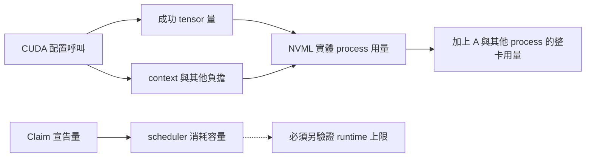
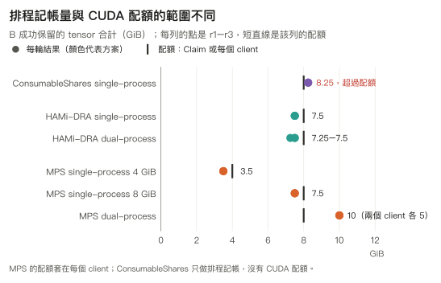
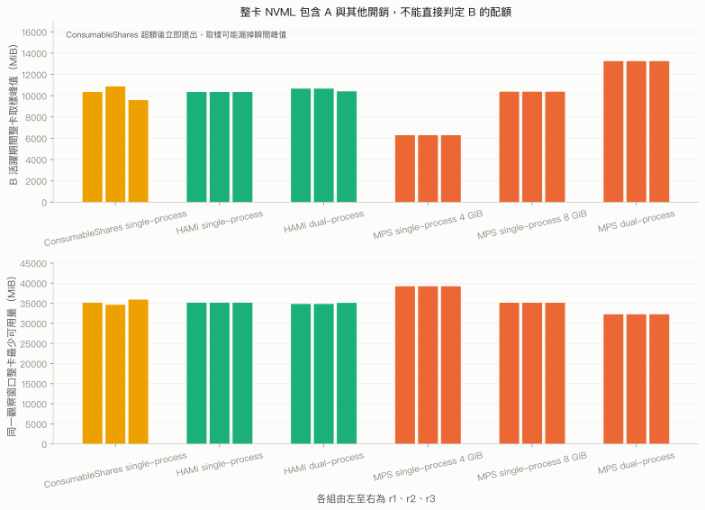
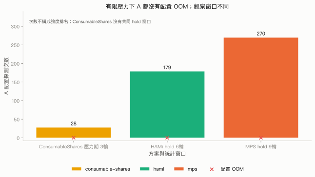

# 4.5 三種方案的比較與容量觀測

## 本頁要回答的問題

同樣寫下 `8Gi`，三種方案是否提供同一種保護？本頁將排程記帳、CUDA 配置配額與 Pod 實體上限放回各自的證據範圍，並比較 B 的配置邊界與 A 的穩定性。這組量測沒有找到可通用的嚴格 per-Task 實體 VRAM 上限。

## 背景原理

Claim 的 `consumedCapacity` 是 scheduler 帳本，成功 tensor 量是 workload 自己保留的資料，NVML 則觀察實體裝置或 process。三者的單位可以換算，計量範圍卻不相同；尤其不能拿包含 A 的整卡 NVML 用量，直接判定 B 是否超過配額。定義與共同 workload 見[第四章設計](README.md#三層隔離模型)。

以下結果限定於 A40、這組版本與 PyTorch 的配置路徑。原始 E2 包含 MPS、ConsumableShares 與 HAMi-DRA；E2B 進一步檢查 HAMi 配額的 container 與 Pod 邊界。原始資料分別保存於 [E2](../../data/e2/README.md)、[HAMi E2](../../data/e2/hami/SOURCES.md)及 [E2B](../../data/e2b/SOURCES.md)，表格可由各套件的標準 library 分析器重算。

## 結果

### 三層限制的完整比較

| 方案 | 第一層 排程記帳 | 第二層 CUDA 配置配額 | 第三層 Pod 嚴格實體上限 |
|---|---|---|---|
| ConsumableShares | 已驗證 memory 記帳，第三份 Claim 等候釋放。 | 本次未強制；B 的成功 tensor 超過請求量後由工具停止。 | 未提供；不能從容量帳本推得實體上限。 |
| MPS | 本次 A、B 共用 Claim，沒有 memory capacity 請求。 | 單一 CUDA client 受限；同一 Pod 內的兩個 client 各有配額。 | 未提供 Pod 合計配額，dual-process tensor 已超過單一 client 上限。 |
| HAMi-DRA | 已驗證 memory 與 cores 記帳。 | 本次 single-process、同一 container 內的 dual-process 與同一 Pod 內的兩個 container 路徑受限；跨 Pod 共用 Claim 的合計限制未成立。 | 同一 container 內的 dual-process 有實體超額；跨 Pod 有 tensor 超額及一輪停滯。 |

各項判定對應 [ConsumableShares](consumable-shares.md#結果)、[MPS](mps.md#驗證與結果)與 [HAMi-DRA](hami-dra.md#結果)。表中的「已驗證」只涵蓋所列條件，沒有將一次配置 OOM 解讀成所有 CUDA API 都受限。

### B 成功 tensor 與宣告配額

下表保留每輪精確值。MPS 的配額是**每個 client**，HAMi-DRA 的 E2 dual-process 則測同一 container 內的共享紀錄；兩種 dual-process 都以每個 child 的有限目標測範圍，不把「達到目標」誤當成找到了最終配置邊界。

| 方法與 B 條件 | 宣告 GiB | r1 tensor GiB | r2 tensor GiB | r3 tensor GiB | 每輪 CUDA OOM | 停止原因 |
|---|---:|---:|---:|---:|---:|---|
| ConsumableShares single-process | 8 | 8.25 | 8.25 | 8.25 | 0 | 成功超額，工具安全停止。 |
| MPS single-process | 每個 client 4 | 3.5 | 3.5 | 3.5 | 1 | 下一個區塊配置 OOM。 |
| MPS single-process | 每個 client 8 | 7.5 | 7.5 | 7.5 | 1 | 下一個區塊配置 OOM。 |
| MPS 同一 Pod 內 dual-process | 每個 client 8 | 10 | 10 | 10 | 0 | 兩個 client 各達 5 GiB。 |
| HAMi-DRA single-process | Claim 8 | 7.5 | 7.5 | 7.5 | 1 | 下一個區塊配置 OOM。 |
| HAMi-DRA 同一 container 內 dual-process | Claim 8 | 7.5 | 7.5 | 7.25 | 2 | 兩個 child 都配置 OOM。 |

ConsumableShares 三輪的 `B_EXIT.outcome` 都是 `limit_not_enforced`。MPS 與 HAMi 的配置 OOM 被 workload 處理後，E2 的 A、B container 仍正常以 exit code 0 結束，沒有 `OOMKilled`；exit code 不能取代 CUDA 事件判讀。[E2 日誌與摘要](../../data/e2/runtime.csv)、[HAMi 日誌與摘要](../../data/e2/hami/runtime.csv)

### B 的實體用量與配額

HAMi 的 host PID 能對應到 Pod／container 身分，因此可以加總 B 的實體 process 用量。以下是共同保留時的 **B process 快照**，不包含 A，也不是每個瞬間的峰值；8 GiB 配額等於 8,192 MiB。在 dual-process 的前兩輪，實體用量各超出配額 100 MiB，成功 tensor 仍只有 7.5 GiB，足以否證這兩輪的嚴格 Pod 實體上限。[HAMi 實體用量證據](../../data/e2/hami/SOURCES.md)

| 方案與 B 條件 | r1 B process 實體 MiB | r2 B process 實體 MiB | r3 B process 實體 MiB | 配額 MiB 與範圍 |
|---|---:|---:|---:|---:|
| ConsumableShares single-process | 未建立活躍快照對照 | 未建立活躍快照對照 | 未建立活躍快照對照 | 8,192，排程記帳 |
| MPS single-process 4 GiB | 未建立完整 PID 對照 | 未建立完整 PID 對照 | 未建立完整 PID 對照 | 4,096，每個 client |
| MPS single-process 8 GiB | 7,986，已核對 B PID | 未建立完整 PID 對照 | 未建立完整 PID 對照 | 8,192，每個 client |
| MPS 同一 Pod 內 dual-process | 未建立完整 Pod 合計 | 未建立完整 Pod 合計 | 未建立完整 Pod 合計 | 8,192，每個 client |
| HAMi single-process | 7,986 | 7,986 | 7,986 | 8,192，B Claim |
| HAMi 同一 container 內 dual-process | 8,292 | 8,292 | 8,036 | 8,192，B Claim |

MPS 的 single-process 8 GiB 第一輪快照也能以 control 清單識別 B 的 7,986 MiB，但第四章沒有替所有 MPS 輪次建立完整的 Pod 實體帳本。ConsumableShares 的 `gpu-during.txt` 已在 B 退出後取得，也不能當作 B 的實體快照。這些缺口保留為缺口，不以整卡量減去推測的 A 用量補值。[MPS 身分與原始快照](mps.md#nvml-process-列表要和-mps-身分對照)、[ConsumableShares 取樣窗口](consumable-shares.md#b-活躍期間的整卡-nvml-峰值)

整卡取樣另回答「配額 OOM 時裝置是否已耗盡」。下圖左欄是 B 活躍期間的整卡取樣峰值，右欄是同一窗口的最少可用量；每列三點為 r1–r3。兩者都使用從最早 `B_GROW` 到最早 `B_EXIT` 的有效樣本，包含 A、B 與其他負擔；精確逐輪值見兩份 runtime CSV。MPS 8 GiB single-process 的整卡峰值為 10,379 MiB、最小 free 為 35,112 MiB，和 B 自己的 7,986 MiB 是不同範圍。

### A 在有限壓力中仍可配置與運算

MPS 與 HAMi 統計 B 已停止增長但仍保留 tensor 的共同保留窗口。ConsumableShares 在成功超額後立即退出，沒有 hold，所以統計整段有限壓力階段。圖與表不以次數高低排名隔離強度；圖上每列直接標出統計窗口，也不把不同窗口合併成同一個成功率。

| 方案 | 觀察窗口 | 輪數 | A 配置成功 | A 配置 OOM | A 運算錯誤 | A／B exit code |
|---|---|---:|---:|---:|---:|---|
| ConsumableShares | 整段有限壓力，沒有 hold。 | 3 | 28 | 0 | 0 | 每輪 0／0 |
| MPS | 三種條件的共同 hold。 | 9 | 270 | 0 | 0 | 每輪 0／0 |
| HAMi-DRA | single-process 與 dual-process 的共同 hold。 | 6 | 179 | 0 | 0 | 每輪 0／0 |

HAMi 的 179 次來自 single-process 每輪 30 次，以及 dual-process 的 30、30、29 次；共同 hold 因 child 啟動差異略短於設定時間。E2B 沒有 A，不加入這張穩定性表。三種方法在這次有限壓力下都沒有觀察到 A 的配置 OOM 或運算錯誤，未測的整卡耗盡、fatal fault 與強制終止仍不能由此推得安全。[E2 分析](../../labs/04-isolation/common/analysis/analyze.py)、[HAMi 分析](../../labs/04-isolation/common/analysis/hami.py)

### 記帳餘額不等於實體空閒量

三輪記帳均使用 16 GiB、24 GiB、8 GiB 的獨立 Claim；sleeper 沒有建立 CUDA context。前兩份請求已記帳 40,960 MiB，第三份需要 8,192 MiB，但帳本只剩 5,108 MiB；此時實體 free 卻為 45,490 MiB。釋放 24 GiB 後，第三份配置成功，兩種 capacity 方法的 memory 帳本變化相同。[ConsumableShares 原始記帳](../../data/e2/accounting.csv)、[HAMi 原始記帳](../../data/e2/hami/accounting.csv)

| 方法與時點 | 公布 MiB | 已記帳 MiB | memory 餘額 MiB | 實體 free MiB | cores 已記帳 | cores 餘額 |
|---|---:|---:|---:|---:|---:|---:|
| ConsumableShares 記帳釋放前 | 46,068 | 40,960 | 5,108 | 45,490 | 不公布此維度 | 不適用 |
| ConsumableShares 記帳釋放後 | 46,068 | 24,576 | 21,492 | 未在此表對照 | 不公布此維度 | 不適用 |
| HAMi 記帳釋放前 | 46,068 | 40,960 | 5,108 | 45,490 | 20 | 80 |
| HAMi 記帳釋放後 | 46,068 | 24,576 | 21,492 | 未在此表對照 | 20 | 80 |
| HAMi runtime A 與 B 配置後 | 46,068 | 12,288 | 33,780 | 見各輪取樣 | 100 | 0 |

HAMi 的**記帳測試**每份 Claim 只要求 10 cores，第三份 Pending 是 memory 不足，不是 cores 耗盡。**Runtime 測試**則是 A 要求 4 GiB／50 cores、B 要求 8 GiB／50 cores，所以即使 memory 帳本還剩 33,780 MiB，cores 已沒有餘額；仍須檢查下一個 Claim 的兩種需求與 request policy，不能只看 VRAM free 判斷能否排入。[HAMi 的容量政策](https://github.com/Project-HAMi/k8s-dra-driver/blob/v0.1.0/cmd/hami-kubelet-plugin/hami_core.go#L87-L111)

## 解讀

ConsumableShares 解決的是申請總量的記帳問題，這條路徑沒有阻止 CUDA 成功超額。MPS 可用來評估只有一個 CUDA client 的 Task；若一個 Pod 內有多個 CUDA process，可再評估 HAMi-DRA 的共享紀錄路徑。HAMi 的適用邊界要保留在**本次同一 Pod 內的測試條件**，不能延伸成所有共用 Claim 的 Task 都共享可靠的總額限制。

E2B 的跨 Pod 共用 Claim 有兩輪保留 9.75 GiB tensor、實體合計 10,596 MiB，另一輪停滯。即使 cache 的 device／inode 相同，也不能因此判定配額生效；詳細矩陣與尚未證明的內部原因見 [HAMi 配額範圍](hami-dra.md#跨-container-與跨-pod-的配額範圍)。

## 限制

第四章沒有找到全面成立的嚴格 per-Task 實體 VRAM 上限。兩種 runtime 配額都仍需要實體 headroom、API 範圍驗證與實際 CUDA process 盤點；沒有量出可通用的安全餘量，也沒有測 CUDA Async、Managed memory、VMM、不可信工作或致命 GPU 故障。

E2 的 GPU 取樣是離散觀察，原始控制端查詢間隔包含查詢時間；重現套件改用 driver Pod 的 500 ms 取樣，仍可能漏掉瞬間峰值。E2B 的實體量是在完整配置 barrier 上的 process 快照，停滯輪次只保留最後完整 barrier，不能把它當成最終上限。不同 Claim 拓撲是待測機制的一部分，第四章也沒有以這組資料比較吞吐量。

## 動手重現

依 [MPS](../../labs/04-isolation/mps/README.md)、[ConsumableShares](../../labs/04-isolation/consumable-shares/README.md)與 [HAMi-DRA](../../labs/04-isolation/hami-dra/README.md)的命令依序執行、收集並清理；provider 切換須另走有備份與還原核對的腳本。HAMi 的縮短版包含 single-process、dual-process 與跨 Pod 共用 Claim 各一輪；加上記帳測試，四個案例已在原叢集重現原始數值，見[實機驗證紀錄](../../labs/04-isolation/VERIFIED.md)。Provider 解除安裝曾在 host 清理中止，後續手動還原已驗證；修正後腳本在第五章縮短版完成解除安裝與還原核對，見[後續實機驗證紀錄](../../labs/05-performance/VERIFIED.md#hami-模式)。

下一章將把「能否配置」與「是否更快」分開，量測固定工作量在不同共用方式下的[吞吐量與延遲](../05-performance/README.md)。再下一章則解釋[依需求選卡](../06-heterogeneous/README.md)；隔離層次、效能與選卡是不同問題，不能以第四章的配額結果代替後兩項量測。

## 重點整理

排程餘額、CUDA 配額與實體 free 各有自己的計量範圍。若是 single-process 的工作，可考慮 MPS；同一 Pod 內有多個 process 時，可考慮 HAMi-DRA，但兩者都須保留實體餘量並驗證使用到的 API；跨 Pod 共用 Claim 的 HAMi 合計上限在這次量測中未成立。任何部署建議都應從實際 process 與 Claim 拓撲出發，而不是只看 `8Gi` 這個字串。

<!-- nav:start -->
[← 上一頁：4.4 HAMi 與 MPS 的差異](hami-vs-mps.md) ｜ [目錄](../README.md) ｜ [下一頁：第 5 章　共用的排程機制與效能 →](../05-performance/README.md)
<!-- nav:end -->
