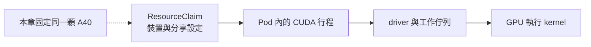
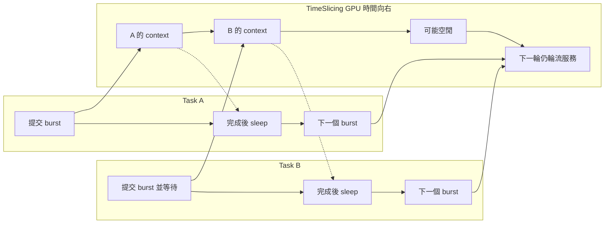
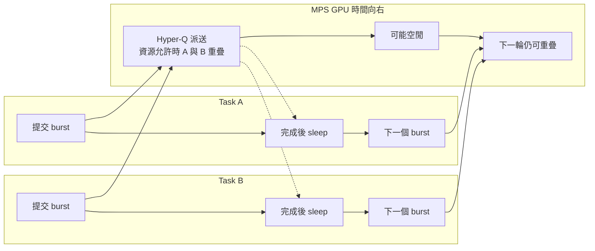
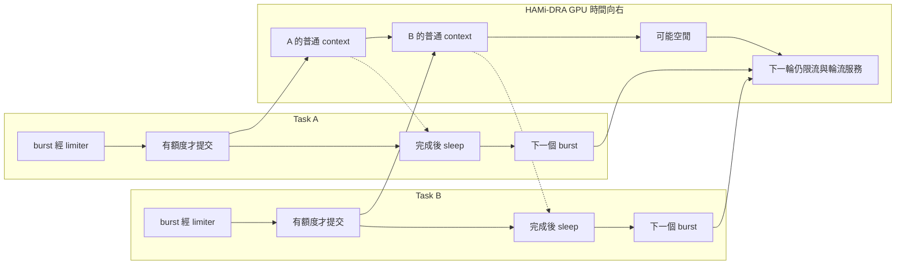
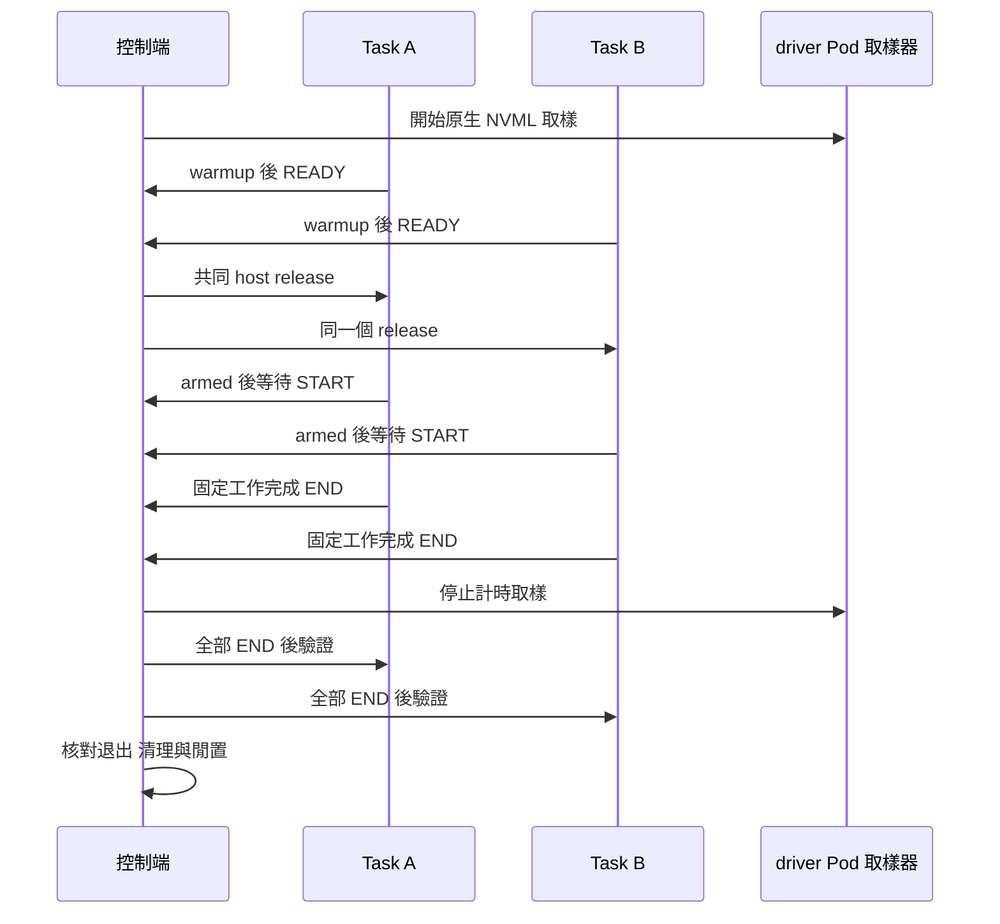
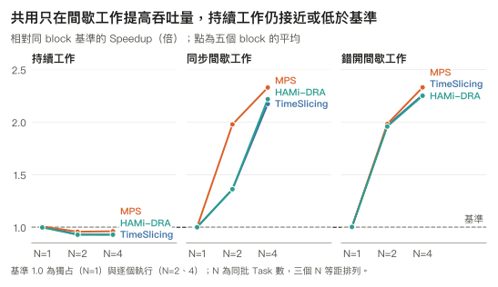
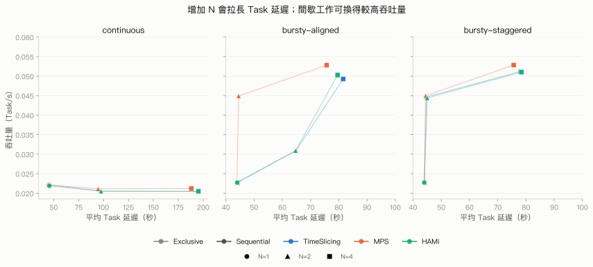
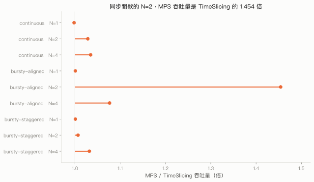

# 第 5 章　共用的排程機制與效能

## 本章要回答的問題

把同一顆 GPU 分給多個 Task，完成工作的速度一定會變快嗎？若整批吞吐量提高，每個 Task 要付出多少延遲，哪些工作形狀值得共用？本章在同一顆 A40 上，以相同矩陣乘法比較獨占、逐個執行、TimeSlicing、MPS 與 HAMi-DRA，將「多個 Pod 能同時取得 GPU」和「GPU 能更有效率地完成工作」分別量測。

第四章已說明 [MPS 的 context 與記憶體配額](../04-isolation/mps.md)，以及 [HAMi-DRA 的容量與執行期限制](../04-isolation/hami-dra.md)。本章只補上與效能有關的排程行為，再用固定工作量觀察吞吐量和延遲的交換關係。

## 背景原理

### 排程發生在不同層次

ResourceClaim 決定 Pod 使用哪個裝置與哪組分享設定；它不負責決定下一個 GPU kernel 的執行順序。本章的「GPU 排程」指 CUDA driver 與 GPU 在工作已提交後如何服務佇列，以及 MPS 或 HAMi-DRA 如何改變這條路徑。五種模式固定同一個 UUID，排除 Kubernetes 選到不同 GPU 的影響。



### 時間切片讓不同 context 輪流執行

一般多行程各自建立 CUDA context。GPU 以時間片輪流服務這些 context，可用 round-robin 的概念理解：A 取得一段服務機會，再輪到 B；同一個 context 內的 stream 可以並行，但不同普通 context 的 compute kernel 不會同時執行。因此，兩個 Task 同時送出工作，只是增加待服務的工作，未必增加實際並行度。[NVIDIA R595 的 context 與時間切片規則](https://docs.nvidia.com/deploy/mps/595/architecture.html)

NVIDIA DRA v0.5.0 在 `TimeSlicingSettings` 開啟時，依 `sharing.strategy: TimeSlicing` 將 compute mode 設為 `DEFAULT`，再把 `timeSlicingConfig.interval` 轉成 `nvidia-smi compute-policy -i <gpu-uuid> --set-timeslice <值>`。它設定 driver 的時間片政策，並沒有替每個 Pod 建立獨立的 GPU 排程器。[SetTimeSlice 原始碼](https://raw.githubusercontent.com/kubernetes-sigs/dra-driver-nvidia-gpu/v0.5.0/cmd/gpu-kubelet-plugin/sharing.go)、[nvidia-smi 呼叫原始碼](https://github.com/kubernetes-sigs/dra-driver-nvidia-gpu/blob/v0.5.0/cmd/gpu-kubelet-plugin/nvlib.go)

| interval | 傳給 `--set-timeslice` 的值 | 意義 |
|---|---:|---|
| `Default` | 0 | driver 的預設時間片政策 |
| `Short` | 1 | 較短的時間片政策 |
| `Medium` | 2 | 中等的時間片政策 |
| `Long` | 3 | 較長的時間片政策 |

這是 v0.5.0 的列舉值與整數對應，不能把數值直接當成毫秒；原始正式 Claim 沒有填 `interval`，本章也保留預設值，不另做時間片長度比較。下面只畫兩個對齊的間歇 Task 的可能順序，箭頭代表時間向右，框寬不代表實測耗時，也不宣稱嚴格的固定公平比例。[interval 定義](https://github.com/kubernetes-sigs/dra-driver-nvidia-gpu/blob/v0.5.0/api/nvidia.com/resource/v1beta1/sharing.go)、[省略設定時的 Normalize](https://raw.githubusercontent.com/kubernetes-sigs/dra-driver-nvidia-gpu/v0.5.0/api/nvidia.com/resource/v1beta1/gpuconfig.go)



### MPS 提供跨行程的並行機會

MPS 讓這顆 GPU 由同一個 server 管理共用的 GPU 排程資源，借助 Hyper-Q 的多條工作佇列，讓不同 client 行程提交的 kernel 有機會重疊。以「一個 server 管理共用排程 context」理解服務端是有用的，但 A40 使用 Volta 起的架構：client 仍保有各自的 CUDA context 與 GPU 位址空間，直接提交工作，server 協調剩餘的共用資源。完整架構見[第四章的 MPS](../04-isolation/mps.md)。[NVIDIA R595 的 client 與 server 架構](https://docs.nvidia.com/deploy/mps/595/architecture.html)

並行只有在 SM 還有可容納其他 thread block 的資源時才發生，例如暫存器、shared memory 與 block 槽位；一個 kernel 已把資源占滿，MPS 就不能憑空加速它。`CUDA_MPS_ACTIVE_THREAD_PERCENTAGE` 限制 client 可用的執行緒資源，是 provisioning 上限，不是保證獲得某個時間百分比，也不會保留一組專屬 SM。本章的 `defaultActiveThreadPercentage` 固定 100%，讓所有 N 都保留最大排程自由度，沒有按 N 降成 50% 或 25%。[CUDA 12.4 並行條件](https://docs.nvidia.com/cuda/archive/12.4.0/cuda-c-programming-guide/index.html#concurrent-kernel-execution)、[R595 的執行資源 provisioning](https://docs.nvidia.com/deploy/mps/595/when-to-use-mps.html)



圖中的重疊是機制允許的情境，不是本次 kernel trace。後面的 NVML 取樣與完成時間能比較效果，不能證明每一次 GEMM 的所有 kernel 都重疊。

### HAMi-DRA 在普通 context 路徑前限制提交速度

HAMi-core 的限制原理見[第四章的 HAMi-DRA](../04-isolation/hami-dra.md)。與本章效能直接相關的是 SM-utilization limiter：普通行程仍使用分開的 CUDA context，GPU 按時間片服務；HAMi-DRA 在 kernel 提交路徑加入軟體限流，沒有把它們變成 MPS client。

固定 commit `8c32de630b24f5f7d6355fbeb0034845d3bdafb7` 的 `utilization_watcher()` 讀取 NVML 行程使用率，依目標上限調整 token；`rate_limiter()` 在 token 為負時用 `nanosleep()` 等待，再以 kernel grid 數量扣除 token。當行程的使用率超過其 `CUDA_DEVICE_SM_LIMIT` 目標，回饋控制會減少提交額度，使後續 kernel 啟動延後；limit 為 100 時則走不限流的分支。這是使用率回饋，不是固定分割 SM，也不保證瞬間使用率永遠精確貼合額度。[HAMi-core 固定 commit 的 limiter 與 watcher](https://raw.githubusercontent.com/Project-HAMi/HAMi-core/8c32de630b24f5f7d6355fbeb0034845d3bdafb7/src/multiprocess/multiprocess_utilization_watcher.c)

本章每個 Task 都有自己的 Claim 與 cache，N=1/2/4 分別要求 cores 100/50/25，總 cores 保持 100。這個政策與 MPS 的每 client 100% 不同，因此比較結果同時包含分享機制與 cores 政策的影響；不能把 HAMi-DRA 與 TimeSlicing 的差值全當成函式庫開銷。



### 有空檔才可能用共用提高吞吐量

Continuous 持續提交 GEMM，獨占時 GPU 使用率已約 99%；加入行程不會增加 GPU 的運算能力，只會引入資源競爭與切換成本。Bursty 則每次 GEMM 後同步、sleep，單 Task 的 GPU 使用率只有約 38%，另一個 Task 有機會利用這些空檔。

Aligned 的初始相位相同，burst 容易碰在一起；普通時間切片把不同 context 的工作序列化，MPS 則可利用跨行程並行機會。Staggered 將初始等待錯開，讓一個 Task 的運算接到另一個 Task 的空檔，即使 TimeSlicing 也能改善；這只設定初始相位，後續相位會隨實際完成時間漂移。以下結果顯示這些差異，並非預先假定任何模式必勝。

## 部署與設定

### 共用輸入與物件名稱

原正式執行固定在 `dra-a40`，GPU UUID 為 `GPU-29ffee3e-bee4-e341-917a-fe7e43e977af`；Kubernetes 是 v1.37.0、NVIDIA DRA driver 是 v0.5.0、NVIDIA driver 是 595.91.07。PyTorch 映像檔以 digest 固定，每個 Task 使用一個 CUDA 行程、1 CPU 與 2 GiB RAM。環境摘要保存在 [environment.json](../../data/e3/environment.json)，正式工作參數在 [benchmark-config.json](../../data/e3/benchmark-config.json)。

以下完整 YAML 對應[復現套件](../../labs/05-performance/README.md)，Claim 的 selector、GpuConfig、映像檔、工作命令與環境變數取自實際套用的完整 YAML；來源對照見 [Manifest 來源](../../labs/05-performance/manifests/SOURCES.md)。改動限於 Job 包裝、角色名稱、書籍標籤、獨立 Claim 的範本，以及 emptyDir 控制通道。原 NVIDIA provider 啟用 `MPSSupport=true,TimeSlicingSettings=true`，`ConsumableShares=false`；TimeSlicing 與 MPS 的同批 Task 共用一個 allocation，sequential 的 Task 則依序取得並釋放獨占 allocation。

| 原物件名稱 | 本套件名稱 | 用途 |
|---|---|---|
| `<原 run-id>-<路徑摘要>` | `gpu-performance-lab` | 專用 Namespace，以 run nonce 區分執行 |
| `task-0`、`task-1` 等 Pod | `benchmark-lead`、`benchmark-partner-*` Job 的 Pod | 同批 Task 的主角色與並行夥伴 |
| `gpu-0` 共用 Claim | `performance-gpu` | exclusive、TimeSlicing、MPS 的 allocation |
| sequential／HAMi-DRA 的 `gpu-<task-id>` Claim | `benchmark-task-gpu` ResourceClaimTemplate 產生的 Claim | 逐 Task 獨立 allocation |
| `e3-code` ConfigMap | `performance-code` | 相同 CUDA worker 與控制輔助程式 |
| 原 provider session 的 `<原 run-id>-gpu` DeviceClass | `gpu.nvidia.com` | 使用既有且沒有附加 config 的 NVIDIA DeviceClass |
| 原 HAMi-DRA session 的 `<原 run-id>-gpu` DeviceClass | `HAMI_DEVICE_CLASS` 指定的既有 class | 由獨立 HAMi-DRA provider 套件提供 |

### Namespace 與共同 Job

以下命令從 `labs/05-performance/` 執行。先列出輸入，再由 runner 按批次套用；單獨 apply Job 只會讓它 warmup 後等待 START，不能代替同步控制流程。原叢集縮短版已完成 NVIDIA 模式與 HAMi-DRA 的效能批次，以及 provider 設定、切換與還原核對，見[實機驗證紀錄](../../labs/05-performance/VERIFIED.md)。下面逐份 YAML 的手動建立命令未另外執行，其建立訊息標為預期輸出。

第二章的原始安裝只明確啟用 MPS，效能實驗還需要 TimeSlicingSettings。先用套件的獨立腳本備份原 DaemonSet，準備三個分享功能開關，再驗證。需要 HAMi-DRA 時，先在空閒邊界還原這份原生設定，再用第四章的 provider 套件切換；兩種切換流程不能疊用。

結束時清理全部 Task 與 Claim，再解除 HAMi-DRA，核對原生 provider 還原。這些操作會修改既有 DaemonSet 並重新建立目標 plugin，備份、原 UID／spec 核對與其他節點保護見[復現套件](../../labs/05-performance/README.md)及[實機切換紀錄](../../labs/05-performance/VERIFIED.md#hami-模式)。

```sh
$ export I_UNDERSTAND_THIS_CHANGES_THE_CLUSTER=1
$ bash scripts/install-native-settings.sh native-performance
$ bash scripts/verify-native-settings.sh native-performance
```

```sh
$ vi manifests/base/namespace.yaml
```

```yaml
apiVersion: v1
kind: Namespace
metadata:
  name: gpu-performance-lab
  labels:
    app.kubernetes.io/part-of: dra-book
    app.kubernetes.io/component: performance-lab
```

| 參數 | 意義 | 為什麼這樣設 |
|---|---|---|
| `namespace` | 專用 Namespace | 將本套件物件集中管理 |
| `part-of`、`component` | 所屬與角色標籤 | 清理必須同時核對所屬與 run nonce |

```sh
$ kubectl apply -f manifests/base/namespace.yaml
```

（預期輸出）

```text
namespace/gpu-performance-lab created
```

```sh
$ vi manifests/base/job.yaml
```

```yaml
apiVersion: batch/v1
kind: Job
metadata:
  name: benchmark-lead
  namespace: gpu-performance-lab
  labels:
    app.kubernetes.io/part-of: dra-book
    app.kubernetes.io/component: benchmark-worker
spec:
  backoffLimit: 0
  template:
    metadata:
      labels:
        app.kubernetes.io/part-of: dra-book
        app.kubernetes.io/component: benchmark-worker
    spec:
      restartPolicy: Never
      terminationGracePeriodSeconds: 120
      automountServiceAccountToken: false
      tolerations:
      - key: nvidia.com/gpu
        operator: Exists
        effect: NoSchedule
      resourceClaims:
      - name: gpu
        resourceClaimName: performance-gpu
      containers:
      - name: workload
        image: docker.io/pytorch/pytorch:2.5.1-cuda12.4-cudnn9-runtime@sha256:c8268a92a69bd500f8be0e665b2630ee006dadaf7bfbc24249141b15ff622755
        imagePullPolicy: IfNotPresent
        command:
        - python
        - -u
        - /opt/lab/worker.py
        args:
        - --config
        - '{"concurrency": 1, "dtype": "float32", "final_sleep_ns": 0, "iterations": 913, "prefix_sleep_ns": 0, "seed": 20261007, "shape": 8192, "sleep_ns": 0, "sync_each": false, "task_id": "0", "tf32": false, "workload_id": "continuous"}'
        - --control-dir
        - /opt/e3-control
        securityContext:
          runAsUser: 0
          runAsGroup: 0
        env:
        - name: OMP_NUM_THREADS
          value: '1'
        - name: MKL_NUM_THREADS
          value: '1'
        - name: EXPERIMENT_RUN
          value: manual-performance
        - name: POD_NAME
          valueFrom:
            fieldRef:
              fieldPath: metadata.name
        - name: POD_UID
          valueFrom:
            fieldRef:
              fieldPath: metadata.uid
        - name: GPU_UUID
          value: GPU-29ffee3e-bee4-e341-917a-fe7e43e977af
        resources:
          requests:
            cpu: '1'
            memory: 2Gi
          limits:
            cpu: '1'
            memory: 2Gi
          claims:
          - name: gpu
            request: gpu
        volumeMounts:
        - name: code
          mountPath: /opt/lab
          readOnly: true
        - name: control
          mountPath: /opt/e3-control
      volumes:
      - name: code
        configMap:
          name: performance-code
      - name: control
        emptyDir: {}
      nodeSelector:
        kubernetes.io/hostname: dra-a40
      initContainers:
      - name: control-owner
        image: docker.io/pytorch/pytorch:2.5.1-cuda12.4-cudnn9-runtime@sha256:c8268a92a69bd500f8be0e665b2630ee006dadaf7bfbc24249141b15ff622755
        imagePullPolicy: IfNotPresent
        command:
        - python
        - /opt/lab/control.py
        - init
        env:
        - name: EXPERIMENT_RUN
          value: manual-performance
        - name: TASK_ID
          value: '0'
        securityContext:
          runAsUser: 0
          runAsGroup: 0
        resources:
          requests:
            cpu: '1'
            memory: 2Gi
          limits:
            cpu: '1'
            memory: 2Gi
        volumeMounts:
        - name: code
          mountPath: /opt/lab
          readOnly: true
        - name: control
          mountPath: /opt/e3-control
```

| 參數 | 意義 | 為什麼這樣設 |
|---|---|---|
| `backoffLimit: 0`、`restartPolicy: Never` | 不重試工作 | 防止同一 Task 重跑後混入量測 |
| `image` | tag 加 digest | 固定原始 PyTorch、CUDA 與工作環境 |
| `--config` | worker 的完整 JSON 參數 | base 是 continuous N=1；runner 按工作與 N 產生每個 Task 的設定 |
| `OMP_NUM_THREADS`、`MKL_NUM_THREADS` | CPU 函式庫執行緒數 | 保留每個 Task 的 1 CPU 條件 |
| `requests`、`limits` | CPU 與 RAM | 保留原始 1 CPU、2 GiB 條件 |
| `runAsUser`、`runAsGroup` | client 的使用者 | 與 MPS server 的 root UID 一致 |
| `resourceClaims` | Pod 使用的 allocation | 原生並行模式引用同一 Claim；sequential 與 HAMi-DRA 由 overlay 換成範本 |
| `nodeSelector`、`GPU_UUID` | 執行節點與裝置核對 | UUID selector 與實際取樣必須指向同一顆 GPU |
| `control-owner`、`emptyDir` | 每個 Pod 的控制目錄 | init container 不建立 CUDA context，只建立原 worker 要求的 owner 身分 |

### 工作負載由來源產生 ConfigMap

```sh
$ vi manifests/base/kustomization.yaml
```

```yaml
apiVersion: kustomize.config.k8s.io/v1beta1
kind: Kustomization
namespace: gpu-performance-lab
resources:
- namespace.yaml
- job.yaml
configMapGenerator:
- name: performance-code
  files:
  - worker.py=../../workload/worker.py
  - policy.py=../../workload/policy.py
  - control.py=../../workload/control.py
  options:
    labels:
      app.kubernetes.io/part-of: dra-book
      app.kubernetes.io/component: workload-code
generatorOptions:
  disableNameSuffixHash: true
```

| 參數 | 意義 | 為什麼這樣設 |
|---|---|---|
| `configMapGenerator.files` | 將來源檔載入 ConfigMap | 不把大量程式碼重複貼成 YAML |
| `disableNameSuffixHash` | 保留固定 ConfigMap 名稱 | Job 以 `performance-code` 引用，runner 保存實際渲染內容與 worker 摘要 |
| `resources` | 共同 Namespace 與 Job | 五種模式重用同一工作負載 |

來源是 [worker.py](../../labs/05-performance/workload/worker.py)、[policy.py](../../labs/05-performance/workload/policy.py) 與 [control.py](../../labs/05-performance/workload/control.py)。worker 與原始檔位元組相同；warmup 完成後才寫入 READY，continuous 最後才同步，bursty 每次 GEMM 都同步再等待。以下是計時的核心路徑，完整來源包含 END、控制序號、八點數值驗證與同步釋放。

```python
sleep_until(release_ns, clock)
start = clock.monotonic_ns()
if cfg['prefix_sleep_ns']:
    clock.sleep(cfg['prefix_sleep_ns'] / 1e9)
```

```python
gpu.gemm(); completed += 1
if bursty or cfg.get('sync_each'):
    gpu.synchronize()
```

### 獨占模式與逐個執行基準

Exclusive 只執行一個 Task，不加 GpuConfig；sequential 則將 N 個同樣的 Task 逐個執行，每個 Task 結束、釋放 allocation 並確認 GPU 空閒後，才建立下一個。兩者都使用整顆 GPU，sequential 的 makespan 加總實際服務時間，排除中間建立與清理的空檔。

```sh
$ vi manifests/overlays/exclusive/claim.yaml
```

```yaml
apiVersion: resource.k8s.io/v1
kind: ResourceClaim
metadata:
  name: performance-gpu
  namespace: gpu-performance-lab
  labels:
    app.kubernetes.io/part-of: dra-book
    app.kubernetes.io/component: shared-gpu
spec:
  devices:
    requests:
    - name: gpu
      exactly:
        deviceClassName: gpu.nvidia.com
        allocationMode: ExactCount
        count: 1
        selectors:
        - cel:
            expression: 'device.attributes["gpu.nvidia.com"].uuid == "GPU-29ffee3e-bee4-e341-917a-fe7e43e977af"'
```

| 參數 | 意義 | 為什麼這樣設 |
|---|---|---|
| `ExactCount: 1` | 一顆完整 GPU | 單 Task 的獨占基準 |
| UUID CEL selector | 固定 A40 | 不讓排程器改選其他裝置 |
| 未設定 `config` | 不啟用分享策略 | 與原 exclusive Claim 相同 |

獨占、TimeSlicing 與 MPS 的 Kustomization 內容完全相同：各自載入共同 base 與同目錄的 `claim.yaml`。以下完整內容適用於 [exclusive](../../labs/05-performance/manifests/overlays/exclusive/kustomization.yaml)、[timeslicing](../../labs/05-performance/manifests/overlays/timeslicing/kustomization.yaml) 與 [mps](../../labs/05-performance/manifests/overlays/mps/kustomization.yaml)，Job base 與 ConfigMap generator 共用前面的設定。

```sh
$ vi manifests/overlays/exclusive/kustomization.yaml
```

```yaml
apiVersion: kustomize.config.k8s.io/v1beta1
kind: Kustomization
resources:
- ../../base
- claim.yaml
```

| 參數 | 意義 | 為什麼這樣設 |
|---|---|---|
| `resources` | 共同 base 與此模式的 Claim | 三種 overlay 重用同一 Job 與 ConfigMap，差別在 Claim 設定 |

```sh
$ vi manifests/overlays/sequential/claim.yaml
```

```yaml
apiVersion: resource.k8s.io/v1
kind: ResourceClaimTemplate
metadata:
  name: benchmark-task-gpu
  namespace: gpu-performance-lab
  labels:
    app.kubernetes.io/part-of: dra-book
    app.kubernetes.io/component: task-gpu-template
spec:
  metadata:
    labels:
      app.kubernetes.io/part-of: dra-book
      app.kubernetes.io/component: task-gpu
  spec:
    devices:
      requests:
      - name: gpu
        exactly:
          deviceClassName: gpu.nvidia.com
          allocationMode: ExactCount
          count: 1
          selectors:
          - cel:
              expression: 'device.attributes["gpu.nvidia.com"].uuid == "GPU-29ffee3e-bee4-e341-917a-fe7e43e977af"'
```

| 參數 | 意義 | 為什麼這樣設 |
|---|---|---|
| `ResourceClaimTemplate` | 每個 Pod 取得自己的 Claim | 保留原 sequential 逐 Task 建立、刪除 Claim 的生命週期 |

其餘 Claim 欄位同獨占模式。逐個執行與 HAMi-DRA 的 Job patch 內容也相同，都是把 base 的共用 Claim 引用換成逐 Pod 產生的 Claim；啟動順序與容量設定則由各模式決定。

```sh
$ vi manifests/overlays/sequential/job-patch.yaml
```

```yaml
apiVersion: batch/v1
kind: Job
metadata:
  name: benchmark-lead
  namespace: gpu-performance-lab
spec:
  template:
    spec:
      resourceClaims:
      - name: gpu
        resourceClaimName: null
        resourceClaimTemplateName: benchmark-task-gpu
```

| 參數 | 意義 | 為什麼這樣設 |
|---|---|---|
| `metadata.namespace` | patch 要修改的 Job 所在 Namespace | 與 base 的 `gpu-performance-lab` 一致，讓 Kustomize 找到目標 |
| `resourceClaimName: null` | 移除 base 的共用引用 | 此檔是 Kustomize patch，不能單獨 apply |
| `resourceClaimTemplateName` | 改用逐 Pod Claim | 讓每個 Task 各自取得 Claim |

以下 Kustomization 同時適用於 [sequential](../../labs/05-performance/manifests/overlays/sequential/kustomization.yaml) 與 [hami](../../labs/05-performance/manifests/overlays/hami/kustomization.yaml)，各自套用同目錄中的 Claim 範本與 Job patch。

```sh
$ vi manifests/overlays/sequential/kustomization.yaml
```

```yaml
apiVersion: kustomize.config.k8s.io/v1beta1
kind: Kustomization
resources:
- ../../base
- claim.yaml
patches:
- path: job-patch.yaml
```

| 參數 | 意義 | 為什麼這樣設 |
|---|---|---|
| `patches.path` | 將 Job 改為使用 Claim 範本 | 逐個執行與 HAMi-DRA 都需逐 Task allocation，runner 決定啟動順序 |

### 時間切片模式

同批 N 個 Task 引用下面同一個 ResourceClaim。`timeSlicingConfig.interval` 未填，保留正式實驗使用的預設時間片；這裡沒有 N 個獨立 allocation，也沒有啟用 ConsumableShares。

```sh
$ vi manifests/overlays/timeslicing/claim.yaml
```

```yaml
apiVersion: resource.k8s.io/v1
kind: ResourceClaim
metadata:
  name: performance-gpu
  namespace: gpu-performance-lab
  labels:
    app.kubernetes.io/part-of: dra-book
    app.kubernetes.io/component: shared-gpu
spec:
  devices:
    requests:
    - name: gpu
      exactly:
        deviceClassName: gpu.nvidia.com
        allocationMode: ExactCount
        count: 1
        selectors:
        - cel:
            expression: 'device.attributes["gpu.nvidia.com"].uuid == "GPU-29ffee3e-bee4-e341-917a-fe7e43e977af"'
    config:
    - requests:
      - gpu
      opaque:
        driver: gpu.nvidia.com
        parameters:
          apiVersion: resource.nvidia.com/v1beta1
          kind: GpuConfig
          sharing:
            strategy: TimeSlicing
```

| 參數 | 意義 | 為什麼這樣設 |
|---|---|---|
| `GpuConfig` | NVIDIA 裝置準備設定 | 隨這個 allocation 生效 |
| `sharing.strategy: TimeSlicing` | 普通多 context 共用 | 與 exclusive 使用相同 GEMM，比較分享成本與空檔利用 |
| 省略 `interval` | 使用 `Default` | 沿用原始 Claim，不改變時間片政策 |

其餘 Claim 欄位同獨占模式；[Kustomization](../../labs/05-performance/manifests/overlays/timeslicing/kustomization.yaml) 使用前面已列出的共同內容。

### MPS 模式

MPS 也讓同批 Task 共用一個 Claim，但裝置準備改為 MPS。每個 CUDA 行程的 VRAM 額度為 8 GiB，active thread percentage 固定 100%；本章每個 Pod 恰好只有一個 CUDA 行程，配額範圍仍依[第四章的驗證](../04-isolation/mps.md)理解。

```sh
$ vi manifests/overlays/mps/claim.yaml
```

```yaml
apiVersion: resource.k8s.io/v1
kind: ResourceClaim
metadata:
  name: performance-gpu
  namespace: gpu-performance-lab
  labels:
    app.kubernetes.io/part-of: dra-book
    app.kubernetes.io/component: shared-gpu
spec:
  devices:
    requests:
    - name: gpu
      exactly:
        deviceClassName: gpu.nvidia.com
        allocationMode: ExactCount
        count: 1
        selectors:
        - cel:
            expression: 'device.attributes["gpu.nvidia.com"].uuid == "GPU-29ffee3e-bee4-e341-917a-fe7e43e977af"'
    config:
    - requests:
      - gpu
      opaque:
        driver: gpu.nvidia.com
        parameters:
          apiVersion: resource.nvidia.com/v1beta1
          kind: GpuConfig
          sharing:
            strategy: MPS
            mpsConfig:
              defaultActiveThreadPercentage: 100
              defaultPinnedDeviceMemoryLimit: 8Gi
              multiUser: false
```

| 參數 | 意義 | 為什麼這樣設 |
|---|---|---|
| `sharing.strategy: MPS` | 啟用 MPS 的 client 路徑 | 提供跨行程 kernel 並行機會 |
| `defaultActiveThreadPercentage: 100` | 每個 client 的執行資源上限 | 不按 N 人為降低可用資源 |
| `defaultPinnedDeviceMemoryLimit: 8Gi` | 每個 CUDA 行程的 VRAM 額度 | 保留正式參數，不將配額當成 Pod 合計硬上限 |
| `multiUser: false` | 同一 UID 的 client | 工作負載與 server 都使用 root |

其餘 Claim 欄位同獨占模式，GpuConfig 的掛載方式同時間切片模式；[Kustomization](../../labs/05-performance/manifests/overlays/mps/kustomization.yaml) 使用前面已列出的共同內容。

完整檔案準備好後，可用 Kustomize 渲染／套用 MPS N=1 的初始輸入；這只會停在 READY。實際比較應執行下節的 runner，讓它按 N 建立 Job、送出 START，再驗證與清理。

```sh
$ kubectl kustomize manifests/overlays/mps --load-restrictor=LoadRestrictionsNone > /tmp/gpu-performance-mps.yaml
$ kubectl apply -f /tmp/gpu-performance-mps.yaml
```

（預期輸出）

```text
namespace/gpu-performance-lab configured
configmap/performance-code created
resourceclaim.resource.k8s.io/performance-gpu created
job.batch/benchmark-lead created
```

### HAMi-DRA 模式

HAMi-DRA 使用[第四章的 provider 套件](../../labs/04-isolation/hami-dra/README.md)與 `hami-core-gpu.project-hami.io` DeviceClass，由 [install-provider.sh](../../labs/04-isolation/hami-dra/scripts/install-provider.sh)／[uninstall-provider.sh](../../labs/04-isolation/hami-dra/scripts/uninstall-provider.sh)做明確切換與還原，本章不重複部署 provider。同一顆 GPU 只能由當下使用的 provider 公布；runner 在 provider 不符時保存空閒邊界進度並停止，不會自行修改 DaemonSet。

```sh
$ vi manifests/overlays/hami/claim.yaml
```

```yaml
apiVersion: resource.k8s.io/v1
kind: ResourceClaimTemplate
metadata:
  name: benchmark-task-gpu
  namespace: gpu-performance-lab
  labels:
    app.kubernetes.io/part-of: dra-book
    app.kubernetes.io/component: task-gpu-template
spec:
  metadata:
    labels:
      app.kubernetes.io/part-of: dra-book
      app.kubernetes.io/component: task-gpu
  spec:
    devices:
      requests:
      - name: gpu
        exactly:
          deviceClassName: hami-core-gpu.project-hami.io
          allocationMode: ExactCount
          count: 1
          selectors:
          - cel:
              expression: 'device.attributes["hami-core-gpu.project-hami.io"].uuid == "GPU-29ffee3e-bee4-e341-917a-fe7e43e977af"'
          capacity:
            requests:
              memory: 8Gi
              cores: '100'
```

| 參數 | 意義 | 為什麼這樣設 |
|---|---|---|
| `deviceClassName` | 既有 HAMi-DRA DeviceClass | 由獨立 provider 套件提供，可由 `HAMI_DEVICE_CLASS` 指定 |
| `memory: 8Gi` | 每個 Task 的 VRAM 額度 | 與正式 HAMi-DRA Claim 相同 |
| `cores: 100` | 此 base 是 N=1 | runner 按 N=1/2/4 寫成 100/50/25，總 cores 100 |
| HAMi-DRA 的 UUID attribute | 固定同一 A40 | 與原生模式對照相同實體 GPU |

未列出的 Claim 範本欄位同逐個執行模式。[Job patch](../../labs/05-performance/manifests/overlays/hami/job-patch.yaml) 與 [Kustomization](../../labs/05-performance/manifests/overlays/hami/kustomization.yaml) 也使用前面逐個執行模式已列出的完整內容；Job 的其餘欄位同共同 base。差別在 runner 同時啟動這批 Task，讓每個 Task 使用自己的容量 Claim 與 cache。

## 實驗設計

### 固定工作量與校準

所有 Task 使用 8192² FP32 GEMM，TF32 關閉，seed 為 20261007，先做十次 warmup。矩陣只建立一次，輸出張量反覆使用，正式計時沒有持續增加 VRAM。工作量固定，所以吞吐量比較回答「完成相同工作要多久」，而不是在固定牆鐘時間內各做多少工作。

| 工作 | GEMM 次數 | 每次等待 | 初始相位 |
|---|---:|---:|---|
| `continuous` | 913 | 0 | 無等待，全部工作最後同步 |
| `bursty-aligned` | 367 | 73,705,924 ns | 所有 Task 的 prefix 為 0 |
| `bursty-staggered` | 367 | 73,705,924 ns | Task i 的 prefix 為 `floor(i × S / N)` |

令 S 代表每次等待時間。Bursty 的每次 GEMM 後都同步；最後一次 sleep 改為 `S − prefix`，因此 aligned 與 staggered 每個 Task 的總等待量都為 `367 × S`，沒有因錯開而減少工作或等待。

校準先比較 2048、4096、8192 三個矩陣尺寸：十次 warmup、二十次 pilot，然後用估計約八秒的固定 GEMM 次數量測三輪；合格條件是 GPU 使用率至少 90%、實體 VRAM 增量低於 2 GiB，再在最佳 median TFLOPs 的 5% 範圍內挑較小尺寸。本次選到 8192，continuous 每次 GEMM 的校準時間為 `0.04930675063636364` 秒，以 `ceil(45/t)` 得到 913 次。

Bursty 另做三十次逐次同步的 pilot，取得 `t=0.0491372825` 秒，令 `S=round(1.5 × t × 10⁹)=73,705,924 ns`，再以 `ceil(45/(t+S))` 得到 367 次。預覽 GPU 使用率為 39.235%，落在計畫要求的 30–60% 範圍。這些是原環境的校準結果，完整復現直接沿用 [benchmark-config.json](../../data/e3/benchmark-config.json)，不在新環境重新調整到相同耗時。

### 配對矩陣與同步開始

每種工作比較 N=1/2/4，共五個 block，一個 block 涵蓋全部工作、模式與 N 的條件。Exclusive 只有 N=1，sequential 只有 N=2/4，其餘模式都有三個 N，總計 180 個有效批次、420 個 Task；[matrix.json](../../data/e3/matrix.json) 保存原來的模式群組輪替與群組內隨機順序。每個同工作、同 N 的共用批次都和同 block 的 sequential 配對，N=1 則配對 exclusive，避免把不同輪次的波動當成模式收益。

全部 Task 完成 warmup 並 READY 後，控制端讀取 GPU 節點的 host monotonic clock，將 release 設為三秒後。所有 client 必須先 armed，並核對相同 boot／time namespace；實際開始延遲和 start skew 都不得超過 20 ms。全部 END 後才開始八點數值驗證，最後核對實際容器退出碼為 0；不把 Job 名稱或「有 END 日誌」當成成功的全部條件。



取樣在 GPU Operator driver Pod 內執行原生 `nvidia-smi --query-gpu=... --format=csv -lms 500`，時間戳來自同一個 host monotonic clock；它不使用受 HAMi-DRA 注入的 workload NVML。保留使用率、VRAM、功率、時脈、溫度、compute mode 與限制原因，平均使用率按量測窗口做時間加權。

### 指標的計時邊界

| 指標 | 定義 | 本章如何彙整 |
|---|---|---|
| makespan | 並行批次的最後 END 減共同 release；sequential 加總各 Task 的實際 START 至 END | 表中「平均時間」是五個 block 的平均 |
| Task/s | `N / makespan` | 先逐 block 算，再平均；不是 `N / 平均 makespan` |
| Speedup | 同 block 基準 makespan／本批 makespan | 同工作、同 N 配 sequential；N=1 配 exclusive，再平均五個比值 |
| Task 延遲 | 每個 Task 的實際 END 減 START | 包含它的 prefix、sleep 與排程等待，不含 warmup |
| P95 延遲 | 同條件全部 Task 延遲的第 95 百分位 | 合併五個 block 的 Task 後線性插值，不平均各批 P95 |
| GPU 使用率 | 原生 NVML 的使用率樣本 | 左側值維持至下個樣本，按執行窗口裁切後加權；sequential 用各 Task 窗口的聯集 |
| MPS／TimeSlicing | 同 block 的 Task/s 比值 | 先配對，再平均五個比值 |

Pod 建立、映像檔下載、容器啟動、warmup、數值驗證與清理都不在 GPU Speedup 內。這些時間仍保存在 [task-timing.csv](../../data/e3/task-timing.csv)，可評估實際端到端成本，但不能拿 UTC 的 Pod 啟動時間替代 GPU 節點的共同 release。將服務時間隔離出來，才能比較相同 GEMM 的分享效果；實際短 Job 的總耗時仍可能由啟動成本主導。

## 結果

以下四張表由 [summary.csv](../../data/e3/summary.csv) 經[標準函式庫分析器](../../labs/05-performance/analysis/analyze.py) 重建，與原報告逐列相同。圖上的點是五個 block 的平均，Speedup 鬚線是五個配對值的最小至最大，沒有把它當成信賴區間。吞吐量與延遲圖用相同模式顏色，圓、三角、方分別代表 N=1、N=2、N=4。





Speedup 的三個面板共用縱軸，方便比較不同工作形狀；同一個 N 的模式稍微水平錯開，以免點互相遮住。吞吐量與延遲圖也共用縱軸，橫軸範圍依工作調整，線只連接同一模式。兩圖都附上五種模式的名稱圖例，以及較小的 N 形狀圖例。

結果表保留分析輸出的模式代號：`timeslicing` 對應 TimeSlicing、`mps` 對應 MPS、`hami` 對應 HAMi-DRA。圖例的 Time-Slicing 與 HAMi 也分別指本章的 TimeSlicing 與 HAMi-DRA 路徑，沒有另外測試 classic HAMi 部署。

<!-- results:start -->
### 持續工作

| 模式 | N | 平均時間（秒） | Task/s | GPU 使用率 | 平均延遲（秒） | P95 延遲（秒） | Speedup |
|---|---:|---:|---:|---:|---:|---:|---:|
| exclusive | 1 | 45.580 | 0.02194 | 99.02% | 45.580 | 45.796 | 1.000 |
| sequential | 2 | 90.653 | 0.02206 | 99.12% | 45.327 | 45.736 | 1.000 |
| sequential | 4 | 181.556 | 0.02203 | 99.04% | 45.389 | 45.760 | 1.000 |
| timeslicing | 1 | 45.167 | 0.02214 | 99.07% | 45.167 | 45.442 | 1.009 |
| timeslicing | 2 | 97.349 | 0.02054 | 99.65% | 97.339 | 97.753 | 0.931 |
| timeslicing | 4 | 195.272 | 0.02048 | 99.76% | 195.258 | 196.728 | 0.930 |
| mps | 1 | 45.249 | 0.02210 | 99.22% | 45.249 | 45.524 | 1.007 |
| mps | 2 | 94.646 | 0.02113 | 99.56% | 94.620 | 95.245 | 0.958 |
| mps | 4 | 188.714 | 0.02120 | 99.82% | 188.061 | 189.252 | 0.962 |
| hami | 1 | 45.656 | 0.02190 | 99.21% | 45.656 | 45.713 | 0.998 |
| hami | 2 | 97.556 | 0.02050 | 99.41% | 97.549 | 97.683 | 0.929 |
| hami | 4 | 195.235 | 0.02049 | 99.71% | 195.220 | 195.777 | 0.930 |

### 同步間歇工作

| 模式 | N | 平均時間（秒） | Task/s | GPU 使用率 | 平均延遲（秒） | P95 延遲（秒） | Speedup |
|---|---:|---:|---:|---:|---:|---:|---:|
| exclusive | 1 | 44.064 | 0.02269 | 37.75% | 44.064 | 44.129 | 1.000 |
| sequential | 2 | 88.130 | 0.02269 | 37.95% | 44.065 | 44.141 | 1.000 |
| sequential | 4 | 176.477 | 0.02267 | 37.98% | 44.119 | 44.144 | 1.000 |
| timeslicing | 1 | 43.966 | 0.02274 | 37.83% | 43.966 | 43.994 | 1.002 |
| timeslicing | 2 | 64.769 | 0.03088 | 58.36% | 64.768 | 65.265 | 1.361 |
| timeslicing | 4 | 81.571 | 0.04926 | 94.90% | 81.530 | 93.180 | 2.173 |
| mps | 1 | 43.925 | 0.02277 | 38.00% | 43.925 | 43.967 | 1.003 |
| mps | 2 | 44.540 | 0.04490 | 76.80% | 44.509 | 44.600 | 1.979 |
| mps | 4 | 75.769 | 0.05279 | 99.58% | 75.691 | 76.063 | 2.329 |
| hami | 1 | 44.034 | 0.02271 | 38.23% | 44.034 | 44.108 | 1.001 |
| hami | 2 | 64.695 | 0.03091 | 58.34% | 64.694 | 65.080 | 1.362 |
| hami | 4 | 79.608 | 0.05028 | 97.51% | 79.562 | 83.847 | 2.218 |

### 錯開間歇工作

| 模式 | N | 平均時間（秒） | Task/s | GPU 使用率 | 平均延遲（秒） | P95 延遲（秒） | Speedup |
|---|---:|---:|---:|---:|---:|---:|---:|
| exclusive | 1 | 44.102 | 0.02267 | 38.05% | 44.102 | 44.157 | 1.000 |
| sequential | 2 | 88.167 | 0.02268 | 38.06% | 44.083 | 44.138 | 1.000 |
| sequential | 4 | 176.472 | 0.02267 | 37.93% | 44.118 | 44.157 | 1.000 |
| timeslicing | 1 | 44.035 | 0.02271 | 37.85% | 44.035 | 44.096 | 1.002 |
| timeslicing | 2 | 44.782 | 0.04466 | 77.43% | 44.770 | 44.841 | 1.969 |
| timeslicing | 4 | 78.125 | 0.05120 | 99.40% | 78.094 | 78.565 | 2.259 |
| mps | 1 | 43.990 | 0.02273 | 37.98% | 43.989 | 44.071 | 1.003 |
| mps | 2 | 44.477 | 0.04497 | 76.95% | 44.465 | 44.690 | 1.982 |
| mps | 4 | 75.712 | 0.05283 | 99.52% | 75.651 | 75.989 | 2.331 |
| hami | 1 | 43.966 | 0.02274 | 37.91% | 43.966 | 44.003 | 1.003 |
| hami | 2 | 45.029 | 0.04442 | 76.25% | 45.017 | 46.033 | 1.958 |
| hami | 4 | 78.403 | 0.05102 | 99.60% | 78.375 | 78.830 | 2.251 |

### MPS 與時間切片的配對比值



| 工作 | N | MPS / Time-Slicing |
|---|---:|---:|
| continuous | 1 | 0.998 |
| continuous | 2 | 1.029 |
| continuous | 4 | 1.035 |
| bursty-aligned | 1 | 1.001 |
| bursty-aligned | 2 | 1.454 |
| bursty-aligned | 4 | 1.077 |
| bursty-staggered | 1 | 1.001 |
| bursty-staggered | 2 | 1.007 |
| bursty-staggered | 4 | 1.032 |
<!-- results:end -->

## 解讀

### 持續工作增加的是競爭

Continuous 的 exclusive 使用率為 99.02%，並行分享後也接近滿載，但 N=2/4 的吞吐量比 sequential 少約 4–7%。MPS 的 Speedup 為 0.958／0.962，損失最小；TimeSlicing 與 HAMi-DRA 約為 0.93。GPU 已經很忙時，再增加 Task 主要拉長個別完成時間：例如 MPS N=4 平均延遲是 188.061 秒，逐個執行每 Task 則是 45.389 秒。

這不表示 MPS 必然比獨占快，也不表示使用率越高就越有效率。Continuous 的最高平均 Task/s 出現在 TimeSlicing N=1；這仍只有一個 client，不能視為多 Task 共用收益，五個 block 的最高平均值也不等於統計顯著。

### 同步 burst 讓並行機制更重要

Bursty-aligned 的 MPS N=2 Speedup 為 1.979，平均延遲 44.509 秒，接近 sequential 的每 Task 44.065 秒；TimeSlicing N=2 則是 1.361、64.768 秒。配對後 MPS 的吞吐量為 TimeSlicing 的 1.454 倍。這與普通 context 的 burst 容易碰撞、MPS 能提供跨 client 重疊的機制一致；本次沒有 kernel trace，不能將這個比值全歸因於某個 kernel 的重疊比例。

MPS N=4 把 aligned 吞吐量提高到 0.05279 Task/s，Speedup 2.329；staggered 的 N=4 是 2.331，約 2.33 倍。兩者都已接近滿載，新增 Task 主要把原本的空檔填起來，收益沒有按 N 成為四倍。

### 初始錯開能讓時間切片填補空檔

Bursty-staggered N=2，TimeSlicing 與 MPS 的 Speedup 分別為 1.969、1.982，平均延遲也接近；MPS／TimeSlicing 的配對比值只有 1.007，N=4 也只有 1.032。Task 的 burst 較少在同一時刻爭用 GPU，時間切片也能交替利用空檔，因此這種工作不一定需要 MPS 才能獲得大部分吞吐量收益。

HAMi-DRA 在多數條件接近 TimeSlicing；aligned N=4 的平均吞吐量稍高，staggered 則很接近。這份資料保留 cores 100/50/25 的限制政策，MPS 卻固定每 client 100%，因此沒有隔離出「僅載入 HAMi-core 函式庫」的成本。實務上應把配額策略一起視為被測系統，不能用這個差值宣稱 limiter 零成本或固定增加某個百分比。

### 用延遲預算選擇同時工作的數量

吞吐量提高不保證每個 Task 更快。Aligned 的 MPS 從 N=2 增加到 N=4，平均延遲由 44.509 秒升到 75.691 秒，P95 由 44.600 秒升到 76.063 秒；如果工作必須接近單 Task 延遲完成，N=2 是本次資料較合理的起點。若優先處理長佇列且可接受較長完成時間，N=4 才更符合目標。

先量測獨占的工作形狀：已持續飽和就維持獨占或逐個執行；有空檔再從較小 N 測起。同時到達的 burst 可優先評估 MPS，初始錯開或自然分散的工作則可比較較簡單的 TimeSlicing；需要容量限制時，再連同 HAMi-DRA 的 cores 與記憶體政策測量。每次增加 N 都應重新核對 Task 延遲、P95、VRAM 需求與隔離邊界，不能只看整批 Task/s。

[第四章 MPS 分享中的歷史案例](../04-isolation/mps.md)也展示了小工作與多 client 的吞吐量機會。本章把這個方向換成同一顆 A40、相同固定 GEMM 的比較；那些案例的 GPU、應用程式與測量方式不同，其倍數不能套用到此處。

## 限制

- 結果只涵蓋 A40，以及持續與間歇兩種固定工作模型；RTX 4090 沒有加入本矩陣。
- Bursty 用固定 sleep 模擬空閒，沒有真正 CPU 前處理、資料讀取或傳輸；初始 stagger 不保證後續相位固定。
- NVML GPU 使用率不等於 SM occupancy，500 ms 取樣也不足以觀察 kernel 層級的重疊。本次沒有另部署 DCGM。
- GPU 時脈與溫度可能改變，原始取樣保留相關欄位；五個 block 不能保證尾端延遲穩定，也沒有據最高平均值做統計顯著性宣告。
- HAMi-DRA 的 cores 政策與 MPS 不同，無法把差值全部解讀成函式庫開銷。固定 commit 用於說明 limiter 機制；原二進位函式庫另有 SHA256 證據，兩者的建置對應尚未證實。

第一個 block 的 continuous sequential N=4 曾在前三個 Task 完成後暫停，第四個於續跑後執行；它加總實際服務時間，排除數小時的停頓，是唯一跨暫停的正式 baseline。同 block 的 continuous MPS N=2 與 aligned MPS N=1 另遇到清理時序競爭：daemon 已自動結束，NVML 暫時仍列出原 server PID。獨立善後證據核對原始 SHA、daemon UID、三個 Task 的退出碼 0 與 GPU 閒置，原 CUDA 工作均未重跑；原失敗檔未覆寫，彙整資料另以 `cleanup_recovered` 與 `continued_after_pause` 標記。量測來源版本與修正拒絕條件後的分析版本分開保存，後者只重算資料；版本差異及恢復來源見[資料說明](../../data/e3/README.md)，不能把這些事件描述成沒有發生。

## 動手復現

完整步驟、收集、離線分析與清理見[效能復現套件](../../labs/05-performance/README.md)。`SMOKE=1` 固定 bursty-aligned、N=2、四種 NVIDIA 模式與一個 block，exclusive 仍為 N=1；GEMM 次數由 367 縮到 `ceil(367/10)=37`，每次等待不變，使總計算與總等待量都按 `37/367` 縮減。這個縮短版目標為約十分鐘內完成操作檢查，無法代替正式五個 block 的效能結果。

```sh
$ cd labs/05-performance
$ SMOKE=1 bash scripts/run.sh smoke-a40
$ bash scripts/collect.sh smoke-a40
$ python3 analysis/analyze.py out/smoke-a40/batches --config out/smoke-a40/benchmark-config.json --output out/smoke-a40/reanalysis
$ bash scripts/cleanup.sh smoke-a40
$ bash scripts/restore-native-settings.sh native-performance
```

`HAMI=1` 會加入 HAMi-DRA，需要先具備上述獨立 provider 相依套件，並在空閒邊界明確切換。最初的 MPS 輪次因行程身分檢查停止，修正後在原叢集重跑，exclusive、sequential、TimeSlicing 與 MPS 都通過，Namespace 清理及原生 provider 還原也完成。NVIDIA 模式與 HAMi-DRA 的縮短版都重現同步間歇工作的主要趨勢，provider 設定、切換、解除安裝與還原已核對，見[實機驗證紀錄](../../labs/05-performance/VERIFIED.md)。本章效能數字仍引用原正式結果，縮短版只有單一短 block，不能用其差距判斷 HAMi-DRA 與 TimeSlicing 的高下。

## 重點整理

- 分享一顆 GPU 的收益來自填補空檔或增加可行的並行；已飽和的 continuous GEMM 沒有這種餘裕。
- TimeSlicing 輪流服務普通 context，MPS 提供跨 client 的並行機會，HAMi-DRA 在普通 context 路徑前加入使用率限流；三者不是同一種排程策略。
- Aligned burst 最能看出 MPS 的差異，staggered 則讓時間切片也接近 MPS。本次間歇工作最高約 2.33 倍，代價仍須用每 Task 的延遲衡量。
- 以相同工作量、同 block 基準與明確計時邊界比較，再按延遲預算選 N；GPU 使用率或可建立的 Pod 數都不能單獨代表效能。

<!-- nav:start -->
[← 上一頁：4.5 三種方案的比較與容量觀測](../04-isolation/results.md) ｜ [目錄](../README.md) ｜ [下一頁：第 6 章　只描述需求，讓排程器挑 GPU →](../06-heterogeneous/README.md)
<!-- nav:end -->
