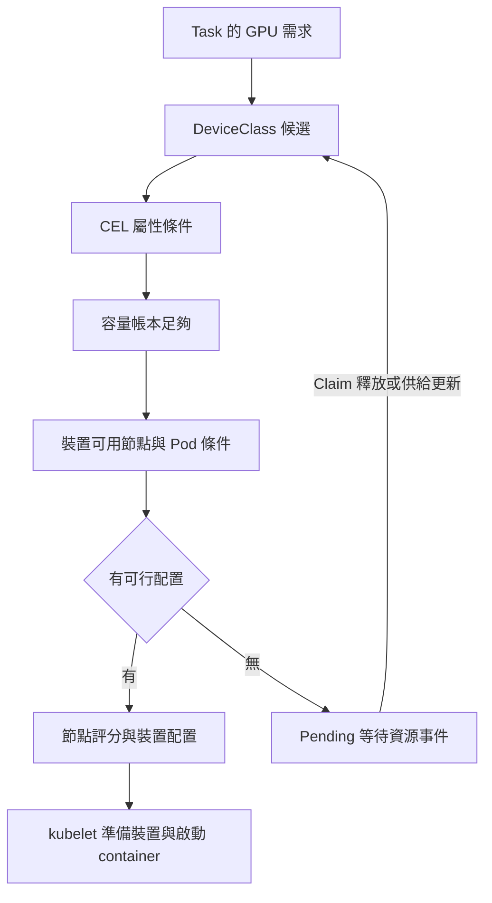
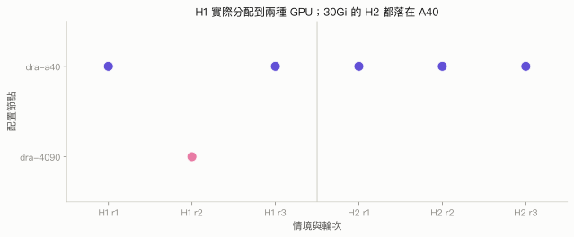

# 第 6 章　只描述需求，讓 scheduler 挑 GPU

## 本章要回答的問題

Task 能否只說「需要多少 VRAM、多少運算額度」，或「任何一張 GPU 都可以」，讓 scheduler 在 A40 與 RTX 4090 之間選擇？若沒有裝置符合需求，工作應等待多久、由誰重新嘗試；工作成功、失敗、取消或重試後，又如何確認 GPU reservation 已釋放？

前幾章已建立 [DRA 物件與配置流程](../01-why-dra/dra-model.md)、[NVIDIA driver 部署](../02-deploy/dra-driver.md)及 [HAMi-DRA 的容量與配額模型](../04-isolation/hami-dra.md)。本章把這些機制接成一個工作流程：需求留在 Claim，選卡交給 Kubernetes，應用程式只執行 CUDA 工作。

## 背景原理

DRA 的選卡先回答「是否符合」，才回答「配置到哪裡」。DeviceClass 限定候選種類，Claim 的 CEL 進一步篩選屬性；若 provider 公布可消耗容量，scheduler 還要核對既有配置加上本次請求是否超過總量，並找出能存取裝置且能執行 Pod 的節點。[DRA 配置流程](https://kubernetes.io/docs/concepts/resource-management/dynamic-resource-allocation/how-dra-works/)、[可消耗容量](https://kubernetes.io/docs/concepts/resource-management/dynamic-resource-allocation/dra-features/#consumable-capacity)

這是閱讀需求時的判斷順序。實作上 scheduler 會在候選節點的 Filter 階段嘗試裝置配置，再整合其他排程條件與評分；不是先選完 GPU 才把 Pod 塞到節點。v1.37 的 DRA 會依 `firstAvailable` 優先清單中的位置評分，但本章的通用 `exactly` 請求沒有 GPU 效能排名。[v1.37.0 Filter 與 Score 原始碼](https://raw.githubusercontent.com/kubernetes/kubernetes/v1.37.0/pkg/scheduler/framework/plugins/dynamicresources/dynamicresources.go)

## 部署與設定

本章提供兩條入口。`selection/native/` 使用第 2 章的 NVIDIA 原生獨占 provider，不切換 provider；`selection/capacity/` 與 KFP 的容量案例則需要兩個 GPU 節點都由 HAMi-DRA 公布 `memory` 與 `cores`。後者用本章套件的 `scripts/install-provider.sh` 與 `restore-provider.sh`（以 `NODES="dra-a40 dra-4090"` 指定兩個節點）切換，底層重用[第 4 章的 provider 切換與還原流程](../../labs/04-isolation/provider/README.md)；切換必須在 GPU 空閒、既有 Claim 已釋放時進行。

| 頁面 | 讀完可以回答的問題 |
|---|---|
| [6.1 DRA 的選卡機制](selection.md) | 型號、屬性、任何 GPU、容量與優先清單要怎麼寫；Pending 如何再試 |
| [6.2 與 Kubeflow Pipelines 整合](kubeflow.md) | Task 如何引用 Template；如何安裝、提交與清除 KFP |
| [6.3 異質 GPU 選卡實驗](experiments.md) | 哪些能力已成立；哪些負面結果與觀測限制仍然存在 |

本章的完整 manifests 與參數表集中在 6.1、6.2。GPU 基礎部署沿用第 2 章，避免把安裝 GPU Operator 與驗證工作需求混成同一個步驟。

## 實驗設計

E4 與 E4B 是原始實驗的兩個階段；KFP 指 Kubeflow Pipelines，Task 是管線中的一個步驟，H 開頭的代號測容量選卡，L 開頭的代號測失敗、取消與重試，holder 是刻意占住容量的占位工作。E4 分三階段驗證 KFP 的 Template 參照、原生獨占選卡，以及 A40 上的 HAMi 並行與容量等待。E4B 接著讓兩張 GPU 使用相同 HAMi 容量模型，以 H1、H2 檢查通用需求，以 H3–H4 檢查釋放後的同一 Pod／Claim，以 H5 檢查同時跨卡執行，再用 L1、L2、L3 分別檢查失敗、取消與重試。[E4 精簡資料](../../data/e4/)、[E4B 精簡資料](../../data/e4b/)

Workload 做小量固定矩陣運算並檢查正確性。`30Gi` 是 DRA 預留容量，不代表程式真的配置同樣大小的 tensor；因此本章觀測選卡與生命週期，不拿 CUDA 時間比較 GPU 效能。

## 結果

| 需求或情境 | 原始實驗結果 |
|---|---|
| H1 通用容量需求 | A40 與 RTX 4090 都曾被選到 |
| H2 較大的記憶體需求 | 只有 A40 的公布容量符合 |
| H3–H4 容量不足後釋放 holder | 保留原 Pod 與 Claim，接著配置成功 |
| H5 每卡留下足夠的一個空位 | 兩個通用 Task 同時使用不同 GPU |
| L1 失敗、L2 取消、L3 重試 | 都有 Claim 釋放證據 |

E4 原生 provider 的 `memory-30gi` 保留為 unsupported，E4B 才完成跨卡容量驗證。完整驗收表、每輪落點、等待時間與 DRA／NVML 對照都在 [6.3](experiments.md)，包含早期未通過的紀錄。

## 解讀

「只描述需求」可以避免為每個 Task 固定節點或 UUID，但需求仍需使用 driver 實際公布的屬性與容量名稱。H2 會自動落在 A40 上，是因為較小的 GPU 不符合容量需求；H1 的落點順序則只能描述這次結果，不能推論隨機策略或效能最佳化。

Pending 也是可驗證的結果。要證明資源釋放讓同一工作繼續，必須保存等待前後的 Pod UID、Claim UID、配置事件與 holder 的釋放證據；只看到最後一次成功執行，無法排除中途重建了工作。

## 限制

本章沒有建立最快 GPU 的選擇器，也沒有重跑第 5 章的效能矩陣。`firstAvailable` 能表達使用者的替代順序，仍不會量測 kernel、頻寬或工作完成時間。

HAMi 的 `memory` 與 `cores` 保留第 4 章的語意：DRA 做排程記帳，HAMi 在所測 CUDA 呼叫路徑執行配額；`cores` 不是 CPU 核心數，reservation 也不是 NVML 實體用量。兩張卡必須切換到同一容量 provider，才能重現 E4B 的統一容量選卡，不能把 E4 的原生選卡與單卡 HAMi 結果拼成跨卡證據。

API 與 NVML 是非原子觀測；跨節點的時鐘漂移尚未校正。取消後的 KFP Task API 可能留在 RUNNING，完成後也可能短暫再建立 Claim；名稱變化的內部原因仍未釐清，須追蹤 UID 與刪除事件。全新 Python 環境的重現只證明該環境能提交並完成工作，沒有證明全新 Kubernetes 叢集已重建。

## 動手重現

從完整 clone 進入[第六章重現套件](../../labs/06-heterogeneous/README.md)，先跑不需要 KFP 的原生選卡，再依需要建立兩節點的 HAMi provider 視窗。KFP 有獨立安裝、執行與解除安裝入口，不會由選卡腳本隱含安裝。

2026-10-12 在原叢集執行的縮短版全部通過：原生選卡的六個情境、`firstAvailable` 在 RTX 4090 空閒時選 4090、被占用時改選 A40；兩卡切換到 HAMi-DRA 後，8Gi 請求可落在任一卡、30Gi 只落在 A40；KFP 的 H1、H2 成功，L1 受控失敗後 Claim 仍被回收。逐項輸出與 provider 還原核對見[實機驗證紀錄](../../labs/06-heterogeneous/VERIFIED.md)。原 E4／E4B 的正式資料與新套件的實機驗證各自保存。

## 重點整理

需求可以是屬性條件、任何 GPU 或可消耗容量。Scheduler 會配置符合條件且有供給的裝置，容量不足則等待可改變結果的資源事件；它不會從通用需求猜出哪張卡最快。

KFP 把 Template 參照帶入 Task Pod，Kubernetes 建立與回收 Claim。驗證時把 CUDA 正確性、KFP 狀態、Pod 終止與 Claim 釋放分開核對，才能判讀成功、失敗、取消與重試的完整生命週期。

<!-- nav:start -->
[← 上一頁：第 5 章　共用的排程機制與效能](../05-performance/README.md) ｜ [目錄](../README.md) ｜ [下一頁：6.1 DRA 的選卡機制 →](selection.md)
<!-- nav:end -->
