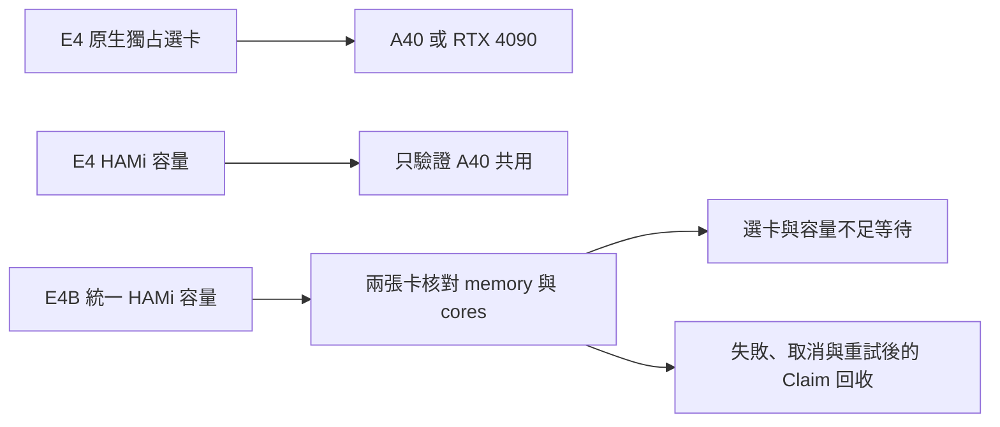
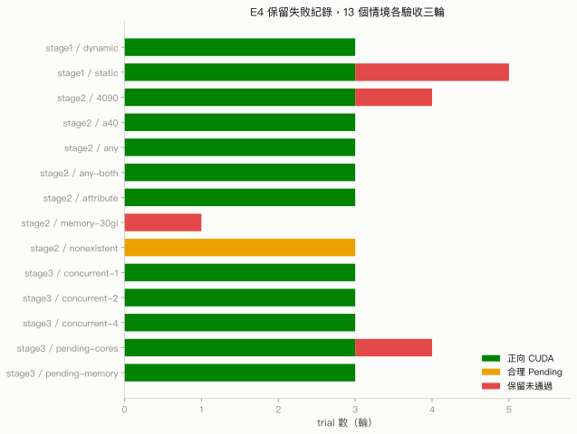
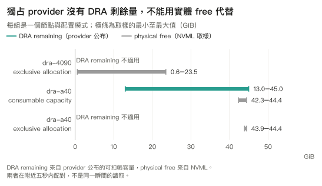
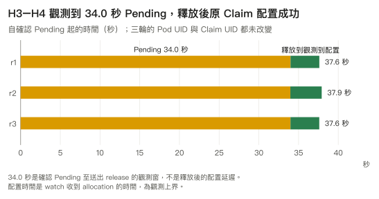
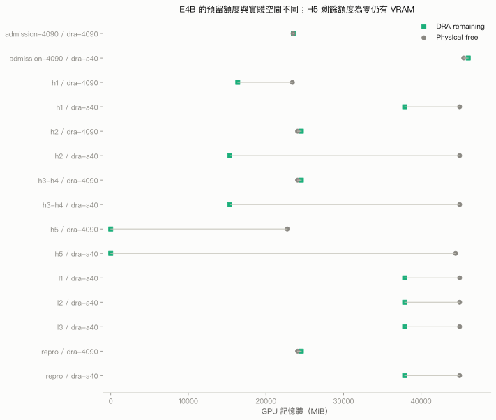

# 6.3 異質 GPU 選卡實驗

## 本頁要回答的問題

選卡成功、CUDA 正確、Pipeline 成功與 Claim 回收，是四個需要分開驗證的結果。本頁比較 E4 與 E4B 的驗收範圍，檢查容量不足後是否保留同一工作，也保留失敗、取消與重試時容易被 API 狀態掩蓋的生命週期證據。

## 背景原理

E4 使用原生 provider 驗證跨卡獨占選擇，再使用 A40 的 HAMi provider 驗證共用容量。E4B 才把兩張卡放進同一個可消耗容量模型；這個差異決定能否讓 `30Gi` 的通用請求依剩餘容量選卡，不能把兩個階段的結果直接合併。

`memory` 是 Claim 預留的 GPU 記憶體額度，`cores` 是 HAMi 公布的運算額度；兩者都不等於這次 CUDA 工作的實際用量。其隔離語意沿用[第 4 章](../04-isolation/hami-dra.md)，本頁只把帳本與 runtime 觀測並列。

## 部署與設定

原始環境使用 Kubernetes v1.37.0、NVIDIA DRA driver v0.5.0 與 HAMi-DRA v0.1.0。原生 GPU provider 的部署見[第 2 章](../02-deploy/dra-driver.md)，本章的需求 manifests 見 [6.1](selection.md)，KFP 的固定來源、image 與 standalone 設定見 [6.2](kubeflow.md)。[請求資料](../../data/e4b/trials.json)

原生選卡的 Task 沒有固定 Pod 節點。E4 的 `a40`、`4090` 在型號 DeviceClass 之外還指定該卡 UUID，重現套件依案例名稱改用 `productName` CEL；在各型號只有一張卡的原環境中落點相同，多張同型號卡的叢集則會接受任何符合型號的裝置。

| 原始名稱或識別 | 套件中的角色名稱 | 意義 |
|---|---|---|
| `e4-a40-r1` Template | `native-a40-gpu` | 原生 A40 選卡需求 |
| `e4-4090-r1` Template | `native-rtx4090-gpu` | 原生 RTX 4090 選卡需求 |
| `e4-any-both-r1` Template | `native-any-gpu-pair-gpu` | 兩個 Pod 各自產生 Claim |
| E4B `gpu-target` Template | `capacity-8gi-gpu` 或 `capacity-30gi-gpu` | 通用容量需求 |
| E4B `target`、`left`、`right` Task | `capacity-h1-worker`、`capacity-pending-worker`、`capacity-parallel-primary`、`capacity-parallel-secondary` | Task 名稱與 Claim UID 分開保存 |

### Workload 與驗收方法

Workload 固定使用 FP32 矩陣、單一 CPU thread 與關閉 TF32 的 CUDA 計算；原始參數包含矩陣邊長 4096、seed 20261010、5 次 warmup、20 次計時 GEMM 與 8 個正確性檢查點。請求 `30Gi` 不會把 tensor 變成 30 GiB，因此下列結果不適合用來比較 GPU 效能。[workload 來源](../../labs/06-heterogeneous/workload/gpu_primitives.py)

正向驗收同時核對 KFP Run／Task、實際 executor Pod、CUDA 記錄、Claim 配置與自然刪除。不存在裝置的案例則核對未配置、排程事件、持續 Pending 與清理；「合理 Pending」不算 CUDA 成功。原始資料由[標準 library 分析程式](../../labs/06-heterogeneous/analysis/analyze.py)整理成以下表格，擷取路徑與雜湊見 [E4](../../data/e4/SOURCES.md)、[E4B](../../data/e4b/SOURCES.md)。

## 結果

### E4 的階段驗收

在 stage1 中，static 與 dynamic 都引用 ResourceClaimTemplate。Static 把 Template 名稱寫在編譯產物，dynamic 以 Pipeline 輸入 JSON 傳入；兩者都由 Kubernetes 為各 Pod 建立 Claim，這裡的 static 不是多人共用一份預先建立的 ResourceClaim。[原始請求與驗收摘要](../../data/e4/trials.json)

在 stage2 中，`attribute` 使用 `architecture == "Ampere"`，`any` 不加 Claim selector，`any-both` 同時提交兩個獨立 Task。`nonexistent` 要求不存在的 UUID，結果是未配置的 Pending；stage3 則在 A40 上依序驗證不同並行數與 cores／memory 不足後的釋放。

| 階段 | 案例 | Provider | 已驗收輪次 | 正向 | 合理 Pending | 保留未通過 | 結果 |
|---|---|---|---|---|---|---|---|
| stage1 | dynamic | hami | 1, 2, 3 | 3 | 0 | 0 | 已驗收三輪 |
| stage1 | static | hami | 1, 2, 3 | 3 | 0 | 2 | 已驗收三輪 |
| stage2 | 4090 | native | 1, 2, 3 | 3 | 0 | 1 | 已驗收三輪 |
| stage2 | a40 | native | 1, 2, 3 | 3 | 0 | 0 | 已驗收三輪 |
| stage2 | any | native | 1, 2, 3 | 3 | 0 | 0 | 已驗收三輪 |
| stage2 | any-both | native | 1, 2, 3 | 3 | 0 | 0 | 已驗收三輪 |
| stage2 | attribute | native | 1, 2, 3 | 3 | 0 | 0 | 已驗收三輪 |
| stage2 | memory-30gi | unavailable | 無 | 0 | 0 | 1 | 尚未驗收三輪 |
| stage2 | nonexistent | native | 1, 2, 3 | 0 | 3 | 0 | 已驗收三輪 |
| stage3 | concurrent-1 | hami | 1, 2, 3 | 3 | 0 | 0 | 已驗收三輪 |
| stage3 | concurrent-2 | hami | 1, 2, 3 | 3 | 0 | 0 | 已驗收三輪 |
| stage3 | concurrent-4 | hami | 1, 2, 3 | 3 | 0 | 0 | 已驗收三輪 |
| stage3 | pending-cores | hami | 1, 2, 3 | 3 | 0 | 1 | 已驗收三輪 |
| stage3 | pending-memory | hami | 1, 2, 3 | 3 | 0 | 0 | 已驗收三輪 |

`memory-30gi` 是 unsupported 紀錄，沒有正式執行證據。E4 的原生獨占 provider 不提供該案例要測的「跨獨立 Claim 消耗 memory」帳本；這不表示原生 provider 不能公布總記憶體屬性，也不表示不能用 CEL 篩選容量。E4B 用 HAMi 的可消耗容量請求補上這個驗證缺口。

表中的保留未通過包含 static 的早期工具／Pipeline 失敗、4090 被既有服務占用的 blocked，以及 pending-cores 的初次證據不成立。後續三輪通過沒有覆寫這些紀錄；因此全目錄驗證仍為 incomplete，而各能力依成功輪次獨立驗收。[完整驗收摘要](../../data/e4/acceptance.json)

### E4 的容量帳本與實體空閒

| 節點 | Provider 模型 | 配對樣本 | DRA remaining GiB | physical free GiB | DRA 減 physical GiB | 最大配對時間差 s |
|---|---|---|---|---|---|---|
| dra-4090 | exclusive allocation | 438 | 不適用 | 0.572 … 23.518 | 不適用 | 4.249639987945557 |
| dra-a40 | consumable capacity | 287 | 12.988 … 44.988 | 42.330 … 44.424 | -31.436 … 0.564 | 4.428816080093384 |
| dra-a40 | exclusive allocation | 151 | 不適用 | 43.898 … 44.424 | 不適用 | 4.138803005218506 |

GiB 範圍依報告保留三位小數，最大配對時間差保留資料中的值。這張表的差值方向是 **DRA remaining 減 physical free**；範圍描述原始取樣窗，兩邊的極值不一定發生在同一瞬間。[配對樣本](../../data/e4/capacity-samples.json)

獨占 provider 的 remaining 是「不適用」，不能填零或拿 NVML free 代替。Pod、Claim、Slice 依序讀取，NVML 在附近五秒內配對；DRA 的觀測時間採 Claim 讀取完成上界，舊批次資料採批次完成上界，因此這些值不能解讀成原子快照。

### E4B 的統一容量與選卡

正式 H1 的 live ResourceSlice 公布 A40 memory 46068 MiB、RTX 4090 memory 24564 MiB，兩者 cores 都是 100。這是該次 provider 的公布值，換卡、換 driver 或重建 Slice 後應重新盤點。[正式請求與容量樣本](../../data/e4b/capacity-samples.csv)

| 案例 | 需求 | r1 | r2 | r3 |
|---|---|---|---|---|
| H1 | 8Gi／25 cores | dra-a40 | dra-4090 | dra-a40 |
| H2 | 30Gi／25 cores | dra-a40 | dra-a40 | dra-a40 |

H1 每輪兩張卡都符合 `8Gi` 需求，落點依序是 A40、RTX 4090、A40；三輪結果不構成隨機策略的證據。H2 沒有型號、節點或 UUID selector，只有 `30Gi`／25 cores；RTX 4090 公布的 memory 小於需求，所以三輪都配置到 A40。[落點與 Claim 身分](../../data/e4b/task-results.json)

### H3 與 H4 的等待與再配置

H3 的 holder 占住 A40 容量，使剩餘 memory 不足以滿足通用 `30Gi` 請求；RTX 4090 的總 memory 也不夠。H4 釋放 holder 後，原 Pending Pod 與原 Claim 配置成功，並未刪掉 Task 重新提交。

| 輪次 | 確認 Pending 至 release s | release 相對時間 s | allocation 相對時間 s | Pod UID 相同 | Claim UID 相同 |
|---|---|---|---|---|---|
| r1 | 34.0 | 33.990 | 37.615 | 是 | 是 |
| r2 | 34.0 | 33.967 | 37.915 | 是 | 是 |
| r3 | 34.0 | 33.983 | 37.608 | 是 | 是 |

每列以該輪首次確認 Pending 為時間零點。報告的 **34.0 秒** 是確認容量不足至送出 release 的觀測窗，取一位小數；allocation 事件在稍後才收到，不能把 34.0 秒寫成釋放後的配置延遲。Claim allocation 的 watch 收件時間是事件發生的觀測上界。[等待前後 UID 與時間](../../data/e4b/trials.json)

### H5 的兩個空位

H5 的受控 holder 在每張 GPU 留下一個 `8Gi` 空位，再同時提交兩個沒有固定節點或 UUID 的通用 Task。三輪都觀測到兩個 Task 同時分布在不同 GPU，各有獨立 Claim UID 與 shareID；holder 的 UUID 只控制測試前置條件，沒有帶進通用 Task 的需求。

這個結果驗證「當兩張卡各留一個合適空位時，需求可同時被滿足」。它沒有證明普通 `8Gi` 請求會主動平均分散到兩張卡；沒有 holder 時，兩個需求也可能共用同一張容量足夠的 GPU。[H5 配置證據](../../data/e4b/task-results.json)

### E4B 的生命週期與能力驗收

| 情境 | 原始 Run／Task 狀態 | Claim 釋放證據 |
|---|---|---|
| L1 CUDA 正確後以 exit code 42 結束 | Run FAILED；Task FAILED | 原 Claim 與後續短暫 Claim 均有刪除觀測 |
| L2 執行中呼叫 cancel API | Run FAILED；Task API 仍 RUNNING | executor Pod 已終止，Claim 均刪除 |
| L3 首次失敗後 controller 重試 | Run 與 Task 最終 SUCCEEDED | 兩次 attempt 各自配置，全部 Claim 均刪除 |

L1 的應用程式 exit code 是 42，但 KFP launcher 主 container 的 exit code 是 1，兩者需要分別記錄。L2 的 Task API 沒有 executor UID，也可能沒有完成時間；驗證時用 Task ID、launcher、owner Workflow UID 與 Workflow node patch 串回 Pod，不能僅憑 RUNNING 判定 GPU 仍被占用。[生命週期證據](../../data/e4b/lifecycle.json)

L3 核對了兩次實際 attempt 的 executor Pod UID、Claim UID 與 shareID，首次失敗後再成功，沒有用「正常成功工作」替代重試證據。完成後短暫新增的 Claim 也納入完整 UID 與 DELETED 事件追蹤；名稱變化的內部原因仍未釐清，不能直接推論資源洩漏。

| 能力 | 驗收 |
|---|---|
| A40 HAMi 容量排程 | VERIFIED |
| RTX 4090 所測 CUDA 配額路徑 | VERIFIED |
| A40 與 RTX 4090 統一容量排程 | VERIFIED |
| 30Gi 的容量選卡 | VERIFIED |
| Pending 後釋放並保留原 Claim | VERIFIED |
| 受控失敗釋放 Claim | VERIFIED |
| 取消釋放 Claim | VERIFIED |
| 實際重試沒有遺留 Claim | VERIFIED |
| 全新 Python 環境重現 | VERIFIED |
| 原 provider 與服務狀態還原 | VERIFIED |

E4B 的正式驗收是 23 輪，原 invalid 保留 5 輪；修正後驗證器可核對 25 輪證據，但重新判讀的歷史 invalid 紀錄不補進正式次數，全目錄仍為 incomplete。全新環境的結果使用重建 SDK wheel 與新的 Python 環境，驗證範圍是 macOS arm64／Python 3.12，沒有宣稱全新 Kubernetes 叢集。[能力與正式次數](../../data/e4b/acceptance.json)

### E4B 的兩種剩餘量

下表採用報告中的代表樣本：每個案例與節點先取最高 reservation，若相同再取最高 physical used。只列 HAMi consumable capacity，排除生命週期階段另一張卡仍在原生獨占模式的樣本；完整取樣窗與讀取區間保留於 CSV。

| 案例 | 節點 | reserved MiB | remaining MiB | cores 預留／剩餘 | physical used／free MiB | free 減 remaining MiB | NVML offset s |
|---|---|---|---|---|---|---|---|
| h1 | dra-4090 | 8192 | 16372 | 25／75 | 670／23414 | 7042 | -0.125 |
| h1 | dra-a40 | 8192 | 37876 | 25／75 | 527／44964 | 7088 | 0.123 |
| h2 | dra-4090 | 0 | 24564 | 0／100 | 1／24082 | -482 | 1.755 |
| h2 | dra-a40 | 30720 | 15348 | 25／75 | 527／44964 | 29616 | -0.176 |
| h3-h4 | dra-4090 | 0 | 24564 | 0／100 | 1／24082 | -482 | 1.862 |
| h3-h4 | dra-a40 | 30720 | 15348 | 25／75 | 527／44964 | 29616 | -0.160 |
| h5 | dra-4090 | 24564 | 0 | 50／50 | 1335／22749 | 22749 | -0.009 |
| h5 | dra-a40 | 46068 | 0 | 50／50 | 1050／44441 | 44441 | 0.521 |

這張表的差值方向改為 **physical free 減 DRA remaining**，與前面的 E4 範圍表相反，欄名已明列。NVML offset 是 physical 樣本時間減 DRA 觀測時間，正負號都保留，配對在附近五秒內而非同時發生。

H2 的 A40 預留 30Gi，卻仍有大量實體空閒，正好說明需求帳本與 tensor 用量不同。H5 的 remaining 可以是零，physical free 卻很大；scheduler 依 Claim reservation 判斷容量，不會因此把新的 Task 塞進已預留滿的裝置。NVML 的 `memory.reserved` 另指 driver 與韌體保留量，所以 physical used 加 free 也可能小於 total。

## 重點整理

E4 驗證原生獨占選卡與單卡共用，E4B 驗證兩卡統一容量、同一工作在釋放後繼續，以及失敗、取消與重試後回收。選卡成功只證明需求被滿足；最快 GPU、隨機策略與配額以外的實體硬上限，都不在本實驗的結論中。

讀結果時同時看正式驗收、原始負面紀錄、工作 UID 與容量時間差。回到[本章的限制與重現入口](README.md#限制)，再選擇要重現的 provider 與 KFP 範圍。

<!-- nav:start -->
[← 上一頁：6.2 與 Kubeflow Pipelines 整合](kubeflow.md) ｜ [目錄](../README.md) ｜ [下一頁：第 7 章　結論與實務建議 →](../07-conclusion.md)
<!-- nav:end -->
