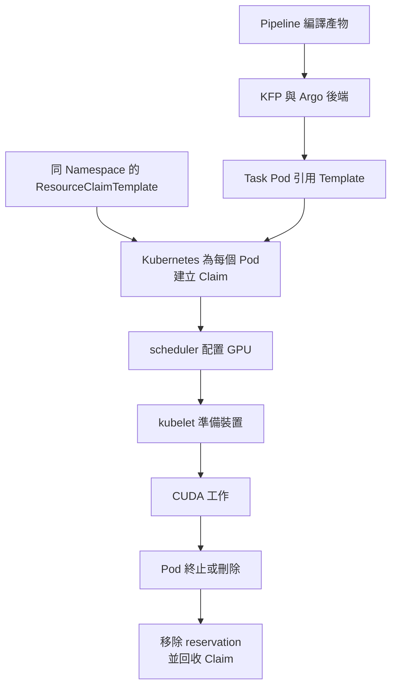
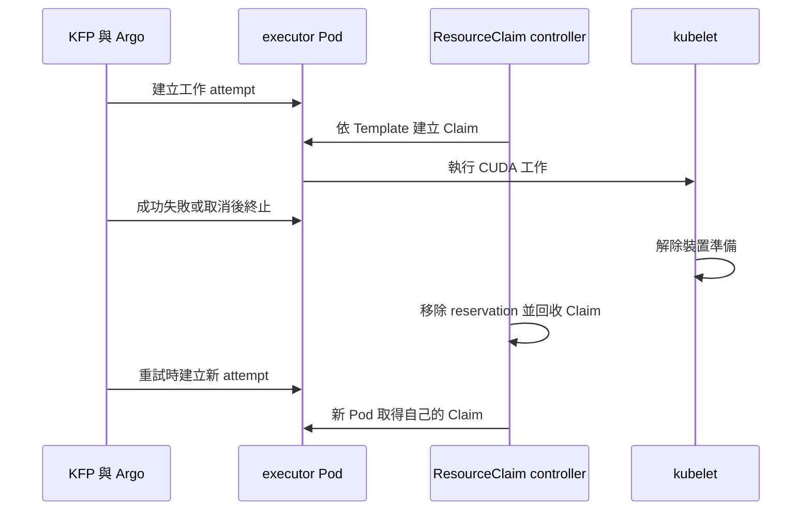

# 6.2 與 Kubeflow Pipelines 整合

## 本頁要回答的問題

Kubeflow Pipelines 的 Task 如何把 GPU 需求交給 Kubernetes，而不在程式裡指定工作節點？除了成功完成的工作，失敗、取消與重試之後，Claim 如何確認已釋放；讀者又能否直接提交編譯產物，避開 SDK 安裝問題？

## 背景原理

Kubeflow Pipelines（KFP）把工作步驟編譯成 Pipeline，後端再建立與追蹤執行它們的 Pod。本實驗使用 standalone KFP，不安裝完整 Kubeflow 平台；GPU 配置仍由 DRA 與 Kubernetes 負責，KFP 只是把 Template 參照帶進 Task。



Template 必須先存在於 Task 的 Namespace。`add_resource_claim` 讓 Task Pod 帶上 `resourceClaims`，並讓 `main` container 引用相同 Claim；Kubernetes 依 Template 建立 Claim，資源符合後才啟動 Pod。KFP 不替管理者建立或設定 Template。[KFP 的 DRA 整合說明](https://www.kubeflow.org/docs/components/pipelines/user-guides/core-functions/dynamic-resource-allocation/)

GPU 的準備與回收流程沿用[第 1 章](../01-why-dra/dra-model.md)，容量與 runtime 配額沿用[第 4 章](../04-isolation/hami-dra.md)。KFP Run 狀態與 GPU reservation 是不同的觀測來源，尤其取消與重試不能只看介面上的一個狀態字串。

## 部署與設定

### 固定來源的 standalone 後端

原始後端以 KFP commit `8279bb0cd394628c77d28a4c28174334e57ddb4f` 的 standalone 資源建立，Argo 使用 v4.1.2。Backend Deployment 與 CPU driver 排在 `dra-non`，GPU executor 保持一般 DRA 排程；每個獨立執行視窗使用 `gpu-kubeflow-<run-id>-lab` Namespace，完成後刪除自己的後端與儲存。[安裝輸入與來源](../../labs/06-heterogeneous/kubeflow/install/SOURCES.md)

套件的完整 kustomization 如下，所有資源都在 clone 內，不需要讓 kustomize 讀取遠端 URL。`objects.json` 是完整 Kubernetes List，保留 standalone 的 namespaced RBAC、Service、ConfigMap、Deployment、初始化 Job 與 PVC；安裝器改寫 run Namespace、加上歸屬 label，並在執行時產生 Secret。

MySQL 初始化的 `MYSQL_ROOT_PASSWORD` 與 API 的兩組資料庫密碼環境變數引用同一個 `mysql-secret/password`。原始實驗沿用空密碼設定；套件改為在執行時產生密碼後，資料庫端也必須讀取同一份 Secret，否則即使 Service 可以連線，也不代表登入成功。MySQL 已初始化的資料目錄不會因環境變數改變而重設密碼，所以修正後要使用新的執行視窗與 PVC。[資料庫初始化與診斷來源](../../labs/06-heterogeneous/kubeflow/install/SOURCES.md#資料庫初始化與診斷)

```console
$ vi labs/06-heterogeneous/kubeflow/install/kustomization.yaml
```

<!-- lab-file: labs/06-heterogeneous/kubeflow/install/kustomization.yaml -->
```yaml
apiVersion: kustomize.config.k8s.io/v1beta1
kind: Kustomization
resources:
  - objects.json
```


| 參數 | 意義 | 為什麼這樣設 |
|---|---|---|
| `objects.json` | 完整後端物件與 CRD 清單 | 以本地輸入重建相同 standalone 設定 |
| `nodeSelector` 的 `dra-non` | Backend 與 CPU driver 的節點 | 不占用 GPU worker 的一般運算資源 |
| `local-path`、PVC `5Gi` | MySQL 與 SeaweedFS 的儲存 | 保留原始後端設定與 Delete 回收政策 |
| 每個 Deployment 一個 replica | 隔離實驗後端 | 沿用實驗規模，不推論正式環境架構 |

完整物件見 [objects.json](../../labs/06-heterogeneous/kubeflow/install/objects.json)，固定 image 見 [images.json](../../labs/06-heterogeneous/kubeflow/install/images.json)。下表保留 tag 與 digest；實際 pull 以 digest 固定內容，SDK wheel 的版本與後端 image tag 分開記錄。

| 角色 | image |
|---|---|
| `api_server` | `ghcr.io/kubeflow/kfp-api-server:2.17.1@sha256:fb0822260617401eb3f35bb9856030046bdd2cd26e4a4360f14c12c23d0e418d` |
| `driver` | `ghcr.io/kubeflow/kfp-driver:2.17.1@sha256:b2dd28deed025f85c5c67c3bf21ebbf64e90761e57331ac30b4057c52326264a` |
| `launcher` | `ghcr.io/kubeflow/kfp-launcher:2.17.1@sha256:d0847ea2dda9c6120d33e3dd6f5539b679c84b95aa544fa39876c0cf09c60f09` |
| `frontend` | `ghcr.io/kubeflow/kfp-frontend:2.17.1@sha256:130dbbbaaa0ac7c1e200f38eda7ac66d708891014eb8cb8b9b78dfe14260c107` |
| `persistence_agent` | `ghcr.io/kubeflow/kfp-persistence-agent:2.17.1@sha256:3798472962a78c621900b38a268805b3494f8607e591ab32f151adf4739941c1` |
| `scheduled_workflow` | `ghcr.io/kubeflow/kfp-scheduled-workflow-controller:2.17.1@sha256:2e725bce548953c7590832e56581ca51435b50f4b6fd253a7f700c9ef1003063` |
| `viewer` | `ghcr.io/kubeflow/kfp-viewer-crd-controller:2.17.1@sha256:6a381f9503391f5ea09f30e6e1f8458fd04ab37bb23d741c3eccd6fd2be526ed` |
| `mysql` | `docker.io/library/mysql:8.4@sha256:6ea90827b1100f8f2ae306a539f86d2c264a26ed435a2a9f75551dd5c3aeb242` |
| `seaweedfs` | `ghcr.io/chrislusf/seaweedfs:4.48@sha256:4e61d15fd35994cb1e43e1e553dff106794841fd9a99ade2fc8c8bfce4d7872d` |
| `alpine` | `docker.io/library/alpine:3.23@sha256:85fe1e81d6758c208f3e1eed4338a1997e19d4be002d4dd32d3100c9a8c010a0` |
| `argo_controller` | `quay.io/argoproj/workflow-controller:v4.1.2@sha256:466192f538abfe750157c5bb5c0b883137b19f67af27c5636ab15bc853c96668` |
| `argo_executor` | `quay.io/argoproj/argoexec:v4.1.2@sha256:4a7b9a9859b63e7aea7927c69fc336a5ef07f8dbea91ae2e175cda8788d972e9` |
| `pytorch` | `docker.io/pytorch/pytorch:2.5.1-cuda12.4-cudnn9-runtime@sha256:c8268a92a69bd500f8be0e665b2630ee006dadaf7bfbc24249141b15ff622755` |

> **警告：KFP 安裝與解除安裝會變更叢集範圍的 CRD 與 DeviceClass，解除安裝也會刪除本次 Namespace 的儲存。請保存 `KFP_STATE_DIR`，在同一執行視窗完成收集與清除。**

不要直接用 `kubectl apply -k` 安裝這組 cluster-scoped 資源。受控安裝器先盤點既有物件，再逐一建立；這個順序讓解除安裝能明確區分本次新增與原本存在的物件。

```console
$ export KFP_RUN_ID="$(date -u +%Y%m%d%H%M%S)"
$ export KFP_STATE_DIR="$PWD/labs/06-heterogeneous/kubeflow/out/$KFP_RUN_ID/kfp-install"
$ ALLOW_KFP_INSTALL=1 bash labs/06-heterogeneous/kubeflow/scripts/install-kfp.sh
```

| 參數 | 意義 | 為什麼這樣設 |
|---|---|---|
| `KFP_RUN_ID` | 本次安裝與 Task 的身分 | 新 Namespace 與 DeviceClass 使用同一識別 |
| `KFP_STATE_DIR` | 安裝前盤點、UID 與設定的保存位置 | 清理必須讀取同一份紀錄 |
| `ALLOW_KFP_INSTALL=1` | 明確啟用叢集安裝 | 安裝不由選卡或提交腳本隱含執行 |

2026-10-12 已在原叢集以修正後的套件完成安裝、H1／H2／L1 縮短版與解除安裝，結果見[實機驗證紀錄](../../labs/06-heterogeneous/VERIFIED.md#kubeflow-pipelinesprovider-切換窗-3b兩卡-hami-dra)。安裝成功時會輸出以下兩行，run ID 與絕對路徑依執行而定。

```text
KFP Namespace: gpu-kubeflow-<run-id>-lab
KFP_STATE_DIR=<clone-path>/labs/06-heterogeneous/kubeflow/out/<run-id>/kfp-install
```

安裝失敗時，原始錯誤會保留，診斷寫入 `KFP_STATE_DIR/diagnostics/<UTC時間>/`。其中包含 API server 與 MySQL 的目前及前一次 container logs、可讀取的 init-container logs、Pod 狀態、Service／EndpointSlice 與事件；尚未開始的 container 會在 `report.json` 記錄為未就緒，不呼叫 logs。這些紀錄用來區分連線、認證與 container 啟動問題，完整命令與清理方式見[KFP 套件](../../labs/06-heterogeneous/kubeflow/README.md)。

### 建立哪些叢集物件

原始 namespaced bundle 有 10 個 CRD：Argo 的 `clusterworkflowtemplates`、`cronworkflows`、`workflowartifactgctasks`、`workfloweventbindings`、`workflows`、`workflowtaskresults`、`workflowtasksets`、`workflowtemplates`，以及 KFP 的 `scheduledworkflows`、`viewers`。它沒有建立 ClusterRole、ClusterRoleBinding 或 webhook；套件另加一個依 run ID 隔離的 HAMi DeviceClass，避免接管原有類別。

安裝前仍會完整盤點 **CRD、ClusterRole、ClusterRoleBinding、MutatingWebhookConfiguration、ValidatingWebhookConfiguration** 的既有物件。既有 CRD 只在相容時重用，不覆寫；叢集範圍的清除只處理記錄為 created、UID 與歸屬 label 仍相符的物件，既有物件則須維持原 UID 與設定。專用 Namespace 的 UID 核對相符後，其 controller 產生的 Lease、Pod、Workflow、ConfigMap 與 Secret 也隨 Namespace 清除；外部實例或其他 Namespace 的 Claim 引用則會保護相應的 CRD 或 DeviceClass，不妨礙其他自有物件清理。[安裝與清理實作](../../labs/06-heterogeneous/kubeflow/scripts/kfp_state.py)

### Task 所用的 Template 與原始碼

本套件重現 H1、H2 與 L1。前兩者不含型號、UUID 或節點條件；L1 保留原始受控失敗案例的 A40 UUID，讀者換到其他叢集時可用 `A40_GPU_UUID` 指定實際公布值。

```console
$ vi labs/06-heterogeneous/kubeflow/manifests/templates.yaml
```

<!-- lab-file: labs/06-heterogeneous/kubeflow/manifests/templates.yaml -->
```yaml
apiVersion: resource.k8s.io/v1
kind: ResourceClaimTemplate
metadata:
  name: gpu-memory-small
  namespace: gpu-kubeflow-lab
  labels: &id001
    app.kubernetes.io/part-of: dra-book
    app.kubernetes.io/component: gpu-h1
spec:
  metadata:
    labels: *id001
  spec:
    devices:
      requests:
      - name: gpu
        exactly:
          deviceClassName: gpu-kubeflow-capacity
          allocationMode: ExactCount
          count: 1
          capacity:
            requests:
              memory: 8Gi
              cores: '25'
---
apiVersion: resource.k8s.io/v1
kind: ResourceClaimTemplate
metadata:
  name: gpu-memory-large
  namespace: gpu-kubeflow-lab
  labels: &id001
    app.kubernetes.io/part-of: dra-book
    app.kubernetes.io/component: gpu-h2
spec:
  metadata:
    labels: *id001
  spec:
    devices:
      requests:
      - name: gpu
        exactly:
          deviceClassName: gpu-kubeflow-capacity
          allocationMode: ExactCount
          count: 1
          capacity:
            requests:
              memory: 30Gi
              cores: '25'
---
apiVersion: resource.k8s.io/v1
kind: ResourceClaimTemplate
metadata:
  name: gpu-controlled-failure
  namespace: gpu-kubeflow-lab
  labels: &id001
    app.kubernetes.io/part-of: dra-book
    app.kubernetes.io/component: gpu-l1
spec:
  metadata:
    labels: *id001
  spec:
    devices:
      requests:
      - name: gpu
        exactly:
          deviceClassName: gpu-kubeflow-capacity
          allocationMode: ExactCount
          count: 1
          selectors:
          - cel:
              expression: 'device.attributes["hami-core-gpu.project-hami.io"].uuid == "GPU-29ffee3e-bee4-e341-917a-fe7e43e977af"'
          capacity:
            requests:
              memory: 8Gi
              cores: '25'
```


| 參數 | 意義 | 為什麼這樣設 |
|---|---|---|
| `gpu-memory-small` | H1 的 8Gi／25 cores | 接受符合需求的任一 HAMi GPU |
| `gpu-memory-large` | H2 的 30Gi／25 cores | 由容量排除較小的 GPU |
| `gpu-controlled-failure` | L1 的 A40 需求 | 沿用原始生命週期案例的 GPU 身分 |
| `gpu-kubeflow-capacity` | 安裝器建立的類別基底名稱 | 實際名稱加上 run ID，CEL 只接受 HAMi driver |
| Template 的 Claim metadata label | 自動 Claim 的歸屬 | 不只標記 Template 本身 |

Workload 以 ConfigMap generator 掛載。下面是完整 kustomization；控制 ConfigMap 隨每一輪由提交器建立，讓成功工作在留下 CUDA 與 Claim 證據後才 release。

```console
$ vi labs/06-heterogeneous/kubeflow/manifests/kustomization.yaml
```

<!-- lab-file: labs/06-heterogeneous/kubeflow/manifests/kustomization.yaml -->
```yaml
apiVersion: kustomize.config.k8s.io/v1beta1
kind: Kustomization
namespace: gpu-kubeflow-lab
resources:
  - templates.yaml
configMapGenerator:
  - name: gpu-code
    files:
      - gpu_workload.py=../workload/gpu_workload.py
      - gpu_primitives.py=../workload/gpu_primitives.py
generatorOptions:
  disableNameSuffixHash: true
  immutable: true
  labels:
    app.kubernetes.io/part-of: dra-book
    app.kubernetes.io/component: gpu-workload
```


| 參數 | 意義 | 為什麼這樣設 |
|---|---|---|
| `gpu-code` | 掛載 CUDA primitives 與 workload | 完整原始碼可在 clone 中檢查 |
| 固定 ConfigMap 名稱 | 對應 Pipeline 的 volume 引用 | 每個獨立 Namespace 保存自己的版本 |
| `gpu-control` | run ID、release 與 Task ID | 由提交器管理 HOLD 的釋放 |

`gpu_primitives.py` 使用固定 FP32 GEMM 與正確性檢查；`gpu_workload.py` 的 `success` 在完成後等待 release，`controlled_failure` 則在完成正確性檢查後以 exit code 42 結束。來源見 [CUDA primitives](../../labs/06-heterogeneous/kubeflow/workload/gpu_primitives.py) 與 [workload](../../labs/06-heterogeneous/kubeflow/workload/gpu_workload.py)，不把程式展開成 ConfigMap YAML。

下面是套件完整的 `pipeline.py`。關鍵是 `kubernetes.add_resource_claim(task, CLAIMS[case])`，它不傳 `nodeSelector` 或 GPU 型號給通用 Task；原始 SDK 實作將名稱寫入 `PodResourceClaim`，再加入 Task 的 Kubernetes 平台設定。[固定 commit 的 SDK 實作](https://github.com/kubeflow/pipelines/blob/8279bb0cd394628c77d28a4c28174334e57ddb4f/sdk/python/kfp/kubernetes/pod_resource_claim.py)

```console
$ vi labs/06-heterogeneous/kubeflow/pipelines/pipeline.py
```

```python
#!/usr/bin/env python3
"""Compile the E4B CUDA task with Kubernetes-generated ResourceClaims."""
import argparse
from pathlib import Path
from kfp import compiler, dsl, kubernetes

IMAGE = 'docker.io/pytorch/pytorch:2.5.1-cuda12.4-cudnn9-runtime@sha256:c8268a92a69bd500f8be0e665b2630ee006dadaf7bfbc24249141b15ff622755'
CLAIMS = {'h1': 'gpu-memory-small', 'h2': 'gpu-memory-large', 'l1': 'gpu-controlled-failure'}


def compile_pipeline(case, output, run_id='dra-book-kubeflow'):
    @dsl.container_component
    def gpu_task(task_id: str, scenario: str, study_id: str):
        return dsl.ContainerSpec(image=IMAGE, command=['python', '-u', '/opt/lab/gpu_workload.py'],
                                 args=['--task-id', task_id, '--scenario', scenario, '--run-id', study_id,
                                       '--control', '/opt/control/control.json', '--hold-timeout', '900'])

    @dsl.pipeline(name='dra-book-kubeflow-' + case)
    def workflow():
        task = gpu_task(task_id='target', scenario='controlled_failure' if case == 'l1' else 'success', study_id=run_id)
        task.set_display_name('gpu-' + case)
        task.set_caching_options(False)
        task.set_cpu_request('1').set_cpu_limit('1')
        task.set_memory_request('2Gi').set_memory_limit('2Gi')
        task.set_retry(num_retries=0, policy='OnFailure', backoff_duration='60s', backoff_factor=1, backoff_max_duration='120s')
        kubernetes.use_config_map_as_volume(task, 'gpu-code', '/opt/lab')
        kubernetes.use_config_map_as_volume(task, 'gpu-control', '/opt/control')
        kubernetes.add_toleration(task, key='nvidia.com/gpu', operator='Exists', effect='NoSchedule')
        for key, value in {'app.kubernetes.io/part-of': 'dra-book', 'app.kubernetes.io/component': 'gpu-' + case,
                           'dra-book/run-id': run_id, 'task-id': 'target'}.items():
            kubernetes.add_pod_label(task, key, value)
        for env, field in [('E4_POD_UID', 'metadata.uid'), ('E4_POD_NAME', 'metadata.name'),
                           ('E4_NAMESPACE', 'metadata.namespace'), ('E4_NODE_NAME', 'spec.nodeName')]:
            kubernetes.use_field_path_as_env(task, env, field)
        kubernetes.set_security_context(task, run_as_user=0, run_as_group=0, run_as_non_root=False)
        task.set_env_variable('PYTORCH_NO_CUDA_MEMORY_CACHING', '1')
        task.set_env_variable('KFP_RETRY_INDEX', '0')
        kubernetes.add_resource_claim(task, CLAIMS[case])

    compiler.Compiler().compile(workflow, str(output))


if __name__ == '__main__':
    p = argparse.ArgumentParser(description=__doc__)
    p.add_argument('--case', choices=CLAIMS, required=True)
    p.add_argument('--output', type=Path, required=True)
    p.add_argument('--run-id', default='dra-book-kubeflow')
    a = p.parse_args()
    compile_pipeline(a.case, a.output, a.run_id)
```

| 參數 | 意義 | 為什麼這樣設 |
|---|---|---|
| `CLAIMS` | 案例對應 Template | 共用工作邏輯，需求留在 Kubernetes 物件 |
| `set_caching_options(False)` | 每輪真的啟動工作 | 不把 cached Task 當成 GPU 驗證 |
| CPU `1`、記憶體 `2Gi` | 主機端執行資源 | 與 GPU `memory` 分開 |
| retry `0` | 本套件 H1、H2、L1 不重試 | L1 要留下明確受控失敗 |
| `E4_POD_UID` 等 Downward API | executor 的實際身分 | CUDA log 可連回 Pod、Claim 與節點 |
| `PYTORCH_NO_CUDA_MEMORY_CACHING=1` | CUDA 記憶體 cache 設定 | 保留原始 E4B 環境 |

### 編譯後的 Claim 參照

[h1.yaml](../../labs/06-heterogeneous/kubeflow/pipelines/h1.yaml) 的第一份 YAML document 保存 Pipeline 中介表示（intermediate representation，IR），描述 DAG、輸入與 container 設定；第二份保存 Kubernetes 平台設定。以下完整列出第二份 document；其中 `podResourceClaims` 指向 `gpu-memory-small`，後端再將這個參照寫入 executor Pod 與 `main` container。

```yaml
platforms:
  kubernetes:
    deploymentSpec:
      executors:
        exec-gpu-task:
          configMapAsVolume:
          - configMapName: gpu-code
            configMapNameParameter:
              runtimeValue:
                constant: gpu-code
            mountPath: /opt/lab
            optional: false
          - configMapName: gpu-control
            configMapNameParameter:
              runtimeValue:
                constant: gpu-control
            mountPath: /opt/control
            optional: false
          fieldPathAsEnv:
          - fieldPath: metadata.uid
            name: E4_POD_UID
          - fieldPath: metadata.name
            name: E4_POD_NAME
          - fieldPath: metadata.namespace
            name: E4_NAMESPACE
          - fieldPath: spec.nodeName
            name: E4_NODE_NAME
          podMetadata:
            labels:
              app.kubernetes.io/part-of: dra-book
              app.kubernetes.io/component: gpu-h1
              dra-book/run-id: dra-book-kubeflow
              task-id: target
          podResourceClaims:
          - resourceClaimTemplateName: gpu-memory-small
          securityContext:
            runAsGroup: '0'
            runAsNonRoot: false
            runAsUser: '0'
          tolerations:
          - effect: NoSchedule
            key: nvidia.com/gpu
            operator: Exists
```

| 參數 | 意義 | 為什麼這樣設 |
|---|---|---|
| `platforms.kubernetes` | Kubernetes 專用 Task 設定 | 與一般 Pipeline DAG 分開 |
| `podResourceClaims[].resourceClaimTemplateName` | Template 名稱 | 由 Kubernetes 為每個 Pod 建立 Claim |
| `configMapAsVolume` | 工作與控制檔案 | 保留 HOLD／release 的觀測點 |
| `fieldPathAsEnv` | Pod 身分 | 驗證實際 executor，避免只看 Task display name |

[h2.yaml](../../labs/06-heterogeneous/kubeflow/pipelines/h2.yaml) 改用大容量 Template，[l1.yaml](../../labs/06-heterogeneous/kubeflow/pipelines/l1.yaml) 改用受控失敗需求與 scenario。這些編譯產物已保存在套件，讀者可以直接提交，不需要先重建 SDK。

### 直接用 REST 提交

從 clone 根目錄執行以下縮短版，H1、H2、L1 各一次；完整模式各三輪。`run.sh` 建立本機 port-forward，`submit.sh` 用 curl 上傳已 commit 的 Pipeline、建立 Run、輪詢 Run／Task，並從提交前的 resourceVersion 開始監看 Pod 與 Claim。提交器為每一輪產生獨立 Task ID 作為 release key，避免上一輪的控制檔提早釋放新工作。

```console
$ SMOKE=1 bash labs/06-heterogeneous/kubeflow/scripts/run.sh
$ bash labs/06-heterogeneous/kubeflow/scripts/collect.sh
```

提交器的核心呼叫是 multipart upload 與 JSON create-run：上傳到 `/apis/v2beta1/pipelines/upload`，取得 `pipeline_id`，再 POST `/apis/v2beta1/runs`，把 ID 放入 `pipeline_version_reference`。請求內容與原始回應都保存到該輪的 `out/`，完整的 curl 呼叫可在 [submit.py](../../labs/06-heterogeneous/kubeflow/scripts/submit.py) 中查看；API schema 見 [KFP v2beta1 參考](https://www.kubeflow.org/docs/components/pipelines/reference/api/kubeflow-pipeline-api-spec/)。

只提交單一案例時，先在一個命令列視窗轉送後端；另一個視窗沿用 `KFP_STATE_DIR`，呼叫同一個 SDKless 提交器。H1／H2 的 HOLD 由提交器在記錄正確性後釋放，L1 則自然走失敗路徑。

```console
$ kubectl -n "gpu-kubeflow-$KFP_RUN_ID-lab" port-forward --address=127.0.0.1 service/ml-pipeline 8888:8888
# 在另一個命令列視窗執行
$ bash labs/06-heterogeneous/kubeflow/scripts/submit.sh h1 1
```

### 需要修改 Pipeline 時重建 SDK

原實驗取得的 KFP 2.17.0 發佈版 wheel 缺少所需的 unified SDK 模組，所以 E4B 從 commit `8279bb0` 重建 SDK；新的 wheel 仍標示 KFP 2.17.0，與原 wheel 並非逐位元相同。只看 `kfp.__version__` 不足以確認是否包含 `kfp.kubernetes` 與 Claim API。[原實驗重建紀錄](../../data/e4b/acceptance.json)

下列命令在讀者的操作機上執行，需要網路、Python 3.11 以上與 `sha256sum`。固定來源 archive 的 SHA256 為 `23e1b6b642225fa184d2239244531e017afe9a0589b7de517e83c491393c4895`；archive 已有三個 generated bindings，建置前逐一檢查，再用原重建環境的 `build==1.6.1` 與 `hatchling==1.28.0` 建立 wheel。[建置 hook](https://github.com/kubeflow/pipelines/blob/8279bb0cd394628c77d28a4c28174334e57ddb4f/sdk/python/hatch_build.py)、[固定來源資訊](../../labs/06-heterogeneous/kubeflow/install/images.json)

```console
$ export BOOK_REPO="$PWD"
$ export SDK_BUILD_ROOT="$(mktemp -d /tmp/kfp-sdk-8279bb0.XXXXXX)"
$ curl --fail --location 'https://codeload.github.com/kubeflow/pipelines/tar.gz/8279bb0cd394628c77d28a4c28174334e57ddb4f' --output "$SDK_BUILD_ROOT/source.tar.gz"
$ printf '%s  %s\n' '23e1b6b642225fa184d2239244531e017afe9a0589b7de517e83c491393c4895' "$SDK_BUILD_ROOT/source.tar.gz" | sha256sum --check -
$ tar -xzf "$SDK_BUILD_ROOT/source.tar.gz" -C "$SDK_BUILD_ROOT"
$ export SDK_SOURCE="$SDK_BUILD_ROOT/pipelines-8279bb0cd394628c77d28a4c28174334e57ddb4f"
$ test -f "$SDK_SOURCE/sdk/python/kfp/pipeline_spec/pipeline_spec_pb2.py"
$ test -f "$SDK_SOURCE/sdk/python/kfp/kubernetes/kubernetes_executor_config_pb2.py"
$ test -f "$SDK_SOURCE/sdk/python/kfp/server_api/__init__.py"
$ python3 -m venv "$SDK_BUILD_ROOT/venv"
$ export SDK_PYTHON="$SDK_BUILD_ROOT/venv/bin/python"
$ "$SDK_PYTHON" -m pip install 'build==1.6.1' 'hatchling==1.28.0'
$ "$SDK_PYTHON" -m build --wheel --no-isolation --outdir "$SDK_BUILD_ROOT/dist" "$SDK_SOURCE/sdk/python"
$ "$SDK_PYTHON" -m pip install "$SDK_BUILD_ROOT"/dist/kfp-2.17.0-*.whl
$ "$SDK_PYTHON" -c 'from importlib.metadata import version; from kfp import kubernetes; assert version("kfp") == "2.17.0"; assert hasattr(kubernetes, "add_resource_claim"); print("KFP ResourceClaim API available")'
$ "$SDK_PYTHON" -m pip check
$ "$SDK_PYTHON" "$BOOK_REPO/labs/06-heterogeneous/kubeflow/pipelines/pipeline.py" --case h1 --output "$SDK_BUILD_ROOT/h1.yaml"
$ "$SDK_PYTHON" "$BOOK_REPO/labs/06-heterogeneous/kubeflow/pipelines/pipeline.py" --case h2 --output "$SDK_BUILD_ROOT/h2.yaml"
$ "$SDK_PYTHON" "$BOOK_REPO/labs/06-heterogeneous/kubeflow/pipelines/pipeline.py" --case l1 --output "$SDK_BUILD_ROOT/l1.yaml"
```

| 參數 | 意義 | 為什麼這樣設 |
|---|---|---|
| commit 與 archive SHA256 | 原始碼身分 | 不跟隨主線更新 |
| `--no-isolation` | 使用剛固定的 build 工具 | 避免另建未固定的建置環境 |
| 三個 `test -f` | 建置所需 generated bindings | 原來源已帶入，不另外選 generator 版本 |
| `pip check` 與 API assertion | 套件依賴與 Claim API | 版本正確之外，還要驗證實際功能 |
| `--case`、`--output` | 重新編譯三個案例 | 輸出留在建置目錄，以便和已 commit 的 IR 比較 |

## 驗證

### 成功、失敗、取消與重試後的釋放

Kubernetes 的 ResourceClaim controller 會辨識終止或刪除的 Pod，移除 `reservedFor` 的 Pod 參照；自動產生的 Claim 在不再使用時回收。kubelet 的裝置解除準備與 API 物件刪除各有自己的流程，所以驗收應等待並保存兩邊觀測，不能假定 Run 變成終態的同一瞬間就全部完成。[v1.37.0 ResourceClaim controller](https://raw.githubusercontent.com/kubernetes/kubernetes/v1.37.0/pkg/controller/resourceclaim/controller.go)



原始 E4B 的 L1、L2、L3 分別驗證受控失敗、執行中取消與首次失敗後的實際重試，Claim 均有釋放證據。L2 的 Run 是 FAILED，Task API 卻仍為 RUNNING 且沒有 executor UID；須沿 Task ID、launcher 與 Workflow UID 找回實際 Pod。L3 則核對每個 attempt 的 Pod／Claim UID，而不是只看最後一次成功。[生命週期資料](../../data/e4b/lifecycle.json)

這個重現套件包含 H1、H2、L1，取消與重試的結論來自保留的原實驗資料。提交器在 Namespace 清理前等待自然 Claim 刪除，記錄每個 UID 的 watch 事件；L1 還同時要求 CUDA 正確與應用程式以 exit code 42 結束，避免把安裝或排程失敗當成受控失敗。

### 清除後端與保留原物件

```console
$ ALLOW_KFP_UNINSTALL=1 bash labs/06-heterogeneous/kubeflow/scripts/uninstall-kfp.sh
```

| 參數 | 意義 | 為什麼這樣設 |
|---|---|---|
| `ALLOW_KFP_UNINSTALL=1` | 明確啟用後端清除 | 和 GPU provider 還原分開 |
| 同一 `KFP_STATE_DIR` | 查對安裝前與 created UID | 只刪除本次建立的物件 |
| `uninstall-verification.json` | 清除後的 API 核對 | 確認 Namespace、PV 與新增 cluster-scoped 物件消失 |

清理會先核對本次 Namespace 的 UID 與歸屬，再連同 runtime 內容刪除並等待消失；最後逐一處理本次新增、沒有外部使用者的 CRD 與 DeviceClass。安裝未完成或某一步清理失敗，也會繼續嘗試其他自有叢集物件，並將錯誤保存在 `uninstall-verification.json`；全部清除且驗證相符才算成功。所有安裝前存在的 cluster-scoped 物件及原 NVIDIA DaemonSet 的 UID／spec 都需相符。完成 KFP 清除後，才依[容量套件](../../labs/06-heterogeneous/README.md#清理與-provider-還原)還原兩張 GPU 的 provider。

## 重點整理

Task 的 GPU 需求在 ResourceClaimTemplate，Pipeline 只攜帶 Template 參照。KFP 後端、Kubernetes 的配置與回收、CUDA 的正確性需要分別核對；Run／Task 狀態不能單獨證明資源釋放。

讀者可先使用已 commit 的 Pipeline 與 curl 提交路徑，只有修改 Task 時才需要重建固定來源 SDK。新 Python 環境的重現不等於新叢集驗證；原始落點、等待與取消 API 行為的證據範圍，見[異質 GPU 選卡實驗](experiments.md)。

<!-- nav:start -->
[← 上一頁：6.1 DRA 的選卡機制](selection.md) ｜ [目錄](../README.md) ｜ [下一頁：6.3 異質 GPU 選卡實驗 →](experiments.md)
<!-- nav:end -->
