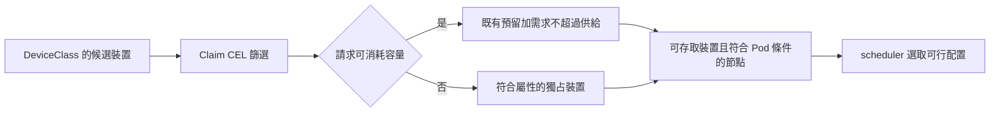
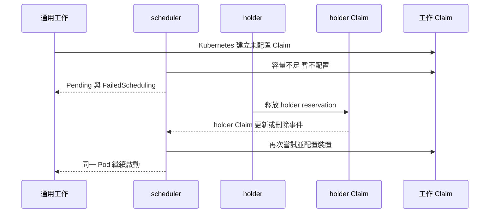

# 6.1 DRA 的選卡機制

## 本頁要回答的問題

同樣是一個 GPU 請求，型號、總記憶體、CUDA 運算能力、任何 GPU 與可消耗容量，各自限制了什麼？當多張卡符合、完全沒有卡符合，或原本不足的容量被釋放時，scheduler 又會如何處理？

## 背景原理

[第 1 章](../01-why-dra/dra-model.md)已介紹 DeviceClass、ResourceSlice 與 ResourceClaim，[第 4 章](../04-isolation/consumable-shares.md)已區分容量記帳與 runtime 隔離。本頁只把「需求如何變成候選集合」接到這些物件：CEL 是布林條件；`capacity.requests` 是可消耗額度；兩者不能互換。



例如「總 memory 至少 30Gi」只判斷裝置公布的容量；即使工作僅使用少量 tensor，它仍可能獨占整張卡。HAMi 的「請求 memory 30Gi」則把 30Gi 算進該裝置的 reservation，其他獨立 Claim 必須共用剩餘帳本。[DRA 容量與選擇器](https://kubernetes.io/docs/concepts/resource-management/dynamic-resource-allocation/dra-features/#consumable-capacity)

## 部署與設定

以下命令從完整 clone 的 `labs/06-heterogeneous/` 執行。靜態檔案的 `kubectl apply --dry-run=client` 用來預覽物件；實際重現則由 `run.sh` 加上本次的歸屬 label 後提交完整 manifests，並保存到 `out/<run-id>/`。原生案例沿用[第 2 章的 NVIDIA provider](../02-deploy/dra-driver.md)，容量案例則先完成[兩節點 HAMi 切換](../../labs/06-heterogeneous/README.md#切換兩個-gpu-的-provider)；兩種 provider 不應在同一節點同時提供本章要測的 GPU。

### 共用 Namespace 與 workload

共用入口只有一個 Namespace、workload ConfigMap 與控制 ConfigMap。ConfigMap 由原始碼產生，不把 Python 展開成大量 YAML；完整程式在 [gpu_primitives.py](../../labs/06-heterogeneous/workload/gpu_primitives.py)、[native_workload.py](../../labs/06-heterogeneous/workload/native_workload.py)及 [gpu_workload.py](../../labs/06-heterogeneous/workload/gpu_workload.py)。

```console
$ vi selection/common/namespace.yaml
```

<!-- lab-file: labs/06-heterogeneous/selection/common/namespace.yaml -->
```yaml
apiVersion: v1
kind: Namespace
metadata:
  name: gpu-heterogeneous-lab
  labels:
    app.kubernetes.io/part-of: dra-book
    app.kubernetes.io/component: heterogeneous-lab
```


| 參數 | 意義 | 為什麼這樣設 |
|---|---|---|
| `gpu-heterogeneous-lab` | 選卡套件的 Namespace | 和 KFP 執行視窗分開 |
| `part-of`、`component` | 所有物件的歸屬與角色 | 清理時檢查 label |

```console
$ vi selection/common/kustomization.yaml
```

<!-- lab-file: labs/06-heterogeneous/selection/common/kustomization.yaml -->
```yaml
apiVersion: kustomize.config.k8s.io/v1beta1
kind: Kustomization
namespace: gpu-heterogeneous-lab
resources:
- namespace.yaml
configMapGenerator:
- name: selection-workload
  files:
  - gpu_primitives.py=../../workload/gpu_primitives.py
  - gpu_workload.py=../../workload/gpu_workload.py
  - native_workload.py=../../workload/native_workload.py
  options:
    labels:
      app.kubernetes.io/part-of: dra-book
      app.kubernetes.io/component: selection-workload
- name: selection-control
  files:
  - control.json
  options:
    labels:
      app.kubernetes.io/part-of: dra-book
      app.kubernetes.io/component: selection-control
generatorOptions:
  disableNameSuffixHash: true
```


| 參數 | 意義 | 為什麼這樣設 |
|---|---|---|
| `configMapGenerator.files` | 將 workload 與控制檔案掛進 container | 保留可直接讀取的 Python 原始碼 |
| `disableNameSuffixHash` | 使用固定 ConfigMap 名稱 | Job 與控制流程引用相同名稱 |
| `control.json` | 依 run ID 與 Task ID 發出 release | 完成 CUDA 後先停在可觀測的 HOLD 狀態 |

```console
$ kubectl apply --dry-run=client -k selection/common
```

以下為 client 預覽的（預期輸出）；實際部署輸出由 `run.sh` 保存在 `out/<run-id>/`。

```text
namespace/gpu-heterogeneous-lab created (dry run)
configmap/selection-control created (dry run)
configmap/selection-workload created (dry run)
```

`native_workload.py` 先做 CUDA 與正確性檢查，再等待控制檔中的 release。容量版沿用 E4B 的 workload，成功後也停在 HOLD；這讓兩卡並行、Pending 與釋放前後的 Claim 都有時間留下證據。

### 屬性條件與任何 GPU

以下 YAML 含多個物件，一次列出六種原生需求。`a40`、`rtx4090` 用 `productName`；`attribute` 保留 E4 的 `architecture == "Ampere"`；`any-gpu` 與 `any-gpu-pair` 沒有 Claim selector，候選仍受 DeviceClass 約束。

```console
$ vi selection/native/claims.yaml
```

<!-- lab-file: labs/06-heterogeneous/selection/native/claims.yaml -->
```yaml
apiVersion: resource.k8s.io/v1
kind: ResourceClaimTemplate
metadata:
  name: native-a40-gpu
  namespace: gpu-heterogeneous-lab
  labels:
    app.kubernetes.io/part-of: dra-book
    app.kubernetes.io/component: a40-gpu
spec:
  metadata:
    labels:
      app.kubernetes.io/part-of: dra-book
      app.kubernetes.io/component: a40-gpu
  spec:
    devices:
      requests:
      - name: gpu
        exactly:
          deviceClassName: gpu.nvidia.com
          allocationMode: ExactCount
          count: 1
          selectors:
          - cel:
              expression: 'device.attributes["gpu.nvidia.com"].productName == "NVIDIA A40"'
---
apiVersion: resource.k8s.io/v1
kind: ResourceClaimTemplate
metadata:
  name: native-rtx4090-gpu
  namespace: gpu-heterogeneous-lab
  labels:
    app.kubernetes.io/part-of: dra-book
    app.kubernetes.io/component: rtx4090-gpu
spec:
  metadata:
    labels:
      app.kubernetes.io/part-of: dra-book
      app.kubernetes.io/component: rtx4090-gpu
  spec:
    devices:
      requests:
      - name: gpu
        exactly:
          deviceClassName: gpu.nvidia.com
          allocationMode: ExactCount
          count: 1
          selectors:
          - cel:
              expression: 'device.attributes["gpu.nvidia.com"].productName == "NVIDIA GeForce RTX 4090"'
---
apiVersion: resource.k8s.io/v1
kind: ResourceClaimTemplate
metadata:
  name: native-any-gpu-gpu
  namespace: gpu-heterogeneous-lab
  labels:
    app.kubernetes.io/part-of: dra-book
    app.kubernetes.io/component: any-gpu-gpu
spec:
  metadata:
    labels:
      app.kubernetes.io/part-of: dra-book
      app.kubernetes.io/component: any-gpu-gpu
  spec:
    devices:
      requests:
      - name: gpu
        exactly:
          deviceClassName: gpu.nvidia.com
          allocationMode: ExactCount
          count: 1
---
apiVersion: resource.k8s.io/v1
kind: ResourceClaimTemplate
metadata:
  name: native-any-gpu-pair-gpu
  namespace: gpu-heterogeneous-lab
  labels:
    app.kubernetes.io/part-of: dra-book
    app.kubernetes.io/component: any-gpu-pair-gpu
spec:
  metadata:
    labels:
      app.kubernetes.io/part-of: dra-book
      app.kubernetes.io/component: any-gpu-pair-gpu
  spec:
    devices:
      requests:
      - name: gpu
        exactly:
          deviceClassName: gpu.nvidia.com
          allocationMode: ExactCount
          count: 1
---
apiVersion: resource.k8s.io/v1
kind: ResourceClaimTemplate
metadata:
  name: native-attribute-gpu
  namespace: gpu-heterogeneous-lab
  labels:
    app.kubernetes.io/part-of: dra-book
    app.kubernetes.io/component: attribute-gpu
spec:
  metadata:
    labels:
      app.kubernetes.io/part-of: dra-book
      app.kubernetes.io/component: attribute-gpu
  spec:
    devices:
      requests:
      - name: gpu
        exactly:
          deviceClassName: gpu.nvidia.com
          allocationMode: ExactCount
          count: 1
          selectors:
          - cel:
              expression: 'device.attributes["gpu.nvidia.com"].architecture == "Ampere"'
---
apiVersion: resource.k8s.io/v1
kind: ResourceClaimTemplate
metadata:
  name: native-nonexistent-gpu
  namespace: gpu-heterogeneous-lab
  labels:
    app.kubernetes.io/part-of: dra-book
    app.kubernetes.io/component: nonexistent-gpu
spec:
  metadata:
    labels:
      app.kubernetes.io/part-of: dra-book
      app.kubernetes.io/component: nonexistent-gpu
  spec:
    devices:
      requests:
      - name: gpu
        exactly:
          deviceClassName: gpu.nvidia.com
          allocationMode: ExactCount
          count: 1
          selectors:
          - cel:
              expression: 'device.attributes["gpu.nvidia.com"].uuid == "GPU-00000000-0000-0000-0000-000000000000"'
```


| 參數 | 意義 | 為什麼這樣設 |
|---|---|---|
| `deviceClassName: gpu.nvidia.com` | 第 2 章已建立的原生 GPU 類別 | 使用 stock NVIDIA provider |
| `ExactCount`、`count: 1` | 每個 Pod 需要一個裝置 | 原生案例測獨占配置 |
| `productName` | GPU 型號條件 | 不固定 Pod 節點或 GPU UUID |
| `architecture == "Ampere"` | E4 的屬性案例 | 驗證屬性選卡，並非效能偏好 |
| 無 `selectors` | 接受 DeviceClass 中任何合適裝置 | `any-gpu-pair` 的兩個 Pod 各自產生 Claim |
| 全零 UUID | 不存在的裝置條件 | 驗證持續 Pending 與 FailedScheduling 事件 |

```console
$ kubectl apply --dry-run=client -f selection/native/claims.yaml
```

（預期輸出）

```text
resourceclaimtemplate.resource.k8s.io/native-a40-gpu created (dry run)
resourceclaimtemplate.resource.k8s.io/native-rtx4090-gpu created (dry run)
resourceclaimtemplate.resource.k8s.io/native-any-gpu-gpu created (dry run)
resourceclaimtemplate.resource.k8s.io/native-any-gpu-pair-gpu created (dry run)
resourceclaimtemplate.resource.k8s.io/native-attribute-gpu created (dry run)
resourceclaimtemplate.resource.k8s.io/native-nonexistent-gpu created (dry run)
```

若需求同時包含型號、總記憶體與 CUDA 運算能力，可以把條件寫成一個 CEL 表達式。下面是套件附帶的範例，**尚未在 E4／E4B 實測**；`quantity` 與 `semver` 分別比較容量與版本型別，欄位必須先在 live ResourceSlice 中確認。[CEL 與裝置屬性](https://kubernetes.io/docs/concepts/resource-management/dynamic-resource-allocation/dra-api/)

```console
$ vi selection/examples/attribute-requirements.yaml
```

<!-- lab-file: labs/06-heterogeneous/selection/examples/attribute-requirements.yaml -->
```yaml
apiVersion: resource.k8s.io/v1
kind: ResourceClaimTemplate
metadata:
  name: attribute-requirements-gpu
  namespace: gpu-heterogeneous-lab
  labels:
    app.kubernetes.io/part-of: dra-book
    app.kubernetes.io/component: attribute-requirements-gpu
spec:
  metadata:
    labels:
      app.kubernetes.io/part-of: dra-book
      app.kubernetes.io/component: attribute-requirements-gpu
  spec:
    devices:
      requests:
      - name: gpu
        exactly:
          deviceClassName: gpu.nvidia.com
          allocationMode: ExactCount
          count: 1
          selectors:
          - cel:
              expression: 'device.attributes["gpu.nvidia.com"].productName == "NVIDIA A40" && device.capacity["gpu.nvidia.com"].memory >= quantity("30Gi") && device.attributes["gpu.nvidia.com"].cudaComputeCapability >= semver("8.6.0")'
```


| 參數 | 意義 | 為什麼這樣設 |
|---|---|---|
| `memory >= quantity("30Gi")` | 公布總容量的下限 | 示範 CEL 容量篩選，沒有預留共用額度 |
| `cudaComputeCapability >= semver("8.6.0")` | CUDA 運算能力版本下限 | 依原環境公布的版本型別比較 |
| 三個條件以 `&&` 組合 | 同時符合才接受 | 此範例未列入實測驗收 |

需要預覽這份範例時，執行 `$ kubectl apply --dry-run=client -f selection/examples/attribute-requirements.yaml`；實際建立 Template 時，它本身不會執行 GPU 工作。不要把這份範例當成 E4 的 `attribute` 案例。

### 讓每個 Job 取得自己的 Claim

Job 的 Pod 指向 ResourceClaimTemplate，container 再引用 Pod 內的 `gpu` 名稱。套件只保存一份工作 Job，執行腳本依案例替換角色名稱、Template 與 Task ID，並將完整實際提交物件存到 `out/<run-id>/`；兩個並行工作各有自己的 Claim。

```console
$ vi selection/native/jobs.yaml
```

<!-- lab-file: labs/06-heterogeneous/selection/native/jobs.yaml -->
```yaml
apiVersion: batch/v1
kind: Job
metadata:
  name: native-worker
  namespace: gpu-heterogeneous-lab
  labels:
    app.kubernetes.io/part-of: dra-book
    app.kubernetes.io/component: native-worker
spec:
  backoffLimit: 0
  template:
    metadata:
      labels:
        app.kubernetes.io/part-of: dra-book
        app.kubernetes.io/component: native-worker
    spec:
      restartPolicy: Never
      tolerations:
      - key: nvidia.com/gpu
        operator: Exists
        effect: NoSchedule
      securityContext:
        runAsUser: 0
        runAsGroup: 0
        runAsNonRoot: false
      resourceClaims:
      - name: gpu
        resourceClaimTemplateName: native-any-gpu-gpu
      containers:
      - name: workload
        image: docker.io/pytorch/pytorch:2.5.1-cuda12.4-cudnn9-runtime@sha256:c8268a92a69bd500f8be0e665b2630ee006dadaf7bfbc24249141b15ff622755
        imagePullPolicy: IfNotPresent
        command:
        - python
        - -u
        - /opt/lab/native_workload.py
        args:
        - --task-id
        - native-worker
        - --run-id
        - selection
        - --control
        - /opt/control/control.json
        - --hold-timeout
        - '900'
        env:
        - name: E4_POD_UID
          valueFrom:
            fieldRef:
              fieldPath: metadata.uid
        - name: E4_POD_NAME
          valueFrom:
            fieldRef:
              fieldPath: metadata.name
        - name: E4_NAMESPACE
          valueFrom:
            fieldRef:
              fieldPath: metadata.namespace
        - name: E4_NODE_NAME
          valueFrom:
            fieldRef:
              fieldPath: spec.nodeName
        resources:
          requests:
            cpu: '1'
            memory: 2Gi
          limits:
            cpu: '1'
            memory: 2Gi
          claims:
          - name: gpu
        volumeMounts:
        - name: source
          mountPath: /opt/lab
          readOnly: true
        - name: control
          mountPath: /opt/control
          readOnly: true
      volumes:
      - name: source
        configMap:
          name: selection-workload
      - name: control
        configMap:
          name: selection-control
```


| 參數 | 意義 | 為什麼這樣設 |
|---|---|---|
| `resourceClaimTemplateName` | 由 Kubernetes 為這個 Pod 建立 Claim | 不共用前一個 Task 的配置 |
| container `resources.claims[].name` | 引用 Pod 內的 `gpu` | 把已配置裝置準備給工作 container |
| `restartPolicy: Never`、`backoffLimit: 0` | Job 失敗不另建 attempt | 選卡驗證不混入自動重試 |
| PyTorch tag 與 digest | 原始 CUDA 工作 image | 固定執行環境 |
| `--hold-timeout 900` | HOLD 的上限秒數 | 留下配置觀測窗並避免無限等待 |
| CPU `1`、記憶體 `2Gi` | 工作 container 的主機資源 | 沿用原工作設定，與 GPU 額度不同 |

```console
$ vi selection/native/kustomization.yaml
```

<!-- lab-file: labs/06-heterogeneous/selection/native/kustomization.yaml -->
```yaml
apiVersion: kustomize.config.k8s.io/v1beta1
kind: Kustomization
namespace: gpu-heterogeneous-lab
resources:
- ../common
- claims.yaml
- jobs.yaml
- ../examples/prefer-4090.yaml
```


| 參數 | 意義 | 為什麼這樣設 |
|---|---|---|
| `../common`、`claims.yaml`、`jobs.yaml` | 完整可渲染的原生資源入口 | 執行腳本以此組裝每一個案例 |
| `../examples/prefer-4090.yaml` | 優先替代清單的 Template | 供新增的 `prefer-4090` 兩步驗收引用 |

本章用控制腳本提交工作，讓取樣、release 與清理保持同一個 run ID。完整模式每案三輪；`SMOKE=1` 每案一次，仍包含不存在裝置的 Pending 驗證。

```console
$ PART=native SMOKE=1 scripts/run.sh native-smoke
$ scripts/collect.sh native-smoke
$ python3 analysis/analyze.py --out out/native-smoke
$ scripts/cleanup.sh native-smoke
```

### 可消耗 memory 與 cores

HAMi 版不寫型號、節點或 UUID，只請求同一 DeviceClass 的 memory 與 cores。Kubernetes v1.37 的 `DRAConsumableCapacity` 為 beta，預設啟用；provider 必須在 ResourceSlice 允許多次配置並公布相應容量，scheduler 才能把獨立 Claim 的配置加總，避免超過可用供給。[v1.37 feature gates](https://kubernetes.io/docs/reference/command-line-tools-reference/feature-gates/)、[KEP 5075](https://github.com/kubernetes/enhancements/blob/master/keps/sig-scheduling/5075-dra-consumable-capacity/README.md)

```console
$ vi selection/capacity/claims.yaml
```

<!-- lab-file: labs/06-heterogeneous/selection/capacity/claims.yaml -->
```yaml
apiVersion: resource.k8s.io/v1
kind: ResourceClaimTemplate
metadata:
  name: capacity-8gi-gpu
  namespace: gpu-heterogeneous-lab
  labels:
    app.kubernetes.io/part-of: dra-book
    app.kubernetes.io/component: capacity-8gi-gpu
spec:
  metadata:
    labels:
      app.kubernetes.io/part-of: dra-book
      app.kubernetes.io/component: capacity-8gi-gpu
  spec:
    devices:
      requests:
      - name: gpu
        exactly:
          deviceClassName: hami-core-gpu.project-hami.io
          allocationMode: ExactCount
          count: 1
          capacity:
            requests:
              memory: 8Gi
              cores: '25'
---
apiVersion: resource.k8s.io/v1
kind: ResourceClaimTemplate
metadata:
  name: capacity-30gi-gpu
  namespace: gpu-heterogeneous-lab
  labels:
    app.kubernetes.io/part-of: dra-book
    app.kubernetes.io/component: capacity-30gi-gpu
spec:
  metadata:
    labels:
      app.kubernetes.io/part-of: dra-book
      app.kubernetes.io/component: capacity-30gi-gpu
  spec:
    devices:
      requests:
      - name: gpu
        exactly:
          deviceClassName: hami-core-gpu.project-hami.io
          allocationMode: ExactCount
          count: 1
          capacity:
            requests:
              memory: 30Gi
              cores: '25'
```


| 參數 | 意義 | 為什麼這樣設 |
|---|---|---|
| `hami-core-gpu.project-hami.io` | 第 4 章的 HAMi DeviceClass | 兩張卡使用相同容量模型 |
| `memory: 8Gi` 或 `30Gi` | 每次配置的記憶體 reservation | H1 接受兩卡；H2 超過 4090 公布容量 |
| `cores: '25'` | HAMi 的運算額度 | 沿用 E4B 的請求，不是 CPU 核心數 |
| 無 selector | 不預先挑型號或節點 | 由供給與既有 reservation 決定可行性 |

```console
$ kubectl apply --dry-run=client -f selection/capacity/claims.yaml
```

（預期輸出）

```text
resourceclaimtemplate.resource.k8s.io/capacity-8gi-gpu created (dry run)
resourceclaimtemplate.resource.k8s.io/capacity-30gi-gpu created (dry run)
```

下面的 Job 使用相同 Pod／Claim 結構，改執行 E4B 容量 workload；它保留 CUDA 記憶體 cache 設定與成功／受控失敗的工作路徑。實際容量控制仍由 provider 與 HAMi 執行，第 4 章的共享 cache、CUDA process 與 NVML 限制仍適用。

```console
$ vi selection/capacity/jobs.yaml
```

<!-- lab-file: labs/06-heterogeneous/selection/capacity/jobs.yaml -->
```yaml
apiVersion: batch/v1
kind: Job
metadata:
  name: capacity-worker
  namespace: gpu-heterogeneous-lab
  labels:
    app.kubernetes.io/part-of: dra-book
    app.kubernetes.io/component: capacity-worker
spec:
  backoffLimit: 0
  template:
    metadata:
      labels:
        app.kubernetes.io/part-of: dra-book
        app.kubernetes.io/component: capacity-worker
    spec:
      restartPolicy: Never
      tolerations:
      - key: nvidia.com/gpu
        operator: Exists
        effect: NoSchedule
      securityContext:
        runAsUser: 0
        runAsGroup: 0
        runAsNonRoot: false
      resourceClaims:
      - name: gpu
        resourceClaimTemplateName: capacity-8gi-gpu
      containers:
      - name: workload
        image: docker.io/pytorch/pytorch:2.5.1-cuda12.4-cudnn9-runtime@sha256:c8268a92a69bd500f8be0e665b2630ee006dadaf7bfbc24249141b15ff622755
        imagePullPolicy: IfNotPresent
        command:
        - python
        - -u
        - /opt/lab/gpu_workload.py
        args:
        - --task-id
        - capacity-worker
        - --run-id
        - selection
        - --control
        - /opt/control/control.json
        - --hold-timeout
        - '900'
        - --scenario
        - success
        env:
        - name: E4_POD_UID
          valueFrom:
            fieldRef:
              fieldPath: metadata.uid
        - name: E4_POD_NAME
          valueFrom:
            fieldRef:
              fieldPath: metadata.name
        - name: E4_NAMESPACE
          valueFrom:
            fieldRef:
              fieldPath: metadata.namespace
        - name: E4_NODE_NAME
          valueFrom:
            fieldRef:
              fieldPath: spec.nodeName
        - name: PYTORCH_NO_CUDA_MEMORY_CACHING
          value: '1'
        - name: KFP_RETRY_INDEX
          value: '0'
        resources:
          requests:
            cpu: '1'
            memory: 2Gi
          limits:
            cpu: '1'
            memory: 2Gi
          claims:
          - name: gpu
        volumeMounts:
        - name: source
          mountPath: /opt/lab
          readOnly: true
        - name: control
          mountPath: /opt/control
          readOnly: true
      volumes:
      - name: source
        configMap:
          name: selection-workload
      - name: control
        configMap:
          name: selection-control
```


| 參數 | 意義 | 為什麼這樣設 |
|---|---|---|
| `capacity-8gi-gpu` | 基本通用容量 Template | 腳本在 H2、H3–H4 改引用 30Gi |
| `gpu_workload.py --scenario success` | E4B 的正向工作路徑 | 保存 CUDA、CORRECT 與 HOLD 事件 |
| `PYTORCH_NO_CUDA_MEMORY_CACHING` | 關閉 PyTorch CUDA 記憶體 cache | 沿用 E4B 的環境設定 |

### 用 holder 製造容量不足與兩個空位

Holder 是測試前置條件，通用工作不會繼承它的型號條件。H3–H4 在 A40 留下低於 `30Gi` 的容量；H5 在每張卡各留一個 `8Gi` 空位，兩個通用工作才會因容量限制而落在不同 GPU 上。

```console
$ vi selection/capacity/holders.yaml
```

<!-- lab-file: labs/06-heterogeneous/selection/capacity/holders.yaml -->
```yaml
apiVersion: resource.k8s.io/v1
kind: ResourceClaimTemplate
metadata:
  name: capacity-holder-pending-gpu
  namespace: gpu-heterogeneous-lab
  labels:
    app.kubernetes.io/part-of: dra-book
    app.kubernetes.io/component: capacity-holder-pending-gpu
spec:
  metadata:
    labels:
      app.kubernetes.io/part-of: dra-book
      app.kubernetes.io/component: capacity-holder-pending-gpu
  spec:
    devices:
      requests:
      - name: gpu
        exactly:
          deviceClassName: hami-core-gpu.project-hami.io
          allocationMode: ExactCount
          count: 1
          selectors:
          - cel:
              expression: 'device.attributes["hami-core-gpu.project-hami.io"].productName == "NVIDIA A40"'
          capacity:
            requests:
              memory: 15349Mi
              cores: '25'
---
apiVersion: resource.k8s.io/v1
kind: ResourceClaimTemplate
metadata:
  name: capacity-holder-a40-gpu
  namespace: gpu-heterogeneous-lab
  labels:
    app.kubernetes.io/part-of: dra-book
    app.kubernetes.io/component: capacity-holder-a40-gpu
spec:
  metadata:
    labels:
      app.kubernetes.io/part-of: dra-book
      app.kubernetes.io/component: capacity-holder-a40-gpu
  spec:
    devices:
      requests:
      - name: gpu
        exactly:
          deviceClassName: hami-core-gpu.project-hami.io
          allocationMode: ExactCount
          count: 1
          selectors:
          - cel:
              expression: 'device.attributes["hami-core-gpu.project-hami.io"].productName == "NVIDIA A40"'
          capacity:
            requests:
              memory: 37876Mi
              cores: '25'
---
apiVersion: resource.k8s.io/v1
kind: ResourceClaimTemplate
metadata:
  name: capacity-holder-rtx4090-gpu
  namespace: gpu-heterogeneous-lab
  labels:
    app.kubernetes.io/part-of: dra-book
    app.kubernetes.io/component: capacity-holder-rtx4090-gpu
spec:
  metadata:
    labels:
      app.kubernetes.io/part-of: dra-book
      app.kubernetes.io/component: capacity-holder-rtx4090-gpu
  spec:
    devices:
      requests:
      - name: gpu
        exactly:
          deviceClassName: hami-core-gpu.project-hami.io
          allocationMode: ExactCount
          count: 1
          selectors:
          - cel:
              expression: 'device.attributes["hami-core-gpu.project-hami.io"].productName == "NVIDIA GeForce RTX 4090"'
          capacity:
            requests:
              memory: 16372Mi
              cores: '25'
```


| 參數 | 意義 | 為什麼這樣設 |
|---|---|---|
| `15349Mi` | 原 A40 的 Pending holder 額度 | 剩餘容量比 30Gi 少 1 Mi |
| `37876Mi`、`16372Mi` | 原兩卡的 H5 holder 額度 | 各留下 8Gi |
| ResourceClaimTemplate | 每個 holder Pod 的受控配置 | 保留原始每個 Pod 各自一個 Claim 的語意並核對 UID |
| 以 live Slice 計算額度 | 適應實際公布容量與 requestPolicy | 原環境得到上列數值，不把別的叢集總量寫死 |

這組檔案列出不同案例的 fixture，腳本只提交該案所需的 holder，並記錄重新計算後的完整 YAML／JSON，不會整組同時套用。H3–H4 只有 Pending holder，H5 才同時有 A40 與 RTX 4090 holder。

```console
$ vi selection/capacity/kustomization.yaml
```

<!-- lab-file: labs/06-heterogeneous/selection/capacity/kustomization.yaml -->
```yaml
apiVersion: kustomize.config.k8s.io/v1beta1
kind: Kustomization
namespace: gpu-heterogeneous-lab
resources:
- ../common
- claims.yaml
- holders.yaml
- jobs.yaml
```


| 參數 | 意義 | 為什麼這樣設 |
|---|---|---|
| `holders.yaml` | 可渲染的 holder 定義 | 執行腳本依案例選取而非一次啟動全部 |
| `jobs.yaml` | 單一工作 Job 定義 | 依角色複製出 holder 與通用工作 |

容量完整模式包含 H1、H2、H3–H4 與 H5；縮短版只跑 H1、H2 各一次。需要等待與兩卡同時執行證據時，另選完整案例；provider 安裝、備份與還原都是獨立操作，詳見[套件 README](../../labs/06-heterogeneous/README.md)。

```console
$ PART=capacity SMOKE=1 scripts/run.sh capacity-smoke
$ PART=capacity CASES=h3h4-pending-release,h5-two-slots scripts/run.sh capacity-lifecycle
$ scripts/collect.sh capacity-lifecycle
$ python3 analysis/analyze.py --out out/capacity-lifecycle
$ scripts/cleanup.sh capacity-lifecycle
```

### 優先替代清單

`firstAvailable` 把同一個 request 寫成有順序的替代方案。Kubernetes v1.37 的 `DRAPrioritizedList` 已是 GA，自 v1.36 起穩定並預設啟用；下面的「優先 4090，否則 A40」是完整 Template，**沒有在 E4／E4B 執行**。[feature gates](https://kubernetes.io/docs/reference/command-line-tools-reference/feature-gates/)、[KEP 4816](https://github.com/kubernetes/enhancements/blob/master/keps/sig-scheduling/4816-dra-prioritized-list/README.md)

```console
$ vi selection/examples/prefer-4090.yaml
```

<!-- lab-file: labs/06-heterogeneous/selection/examples/prefer-4090.yaml -->
```yaml
apiVersion: resource.k8s.io/v1
kind: ResourceClaimTemplate
metadata:
  name: prefer-4090-gpu
  namespace: gpu-heterogeneous-lab
  labels:
    app.kubernetes.io/part-of: dra-book
    app.kubernetes.io/component: prefer-4090-gpu
spec:
  metadata:
    labels:
      app.kubernetes.io/part-of: dra-book
      app.kubernetes.io/component: prefer-4090-gpu
  spec:
    devices:
      requests:
      - name: gpu
        firstAvailable:
        - name: rtx4090
          deviceClassName: gpu.nvidia.com
          allocationMode: ExactCount
          count: 1
          selectors:
          - cel:
              expression: 'device.attributes["gpu.nvidia.com"].productName == "NVIDIA GeForce RTX 4090"'
        - name: a40
          deviceClassName: gpu.nvidia.com
          allocationMode: ExactCount
          count: 1
          selectors:
          - cel:
              expression: 'device.attributes["gpu.nvidia.com"].productName == "NVIDIA A40"'
```


| 參數 | 意義 | 為什麼這樣設 |
|---|---|---|
| `firstAvailable` | 依序嘗試子請求 | 它與同一 request 的 `exactly` 擇一 |
| `rtx4090`、`a40` | 子請求名稱與順序 | 明確表達使用者偏好 |
| `count: 1` | 接受其中一個替代方案的一張卡 | 不同於同時請求兩張卡 |

需要預覽時執行 `$ kubectl apply --dry-run=client -f selection/examples/prefer-4090.yaml`；實際使用時，Pod 引用這個 Template 名稱。各候選節點先找可行替代方案；DRA Score 依配置所用的清單位置評分，再與其他 scheduler plugin 的節點評分合併。因此偏好是排程輸入，並不保證永遠選到第一種型號。[DRA API 的優先清單語意](https://kubernetes.io/docs/concepts/resource-management/dynamic-resource-allocation/dra-api/)

本章重現套件的 native `prefer-4090` 案例會執行這份 Template，`SMOKE=1` 也包含它。先在兩張 GPU 空閒時提交 Job，再讓使用普通獨占 Claim 的 holder 占用 RTX 4090，於 holder 持有配置時以相同 Template 提交 Job，第二步完成後才釋放 holder。這是新增的驗收設計；2026-10-12 的實測中，兩張卡空閒時落在 RTX 4090（子請求 `gpu/rtx4090`），RTX 4090 被 holder 占用時改落 A40（`gpu/a40`），完整紀錄見[實機驗證紀錄](../../labs/06-heterogeneous/VERIFIED.md#原生選卡不切換-provider)。

```bash
$ PART=native CASES=prefer-4090 SMOKE=1 scripts/run.sh native-preference
$ scripts/collect.sh native-preference
$ python3 analysis/analyze.py --out out/native-preference --output out/native-preference/summary.json
$ scripts/cleanup.sh native-preference
```

| 參數或欄位 | 意義 | 為什麼這樣設 |
|---|---|---|
| `CASES=prefer-4090` | 只執行優先清單的兩步驗收 | 不重跑其他原生案例 |
| `SMOKE=1` | 空閒與 holder 占用各跑一次 | 同時驗證偏好與退回替代方案 |
| `status.allocation.devices.results[].request` | 配置使用的 request 或子請求 | 分別驗收 `gpu/rtx4090`、`gpu/a40`，不能只看最後落點 |

Claim 的配置結果用 `gpu/<子請求名稱>` 辨識 `firstAvailable` 選到的替代方案；分析輸出保留這個 `request`，並與該步的 Pod／Claim UID、落點共同核對。[v1.37.0 配置結果 API](https://raw.githubusercontent.com/kubernetes/kubernetes/v1.37.0/staging/src/k8s.io/api/resource/v1/types.go)

## 驗證

### 多張卡符合時究竟選誰

v1.37 不是完全沒有 DRA 評分：`DynamicResources.Score` 明確處理優先清單。但其 `computeScore` 對沒有 `firstAvailable` 的 request 直接略過，沒有依 VRAM 餘量、GPU 型號速度或工作耗時排序的通用裝置分數；其他 scheduler plugin 仍可影響落點。[v1.37.0 Score 與 computeScore](https://raw.githubusercontent.com/kubernetes/kubernetes/v1.37.0/pkg/scheduler/framework/plugins/dynamicresources/dynamicresources.go)

同一節點內的配置器按候選 pool／ResourceSlice 的既定遍歷順序找可行配置，這也不是工作效能排名。[DRA API 配置說明](https://kubernetes.io/docs/concepts/resource-management/dynamic-resource-allocation/dra-api/) H1 的三輪落點只能證明兩張卡都可滿足 `8Gi` 請求，不能推出隨機、平均分散或最快 GPU 策略。

### Pending 後為何同一工作能繼續

沒有任何裝置滿足需求時，Pod 會留下 FailedScheduling 事件，Claim 仍未配置。Scheduler 會監看 Claim、ResourceSlice、DeviceClass 等物件的變動；已配置的 Claim 釋放後，受容量限制而等待的工作會再次進入排程，不需要應用程式刪掉原 Pod 重建。[v1.37.0 EventsToRegister 與 Claim 事件處理](https://raw.githubusercontent.com/kubernetes/kubernetes/v1.37.0/pkg/scheduler/framework/plugins/dynamicresources/dynamicresources.go)



H3–H4 在釋放前後核對 Pod UID、Claim UID 與 allocation，原始觀測窗每輪取一位小數後都是 34.0 秒；這是案例的等待窗，並非 scheduler 保證的逾時或配置延遲。[實測時間與身分](../../data/e4b/trials.json) 縮短版不包含此案例，完整模式會保留這段生命週期證據。

## 重點整理

CEL 描述「哪種裝置符合」，無 selector 表示接受 DeviceClass 的候選，可消耗容量則描述「本次要保留多少」。只要 provider 與 scheduler 使用同一容量模型，工作就能依需求等待與再配置，無須自己挑節點或卡。

`firstAvailable` 能加入替代順序，但不會自動建立 GPU 效能模型。讀取多卡落點時，先核對需求、供給、既有 reservation 與 Pod 條件，再回到[實驗結果](experiments.md)看證據範圍。

<!-- nav:start -->
[← 上一頁：第 6 章　只描述需求，讓 scheduler 挑 GPU](README.md) ｜ [目錄](../README.md) ｜ [下一頁：6.2 與 Kubeflow Pipelines 整合 →](kubeflow.md)
<!-- nav:end -->
