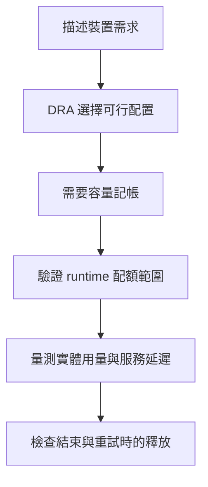

# 第 7 章　結論與實務建議

## 本頁要回答的問題

面對不同的 GPU 需求，應選哪一種管理與共用方式？本頁把各章證據整理成決策指南，明列方案的保證邊界，並把尚待驗證的問題整理成後續研究方向。

## 背景原理

GPU 共用的決策順序應從需求開始。先決定工作如何取得裝置，再決定是否需要容量記帳與 runtime 配額，最後用實際工作量驗證吞吐量、延遲和生命週期；不能由一個層次的成功推論另一個層次也受到保護。[三層隔離模型](04-isolation/README.md#三層隔離模型)、[效能的排程層次](05-performance/README.md#排程發生在不同層次)

## 結果

### 依需求選擇方案

下表的「保證」限於各章已驗證的部署與 workload。對更嚴格的隔離需求，未測得或已被反例否定的性質，都應視為需要額外驗證的條件。

| 需求 | 方案 | 已驗證的能力或邊界 | 不保證的事 |
| --- | --- | --- | --- |
| 工作描述需求，每個 Task 取得自己的 GPU 配置 | DRA、DeviceClass 與 ResourceClaimTemplate | [屬性條件可選 A40 或 RTX 4090，Claim 跟隨工作生命週期](06-heterogeneous/experiments.md#e4-的階段驗收) | [不自動選最快的卡，也不直接提供記憶體配額](06-heterogeneous/README.md#限制) |
| 明確表達可接受 GPU 的優先順序 | DRA `firstAvailable` | [新增縮短版在空閒時選 RTX 4090，被 holder 占用時改選 A40](../labs/06-heterogeneous/VERIFIED.md#原生選卡不切換-provider) | [仍與其他排程條件共同作用；偏好順序不是效能排名](06-heterogeneous/selection.md#優先替代清單) |
| 在接受需求前檢查容量是否足夠 | ConsumableShares | [不足時 Pending，釋放後可再配置](04-isolation/consumable-shares.md#記帳判定與釋放) | [8 GiB Claim 仍能保留 8.25 GiB tensor；帳本不是 CUDA 限制](04-isolation/consumable-shares.md#8-gib-claim-仍可保留-825-gib-tensor) |
| 限制單一 CUDA process，讓有限壓力不耗盡整張卡 | MPS | [8 GiB 限制下 single-process 保留 7.5 GiB 後遇到配額 OOM，持續服務仍能配置與運算](04-isolation/mps.md#single-process-邊界與-dual-process-合計量) | [同一 Pod 內的 dual-process 合計達 10 GiB；不是 Pod 總額上限](04-isolation/mps.md#解讀) |
| 在本次 HAMi-core 攔截路徑中限制配置合計 | HAMi-DRA | [在同一 container 內的 dual-process 中，shared-cache 計量可拒絕超量 tensor 配置](04-isolation/hami-dra.md#single-process-與同一-container-內的-dual-process) | [8192 MiB Claim 下 NVML 曾達 8292 MiB，不能宣稱實體硬上限](04-isolation/hami-dra.md#single-process-與同一-container-內的-dual-process) |
| 多個 Pod 共用同一 Claim 並要求總額配額 | 先驗證配額身分與實際計量範圍 | [跨 Pod 共用 Claim 的案例合計達 9.75 GiB](04-isolation/hami-dra.md#跨-container-與跨-pod-的配額範圍) | [相同 cache 路徑不構成跨 Pod 合計上限的證明](04-isolation/hami-dra.md#解讀) |
| 持續運算，優先維持單個工作的延遲 | 先以獨占或逐個執行建立基準 | [持續工作共用時，增加並行工作主要增加競爭與延遲](05-performance/README.md#持續工作增加的是競爭) | [不能由 GPU 使用率較高推論每個 Task 更快](05-performance/README.md#用延遲預算選擇同時工作的數量) |
| 間歇工作有可填補的空檔，希望增加吞吐量 | 比較 TimeSlicing 與 MPS | [同步間歇工作 N=2 的 MPS speedup 為 1.979，TimeSlicing 為 1.361](05-performance/README.md#同步間歇工作) | [收益不能直接外推到模型服務，也不等於延遲沒有增加](05-performance/README.md#限制) |
| 用同一容量需求在異質 GPU 間找可行配置 | HAMi-DRA 與 DRA 可消耗容量請求 | [30 GiB 需求排除容量不足的 RTX 4090，配置到 A40](06-heterogeneous/experiments.md#e4b-的統一容量與選卡) | [容量符合不代表效能最佳；排程帳本不等於 NVML 空閒量](06-heterogeneous/experiments.md#e4b-的兩種剩餘量) |
| Pipeline 工作成功、失敗、取消或重試時都能追蹤資源 | KFP Task 接入 ResourceClaimTemplate，核對 Pod 與 Claim UID | [原始實驗保存了終態、保留關係與 Claim 回收證據](06-heterogeneous/kubeflow.md#成功失敗取消與重試後的釋放) | [Run 狀態不能代替 Pod 與 Claim 的實際占用狀態](06-heterogeneous/kubeflow.md#成功失敗取消與重試後的釋放) |

配額與實體用量的差異，可直接由第四章的圖比較；它們也提醒讀者，同一個「限制」名稱可能作用於不同身分與範圍。[完整隔離比較](04-isolation/results.md)

間歇工作的吞吐量收益則必須與相同工作量的逐個執行基準比較。第五章保留各工作形態的精確值與延遲，而非只提供一個最佳倍數。[效能結果](05-performance/README.md#結果)

## 解讀

本書驗證的第一個結論，是 DRA 能讓需求、配置與生命週期變得可觀察，也能透過容量記帳使不足的需求等待。第二個結論，是 runtime 配額必須說清楚「限制誰」與「計算什麼」：MPS 的 process 範圍、HAMi-DRA 的 shared-cache 計量與 NVML 實體用量不能混為一談。[DRA 模型](01-why-dra/dra-model.md)、[隔離比較](04-isolation/results.md#解讀)

第三個結論，是 GPU 共用的效能收益來自工作留下的空檔與 runtime 如何利用它們。維運決策應先定義工作量與延遲預算，再比較模式；異質 GPU 則先驗證可行性與釋放，不把本書的選卡結果解讀成效能排序。[效能解讀](05-performance/README.md#解讀)、[異質選卡解讀](06-heterogeneous/README.md#解讀)

## 限制

### 尚待回答的問題

以下方向合併各章與原始實驗的限制。同一項缺口只列一次，並把可以採取的下一步與證據入口放在一起。

| 主題 | 未解問題 | 下一步與來源 |
| --- | --- | --- |
| 硬體與 workload 外推 | RTX 4090 的 MPS 未量測；目前配額與效能結論主要來自 A40 和合成工作 | 在其他 GPU 重做身分、配額與效能驗證，再加入推論、訓練及混合工作；先維持相同計時邊界。[MPS 限制](04-isolation/mps.md#限制)、[效能限制](05-performance/README.md#限制) |
| 記憶體配置路徑 | 一般 PyTorch tensor 結果不涵蓋所有 CUDA API、allocator、library 與 context 額外用量 | 分別測試其他配置路徑與實際框架，記錄 tensor、計量器和 NVML 的差值；不要把本次差值當成固定安全餘額。[OOM 限制](03-oom/README.md#限制)、[HAMi-DRA 限制](04-isolation/hami-dra.md#限制) |
| HAMi-DRA 配額範圍 | 同一 Pod 內跨 container 的案例受限，但跨 Pod 共用同一 Claim 與 cache 路徑的合計限制有反例；實際 library 的精確原始碼身分尚未建立 | 檢查 process 槽位、PID 可見性、cache 身分與配置計量，對照固定二進位檔再測試跨 Pod 合計，而不先斷言根因。[範圍實驗](04-isolation/hami-dra.md#跨-container-與跨-pod-的配額範圍)、[library 身分](04-isolation/hami-dra.md#library-身分與原始碼的界線) |
| 故障與安全隔離 | 配額 OOM 不等於致命 GPU 故障；未做非法存取、故障注入，以及不受信任工作之間的隔離測試 | 分開設計配置失敗與致命故障案例，觀察同一 Claim、不同 Claim 和不同使用者的影響；不能把目前的成功服務觀察當作故障隔離承諾。[MPS 故障邊界](04-isolation/mps.md#配置失敗與致命-gpu-故障的差別)、[隔離限制](04-isolation/README.md#限制) |
| 效能觀測與決策 | GPU 使用率不能解釋 SM occupancy、kernel 重疊或 throttling 成本；真實服務的尾端延遲與重複性仍待驗證 | 補上 DCGM 與 CUDA trace 等觀測，加入更長工作、延遲分布和 throttling 設定比較，才能建立可供服務使用的選擇規則。[效能限制](05-performance/README.md#限制) |
| 異質 GPU 選擇 | 原 E4/E4B 未執行 `firstAvailable`；新增縮短版已驗證偏好順序與替代，但沒有依預測效能挑最快 GPU 的驗證 | 保留原始與新增測試的證據邊界，再加入工作效能模型；使用者的偏好不等於效能排名。[優先替代清單](06-heterogeneous/selection.md#優先替代清單)、[實機驗證紀錄](../labs/06-heterogeneous/VERIFIED.md#原生選卡不切換-provider)、[選卡限制](06-heterogeneous/README.md#限制) |
| 容量觀測與時間 | DRA 帳本與 NVML 樣本並非單一原子快照；事件收件時間也不等於 controller 內部發生時間 | 以一致的 UID、時間軸和更連續的取樣追蹤占用、解除準備與刪除，明確標示觀測上界。[容量比較限制](04-isolation/results.md#限制)、[異質實驗觀測](06-heterogeneous/experiments.md#e4b-的兩種剩餘量) |
| 整合與維運生命週期 | KFP 的 API 終態、executor 終態與 Claim 回收各有自己的流程；SDK 版本字串也不足以確認所需 API | 持續驗證取消、重試、重新安裝與升級後的釋放，固定 SDK 來源並保存後端物件身分；新 Python 環境可用不等於新叢集已驗證。[KFP 生命週期](06-heterogeneous/kubeflow.md#成功失敗取消與重試後的釋放)、[SDK 重建](06-heterogeneous/kubeflow.md#需要修改-pipeline-時重建-sdk) |

## 動手重現

先依 [labs 使用說明](../labs/README.md)檢查前置條件，再用[重現對照表](appendix/reproduction-map.md)選擇工作。原叢集縮短版的實機驗證紀錄是判讀套件可用範圍的入口：[部署](../labs/02-setup/VERIFIED.md)、[OOM](../labs/03-oom/VERIFIED.md)、[隔離](../labs/04-isolation/VERIFIED.md)、[效能](../labs/05-performance/VERIFIED.md)及[異質 GPU](../labs/06-heterogeneous/VERIFIED.md)。

## 重點整理

讓工作只描述需求，是 GPU 共用的一個起點；讓每種保證都能被量測與反證，才使共用成為可維運的選擇。希望讀者能用這些套件與觀測方法，把自己的需求轉成實驗，再依結果決定分配、配額與並行方式。

<!-- nav:start -->
[← 上一頁：6.3 異質 GPU 選卡實驗](06-heterogeneous/experiments.md) ｜ [目錄](README.md) ｜ [下一頁：附錄 A　名詞對照表 →](appendix/glossary.md)
<!-- nav:end -->
